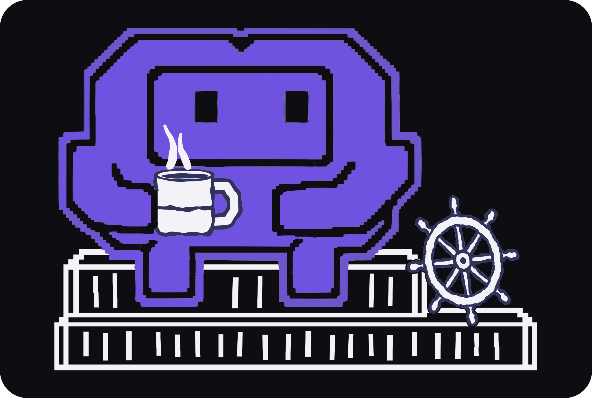
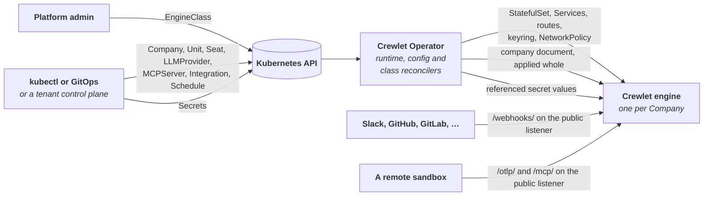

<div align="center">



# Crewlet Operator

**Run Crewlet companies on Kubernetes.**

The Crewlet Operator makes a [Crewlet](https://github.com/crewlet/crewlet) AI
agent company a native Kubernetes object. You declare the company and its org
chart — units, seats, model providers, tool servers, integrations, schedules —
as custom resources, and the operator runs the company's engine and keeps its
live configuration equal to what the resources say.

[](https://github.com/crewlet/crewlet-operator/actions/workflows/ci.yml)
[](LICENSE)
[](go.mod)
[](docs/guides/installing.md#before-you-install)
[](docs/reference/api.md)
[](https://docs.crewlet.ai/operator/latest/)

<a href="docs/getting-started.md"><b>Quickstart</b></a> ·
<a href="docs/guides/installing.md"><b>Installing</b></a> ·
<a href="docs/concepts/overview.md"><b>Concepts</b></a> ·
<a href="docs/README.md"><b>Documentation</b></a> ·
<a href="CONTRIBUTING.md"><b>Contributing</b></a>

</div>

---

## A company is a Kubernetes object

You write a company the way you write a Deployment, and the operator keeps the
engine equal to it. The same API serves a self-hoster writing YAML and a
control plane provisioning a company for every tenant.

<table>
<tr>
<td width="33%" align="center" valign="top">
<br>
<b>A company is a resource</b><br>
<sub>Declare a <code>Company</code> and its units, seats, models, tool servers, integrations
and schedules as <code>crewlet.ai</code> objects — reviewed, diffed and synced like the rest of
your cluster.</sub>
</td>
<td width="33%" align="center" valign="top">
<br>
<b>The org chart is objects</b><br>
<sub>A Seat points at its Unit, a Unit at its parent. Each is added, permission-scoped
and deleted on its own — not edited inside one shared file.</sub>
</td>
<td width="33%" align="center" valign="top">
<br>
<b>Applied whole, or not at all</b><br>
<sub>Every change renders one company document, which the engine dry-runs and applies as
one revision. An object that cannot be applied safely holds the next one back — the last
good revision keeps running.</sub>
</td>
</tr>
<tr>
<td width="33%" align="center" valign="top">
<br>
<b>Credentials by reference</b><br>
<sub>No field takes a secret. Every credential is a reference to a Kubernetes Secret. Those
the company document uses are pushed into the engine's encrypted store and rotated live, and
no value is written into a pod template.</sub>
</td>
<td width="33%" align="center" valign="top">
<br>
<b>An engine for every company</b><br>
<sub>The operator runs each company's engine: its data pod and volume, seat pools beside
it, Services, webhook routes and network policy — and cleans up after it.</sub>
</td>
<td width="33%" align="center" valign="top">
<br>
<b>Built for many tenants</b><br>
<sub>A namespace per tenant, EngineClasses as tiers, server-side apply from your control
plane — and no admission webhooks, so no cert-manager.</sub>
</td>
</tr>
</table>

> **Alpha: do not run it against anything you care about.** The
> `crewlet.ai/v1alpha1` API changes without notice, and nothing is released
> yet. [Status](#status) says what works today.

---

## How it works



- **The runtime reconciler makes the engine exist.** From the `Company` and the
  `EngineClass` it names — a cluster-scoped set of platform defaults and limits,
  the way a `StorageClass` is — it creates and owns the engine's StatefulSet,
  storage, keyring and API tokens, Services, webhook routes and network policy.
  A third reconciler checks that each `EngineClass` names what exists.
- **The config reconciler makes its configuration match.** It collects the
  `Unit`, `Seat`, `LLMProvider`, `MCPServer`, `Integration` and `Schedule`
  objects that reference the company, renders them into the single company
  document Crewlet runs on, has the engine validate it, and applies it **whole
  or not at all**: one unresolved reference holds the next revision back and is
  reported on the object that caused it, while the last good revision keeps
  running.
- **Credentials go by reference, never by value.** No field accepts a secret:
  every credential is a reference to a Kubernetes `Secret`, whose value the
  operator pushes into the engine's encrypted secret store and rotates live.
  Who put the value there — a person with `kubectl`, External Secrets, or a
  control plane after a vendor's install flow only it knows about — is
  invisible to the operator.

That is the glance; **[How the Operator Models a Company](docs/concepts/overview.md)**
explains the kinds and how they relate, and
**[How the Document Is Applied](docs/concepts/applying.md)** what happens on
every change.

---

## Quickstart

There is no engine to build: the operator is tested against Crewlet's `main`,
which Crewlet publishes as `ghcr.io/crewlet/crewlet:main`, and the cluster's
node pulls it when the first company starts. On a throwaway kind cluster, with
the operator's image built from this checkout:

```bash
make kind kubectl                                 # the pinned kind and kubectl, in bin/
bin/kind create cluster --name crewlet
make docker-build IMG=crewlet-operator:dev
bin/kind load docker-image crewlet-operator:dev --name crewlet
make install deploy IMG=crewlet-operator:dev      # or: make helm-deploy IMG=crewlet-operator:dev
```

Beside the `EngineClass` a platform provides and the Secret holding its model
key, a company with one agent can be four objects — the `Company`, the model
provider its seats run on, a `Unit` and a `Seat` in it:

```yaml
apiVersion: crewlet.ai/v1alpha1
kind: Company
metadata:
  name: acme
spec:
  engineClassName: local
  companyName: Acme
  mission: Make widgets people love.
  deletionPolicy: Delete
---
apiVersion: crewlet.ai/v1alpha1
kind: LLMProvider
metadata:
  name: anthropic
spec:
  companyRef:
    name: acme
  type: Anthropic
  model: claude-sonnet-5
  apiKeySecretRefs:
    - name: anthropic
      key: apiKey
---
apiVersion: crewlet.ai/v1alpha1
kind: Unit
metadata:
  name: engineering
spec:
  companyRef:
    name: acme
  displayName: Engineering
  type: Department
  purpose: Build the widgets.
---
apiVersion: crewlet.ai/v1alpha1
kind: Seat
metadata:
  name: lead
spec:
  companyRef:
    name: acme
  displayName: Engineering Lead
  unitRef:
    name: engineering
  goal: Decide what Acme builds next and keep the team unblocked.
  llm:
    default:
      - name: anthropic
```

The full **[Quickstart](docs/getting-started.md)** walks through the rest: the
`EngineClass` and the Secret, a second seat, what every object reports,
changing the company, opening its dashboard and removing everything again.

---

## Requirements

- A Kubernetes cluster on one of the four newest minor releases (1.34 to 1.37
  today). The e2e suite runs on kind's default node image, Kubernetes 1.37.
- A CNI that enforces NetworkPolicy, for the isolation the operator sets up
  around each engine.
- To build and run from source: Go (the version in [`go.mod`](go.mod)),
  Docker, make, git and curl. Every other tool is pinned in the
  [`Makefile`](Makefile) and downloaded into `bin/`.

---

## Status

The operator is alpha, under active development, and has no release yet. It
runs a company end to end today:

- It accepts each `Company` whose `EngineClass` resolves and whose objects stay
  within the class's limits.
- It runs the company's engine: the StatefulSet, storage, keyring and API
  tokens, Services, webhook routes and network policy.
- It applies the company document, with the Secret values it references, as
  the company's [management policy](docs/guides/management-policies.md) says,
  and cleans up after the company as its deletion policy says.
- It runs one data pod per company, and the [seat pools](docs/guides/topology.md)
  a company declares as stateless pods beside it, Shared or one pod per seat,
  and reports on each Seat which pod the engine runs it on.

Highly available companies, with more than one data pod, come later. The e2e
suite proves all of the above on kind against Crewlet's `main`, as Crewlet
publishes it at `ghcr.io/crewlet/crewlet:main`; every test suite runs that
engine, so a Crewlet change that breaks the operator fails the operator's next
run.

---

## Documentation

<table>
<tr>
<td valign="top" width="62%">

**Start here**
- [Quickstart](docs/getting-started.md) — the operator and a small company on a local kind cluster
- [Installing the operator](docs/guides/installing.md) — the Helm chart, the engine image to run, the values that matter

**Core concepts**
- [How the operator models a company](docs/concepts/overview.md) · [What the engine is given](docs/concepts/company-document.md)
- [How the document is applied](docs/concepts/applying.md) · [How a company's engine runs](docs/concepts/runtime.md) · [Credential positions](docs/concepts/credentials.md)

**Guides**
- [Supplying credentials](docs/guides/credentials.md) · [Connecting integrations](docs/guides/integrations.md) · [Seats on a coding CLI](docs/guides/cli-agents.md)
- [Exposure and network policy](docs/guides/exposure.md) · [Management policies](docs/guides/management-policies.md) · [Where seats run](docs/guides/topology.md)
- [Hosting many tenants](docs/guides/multi-tenancy.md) · [Troubleshooting](docs/guides/troubleshooting.md)

**Reference**
- [API reference](docs/reference/api.md) — every kind and field of `crewlet.ai/v1alpha1`, generated from the types

Every page is also published at
[docs.crewlet.ai/operator](https://docs.crewlet.ai/operator/latest/), beside
the engine's documentation.

</td>
<td valign="top" align="center" width="38%">

</td>
</tr>
</table>

---

## Contributing

Issues and pull requests are welcome. [CONTRIBUTING.md](CONTRIBUTING.md) covers
the development setup, the checks, the API change policy and the commit
conventions:

```bash
make check      # every gate CI runs except the e2e suite and the image build
make test       # the unit, envtest, engine and chart suites, both modules, -race
make test-e2e   # a kind cluster (Docker 28+); pulls the engine image too
make help       # everything else
```

Commits are signed off (`git commit -s`), which certifies the [DCO](DCO) over
them — CI checks it. Releases are cut by pushing a `v*` tag — see
[RELEASING.md](RELEASING.md). Participation is governed by the
[Code of Conduct](CODE_OF_CONDUCT.md).

Security issues: please report them privately — see [SECURITY.md](SECURITY.md),
which also describes the operator's security properties.

## License

[MIT](LICENSE)
