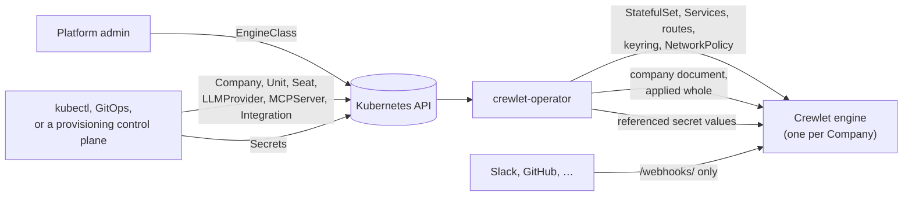

# crewlet-operator

A Kubernetes operator for [Crewlet](https://github.com/crewlet/crewlet), the
AI agent company engine. It makes a Crewlet company a native Kubernetes
object: you declare a `Company` and its org chart — units, seats, model
providers, MCP servers, integrations — as custom resources in the
`crewlet.ai` API group, and the operator runs the engine for that company and
keeps the engine's live configuration equal to what the resources say.

> **Status: alpha, under active development.** The `crewlet.ai/v1alpha1` API
> is being defined and will change without notice; nothing has been released
> yet. Do not run it against anything you care about.
>
> Today the operator runs a company end to end: it accepts each `Company`
> (its `EngineClass` resolves and its objects stay within the class's
> limits), runs its engine (the StatefulSet, storage, keyring and API tokens,
> Services, webhook routes and network policy), applies its company
> document, with the Secret values it references, as its management policy
> says, and cleans up after it as its deletion policy says. The e2e suite
> proves that on kind with the pinned Crewlet engine built from source. It
> runs one data pod per company, and the seat pools a company declares as
> stateless pods beside it, Shared or one pod per seat, and reports on each
> Seat which pod the engine runs it on; highly available companies come
> later.

## How it works

The operator runs two reconcilers for every `Company`, and a third that
checks each `EngineClass`. The first makes the engine exist: from the
`Company` and the `EngineClass` it names (a
cluster-scoped set of platform defaults and limits, in the way a
`StorageClass` is), it creates and owns the engine's StatefulSet, storage,
keyring and API tokens, Services, webhook routes and network policy. The
second makes the engine's configuration match: it collects the `Unit`,
`Seat`, `LLMProvider`, `MCPServer` and `Integration` objects that reference
the company, renders them into the single company document Crewlet runs on,
validates it with the engine, and applies it **whole or not at all** — one
unresolved reference blocks the next revision and is reported on the object
that caused it, while the last good revision keeps running.

Credentials are handled **by reference, never by value**. No field accepts a
secret; every credential is a reference to a Kubernetes `Secret`, whose value
the operator pushes into the engine's encrypted secret store and rotates live.
Who put the value there — a person with `kubectl`, External Secrets, or a provisioning
control plane after an OAuth flow only it knows about — is invisible to the
operator, so the same API serves self-hosters writing YAML and a control
plane writing objects programmatically, one namespace per tenant.



## Requirements

- A Kubernetes cluster on one of the four newest minor releases (1.34 to
  1.37 today). The e2e suite runs on kind's default node image, Kubernetes
  1.37.
- A CNI that enforces NetworkPolicy, for the isolation the operator sets up
  around each engine.
- To build and run from source: Go (the version in [`go.mod`](go.mod)),
  Docker, make, git and curl. Every other tool is pinned in the
  [`Makefile`](Makefile) and downloaded into `bin/`.

## Running it locally

On a throwaway kind cluster, with the operator's image and the Crewlet
engine's, both built from source and loaded into the cluster:

```bash
make kind kubectl                                 # the pinned kind and kubectl, in bin/
bin/kind create cluster --name crewlet
make docker-build IMG=crewlet-operator:dev
make crewlet-image CREWLET_IMG=crewlet:dev        # the engine, at the pinned CREWLET_VERSION
bin/kind load docker-image crewlet-operator:dev crewlet:dev --name crewlet
make install deploy IMG=crewlet-operator:dev      # or: make helm-deploy IMG=crewlet-operator:dev
```

[docs/getting-started.md](docs/getting-started.md) continues from there: an
`EngineClass`, a company with a team of two agents, changing it, and removing
everything again.

## Documentation

- [docs/](docs/README.md) — the documentation index
- [docs/getting-started.md](docs/getting-started.md) — running the operator
  and a company on a local cluster
- [docs/guides/](docs/README.md#guides) — installing, credentials, exposure,
  management policies, choosing where seats run, hosting many tenants on the
  operator, troubleshooting
- [docs/concepts/overview.md](docs/concepts/overview.md) — the kinds, how
  they relate, credentials and management policies
- [docs/reference/api.md](docs/reference/api.md) — the `crewlet.ai` API
  reference, generated from the types
- [CONTRIBUTING.md](CONTRIBUTING.md) — development setup, checks, API change
  policy, commit conventions
- [RELEASING.md](RELEASING.md) — how releases are cut and verified
- [SECURITY.md](SECURITY.md) — reporting vulnerabilities, and the operator's
  security properties

## Contributing

Contributions are welcome; [CONTRIBUTING.md](CONTRIBUTING.md) has everything
you need, and `make check` runs every gate CI runs except the e2e suite and
the image build. Every commit is signed off under the [DCO](DCO).
Participation is governed by the [Code of Conduct](CODE_OF_CONDUCT.md).

## License

[MIT](LICENSE)
