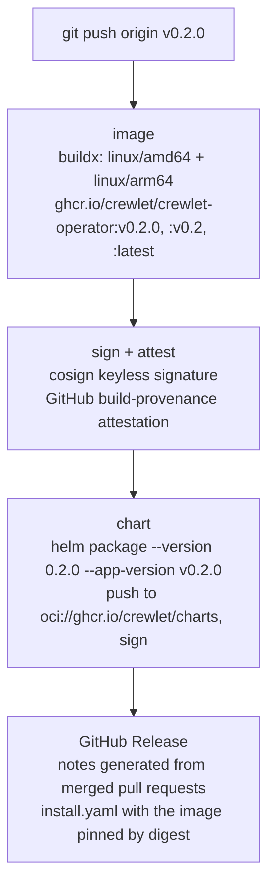

# Releasing

Maintainer runbook for publishing crewlet-operator. Releases are driven by
tags, and there are two kinds:

| Tag | Releases | How |
|---|---|---|
| `vX.Y.Z` | the operator: image, Helm chart, GitHub Release | [`.github/workflows/release.yml`](.github/workflows/release.yml) |
| `api/vX.Y.Z` | the Go module `github.com/crewlet/crewlet-operator/api` | the tag itself; Go's module proxy serves it |

Nothing in the tree records a version, so there is no version bump to make and
nothing for a tag to disagree with: **the tag is the version.**

## The operator: `v*` tags



What a release publishes:

- **The image** `ghcr.io/crewlet/crewlet-operator`, for linux/amd64 and
  linux/arm64, tagged `vX.Y.Z` and `vX.Y`, plus `latest` unless the tag has a
  pre-release suffix. It carries an SBOM, a keyless cosign signature and a
  GitHub build-provenance attestation, all bound to the manifest digest.
- **The Helm chart** `oci://ghcr.io/crewlet/charts/crewlet-operator`, at
  version `X.Y.Z` (SemVer has no `v`) with appVersion `vX.Y.Z`. The chart's
  default image tag is empty, which means its appVersion, so a released chart
  deploys the image built from the same tag. The chart is signed with cosign
  too.
- **The GitHub Release**, with notes GitHub generates from the titles of the
  pull requests merged since the previous tag (sorted by
  [`.github/release.yml`](.github/release.yml)), and `install.yaml`: the
  kustomize-rendered CRDs and manager, with the image pinned by digest.

A tag with a pre-release suffix (`v0.2.0-rc.1`) is published as a GitHub
pre-release and does not move `latest`.

### Cutting a release

1. Make sure `main` is green, and that the pull request titles since the last
   tag read as release notes (`gh pr list --state merged --base main`); fix a
   title before tagging, because the notes are generated from them.
2. Choose the version. While the API is `v1alpha1`, releases are `v0.Y.Z`:
   bump `Y` for anything that changes the API or behaviour, `Z` for fixes.
3. Tag `main` and push the tag:

   ```bash
   git switch main && git pull --ff-only
   git tag -s v0.2.0 -m "v0.2.0"
   git push origin v0.2.0
   ```

4. Watch the `release` workflow. When it finishes, check the Release page and
   verify the artifacts as below.

If the API changed since its last tag, tag the API module in the same sitting
(below), so a consumer can depend on the API the operator release serves.

### Verifying a release

```bash
# The image signature: signed by this repository's release workflow, for a v* tag.
cosign verify ghcr.io/crewlet/crewlet-operator:v0.2.0 \
  --certificate-identity-regexp '^https://github.com/crewlet/crewlet-operator/\.github/workflows/release\.yml@refs/tags/v' \
  --certificate-oidc-issuer https://token.actions.githubusercontent.com

# The build provenance.
gh attestation verify oci://ghcr.io/crewlet/crewlet-operator:v0.2.0 --repo crewlet/crewlet-operator

# The chart.
helm pull oci://ghcr.io/crewlet/charts/crewlet-operator --version 0.2.0
cosign verify ghcr.io/crewlet/charts/crewlet-operator:0.2.0 \
  --certificate-identity-regexp '^https://github.com/crewlet/crewlet-operator/\.github/workflows/release\.yml@refs/tags/v' \
  --certificate-oidc-issuer https://token.actions.githubusercontent.com
```

### One-time setup

The workflow publishes with the run's own `GITHUB_TOKEN`; there are no stored
secrets. After the first release, two settings live in GitHub rather than in
the tree:

- make the `crewlet-operator` container package and the
  `charts/crewlet-operator` package public, and link both to this repository
  (Package settings), so a pull needs no credentials;
- protect `v*` and `api/v*` tags so only maintainers can create them.

### If a release goes wrong

A tag that produced broken artifacts is not moved or reused: the image and
chart may already have been pulled, and their signatures name the tag. Fix
the problem on `main` and release the next patch version. If the workflow
failed before publishing anything, delete the tag (`git push --delete origin
vX.Y.Z`), fix, and tag again.

## The API module: `api/v*` tags

The API types are the Go module `github.com/crewlet/crewlet-operator/api`
(see [CONTRIBUTING.md](CONTRIBUTING.md#two-go-modules)). Go resolves a module
in a subdirectory from tags prefixed with that directory, so the API is
released by pushing a tag of the form `api/vX.Y.Z`:

```bash
git tag -s api/v0.2.0 -m "api/v0.2.0"
git push origin api/v0.2.0
```

Consumers then run `go get github.com/crewlet/crewlet-operator/api@v0.2.0`.

API module versions are independent of operator versions. Choose them by what
changed in `api/` alone:

- while the API is `v1alpha1`, `v0.Y.Z`: bump `Y` for a change to the types,
  `Z` for documentation or validation fixes that change no field;
- once a `v1` API is served, the module follows SemVer: a removal or a
  change of meaning to an exported type is a new major version.

The operator module keeps requiring the API through `replace ./api`, so it
always builds against the types in the same commit; the tag is for consumers.
