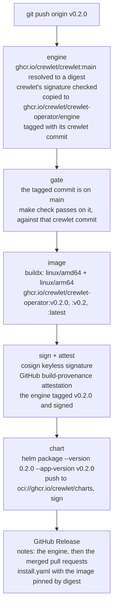

# Releasing

Maintainer runbook for publishing crewlet-operator. Releases are driven by
tags, and there are two kinds:

| Tag | Releases | How |
|---|---|---|
| `vX.Y.Z` | the operator: image, Helm chart, GitHub Release | [`.github/workflows/release.yml`](.github/workflows/release.yml) |
| `api/vX.Y.Z` | the Go module `github.com/crewlet/crewlet-operator/api` | the tag itself; Go's module proxy serves it |

Nothing in the tree records a version, so there is no version bump to make and
nothing for a tag to disagree with: **the tag is the version.**

## The operator: `v*` tags



What a release publishes:

- **The image** `ghcr.io/crewlet/crewlet-operator`, for linux/amd64 and
  linux/arm64, tagged `vX.Y.Z`, `vX.Y` and `latest`. A pre-release tag
  (`vX.Y.Z-rc.N`) publishes the image under that tag alone: no `vX.Y`, no
  `latest`. It carries an SBOM, a keyless cosign signature and a
  GitHub build-provenance attestation, all bound to the manifest digest.
- **The engine image** the release was tested against,
  `ghcr.io/crewlet/crewlet-operator/engine:vX.Y.Z`: crewlet's `main` image
  as the `gate` job tested it, copied whole (both platforms, the same
  digest) and signed by this workflow like the operator's image. The
  operator runs no engine of its own, so this is what an installer names in
  an EngineClass ([Installing](docs/guides/installing.md#engine-image)), and
  the operator orders its tag: a class moved back to an older release's
  engine is refused.
- **The Helm chart** `oci://ghcr.io/crewlet/charts/crewlet-operator`, at
  version `X.Y.Z` (SemVer has no `v`) with appVersion `vX.Y.Z`. The chart's
  default image tag is empty, which means its appVersion, so a released chart
  deploys the image built from the same tag. The chart is signed with cosign
  too.
- **The GitHub Release**, with notes GitHub generates from the titles of the
  pull requests merged since the previous tag (sorted by
  [`.github/release.yml`](.github/release.yml)) after a line naming the
  engine image by tag and digest and the crewlet commit it was built from,
  and `install.yaml`: the kustomize-rendered CRDs and manager, with the image
  pinned by digest.

A tag with a pre-release suffix (`v0.2.0-rc.1`) is published as a GitHub
pre-release and does not move `latest`.

The first job, `engine`, keeps the engine the release is tested against.
Every suite runs crewlet's `main` image (ADR-0002), a tag that moves with
every build of crewlet's `main`, and GHCR deletes the image it named once
`main` has moved and that image is an hour old, often minutes after the
move ([Images from main](https://github.com/crewlet/crewlet/blob/main/RELEASING.md#images-from-main)):
sooner than the gate takes, and long before anybody installs the release.
So the job resolves the tag to one digest, checks crewlet's signature on it
for the commit its label names, and copies it by that digest into
`ghcr.io/crewlet/crewlet-operator/engine`, tagged with that commit, before
anything is tested. The copy names a crewlet commit and nothing about the
release, so one a failed release leaves behind claims nothing.

The second job, `gate`, publishes nothing: it fails the release unless the
tagged commit is an ancestor of `main` and `make check` passes on it, against
the crewlet commit the `engine` job kept (`CREWLET_VERSION`). A tag on an
unmerged branch, or on a commit that broke since it merged, releases nothing,
so a mistaken tag costs only its deletion. A tag pushed while crewlet's
`main` breaks the operator releases nothing either. Once crewlet's `main` is
fixed, re-run all of the release's jobs, so that the `engine` job reads
`main` again (re-running the failed `gate` alone tests the same engine); if
the operator needed the fix instead, delete the tag and tag the commit that
carries it ([If a release goes wrong](#if-a-release-goes-wrong)).
Once the gate passes, the `image` job tags the kept engine with the
release's version and signs it, and the Release's notes name it.

### Cutting a release

1. Make sure `main` is green, its latest daily run included, which ran
   crewlet's `main` of that day (the `gate` job refuses a commit that is not
   on `main` or does not pass `make check`, but finding out from a failed
   release is slower), and that the pull request titles since the last
   tag read as release notes (`gh pr list --state merged --base main`); fix a
   title before tagging, because the notes are generated from them. The
   line naming the engine is written by the release itself.
2. Choose the version. While the API is `v1alpha1`, releases are `v0.Y.Z`:
   bump `Y` for anything that changes the API or behaviour, `Z` for fixes.
3. Tag `main` and push the tag:

   ```bash
   git switch main && git pull --ff-only
   git tag -s v0.2.0 -m "v0.2.0"
   git push origin v0.2.0
   ```

4. Watch the `release` workflow. When it finishes, check the Release page and
   verify the artifacts as below.

If the API changed since its last tag, tag the API module in the same sitting
(below), so a consumer can depend on the API the operator release serves.

### Verifying a release

```bash
# The image signature: signed by this repository's release workflow, for a v* tag.
cosign verify ghcr.io/crewlet/crewlet-operator:v0.2.0 \
  --certificate-identity-regexp '^https://github.com/crewlet/crewlet-operator/\.github/workflows/release\.yml@refs/tags/v' \
  --certificate-oidc-issuer https://token.actions.githubusercontent.com

# The build provenance.
gh attestation verify oci://ghcr.io/crewlet/crewlet-operator:v0.2.0 --repo crewlet/crewlet-operator

# The engine it was tested against, signed by the same workflow.
cosign verify ghcr.io/crewlet/crewlet-operator/engine:v0.2.0 \
  --certificate-identity-regexp '^https://github.com/crewlet/crewlet-operator/\.github/workflows/release\.yml@refs/tags/v' \
  --certificate-oidc-issuer https://token.actions.githubusercontent.com

# The chart.
helm pull oci://ghcr.io/crewlet/charts/crewlet-operator --version 0.2.0
cosign verify ghcr.io/crewlet/charts/crewlet-operator:0.2.0 \
  --certificate-identity-regexp '^https://github.com/crewlet/crewlet-operator/\.github/workflows/release\.yml@refs/tags/v' \
  --certificate-oidc-issuer https://token.actions.githubusercontent.com
```

### One-time setup

The workflow publishes with the run's own `GITHUB_TOKEN`; there are no stored
secrets. After the first release, two settings live in GitHub rather than in
the tree:

- make the `crewlet-operator` and `crewlet-operator/engine` container
  packages and the `charts/crewlet-operator` package public, and link them
  to this repository (Package settings), so a pull needs no credentials;
- protect `v*` and `api/v*` tags so only maintainers can create them.

### If a release goes wrong

A tag that produced broken artifacts is not moved or reused: the image and
chart may already have been pulled, and their signatures name the tag. Fix
the problem on `main` and release the next patch version. If the workflow
failed before publishing anything (a failed `gate` publishes nothing), delete
the tag (`git push --delete origin vX.Y.Z`), fix, and tag again.

## The API module: `api/v*` tags

The API types are the Go module `github.com/crewlet/crewlet-operator/api`
(see [CONTRIBUTING.md](CONTRIBUTING.md#two-go-modules)). Go resolves a module
in a subdirectory from tags prefixed with that directory, so the API is
released by pushing a tag of the form `api/vX.Y.Z`:

```bash
git tag -s api/v0.2.0 -m "api/v0.2.0"
git push origin api/v0.2.0
```

Consumers then run `go get github.com/crewlet/crewlet-operator/api@v0.2.0`.

API module versions are independent of operator versions. Choose them by what
changed in `api/` alone:

- while the API is `v1alpha1`, `v0.Y.Z`: bump `Y` for a change to the types,
  `Z` for documentation or validation fixes that change no field;
- once a `v1` API is served, the module follows SemVer: a removal or a
  change of meaning to an exported type is a new major version.

The operator module keeps requiring the API through `replace ./api`, so it
always builds against the types in the same commit; the tag is for consumers.
