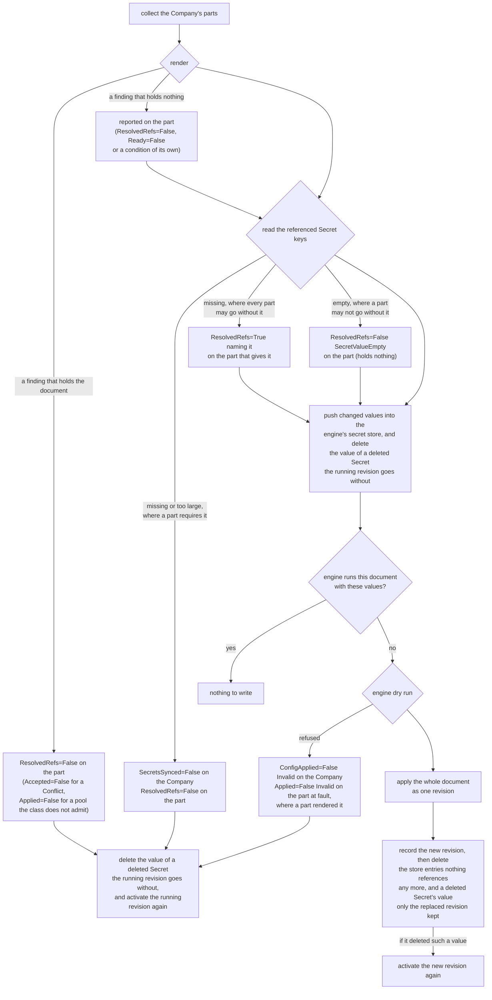
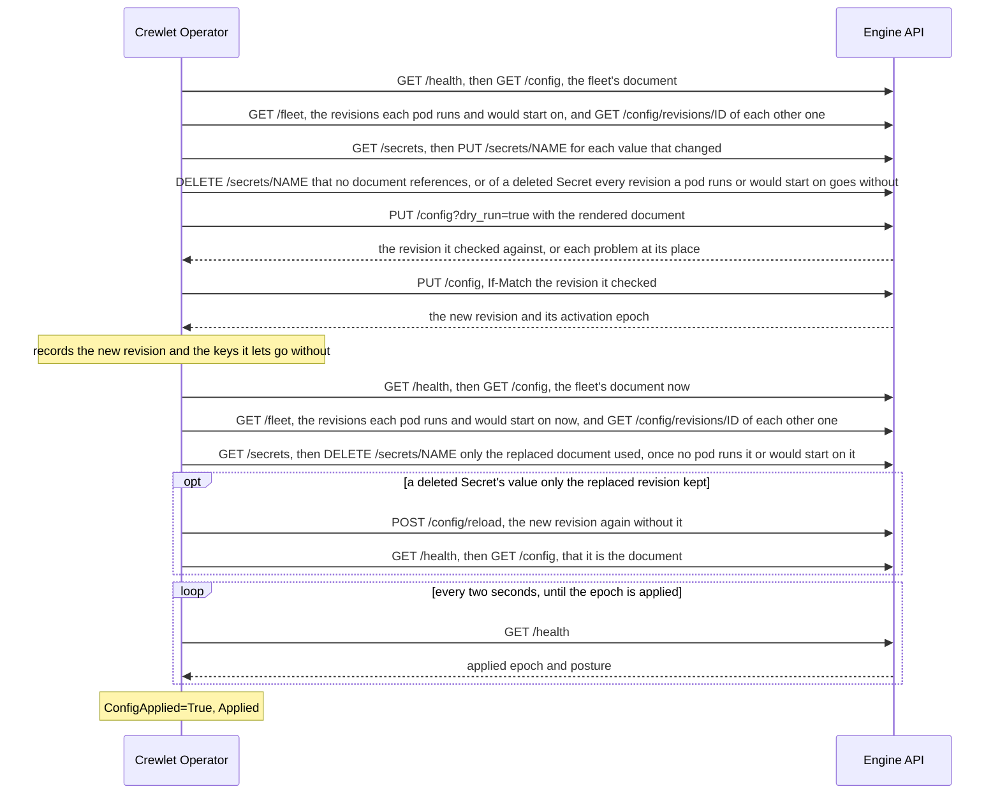

# How the Document Is Applied

On every change the operator renders the company document, has the engine
dry-run it, and applies it as one revision, whole or not at all.

The config reconciler keeps the company document a Company's engine runs
equal to what the Company and its parts declare: the `Unit`, `Seat`,
`LLMProvider`, `MCPServer`, `Integration` and `Schedule` objects that name it
in `spec.companyRef`. This page describes what it does on every change, what
each management policy lets it write, and how it reports the outcome on every
object involved. [What the engine is given](company-document.md) describes the
document itself; [How a company's engine runs](runtime.md) the engine it is
applied to.

---

## When it runs

A Company is looked at again when:

- its spec changes, or the runtime reconciler reports a change in whether
  there is an engine to talk to (`Accepted`, `RuntimeReady`, the public base
  URL);
- one of its parts is created, changed or deleted (a status write does not
  count: the parts' status is the config reconciler's own);
- a Secret one of them, or the Company, references changes. The operator
  watches Secrets as metadata only and finds the companies that read one
  through an index of every reference in their specs, so it never holds a
  Secret's value in memory longer than one reconcile;
- its EngineClass's platform model providers change, when it uses them;
- the runtime reconciler reports a change in the company's pods
  (`status.topology`), after which the engine moves seats between them;
- five minutes have passed with no change, to find edits made through the
  engine's own API or dashboard, which nothing announces, and to refresh the
  integrations' health and where each seat runs. While a seat of the running
  revision is not yet held by a pod of its own StatefulSet although one of
  them is ready, or is held by a pod of it past that pod's share of its seats
  (a pool that gained a pod, where the engine moves seats onto the new one),
  the engine is placing it, and the operator looks every fifteen seconds
  instead, for at most three minutes: the engine claims a few seats every
  five seconds, and a seat whose pod was killed waits out its 45-second lease
  first.

> **Changes are coalesced.** A platform that provisions a company writes its
> objects one request at a time, and each revision is a permanent entry in the
> engine's history and a rebuild of every seat. So after a change to a part or
> to a referenced Secret the operator waits until two seconds have passed
> without another one, and then applies everything as one revision: twenty
> Seats created in a burst become one revision, not twenty. A burst that never
> pauses (a Secret something rewrites every second) holds the company back for
> ten seconds at most; the operator then applies what it has.

---

## What one reconcile does



1. **Render.** Every part is rendered into one document. A finding that
   holds the document stops here: one the engine would refuse, one that
   would harm more than the object at fault if applied (a reference to an
   object that does not exist, written by a name another object could take
   later; a loop of parent Units), or one the class forbids (see
   [What blocks a document](company-document.md#what-blocks-a-document)). A
   finding that holds nothing, such as a Seat in a pool the Company does not
   declare, is reported on its object, and the document goes on.
2. **Read the Secret values** the document references, from the API server
   directly. A missing Secret or key, or a value over the 64 KiB the engine's
   store accepts, stops here, except a missing one every reference to which
   is a value a tool server or a seat's executor run may go without (its key listed
   in the `optionalKeys` that governs it): the engine is to leave that value
   out, so the store is to hold none for it. The parts are told what was
   read either way: a value a part goes without, and an empty value under a
   key nothing lists (`SecretValueEmpty`), which holds nothing.
3. **Push the values.** The operator reads the fleet's document, the
   revision the engine's activation pointer names, which every engine pod
   answers alike (`GET /health`, then `GET /config`), reads which revisions
   each engine pod runs and would start on (`GET /fleet`), and lists the
   engine's encrypted secret store. Each referenced key is one entry in the store, named as the
   document refers to it (`K8S_<SECRET>_<KEY>_<hash>`). Only values that
   changed since the last push are written, and any entry the store lost or
   the engine lists as last written with a credential other than the
   operator's own token: somebody with an admin credential replaced it, and
   the operator writes its value back. The engine records that credential
   from the write's authentication, so no writer can pass for the operator.
   The values are written together, as one batch of up to 64 (`PUT
   /secrets`; a larger set goes in batches of 64, and a value that is not
   UTF-8, which a JSON body cannot carry, goes alone before them), because
   the engine activates the revision it runs again, unchanged, at every
   write or removal of a value that revision reads, so that it runs with
   the new value: one write per value would be one activation per value,
   the company running a mix of old and new values between them. A sync's
   values are one activation: every write but the last asks the engine to
   activate nothing (`defer_reload`), and the last activates the revision
   once, with every value in the store. A sync whose last write fails, or
   that stops before it, records no fingerprint for the values it wrote
   deferred, so the next sync writes them again and its last write
   activates them; where the last write activates nothing (the revision
   reads none of its values) or its activation fails, the operator applies
   the document itself.
   The entries the running document still references are kept until the next
   document replaces it, and so are those of every other revision an engine
   pod runs or would start on: each pod applies the fleet's revision on its
   own loop, and one that refused it goes on running the revision it ran
   before. A pod, a seat pod as much as a data pod, needs the values of the
   revision it runs for as long as it runs it: every attempt to apply a
   revision, refused or not, reads the store again into what the running
   revision resolves its references from, so a value gone from the store is
   gone from the pod at its next attempt, and what it starts afterwards, such
   as a seat's tool server, finds nothing under that name. And a pod does not
   start on a revision once a value that revision requires is gone from the
   store. Only a data pod starts on a revision: the one its volume names,
   which the engine reports apart from the one it runs
   (`config_boot_revision_id` beside `config_serving_revision_id` in
   `GET /fleet`), since it moves it only once an apply has succeeded and
   retries that write until it lands, the two differing meanwhile. A seat
   pod's store is scratch (Crewlet's `store.scratch`), which the engine
   discards at every start, so it starts on nothing, whatever it ran, and
   applies the fleet's revision. The operator reads the document of each
   such revision (`GET /config/revisions/<id>`) and keeps what it references
   until no pod runs it or would start on it, looking at the engine again
   every 18 seconds (the longest a pod goes before it reads the activation
   pointer again) while it does; the Company's `SecretsSynced` names the
   values and the pods. A pod that runs no company and would start on none
   keeps nothing more: a seat pod that refused the fleet's revision, say, or
   a data pod that started on an empty volume and refused it. A pod the
   fleet does not list (restarting, Pending, or cut off from the data pod)
   is judged by what it can be running, which its Pod says, and never by
   what the operator saw of it before: a pod applies the fleet's revision on
   its own loop, and a data pod moves the revision its volume starts it on
   after every apply that succeeds, so one that applied a revision since the
   fleet last listed it and then went down (a rolling restart takes each pod
   down in turn) or was cut off runs, or would start on, a revision no
   listing named.
   So a data pod the fleet does not list keeps every value until the fleet
   lists it again, whether its `engine` container runs or not: running, it
   may run any revision the fleet named since it last listed the pod; not
   running (Pending where no node has room for it, waiting in
   `CrashLoopBackOff`, or not created yet), it would start on whichever
   revision it applied last. A seat pod the fleet does not list keeps every
   value while its `engine` container runs, and nothing while it does not:
   it then runs nothing, and starts on nothing. That has a cost: every
   deletion waits while a data pod is down, Pending or cut off from the
   fleet. In v1alpha1 that rarely shows, since the one data pod is the node
   the operator reaches: when `GET /fleet` answers at all, it lists that
   pod, and when it does not, every value is kept anyway. And a seat pod's
   Pod on a node whose kubelet stopped reporting stays `Running`, and holds
   every deletion back until it is removed. Every value is kept, too, for a
   node that has not yet recorded an attempt to apply a revision, a revision
   the engine cannot answer, and every pod while `GET /fleet` cannot be
   read. The data pod the operator reaches answers a revision from its own history, which
   keeps one older than Crewlet's revision retention (over a year) only where
   it is, or is an ancestor of, the revision that pod boots on or the
   fleet's, whatever another pod runs: a revision another pod still runs or
   would start on off those lines can be gone, and is then one the engine
   cannot answer. An entry of the operator's shape that no document a pod
   runs or would start on references is deleted now. So is the entry of a value whose
   Secret or key no longer exists where the revision the engine runs goes
   without it, so that the revision step 6 writes, or the one activated
   again below, activates without the deleted value: where that revision
   does not reference the value, or every reference to it there is under a
   listed key. The operator knows how a revision reads a value from its
   record of the store, which names the revision it last activated with the
   Secret keys that revision's document lets go without, and from the
   document itself where the engine runs the very document the operator
   renders, whoever activated it (a `crewlet config reload` of it, say). A
   value such a revision lets go is deleted whatever the next document reads
   of it: a next document that requires it is held for it anyway, and is
   applied once the Secret exists again, when its value is pushed. Any other
   revision, one that reads the value where it is required, or another
   document somebody else activated, whose reading the operator does not
   know, keeps the value it holds for as long as it runs, as the last good
   revision keeps every value it requires while the next document is held.
   The Company's `SecretsSynced` and the part's `ResolvedRefs` message say so
   wherever the reconcile read the Secrets the document references, and a
   `SecretKept` event, told once, when the reconcile ends with the value
   kept; a document the render holds reads only the values it may go
   without, and is told by the event alone. Step 7 deletes the value once
   the next document runs. Whenever the reconcile ends without activating a
   revision after it deleted a value, because the document is held at any
   step (the engine's own refusal of it included: a document it finds
   invalid, a human seat somebody holds that the document takes away, or
   the operator's token refused the change), or because the engine already
   runs it with every value it references (step 4), the revision the engine
   runs is activated again, unchanged, so the engine reads its store without
   the deleted value rather than starting a tool server or an executor run
   with it (a `Reactivated` event): where that revision read the value, the
   engine did so itself as the operator removed it, and the operator takes
   that activation for its own; otherwise, or where the engine's failed, it
   asks for one (`POST /config/reload`). It keeps what it owes in its record
   of the store until the engine runs a revision activated after the
   deletion, whoever activated it ([What the engine has read](#what-the-engine-has-read)).
   It activates again only a revision that goes without the value, never one
   that keeps it, and records the revision that activates it again as its
   own only once it has read back that it is that document: the engine
   activates again whichever revision is active when the request lands, so
   one somebody else activated in between is reported with a Warning
   `Reactivated`, and read as a revision whose reading the operator does not
   know. A request of the operator's that fails is read back too: a revision
   the engine runs that activated after the deletion read the store without
   the value, so nothing is owed and nothing is activated again; where it is
   the running document again (the request landed although its answer did
   not, or somebody reloaded the document), it is recorded as the
   reactivation, and where it is another document, a Warning `Reactivated`
   says the operator activated nothing again. Where the engine still runs
   the revision read, and answered that it stored the request's revision and
   could not confirm activating it, that revision may land yet: the deletion
   stays owed and is reported, and, where the revision read is the
   operator's, the stored one is recorded as an unconfirmed write of its
   document (step 6), so that once it runs it is the operator's. Nothing
   makes the engine's reload or its deletion conditional on the revision the
   operator read, so a revision somebody activates in that moment goes
   without a value it may require until the Secret exists again.
4. **Compare.** The operator compares the engine's active document with the
   rendered one, and checks that the revision the engine runs activated
   after every value it wrote into the store. If both hold, there is nothing
   to write, and the revision is recorded with a hash of the rendered
   document and of the values it references (`status.config.appliedHash`)
   whoever activated it. A changed value alone needs a new revision: the
   engine reads a rotated value only when a revision activates. Where the
   engine runs the rendered document, the write in step 3 made that
   revision, since the engine activates the revision that reads a value it
   is written, and the operator records it as its own apply
   (`status.config`), once it has read back that the engine runs it, rather
   than activating the same document a second time; its summary is the
   engine's, `reload: secret <NAME> written`. Where the engine did not
   activate one (nothing it runs reads the value, or its activation failed
   or was overtaken by another write), the operator applies the same
   document itself, with a summary that names the Secret. So with a value
   written back in step 3, for the same reason: since it was replaced, a
   reload may have handed the engine the other value. A value stays a reason
   to write until the engine runs a revision activated after it is written
   ([What the engine has read](#what-the-engine-has-read)), not just in the
   reconcile that wrote it: a write that fails, or loses its race to another
   writer, leaves the next sync nothing to write while the engine may still
   run a revision that read the store before it. Where no write is coming,
   because the engine refuses the document or it is held, the revision the
   engine runs is activated again for a value that revision references
   (`Reactivated`), so that a credential somebody rotated reaches the
   running engine whatever else is wrong with the document: by the engine
   itself at the write, or, where its activation failed, by the operator; a
   Warning `SecretRefreshFailed` says when neither could. A value the
   running revision does not reference waits for the write that does.
5. **Dry-run** the document. The engine checks everything the API server
   cannot: rules that span objects, such as a Seat that asks for a sandbox
   the Company does not offer. Each problem the engine reports is traced back,
   by its place in the document, to the part that rendered that place.
6. **Apply** the document as one revision, on the condition that the engine
   still runs the revision the dry run checked against (`If-Match`; into an
   engine with no document yet, on the condition that it still has none).
   The revision's summary is `crewlet-operator:` followed by the objects
   whose part of the document changed. A write that loses a race with
   another writer is started over once from a fresh read. When the engine
   stores the revision and then can't confirm that it activated it (a `503`
   naming the revision it stored), the fleet may run it or may not, so the
   operator records the write in `status.config.unconfirmed` and writes
   nothing more until it has read which revision the engine runs: that one,
   and it is recorded and reported as the operator's write, as though the
   engine had confirmed it, a revision somebody else wrote that it replaced
   included (`DriftCorrected`, with the `Drifted` event recorded then), at
   the epoch the fleet's activation names and as applied when the operator
   found it, since nothing says when its activation landed; the one the
   write was built on, and the write is sent again on the same condition,
   which the engine refuses if the first one landed meanwhile; any other,
   and the write goes, since it can no longer land. If it landed and was
   activated again since (the engine's own reload after it mints a
   credential, a `crewlet config reload`, or the operator's own activation
   of it again), the revision that runs activated after every value the
   write's sync wrote and withdrew ([What the engine has read](#what-the-engine-has-read)),
   so, where it is the rendered document, it is in sync and nothing is
   written. Under `Seed`, a write into an engine that had no document is
   kept in `status.config.overtaken` once overtaken, and is the seed,
   whatever revision runs now: nothing the engine says tells a seed that
   landed and was replaced from another writer's create that reached the
   engine first. It stays recorded until a reconcile decides with it, so one
   that fails first does not lose it. Before the write is sent, the operator
   also records, under the write's `appliedHash`, which Secret keys its
   document lets go without (`pending-activations`), since nothing else says
   it once the render has moved on: a write the engine is found running that
   `status.config` names as the operator's, confirmed or not, is recorded as
   reading the store that way, even where the reconcile that made it did not
   get as far as saving the record of the store after it, so that the value of
   a deleted Secret it lets go is taken out of the store rather than kept for
   it. Where the `status.config` record of the write is lost too, the revision
   reads as one the operator has no record of activating, requiring every
   value it references. A reconcile that holds its document reads the engine
   while a write is unconfirmed, records how a write that runs reads the
   store, and leaves `status.config` to the next one that applies a document;
   where it activates that write again, the write's record moves on to the
   revision that activates it, which the next reconcile then confirms. A
   request to activate the running revision again that the engine stores and
   cannot confirm activating is recorded the same way, as a write of the
   operator's of that revision's document, from the answer, whatever the
   operator can read back after it (step 3), with a digest of that document
   (`documentSHA256`): the engine activates again whichever revision is active
   when the request lands, so a revision found running another document was a
   reload of one somebody activated in between, and is not the operator's.
   What a write replaced is reported once, by whichever of the write and such
   a reload of it is found running.
7. **Clean up** the store. The operator records the new revision in its
   record of the store, with the Secret keys its document lets go without,
   before it deletes anything, so that a deletion whose own record a failed
   write loses is withdrawn by the next reconcile. Then it reads the fleet's
   document again, and which revisions each pod runs and would start on, and
   lists the store,
   and every entry of the operator's shape that the new document does not
   reference, the ones only the replaced document used, is deleted, and so
   is the value of a deleted Secret the replaced revision kept, which the new
   one goes without; a revision somebody activated since the apply keeps
   every value it references instead, and so does the revision before it
   for as long as a pod runs it or would start on it, as in step 3. Right
   after the write the pods have yet to apply the new revision, so these
   entries usually go at the operator's next look, a few seconds later, once
   the pods report it applied; a pod that refuses it keeps them for as long
   as it runs the revision before it, or would start on it. The new revision activated with a deleted Secret's
   value still in the store, so it is activated again once that value is
   gone, unchanged (`Reactivated`), by the engine as the operator removes the
   value, or else at the operator's request, and the engine reads its store
   without it. Until then the
   new revision may start a tool server or an executor run with the deleted
   Secret's value: that moment is the price of keeping the last good revision
   whole, paid where the revision the engine ran read the key as required,
   or was one whose reading the operator did not know, when the key's Secret
   was deleted. Entries of any other name — one a person wrote with
   `crewlet secrets set`, say — are never touched.
8. **Wait for the engine to apply it.** The write activates the revision and
   returns its activation epoch; the engine applies it afterwards, on its own
   loop, and runs the previous revision until it has. So the Company reports
   `ConfigApplied=False` with the reason `Applying` until the engine's
   `/health` reports that epoch applied (the operator looks every two
   seconds; it usually takes milliseconds), and only then `True`.



> **When the engine does not apply a revision.** The engine's posture reads
> `wait` for as long as it applies an epoch, and turns `isolated`, `shed` or
> `stuck` only once it has concluded that it did not: an attempt ended in
> failure, or the apply has run past the engine's 45-second grace while a peer
> applied the epoch. On such a posture, or on `wait` still 72 seconds after the
> write (four of its 18-second polls), or after the operator found a revision it
> adopts (below), the Company reports
> `ConfigApplied=False ApplyFailed` with the engine's status, posture and
> account of the failure (from its record of the attempt in `/fleet`), and an
> `ApplyFailed` event. The fleet's revision stays the one the write activated
> (`GET /config` answers it), but a pod that did not apply it keeps running
> the revision it ran before, and a data pod starts on the revision its
> volume names if it restarts, that same one unless the engine is still
> moving it: `/fleet` gives each pod the revision it last attempted
> (`config_revision_id`), the one it runs (`config_serving_revision_id`) and
> the one it would start on (`config_boot_revision_id`). So the operator
> keeps in the store every value the revision a pod runs or would start on
> references, as step 3 says, for as long as a pod does. The same check
> runs on every later look, so an engine that fails a revision someone
> activates afterwards is reported too.

That is the reconcile under `Enforce`. Under `Observe` the operator renders,
dry-runs and compares, and reads no Secret value and writes nothing; under
`Seed` it goes through every step once, into an engine with no document, and
never again (see [Management policies](#management-policies)).

The operator remembers what it pushed as keyed fingerprints of the values, in
a Secret of its own, `<company>-secret-sync`, owned by the Company: the engine
never returns a value, so this is how the operator knows which ones changed. A
fingerprint without the key that Secret also holds says nothing about a value.
The same Secret holds the operator's record of the store's other facts: the
revision whose reading of the values it knows, with the Secret keys that
revision lets go without (`optional-keys`), the values it deleted that a
revision has yet to activate without (`withdrawn-names`), the ones it wrote
that a revision has yet to activate with (`written-names`), each of those two
with the activation epoch it waits past and the revisions it awaits
(`awaited-revisions`), the ones it said it keeps, and, for each write of the
document the engine may yet be found running before the operator's record of
the store has followed it, the Secret keys that write's document lets go
without, under its `appliedHash` (`pending-activations`). It records nothing
of the engine's pods: what each runs and would start on is what `GET /fleet`
says of it now, since a pod applies revisions, and a data pod moves the
revision its volume starts it on, whether or not the operator is looking, and
a pod the fleet does not list keeps every value it may need instead (step 3).

The engine is reached at its first data pod,
`http://<company>-data-0.<company>-data.<namespace>.svc:8080`, with the
operator's own token from the Secret `<company>-api-tokens`, never through the
`<company>-engine` Service: that Service routes only to a ready pod, and an
engine is ready only once it runs a document. While the engine does not
answer, or answers that it cannot read the fleet's coordination store, which
holds the activation pointer (`GET /config` answers `503` then), the Company
reports `ConfigApplied=False` with the reason `EngineUnavailable`, and the
operator tries again every ten seconds, or sooner where the engine's
`Retry-After` says so. Because
the address is the cluster's DNS name of the pod, an operator running outside
the cluster (`make run`) cannot reach any engine. When the engine answers but
its keyring does not open the fleet's revision, the Company reports
`RevisionUnreadable` instead, which no retry clears, and the operator looks
again when the data pods restart and every five minutes besides
([The engine cannot open its company document](../guides/troubleshooting.md#the-engine-cannot-open-its-company-document)).

### What the engine has read

The engine reads its secret store only when a revision activates: every node
reads it at its attempt to apply the activation, a node that refuses the
revision included, whose running revision resolves its references from what
that attempt read. So a value written or deleted reaches nothing the engine
runs until a revision activates after it. The fleet's activation pointer
(`GET /fleet`, `activation`) names the fleet's revision at its epoch, and the
epoch only grows. So the operator reads the pointer after every change it
makes to the store, before it asks for the activation that is to read it, and
marks each change with the epoch read (`withdrawn-names` and `written-names`
keep it after the name): any revision the pointer names at a greater epoch
activated after the change. A change is settled once the pointer is read
naming such a revision, whoever activated it: the operator's own write or
reload, a person's `crewlet config reload`, or the engine's own reload after
it mints a credential. Only a revision the operator's read of `GET /config`
returned counts, as one it saw opened: both read the pointer, and a revision
a write activated between the two reads may be one no node can open. A value
is marked as written before it is
written, and the marks are saved before the activation is asked for, so a
save the operator loses after either, or a restart between them, leaves the
change owed, or settled by the next read of the engine, never settled by a
revision that activated before it. A write of the document that the engine
runs is therefore never sent again because the record of its activation was
lost: the next reconcile finds the revision running above the epoch every
value was marked by, and takes it for in sync. That needs a read of the
pointer between the change and the activation. A change the operator could not
follow with one, because the fleet could not be read or the engine had no
document yet, is settled by the activation the operator sees answered; where
the engine answers that it stored a revision for the activation and could not
confirm activating it, which is when the pointer is likeliest to be
unreadable, the change awaits that revision (`awaited-revisions`) and is
settled once the engine is read running it, however the pointer reads then.
Only where the engine confirmed the activation and the operator lost the
record of that answer as well does the next reconcile activate a revision
again for such a change: one write or reload of the document more, with the
same values. So is a change whose activation the engine made itself: the
last write or removal of a sync activates the revision inside the same
request, before any read of the pointer can follow the change, so the
operator settles it from that request's answer once it has read back that
the engine runs the revision it names, and a save lost after that costs one
activation more.

---

## Management policies

`Company.spec.config.managementPolicy` says who owns the engine's document.

### Enforce (the default)

The operator is the document's only writer, and the engine enforces it: the
data pod's `crewlet.yaml` sets Crewlet's `api.auth.company_writers` to the id
of the operator's own token, `operator`, so the engine refuses every other
credential any change to the document — a `PUT` or `PATCH` of `/config`, an
entity write, a revert, a `/setup` connect, and the dry run of each — with
`403 config_managed`, and its dashboard shows the document read-only. That
takes in a person signed in at the dashboard, whatever they signed in with:
the engine judges the credential a write came through, never its author.
Reads, `POST /config/reload` and the secret store stay open to whoever holds
admin, which is how a person rotates a leaked credential; see
[Crewlet's managed configuration](https://github.com/crewlet/crewlet/blob/main/docs/concepts/configuration.md#managed-configuration).
Under `Observe` and `Seed` the list is not set, since the engine's own users
own the document there: Crewlet's authority table decides, which admits an
administrator, or a lead inside their own part of the chart. The engine reads
`crewlet.yaml` only at start, so a switch to or from `Enforce` restarts the
data pod.

On every look the operator compares the engine's active document with the
rendered one; when they differ and the engine runs a revision the operator
did not write — one the engine recorded itself, such as a provisioning pass
writing down what it discovered at a vendor, a revision made before the data
pod restarted onto `Enforce`, a document the engine had before the Company
was created — it applies the rendered document over it, records a
`Drifted` event naming the revision and the places that differed, and
reports `ConfigApplied=True` with the reason `DriftCorrected` until its next
write.

A revision the engine activates on its own with the same content — a reload
after a credential was minted — is not drift: the operator adopts its id in
`status.config.revisionID`, and in `status.config.epoch` the epoch the
fleet's activation names for it (`GET /fleet`), and writes nothing. It
reports `ConfigApplied=True` once the engine has applied that epoch, not the
epoch of the revision it replaced, and `ApplyFailed` when the engine has not
72 seconds after the operator found it, which `status.config.appliedAt`
records: the operator's last write is another revision's, and may be days
old. A fleet whose activation names another revision by then had another
write activate one between the two reads, and the operator records nothing and
starts over once from a fresh read, as it does a write that lost its race.

The comparison is over what the engine serves back, which is its own encoding
of the document rather than the bytes it was given. It disregards the
engine's shorter spelling of a seat's model chain, and the defaults the
engine fills into the tuning blocks a Company sets through `engineConfig`.
So inside an `engineConfig` block an edit to a setting the Company sets is
found and overwritten, while a setting someone only added there cannot be
told from a default and is left. Every other part of the document is compared
exactly.

### Observe

The operator renders the document, has the engine dry-run it, and compares it
with the engine's, and never writes: no revision, and no value into the
secret store (`SecretsSynced` is `Unknown` with the reason `NotManaged`).

| The engine runs | Company `ConfigApplied` | Each part's `Applied` |
|---|---|---|
| the rendered document | `True`, `InSync` | `True`, `InRevision` |
| another one | `False`, `Drifted`, naming the places that differ | `False`, `Drifted`, on each part whose place differs; `True` on the others |
| no document | `False`, `Drifted` | `False`, `Drifted` |

A `Drifted` event is recorded when the difference first appears or changes.
Observe is how to hand the objects a company the engine already runs (one
run from its dashboard under Seed, or a Company created again over the
volumes a [Retain](runtime.md#deletion) deletion kept): once it reports
`InSync`, the objects say what the engine runs, and switching to `Enforce`
pushes the Secret values, which the engine activates the same document again
with once, a revision the operator records as its own (or, where the engine
does not, the operator applies the same document once itself).

### Seed

The operator writes the document once, into an engine that has none, with the
values it references, and from then on leaves the engine alone: the
Company reports `ConfigApplied=True` with the reason `Seeded`, and every part
`Applied=False` with the reason `NotManaged`, since a change to it is no longer
applied. An engine that already had a document when the Company was created
is never written to; the Company reports `Seeded` all the same, saying so.

---

## Pausing a seat

A seat's pause is not part of the company document. Crewlet keeps it in its
coordination store, where a person puts it from the engine's dashboard to
stop an agent taking work without taking it out of the chart: a paused seat
starts no new turn, the mail it is sent waits on its inbox in order, and its
schedules' fires are skipped rather than queued; resuming it delivers what
waited. `Seat.spec.paused` is how the objects say the same:

```yaml
spec:                       # Seat ana
  paused: true
  pauseReason: Deploy freeze until the incident review   # optional
  stopRunning: true                                      # optional: end the turn it is on now, and its executor run
```

On every look at the engine, whatever became of the document, the operator,
under `Enforce`, calls the engine's `pause_seat` or `resume_seat` tool for
each Seat that sets `spec.paused`, over the engine's operator catalogue
(`/operator/mcp`), with its own token. Both are no-ops on a seat already in
the state asked for, and both answer with the pause as the engine's
coordination store records it, which is what the Seat then reports. The
operator does not decide from the engine's roster (`GET /agents`, the
account its dashboard draws) whether to call: the roster is moved by the
announcement of each pause and resume, and a node that missed one would
report the brake held when it is not. It reads the roster for the Seats
that do not own their pause, whose pause it only reports, and to know which
seats the engine runs at all. A call the engine may or may not have
recorded, or refused (the record changed under it, say), is made again ten
seconds later, and so is every owned pause while the roster cannot be read.

A Seat's `status.pause.pausedBy` names who paused it as Crewlet records the
author of any write: the seat of the person who paused it, or `token:<id>`
for a token no seat is bound to. A pause the operator took reads
`token:operator`, and one taken with the token the Company publishes,
`token:access`.

> **Who owns a pause.** Only a Seat that sets `spec.paused`, and only under
> `Enforce`. A pause or resume made in the dashboard of such a seat is undone on
> the operator's next look, at most five minutes later, with a `Drifted`
> event on the Seat. A Seat that leaves `spec.paused` unset owns nothing, under
> any policy: the operator reports a pause a person takes and never lifts it.
> Reading unset as "not paused" would make the operator lift every pause a
> person takes in the dashboard of an operator-run company within minutes,
> and a pause is the control a person reaches for when an agent misbehaves —
> the reason the engine keeps it out of the document, which `Enforce` makes the
> operator's. Under `Observe` and `Seed` the operator changes no pause; a Seat
> whose pause differs from its `spec.paused` reports so.

The engine keeps the reason a pause was taken with: a `pauseReason` changed
while the seat stays paused shows from its next pause on. Setting
`stopRunning` on a seat already paused ends the turn it is on then, at its
next round, and its executor run at once, the box reclaimed; unsetting it
changes nothing, since a stopped turn is not run again. A run parked on a
person's question stays parked behind the pause.

The engine knows no seat it does not run, so a Seat created with
`paused: true` is paused once the revision that adds it is applied: the
operator looks again every two seconds while the engine applies it, and
pauses the seat on the first look that finds it. In the seconds between, the
seat runs: a Seat created again under a handle whose durable inbox kept
messages can start on them before the pause lands. Pause it in the engine's
dashboard first, or create it with `paused: true` in a revision that holds
nothing else back, where that matters.

A pause outlives its Seat: the engine keeps the record, which never expires,
when a Seat with `spec.paused: true` is deleted, and a later Seat with the
same handle starts paused even with `spec.paused` unset, which leaves the
pause to the dashboard. Create it with `spec.paused: false`, or resume it in
the dashboard, to start it running. A Human seat has no pause: the engine
takes no work for a person that a pause could hold.

---

## What each object reports

| Object | Condition | When |
|---|---|---|
| Company | `SecretsSynced` | `True`, `Synced`, once the store holds every referenced value, counting the values a tool server or a seat's executor run may go without whose Secret or key does not exist, which it does not hold, or holds as it was for the revision the engine runs where that revision requires one, or is one whose reading the operator does not know (it names those, and which of the two it is), the values it keeps only for a revision an engine pod runs or would start on other than the fleet's, or for a pod whose revisions it does not know (naming the pods), and, the Company having no `ResolvedRefs`, naming the values of its own setup steps a run goes without and a value of theirs that holds nothing under a key their `optionalKeys` does not list ([What blocks a document](company-document.md#what-blocks-a-document)). `False`, `SecretNotFound` or `SecretTooLarge`, naming each Secret and key; `False`, `EngineUnavailable` when a write to the store failed; `Unknown`, `NotManaged` under Observe, and under Seed once seeded. |
| Company | `ConfigApplied` | `True` with `Applied`, `DriftCorrected`, `InSync` or `Seeded`, once the engine reports the revision's epoch applied. `False` with `Applying` while it applies it, `ApplyFailed` when it did not; otherwise with the reason of whatever blocks the document ([What blocks a document](company-document.md#what-blocks-a-document)): `RefNotFound`, `Cycle`, `Conflict`, `ReferenceNotAllowed`, `HumanSeat`, `PerSeatNotAllowed`, `PoolCapacityExceeded`, `SeatPoolsNotAllowed`, `CLIAuthNotPortable`, `NoExecutorCLI`, `SandboxPlacementNotOffered`, `SandboxRequired`, `OptionalKeyUnused`, `SecretNotFound`, `SecretTooLarge`, `NameConflict` (the Secret `<company>-secret-sync` is someone else's), `Invalid` (the engine's own words), `Drifted` (Observe), `WriteRefused` (the engine refuses the operator's own token a change to the document), `NotGranted` (the engine does not let the operator's token make a request it needs), `SeatHeld` (the document takes away a human seat a person, a service account or an open invitation holds in the engine), `RevisionUnreadable` (the engine's keyring does not open the fleet's revision, so it neither shows the document nor takes another) or `EngineUnavailable`. |
| Company | `EngineHealthy` | The engine's alarm table, read each time the engine is reached: `True`, `NoAlarms`; `False`, `Alarms`, naming the one standing longest; `Unknown`, `AlarmsNotReported`, before the engine has evaluated them. Not part of `Ready`. |
| Company | `IdentityClaimed` | Whether anybody has joined the company, read from the engine's `/health` each time the engine is reached, and every 30 seconds while nobody has, since a person joins where no watch sees it: `True`, `PersonEnrolled`, once its identity directory holds a person; `False`, `Unclaimed`, while nobody has joined, naming up to five of the company's Human seats and the access token to bring the first person in with; `False`, `NoHumanSeat`, when nobody can, for want of a Human seat; `Unknown`, `IdentityNotReported`, when the engine could not read its directory, did not say, or could not be asked. Not part of `Ready`: a company nobody has joined runs its agent seats. |
| every part | `Accepted` | `True` once its Company exists; `False` with `CompanyNotFound`, or `Conflict` when it collides with another object of its company. |
| every part | `ResolvedRefs` | `True`, `Resolved`, its message naming any value it gives a tool server or a seat's executor run that the engine starts with and goes without, under a key an `optionalKeys` list lets go (the message names it: the MCPServer's for a tool server's value, a Seat's or Unit's included), whose Secret or key does not exist or holds an empty value, also while a Secret another part requires holds the document, and saying where the engine keeps the value it held for the revision it runs, which requires it, or whose reading the operator does not know. `False` with `RefNotFound`, `Cycle`, `HumanSeat`, `ReferenceNotAllowed`, `SecretNotFound`, `SecretTooLarge`, `OptionalKeyUnused`, `PoolNotFound`, `NoProvisioner`, `SecretValueEmpty` or `NotAnAccountID`, saying what it references that is missing or cannot be there. Most hold the document, and the part reports the same reason on `Applied`; `PoolNotFound`, `NoProvisioner`, `SecretValueEmpty`, `NotAnAccountID`, and `HumanSeat` on a GitLab `accessLevels` entry hold nothing, because only the part at fault suffers them: it is applied (`Applied=True`) and reported, with a Warning event when the condition turns so. |
| every part | `Applied` | `True`, `InRevision`, naming the revision, with the generation that revision was rendered from as its `observedGeneration`, once the engine has applied it. `False` with the part's own problem (`Invalid`, `RefNotFound`, a Seat's `PerSeatNotAllowed`, `PoolCapacityExceeded`, `CLIAuthNotPortable`, `NoExecutorCLI`, or `SeatHeld` when it turns a held human seat into an agent's, an LLMProvider's `SandboxPlacementNotOffered`, ...), a Seat's `PlacementPending` while it stays where it runs until a pod of the pool it moves to is ready (or for good, while the Company does not declare that pool), `Blocked` when another object keeps the document from being applied, `Applying` while the engine applies the revision, or `ApplyFailed` when it did not. A part whose current generation already runs keeps `True` meanwhile: only what changed is held back. |
| Seat (agent) | `Ready` | Whether the seat runs: see [A Seat's `Ready` condition](#a-seats-ready-condition). A Human seat has none. |
| Seat (Agent) | `Paused` | Whether the engine holds the seat paused, once it runs the seat: `True`, `SeatPaused`, naming who paused it, when and why; `False`, `SeatRunning`; with `PauseNotManaged` instead when the pause differs from `spec.paused` under `Observe` or `Seed`. `Unknown`, `PauseUnknown`, while a pause or resume the engine may or may not have recorded is retried; `Unknown`, `PauseRefused`, with the engine's words when it refused one, which is asked for again ten seconds later. None while the engine runs no seat of the Seat's (not in its revision, or a handle another Seat derives too). |
| Integration | `Healthy` | The engine's own verdict on the vendor: `True`, `CheckPassed`, when it reports the tool connected; `False`, `CheckFailed`, with the engine's reason otherwise; `False`, `NotExposed` while the Company has no public address, since no webhook can reach the engine. |

Besides the conditions:

- **Company** `status.config`: the revision the engine runs the rendered
  document as, its activation epoch, `appliedHash`, when the operator
  activated it or found it running (`appliedAt`), and how many objects of each
  kind it was rendered from (platform model providers included).
  `status.config.unconfirmed` lists the operator's writes the engine stored
  and couldn't confirm activating, at most 16, the oldest dropped first, until
  a read of the revision the engine runs settles them (step 6 above), each
  with what it replaced where that was somebody else's revision
  (`replaced: Drifted`, and `driftedAt`, where it differed), for the report
  made once the engine is seen running it. `status.config.overtaken` lists the
  ones written into an engine that had no document that another revision
  overtook, which can no longer land, and of which `Seed` takes one for the
  seed, at most 16, until a reconcile records a revision of the rendered
  document in sync, a write of it, or the seed. `status.config.placement` is
  where the document the engine runs pins its agent seats: every value of
  `crewlet.ai/pool` (`data` and the Shared pools that run a seat) and of
  `crewlet.ai/seat` (each seat of a PerSeat pool). It is read from the
  engine's own document under every policy, so under Observe and Seed too. A
  new revision's pins join the record before the operator's write that
  activates it, and while the engine applies it the record is the previous
  revision's pins and the new one's together, because the engine keeps running
  the previous revision until it has applied the new one, and for good if that
  apply fails. Once the engine reports the new revision's epoch applied, the
  record is its pins alone; a document the engine owns (Observe, Seed) is
  narrowed to only once the engine's own record of its last apply names that
  revision and says it ended well. The runtime reconciler reads it to keep a
  seat pool's pods running for as long as the running revision pins a seat to
  them ([A pool removed while seats still run in
  it](runtime.md#a-pool-removed-while-seats-still-run-in-it)).
- **Seat**: its handle, its identity in the engine (`seatID`, derived from
  the company name and the handle), the pool that runs it and the
  StatefulSet whose pods do (`status.placement.workload`; unset while the
  class runs no pod for it), the pod whose engine holds it
  (`status.placement.node`, unset while none does), and the addresses
  its own vendor apps deliver to: `<publicBaseURL>/webhooks/slack/<handle>`
  and `<publicBaseURL>/webhooks/github/<handle>`, set as soon as the Company
  has the vendor's Integration and a public address. While the engine holds
  it paused, `status.pause` says who paused it, when, why, and whether its
  running turn was stopped.
- **Unit**: its depth in the chart (`0` at the top; unset for a Unit outside
  it) and how many Seats are directly in it.
- **Integration**: the company-wide address the vendor delivers to, for
  GitHub `<publicBaseURL>/webhooks/github`. Slack has none: each seat's app
  has its own.

Every event the config reconciler records is on the Company, but a seat's
pause, which is recorded on the Seat (`SeatPaused`, `SeatResumed`, and
`Drifted` when it undid a change made in the engine): `Activated`
with the revision, its epoch and its summary (for a write the engine couldn't
confirm, with the revision and its epoch once a read shows the engine runs
it), `Applied` once the engine has
applied it, `ApplyFailed` when it did not, `SecretsSynced` with the store
entries it wrote and deleted, a Warning `SecretOverwritten` naming each entry
it wrote back and who had replaced it, `SecretKept` naming each value of a
deleted Secret it keeps in the store for the revision the engine runs, which
requires it or whose reading the operator does not know, `Reactivated` when
it activated the running revision again so the engine reads its store
without the value of a deleted Secret, or with a value it wrote while no
write of the document was coming, a Warning `Reactivated` when the revision
activated again is not the document it read, or when a request that failed
finds another document running that activated after the change, a Warning
`SecretWithdrawalFailed` when it could not have the engine read its store
without a deleted Secret's value, a Warning `SecretRefreshFailed` when it
could not have it read a value it wrote,
`Drifted`, `Invalid` with the engine's problems, and
`EngineWarnings` when the engine applied a revision it has something to say
about. Events, conditions and logs name Secrets, keys and store entries,
never a value.

### A Seat's `Ready` condition

`Ready` says whether an agent seat runs, as the first of these that holds:

| Status | Reason | When |
|---|---|---|
| False | `Suspended` | The Company is suspended. |
| False | `NotExposed` | The seat's executor runs in `E2B`, and the Company has no public address for the box to call the seat's tools back at. |
| False | `SandboxLoginNotPortable` | The seat's executor runs in `E2B` on a provider whose login cannot follow it there, and nothing in the run's environment (the provider's `env`, the env of the Company's and the Seat's setup steps, and the Seat's `spec.sandbox.env`) signs its CLI in. |
| True | `LeaseHeld` | An engine pod holds the seat's lease, as the engine's `GET /fleet` reports. The message names the pod, and says so when it is not a pod of the seat's StatefulSet yet, while the engine moves it; and it names the provider, the CLI and the cell the seat's executor runs in. The engine names a lease by the seat's handle, or by its id (`status.seatID`) when the engine pod that answered does not run the seat yet; the operator finds it either way. |
| False | `PoolNotFound` | No pod holds the seat and none can: the Company does not declare its pool. |
| False | `Unplaced` | No pod holds the seat: it is not in the revision the engine runs, its pool runs no pod, or the engine has not claimed it yet. The message says which. |
| Unknown | `EngineUnavailable` | The engine's fleet could not be read. |

`NotExposed` and `SandboxLoginNotPortable` are decided
from the spec, and the Secrets once they are read, each time the document is
rendered ([Where a seat's executor runs](../guides/cli-agents.md#where-a-seats-executor-runs)):
the engine applies such a seat and refuses each launch of its executor, so
the condition holds nothing back, names the pod
that holds the seat if one does, and comes with a Warning event when `Ready`
becomes so (a suspended Company's seat, whose `Ready` says `Suspended`, is
announced once it resumes). Once the spec is fixed, a reconcile that does not
reach the engine reports `False`, `Unplaced`, until the engine is asked which
pod holds the seat, rather than keep the old reason. The other reasons are
read each time the operator reaches the engine, and stay as they are while it
does not.

---

## Who writes what

The config reconciler writes the Company's `SecretsSynced` and
`ConfigApplied` conditions and `status.config`, and the whole status of every
part; the runtime reconciler writes the rest of the Company's status. Both
write the Company's status with a JSON merge patch under an optimistic lock:
a write that conflicts with the other's is retried on a fresh read of the
Company, so neither overwrites a field of the other's. A change of
`ConfigApplied` makes the runtime reconciler recompute `Ready`, and a change
of `status.config.placement` makes it delete the seat pods no running revision
needs any more.

---

## See also

- [What the Engine Is Given](company-document.md) — the document this page applies, and what blocks one
- [Choosing a Management Policy](../guides/management-policies.md) — which policy to run a company under
- [Troubleshooting](../guides/troubleshooting.md) — what to do about each condition
- [Crewlet's control plane](https://github.com/crewlet/crewlet/blob/main/docs/concepts/control-plane.md) — how the engine applies a revision, and the postures a node takes
