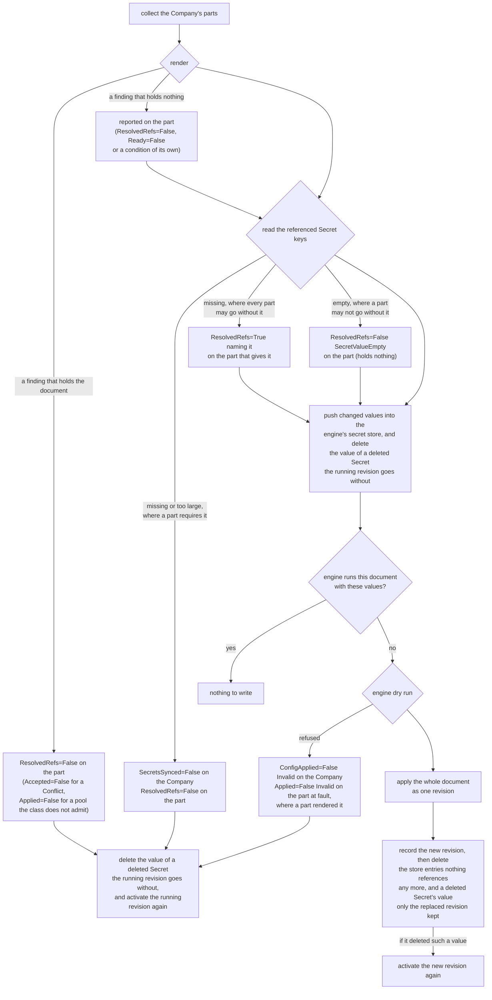
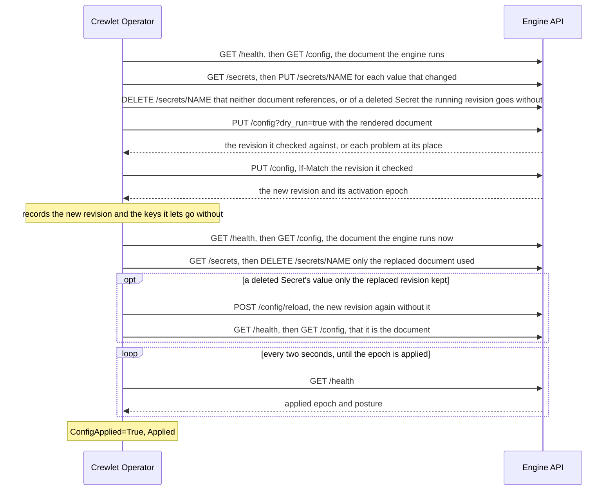

# How the Document Is Applied

On every change the operator renders the company document, has the engine
dry-run it, and applies it as one revision, whole or not at all.

The config reconciler keeps the company document a Company's engine runs
equal to what the Company and its parts declare: the `Unit`, `Seat`,
`LLMProvider`, `MCPServer`, `Integration` and `Schedule` objects that name it
in `spec.companyRef`. This page describes what it does on every change, what
each management policy lets it write, and how it reports the outcome on every
object involved. [What the engine is given](company-document.md) describes the
document itself; [How a company's engine runs](runtime.md) the engine it is
applied to.

---

## When it runs

A Company is looked at again when:

- its spec changes, or the runtime reconciler reports a change in whether
  there is an engine to talk to (`Accepted`, `RuntimeReady`, the public base
  URL);
- one of its parts is created, changed or deleted (a status write does not
  count: the parts' status is the config reconciler's own);
- a Secret one of them, or the Company, references changes. The operator
  watches Secrets as metadata only and finds the companies that read one
  through an index of every reference in their specs, so it never holds a
  Secret's value in memory longer than one reconcile;
- its EngineClass's platform model providers change, when it uses them;
- the runtime reconciler reports a change in the company's pods
  (`status.topology`), after which the engine moves seats between them;
- five minutes have passed with no change, to find edits made through the
  engine's own API or dashboard, which nothing announces, and to refresh the
  integrations' health and where each seat runs. While a seat of the running
  revision is not yet held by a pod of its own StatefulSet although one of
  them is ready, or is held by a pod of it past that pod's share of its seats
  (a pool that gained a pod, where the engine moves seats onto the new one),
  the engine is placing it, and the operator looks every fifteen seconds
  instead, for at most three minutes: the engine claims a few seats every
  five seconds, and a seat whose pod was killed waits out its 45-second lease
  first.

> **Changes are coalesced.** A platform that provisions a company writes its
> objects one request at a time, and each revision is a permanent entry in the
> engine's history and a rebuild of every seat. So after a change to a part or
> to a referenced Secret the operator waits until two seconds have passed
> without another one, and then applies everything as one revision: twenty
> Seats created in a burst become one revision, not twenty. A burst that never
> pauses (a Secret something rewrites every second) holds the company back for
> ten seconds at most; the operator then applies what it has.

---

## What one reconcile does



1. **Render.** Every part is rendered into one document. A finding that
   holds the document stops here: one the engine would refuse, one that
   would harm more than the object at fault if applied (a reference to an
   object that does not exist, written by a name another object could take
   later; a loop of parent Units), or one the class forbids (see
   [What blocks a document](company-document.md#what-blocks-a-document)). A
   finding that holds nothing, such as a Seat in a pool the Company does not
   declare, is reported on its object, and the document goes on.
2. **Read the Secret values** the document references, from the API server
   directly. A missing Secret or key, or a value over the 64 KiB the engine's
   store accepts, stops here, except a missing one every reference to which
   is a value a tool server or a coding run may go without (its key listed
   in the `optionalKeys` that governs it): the engine is to leave that value
   out, so the store is to hold none for it. The parts are told what was
   read either way: a value a part goes without, and an empty value under a
   key nothing lists (`SecretValueEmpty`), which holds nothing.
3. **Push the values.** The operator reads the document the engine runs
   (`GET /health`, then `GET /config`) and lists the engine's encrypted
   secret store. Each referenced key is one entry in the store, named as the
   document refers to it (`K8S_<SECRET>_<KEY>_<hash>`). Only values that
   changed since the last push are written, and any entry the store lost or
   the engine lists as last written with a credential other than the
   operator's own token: somebody with an admin credential replaced it, and
   the operator writes its value back. The engine records that credential
   from the write's authentication, so no writer can pass for the operator.
   The entries the running document still references are kept until the next
   document replaces it; an entry of the operator's shape that neither
   document references is deleted now. So is the entry of a value whose
   Secret or key no longer exists where the revision the engine runs goes
   without it, so that the revision step 6 writes, or the one activated
   again below, activates without the deleted value: where that revision
   does not reference the value, or every reference to it there is under a
   listed key. The operator knows how a revision reads a value from its
   record of the store, which names the revision it last activated with the
   Secret keys that revision's document lets go without, and from the
   document itself where the engine runs the very document the operator
   renders, whoever activated it (a `crewlet config reload` of it, say). A
   value such a revision lets go is deleted whatever the next document reads
   of it: a next document that requires it is held for it anyway, and is
   applied once the Secret exists again, when its value is pushed. Any other
   revision, one that reads the value where it is required, or another
   document somebody else activated, whose reading the operator does not
   know, keeps the value it holds for as long as it runs, as the last good
   revision keeps every value it requires while the next document is held.
   The Company's `SecretsSynced` and the part's `ResolvedRefs` message say so
   wherever the reconcile read the Secrets the document references, and a
   `SecretKept` event, told once, when the reconcile ends with the value
   kept; a document the render holds reads only the values it may go
   without, and is told by the event alone. Step 7 deletes the value once
   the next document runs. Whenever the reconcile ends without activating a
   revision after it deleted a value, because the document is held at any
   step, the operator activates the revision the engine runs again,
   unchanged (`POST /config/reload`, with a `Reactivated` event), so the
   engine reads its store without the deleted value rather than starting a
   tool server or a coding run with it; it keeps what it owes in its record
   of the store until a revision has activated. It activates again only a
   revision that goes without the value, never one that keeps it, and
   records the revision that activates it again as its own only once it has
   read back that it is that document: the engine activates again whichever
   revision is active when the request lands, so one somebody else activated
   in between is reported with a Warning `Reactivated`, and read as a
   revision whose reading the operator does not know. Nothing makes the
   engine's reload or its deletion conditional on the revision the operator
   read, so a revision somebody activates in that moment goes without a
   value it may require until the Secret exists again.
4. **Compare.** The operator compares the engine's active document with the
   rendered one, and compares a hash of the rendered document and
   of the values it references with the one it recorded when it last applied
   (`status.config.appliedHash`). If both match, there is nothing to write.
   A changed value alone is a reason to write: the engine reads a rotated
   value only when a revision activates, so rewriting a Secret produces a new
   revision with the same document, and its summary names the Secret. So is
   a value written back in step 3, for the same reason: since it was
   replaced, a reload may have handed the engine the other value.
5. **Dry-run** the document. The engine checks everything the API server
   cannot: rules that span objects, such as a Seat that asks for a sandbox
   the Company does not offer. Each problem the engine reports is traced back,
   by its place in the document, to the part that rendered that place.
6. **Apply** the document as one revision, on the condition that the engine
   still runs the revision the dry run checked against (`If-Match`; into an
   engine with no document yet, on the condition that it still has none).
   The revision's summary is `crewlet-operator:` followed by the objects
   whose part of the document changed. A write that loses a race with
   another writer is started over once from a fresh read.
7. **Clean up** the store. The operator records the new revision in its
   record of the store, with the Secret keys its document lets go without,
   before it deletes anything, so that a deletion whose own record a failed
   write loses is withdrawn by the next reconcile. Then it reads the
   document the engine runs again and lists the store, and every entry of
   the operator's shape that the new document does not reference, the ones
   only the replaced document used, is deleted, and so is the value of a
   deleted Secret the replaced revision kept, which the new one goes
   without; a revision somebody activated since the apply keeps every value
   it references instead. The new revision activated with that value still
   in the store, so the operator activates it again at once, unchanged
   (`Reactivated`), and the engine reads its store without it. Until then the
   new revision may start a tool server or a coding run with the deleted
   Secret's value: that moment is the price of keeping the last good revision
   whole, paid where the revision the engine ran read the key as required,
   or was one whose reading the operator did not know, when the key's Secret
   was deleted. Entries of any other name — one a person wrote with
   `crewlet secrets set`, say — are never touched.
8. **Wait for the engine to apply it.** The write activates the revision and
   returns its activation epoch; the engine applies it afterwards, on its own
   loop, and runs the previous revision until it has. So the Company reports
   `ConfigApplied=False` with the reason `Applying` until the engine's
   `/health` reports that epoch applied (the operator looks every two
   seconds; it usually takes milliseconds), and only then `True`.



> **When the engine does not apply a revision.** The engine's posture reads
> `wait` for as long as it applies an epoch, and turns `isolated`, `shed` or
> `stuck` only once it has concluded that it did not: an attempt ended in
> failure, or the apply has run past the engine's 45-second grace while a peer
> applied the epoch. On such a posture, or on `wait` still 72 seconds after the
> write (four of its 18-second polls), the Company reports
> `ConfigApplied=False ApplyFailed` with the engine's status, posture and
> account of the failure (from its record of the attempt in `/fleet`), and an
> `ApplyFailed` event; the engine keeps running the revision it applied last.
> The same check runs on every later look, so an engine that fails a revision
> someone activates afterwards is reported too.

That is the reconcile under `Enforce`. Under `Observe` the operator renders,
dry-runs and compares, and reads no Secret value and writes nothing; under
`Seed` it goes through every step once, into an engine with no document, and
never again (see [Management policies](#management-policies)).

The operator remembers what it pushed as keyed fingerprints of the values, in
a Secret of its own, `<company>-secret-sync`, owned by the Company: the
engine never returns a value, so this is how the operator knows which ones
changed. A fingerprint without the key that Secret also holds says nothing
about a value. The same Secret holds the operator's record of the store's
other facts: the revision whose reading of the values it knows, with the
Secret keys that revision lets go without (`optional-keys`), the values it
deleted that a revision has yet to activate without, and the ones it said it
keeps.

The engine is reached at its first data pod,
`http://<company>-data-0.<company>-data.<namespace>.svc:8080`, with the
operator's own token from the Secret `<company>-api-tokens`, never through the
`<company>-engine` Service: that Service routes only to a ready pod, and an
engine is ready only once it runs a document. While the engine does not
answer, the Company reports `ConfigApplied=False` with the reason
`EngineUnavailable`, and the operator tries again every ten seconds. Because
the address is the cluster's DNS name of the pod, an operator running outside
the cluster (`make run`) cannot reach any engine.

---

## Management policies

`Company.spec.config.managementPolicy` says who owns the engine's document.

### Enforce (the default)

The operator is the document's only writer, and the engine enforces it: the
data pod's `crewlet.yaml` sets Crewlet's `api.auth.company_writers` to the id
of the operator's own token, `operator`, so the engine refuses every other
credential any change to the document — a `PUT` or `PATCH` of `/config`, an
entity write, a revert, a `/setup` connect, and the dry run of each — with
`403 config_managed`, and its dashboard shows the document read-only. That
takes in a person signed in at the dashboard, whatever they signed in with:
the engine judges the credential a write came through, never its author.
Reads, `POST /config/reload` and the secret store stay open to whoever holds
admin, which is how a person rotates a leaked credential; see
[Crewlet's managed configuration](https://github.com/crewlet/crewlet/blob/main/docs/concepts/configuration.md#managed-configuration).
Under `Observe` and `Seed` the list is not set, since the engine's own users
own the document there: Crewlet's authority table decides, which admits an
administrator, or a lead inside their own part of the chart. The engine reads
`crewlet.yaml` only at start, so a switch to or from `Enforce` restarts the
data pod.

On every look the operator compares the engine's active document with the
rendered one; when they differ and the engine runs a revision the operator
did not write — one the engine recorded itself, such as a provisioning pass
writing down what it discovered at a vendor, a revision made before the data
pod restarted onto `Enforce`, a document the engine had before the Company
was created — it applies the rendered document over it, records a
`Drifted` event naming the revision and the places that differed, and
reports `ConfigApplied=True` with the reason `DriftCorrected` until its next
write.

A revision the engine activates on its own with the same content — a reload
after a credential was minted — is not drift: the operator adopts its id in
`status.config.revisionID` and writes nothing.

The comparison is over what the engine serves back, which is its own encoding
of the document rather than the bytes it was given. It disregards the
engine's shorter spelling of a seat's model chain, and the defaults the
engine fills into the tuning blocks a Company sets through `engineConfig`.
So inside an `engineConfig` block an edit to a setting the Company sets is
found and overwritten, while a setting someone only added there cannot be
told from a default and is left. Every other part of the document is compared
exactly.

### Observe

The operator renders the document, has the engine dry-run it, and compares it
with the engine's, and never writes: no revision, and no value into the
secret store (`SecretsSynced` is `Unknown` with the reason `NotManaged`).

| The engine runs | Company `ConfigApplied` | Each part's `Applied` |
|---|---|---|
| the rendered document | `True`, `InSync` | `True`, `InRevision` |
| another one | `False`, `Drifted`, naming the places that differ | `False`, `Drifted`, on each part whose place differs; `True` on the others |
| no document | `False`, `Drifted` | `False`, `Drifted` |

A `Drifted` event is recorded when the difference first appears or changes.
Observe is how to hand the objects a company the engine already runs (one
run from its dashboard under Seed, or a Company created again over the
volumes a [Retain](runtime.md#deletion) deletion kept): once it reports
`InSync`, the objects say what the engine runs, and switching to `Enforce`
pushes the Secret values and applies the same document once, as a revision
of the operator's own.

### Seed

The operator writes the document once, into an engine that has none, with the
values it references, and from then on leaves the engine alone: the
Company reports `ConfigApplied=True` with the reason `Seeded`, and every part
`Applied=False` with the reason `NotManaged`, since a change to it is no longer
applied. An engine that already had a document when the Company was created
is never written to; the Company reports `Seeded` all the same, saying so.

---

## Pausing a seat

A seat's pause is not part of the company document. Crewlet keeps it in its
coordination store, where a person puts it from the engine's dashboard to
stop an agent taking work without taking it out of the chart: a paused seat
starts no new turn, the mail it is sent waits on its inbox in order, and its
schedules' fires are skipped rather than queued; resuming it delivers what
waited. `Seat.spec.paused` is how the objects say the same:

```yaml
spec:                       # Seat ana
  paused: true
  pauseReason: Deploy freeze until the incident review   # optional
  stopRunning: true                                      # optional: end the turn it is on now
```

On every look at the engine, whatever became of the document, the operator,
under `Enforce`, calls the engine's `pause_seat` or `resume_seat` tool for
each Seat that sets `spec.paused`, over the engine's operator catalogue
(`/operator/mcp`), with its own token. Both are no-ops on a seat already in
the state asked for, and both answer with the pause as the engine's
coordination store records it, which is what the Seat then reports. The
operator does not decide from the engine's roster (`GET /agents`, the
account its dashboard draws) whether to call: the roster is moved by the
announcement of each pause and resume, and a node that missed one would
report the brake held when it is not. It reads the roster for the Seats
that do not own their pause, whose pause it only reports, and to know which
seats the engine runs at all. A call the engine may or may not have
recorded, or refused (the record changed under it, say), is made again ten
seconds later, and so is every owned pause while the roster cannot be read.

A Seat's `status.pause.pausedBy` names who paused it as Crewlet records the
author of any write: the seat of the person who paused it, or `token:<id>`
for a token no seat is bound to. A pause the operator took reads
`token:operator`, and one taken with the token the Company publishes,
`token:access`.

> **Who owns a pause.** Only a Seat that sets `spec.paused`, and only under
> `Enforce`. A pause or resume made in the dashboard of such a seat is undone on
> the operator's next look, at most five minutes later, with a `Drifted`
> event on the Seat. A Seat that leaves `spec.paused` unset owns nothing, under
> any policy: the operator reports a pause a person takes and never lifts it.
> Reading unset as "not paused" would make the operator lift every pause a
> person takes in the dashboard of an operator-run company within minutes,
> and a pause is the control a person reaches for when an agent misbehaves —
> the reason the engine keeps it out of the document, which `Enforce` makes the
> operator's. Under `Observe` and `Seed` the operator changes no pause; a Seat
> whose pause differs from its `spec.paused` reports so.

The engine keeps the reason a pause was taken with: a `pauseReason` changed
while the seat stays paused shows from its next pause on. Setting
`stopRunning` on a seat already paused ends the turn it is on then; unsetting
it changes nothing, since a stopped turn is not run again and a stop lasts
until the seat is resumed.

A stop also reaches a coding run the seat detached, which outlives its turn
and runs on through the pause: until the seat is resumed, the engine refuses
every change the run would make, naming who stopped the seat. That is a call
it makes through the tool bridge of any of the seat's tools not marked
read-only, and a push its box makes to the company's code host, which the
operator does not offer. Its reads still answer. A pause without
`stopRunning` stops new work only, so a running job's writes land, as a turn
in flight finishes.

The engine knows no seat it does not run, so a Seat created with
`paused: true` is paused once the revision that adds it is applied: the
operator looks again every two seconds while the engine applies it, and
pauses the seat on the first look that finds it. In the seconds between, the
seat runs: a Seat created again under a handle whose durable inbox kept
messages can start on them before the pause lands. Pause it in the engine's
dashboard first, or create it with `paused: true` in a revision that holds
nothing else back, where that matters.

A pause outlives its Seat: the engine keeps the record, which never expires,
when a Seat with `spec.paused: true` is deleted, and a later Seat with the
same handle starts paused even with `spec.paused` unset, which leaves the
pause to the dashboard. Create it with `spec.paused: false`, or resume it in
the dashboard, to start it running. A Human seat has no pause: the engine
takes no work for a person that a pause could hold.

---

## What each object reports

| Object | Condition | When |
|---|---|---|
| Company | `SecretsSynced` | `True`, `Synced`, once the store holds every referenced value, counting the values a tool server or a coding run may go without whose Secret or key does not exist, which it does not hold, or holds as it was for the revision the engine runs where that revision requires one, or is one whose reading the operator does not know (it names those, and which of the two it is), and, the Company having no `ResolvedRefs`, naming the values of its own setup steps a run goes without and a value of theirs that holds nothing under a key their `optionalKeys` does not list ([What blocks a document](company-document.md#what-blocks-a-document)). `False`, `SecretNotFound` or `SecretTooLarge`, naming each Secret and key; `False`, `EngineUnavailable` when a write to the store failed; `Unknown`, `NotManaged` under Observe, and under Seed once seeded. |
| Company | `ConfigApplied` | `True` with `Applied`, `DriftCorrected`, `InSync` or `Seeded`, once the engine reports the revision's epoch applied. `False` with `Applying` while it applies it, `ApplyFailed` when it did not; otherwise with the reason of whatever blocks the document ([What blocks a document](company-document.md#what-blocks-a-document)): `RefNotFound`, `Cycle`, `Conflict`, `ReferenceNotAllowed`, `HumanSeat`, `PerSeatNotAllowed`, `PoolCapacityExceeded`, `SeatPoolsNotAllowed`, `CLIAuthNotPortable`, `CodingAgentMismatch`, `OptionalKeyUnused`, `SecretNotFound`, `SecretTooLarge`, `NameConflict` (the Secret `<company>-secret-sync` is someone else's), `Invalid` (the engine's own words), `Drifted` (Observe), `WriteRefused` (the engine refuses the operator's own token a change to the document), `NotGranted` (the engine does not let the operator's token make a request it needs), `SeatHeld` (the document takes away a human seat a person, a service account or an open invitation holds in the engine) or `EngineUnavailable`. |
| Company | `EngineHealthy` | The engine's alarm table, read each time the engine is reached: `True`, `NoAlarms`; `False`, `Alarms`, naming the one standing longest; `Unknown`, `AlarmsNotReported`, before the engine has evaluated them. Not part of `Ready`. |
| Company | `IdentityClaimed` | Whether anybody has joined the company, read from the engine's `/health` each time the engine is reached, and every 30 seconds while nobody has, since a person joins where no watch sees it: `True`, `PersonEnrolled`, once its identity directory holds a person; `False`, `Unclaimed`, while nobody has joined, naming up to five of the company's Human seats and the access token to bring the first person in with; `False`, `NoHumanSeat`, when nobody can, for want of a Human seat; `Unknown`, `IdentityNotReported`, when the engine could not read its directory, did not say, or could not be asked. Not part of `Ready`: a company nobody has joined runs its agent seats. |
| every part | `Accepted` | `True` once its Company exists; `False` with `CompanyNotFound`, or `Conflict` when it collides with another object of its company. |
| every part | `ResolvedRefs` | `True`, `Resolved`, its message naming any value it gives a tool server or a coding run that the engine starts with and goes without, under a key an `optionalKeys` list lets go (the message names it: the MCPServer's for a tool server's value, a Seat's or Unit's included), whose Secret or key does not exist or holds an empty value, also while a Secret another part requires holds the document, and saying where the engine keeps the value it held for the revision it runs, which requires it, or whose reading the operator does not know. `False` with `RefNotFound`, `Cycle`, `HumanSeat`, `ReferenceNotAllowed`, `SecretNotFound`, `SecretTooLarge`, `OptionalKeyUnused`, `PoolNotFound`, `NoProvisioner`, `SecretValueEmpty` or `NotAnAccountID`, saying what it references that is missing or cannot be there. Most hold the document, and the part reports the same reason on `Applied`; `PoolNotFound`, `NoProvisioner`, `SecretValueEmpty`, `NotAnAccountID`, and `HumanSeat` on a GitLab `accessLevels` entry hold nothing, because only the part at fault suffers them: it is applied (`Applied=True`) and reported, with a Warning event when the condition turns so. |
| every part | `Applied` | `True`, `InRevision`, naming the revision, with the generation that revision was rendered from as its `observedGeneration`, once the engine has applied it. `False` with the part's own problem (`Invalid`, `RefNotFound`, a Seat's `PerSeatNotAllowed`, `PoolCapacityExceeded`, `CLIAuthNotPortable`, `CodingAgentMismatch`, or `SeatHeld` when it turns a held human seat into an agent's, ...), a Seat's `PlacementPending` while it stays where it runs until a pod of the pool it moves to is ready (or for good, while the Company does not declare that pool), `Blocked` when another object keeps the document from being applied, `Applying` while the engine applies the revision, or `ApplyFailed` when it did not. A part whose current generation already runs keeps `True` meanwhile: only what changed is held back. |
| Seat (agent) | `Ready` | Whether the seat runs: see [A Seat's `Ready` condition](#a-seats-ready-condition). A Human seat has none. |
| Seat (Agent) | `Paused` | Whether the engine holds the seat paused, once it runs the seat: `True`, `SeatPaused`, naming who paused it, when and why; `False`, `SeatRunning`; with `PauseNotManaged` instead when the pause differs from `spec.paused` under `Observe` or `Seed`. `Unknown`, `PauseUnknown`, while a pause or resume the engine may or may not have recorded is retried; `Unknown`, `PauseRefused`, with the engine's words when it refused one, which is asked for again ten seconds later. None while the engine runs no seat of the Seat's (not in its revision, or a handle another Seat derives too). |
| Seat (Agent) | `CodeWorkRunnable` | On an Agent seat with `spec.sandbox` whose executor does not run in agent mode, in a Company with `spec.sandbox`: whether its coding agent can run on the provider at the head of its sandbox chain, or on the sign-in the seat's sandbox environment gives it, decided from the spec, and the Secrets once they are read, each time the document is rendered, whatever became of the document: a sign-in variable the run goes without, under a key listed in the `optionalKeys` that governs the value that wins (the seat's `spec.sandbox.optionalKeys`, or its step's), counts for nothing once the reconcile has found its Secret or key missing, or its value empty. Under `Observe` or `Seed` it judges the Seat's objects, which may not be the document the engine runs; `Applied` says whether they are. `True`, `CodeWorkSupported`, naming the coding agent and what it runs on; `False` with `CodingAgentMismatch`, which also holds the document (`Applied`), or with `SandboxLoginNotPortable`, `SecretValueEmpty` (a value the runs are given holds an empty value, under a key nothing lists) or `NoProvisioner` (one is a provisioned credential nothing creates), which do not: the seat is applied and runs its turns, and Crewlet refuses each of its coding runs. The operator records a Warning event on the Seat each time the condition becomes `False` or its reason changes. Not part of `Ready`, which says whether a pod runs the seat. None on any other Seat (a seat whose executor runs in agent mode codes in that run, and Crewlet never offers it `run_sandbox`), or while none of the seat's sandbox chain resolves; unchanged while the Company is not accepted. |
| LLMProvider (in `mode: Agent`) | `AgentModeRunnable` | Whether its runs can call a seat's tools back through the tool bridge, decided from the spec each time the document is rendered: `True`, `ToolBridgeServed`, naming the bridge at the Company's public address; `False`, `NotExposed`, while the Company has none. The provider is applied either way (it still serves a text call behind a chain's head or in another phase); the operator records a Warning event when the condition becomes `False`. None on any other provider; unchanged while the Company is not accepted. |
| Integration | `Healthy` | The engine's own verdict on the vendor: `True`, `CheckPassed`, when it reports the tool connected; `False`, `CheckFailed`, with the engine's reason otherwise; `False`, `NotExposed` while the Company has no public address, since no webhook can reach the engine. |

Besides the conditions:

- **Company** `status.config`: the revision the engine runs the rendered
  document as, its activation epoch, `appliedHash`, when the operator last
  applied, and how many objects of each kind it was rendered from (platform
  model providers included). `status.config.placement` is where the document
  the engine runs pins its agent seats: every value of `crewlet.ai/pool`
  (`data` and the Shared pools that run a seat) and of `crewlet.ai/seat` (each
  seat of a PerSeat pool). It is read from the engine's own document under
  every policy, so under Observe and Seed too. A new revision's pins join
  the record before the operator's write that activates it, and while the
  engine applies it the record is the previous revision's pins and the new
  one's together, because the engine keeps running the previous revision
  until it has applied the new one, and for good if that apply fails. Once
  the engine reports the new revision's epoch applied, the record is its
  pins alone; a document the engine owns (Observe, Seed) is narrowed to only
  once the engine's own record of its last apply names that revision and
  says it ended well.
  The runtime reconciler reads it to keep a seat pool's pods running for as
  long as the running revision pins a seat to them ([A pool removed while
  seats still run in it](runtime.md#a-pool-removed-while-seats-still-run-in-it)).
- **Seat**: its handle, its identity in the engine (`seatID`, derived from
  the company name and the handle), the pool that runs it and the
  StatefulSet whose pods do (`status.placement.workload`; unset while the
  class runs no pod for it), the pod whose engine holds it
  (`status.placement.node`, unset while none does), and the addresses
  its own vendor apps deliver to: `<publicBaseURL>/webhooks/slack/<handle>`
  and `<publicBaseURL>/webhooks/github/<handle>`, set as soon as the Company
  has the vendor's Integration and a public address. While the engine holds
  it paused, `status.pause` says who paused it, when, why, and whether its
  running turn was stopped and its detached coding runs' writes refused.
- **Unit**: its depth in the chart (`0` at the top; unset for a Unit outside
  it) and how many Seats are directly in it.
- **Integration**: the company-wide address the vendor delivers to, for
  GitHub `<publicBaseURL>/webhooks/github`. Slack has none: each seat's app
  has its own.

Every event the config reconciler records is on the Company, but a seat's
pause, which is recorded on the Seat (`SeatPaused`, `SeatResumed`, and
`Drifted` when it undid a change made in the engine): `Activated`
with the revision, its epoch and its summary, `Applied` once the engine has
applied it, `ApplyFailed` when it did not, `SecretsSynced` with the store
entries it wrote and deleted, a Warning `SecretOverwritten` naming each entry
it wrote back and who had replaced it, `SecretKept` naming each value of a
deleted Secret it keeps in the store for the revision the engine runs, which
requires it or whose reading the operator does not know, `Reactivated` when
it activated the running revision again so the engine reads its store
without the value of a deleted Secret, a Warning `Reactivated` when the
revision activated again is not the document it read, a Warning
`SecretWithdrawalFailed` when it could not,
`Drifted`, `Invalid` with the engine's problems, and
`EngineWarnings` when the engine applied a revision it has something to say
about. Events, conditions and logs name Secrets, keys and store entries,
never a value.

### A Seat's `Ready` condition

`Ready` says whether an agent seat runs, as the first of these that holds:

| Status | Reason | When |
|---|---|---|
| False | `Suspended` | The Company is suspended. |
| False | `AgentModeBridgeUnsupported` | The head of the seat's executor's chain is an `LLMProvider` in `mode: Agent`, and the seat is in a seat pool, whose pods serve no tool bridge a run can call back through. |
| False | `NotExposed` | The same provider heads the chain, and the Company has no public address. |
| True | `LeaseHeld` | An engine pod holds the seat's lease, as the engine's `GET /fleet` reports. The message names the pod, and says so when it is not a pod of the seat's StatefulSet yet, while the engine moves it. The engine names a lease by the seat's handle, or by its id (`status.seatID`) when the engine pod that answered does not run the seat yet; the operator finds it either way. |
| False | `PoolNotFound` | No pod holds the seat and none can: the Company does not declare its pool. |
| False | `Unplaced` | No pod holds the seat: it is not in the revision the engine runs, its pool runs no pod, or the engine has not claimed it yet. The message says which. |
| Unknown | `EngineUnavailable` | The engine's fleet could not be read. |

`AgentModeBridgeUnsupported` and `NotExposed` are decided from the spec each
time the document is rendered: the engine applies such a seat and refuses
every one of its turns, so the condition holds nothing back, names the pod
that holds the seat if one does, and comes with a Warning event when `Ready`
becomes so (a suspended Company's seat, whose `Ready` says `Suspended`, is
announced once it resumes). Once the spec is fixed, a reconcile that does not
reach the engine reports `False`, `Unplaced`, until the engine is asked which
pod holds the seat, rather than keep the old reason. The other reasons are
read each time the operator reaches the engine, and stay as they are while it
does not.

---

## Who writes what

The config reconciler writes the Company's `SecretsSynced` and
`ConfigApplied` conditions and `status.config`, and the whole status of every
part; the runtime reconciler writes the rest of the Company's status. Both
write the Company's status with a JSON merge patch under an optimistic lock:
a write that conflicts with the other's is retried on a fresh read of the
Company, so neither overwrites a field of the other's. A change of
`ConfigApplied` makes the runtime reconciler recompute `Ready`, and a change
of `status.config.placement` makes it delete the seat pods no running revision
needs any more.

---

## See also

- [What the Engine Is Given](company-document.md) — the document this page applies, and what blocks one
- [Choosing a Management Policy](../guides/management-policies.md) — which policy to run a company under
- [Troubleshooting](../guides/troubleshooting.md) — what to do about each condition
- [Crewlet's control plane](https://github.com/crewlet/crewlet/blob/main/docs/concepts/control-plane.md) — how the engine applies a revision, and the postures a node takes
