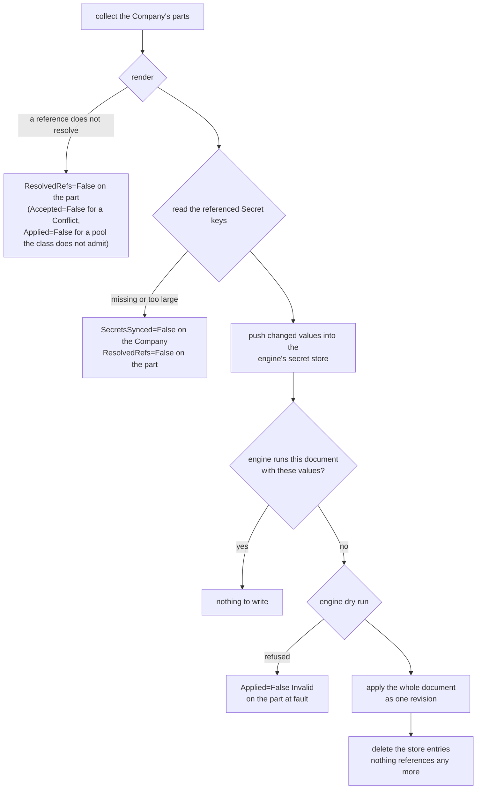

# How the document is applied

The config reconciler keeps the company document a Company's engine runs
equal to what the Company and its parts — the `Unit`, `Seat`, `LLMProvider`,
`MCPServer`, `Integration` and `Schedule` objects that name it in
`spec.companyRef` —
declare. This page describes what it does on every change, what each
management policy lets it write, and how it reports the outcome on every
object involved. [What the engine is given](company-document.md) describes
the document itself; [How a company's engine runs](runtime.md) the engine it
is applied to.

## When it runs

A Company is looked at again when:

- its spec changes, or the runtime reconciler reports a change in whether
  there is an engine to talk to (`Accepted`, `RuntimeReady`, the public base
  URL);
- one of its parts is created, changed or deleted (a status write does not
  count: the parts' status is the config reconciler's own);
- a Secret one of them, or the Company, references changes. The operator
  watches Secrets as metadata only and finds the companies that read one
  through an index of every reference in their specs, so it never holds a
  Secret's value in memory longer than one reconcile;
- its EngineClass's platform model providers change, when it uses them;
- the runtime reconciler reports a change in the company's pods
  (`status.topology`), after which the engine moves seats between them;
- five minutes have passed with no change, to find edits made through the
  engine's own API or dashboard, which nothing announces, and to refresh the
  integrations' health and where each seat runs. While a seat of the running
  revision is not yet held by a pod of its own StatefulSet although one of
  them is ready, the engine is placing it, and the operator looks every
  fifteen seconds instead, for at most three minutes: the engine claims a few
  seats every five seconds, and a seat whose pod was killed waits out its
  45-second lease first.

**Changes are coalesced.** A platform that provisions a company writes its
objects one request at a time, and each revision is a permanent entry in the
engine's history and a rebuild of every seat. So after a change to a part or
to a referenced Secret the operator waits until two seconds have passed
without another one, and then applies everything as one revision: twenty
Seats created in a burst become one revision, not twenty. A burst that never
pauses (a Secret something rewrites every second) holds the company back for
ten seconds at most; the operator then applies what it has.

## What one reconcile does



1. **Render.** Every part is rendered into one document. A reference to an
   object that does not exist, a loop of parent Units, or two objects
   Crewlet would read as one stop here (see
   [What blocks a document](company-document.md#what-blocks-a-document)).
2. **Read the Secret values** the document references, from the API server
   directly. A missing Secret or key, or a value over the 64 KiB the engine's
   store accepts, stops here.
3. **Push the values.** Each referenced key is one entry in the engine's
   encrypted secret store, named as the document refers to it
   (`K8S_<SECRET>_<KEY>_<hash>`). Only values that changed since the last
   push are written. The entries the running document still references are
   kept until the next document replaces it.
4. **Compare.** The operator reads the engine's active document and compares
   it with the rendered one, and compares a hash of the rendered document and
   of the values it references with the one it recorded when it last applied
   (`status.config.appliedHash`). If both match, there is nothing to write.
   A changed value alone is a reason to write: the engine reads a rotated
   value only when a revision activates, so rewriting a Secret produces a new
   revision with the same document, and its summary names the Secret.
5. **Dry-run** the document. The engine checks everything the API server
   cannot: rules that span objects, such as a Seat that asks for a sandbox
   the Company does not offer. Each problem the engine reports is traced back,
   by its place in the document, to the part that rendered that place.
6. **Apply** the document as one revision, on the condition that the engine
   still runs the revision the dry run checked against (`If-Match`; into an
   engine with no document yet, on the condition that it still has none).
   The revision's summary is `crewlet-operator:` followed by the objects
   whose part of the document changed. A write that loses a race with
   another writer is started over once from a fresh read.
   The write activates the revision and returns its activation epoch; the
   engine applies it afterwards, on its own loop, and runs the previous
   revision until it has. So the Company reports `ConfigApplied=False` with
   the reason `Applying` until the engine's `/health` reports that epoch
   applied (the operator looks every two seconds; it usually takes
   milliseconds), and only then `True`. When the engine records the attempt
   as failed, or has neither applied nor failed the epoch 72 seconds after
   the write (four of its 18-second polls), the Company reports
   `ConfigApplied=False ApplyFailed` with the engine's status, posture and
   account of the failure, and an `ApplyFailed` event; the engine keeps
   running the revision it applied last. The same check runs on every later
   look, so an engine that fails a revision someone activates afterwards is
   reported too.
7. **Clean up** the store: every entry of the operator's shape that the new
   document does not reference is deleted. Entries of any other name — one a
   person wrote with `crewlet secrets set`, say — are never touched.

That is the reconcile under `Enforce`. Under `Observe` the operator renders,
dry-runs and compares, and reads no Secret value and writes nothing; under
`Seed` it goes through every step once, into an engine with no document, and
never again (see [Management policies](#management-policies)).

The operator remembers what it pushed as keyed fingerprints of the values, in
a Secret of its own, `<company>-secret-sync`, owned by the Company: the
engine never returns a value, so this is how the operator knows which ones
changed. A fingerprint without the key that Secret also holds says nothing
about a value.

The engine is reached at its first data pod,
`http://<company>-data-0.<company>-data.<namespace>.svc:8080`, with the
operator's own token from the Secret `<company>-api-tokens`, never through the
`<company>-engine` Service: that Service routes only to a ready pod, and an
engine is ready only once it runs a document. While the engine does not
answer, the Company reports `ConfigApplied=False` with the reason
`EngineUnavailable`, and the operator tries again every ten seconds. Because
the address is the cluster's DNS name of the pod, an operator running outside
the cluster (`make run`) cannot reach any engine.

## Management policies

`Company.spec.config.managementPolicy` says who owns the engine's document.

### Enforce (the default)

The operator is the document's only writer, and the engine enforces it: the
data pod's `crewlet.yaml` sets Crewlet's `api.auth.company_writers` to the id
of the operator's own token, `operator`, so the engine refuses every other
token any change to the document — a `PUT` or `PATCH` of `/config`, an entity
write, a revert, a `/setup` connect, and the dry run of each — with
`403 config_managed`, and its dashboard shows the document read-only. Reads,
`POST /config/reload` and the secret store stay open to every token, which is
how a person rotates a leaked credential; see
[Crewlet's managed configuration](https://github.com/crewlet/crewlet/blob/main/docs/concepts/configuration.md#managed-configuration).
Under `Observe` and `Seed` the list is not set, since the engine's own users
own the document there. The engine reads `crewlet.yaml` only at start, so a
switch to or from `Enforce` restarts the data pod.

On every look the operator compares the engine's active document with the
rendered one; when they differ and the engine runs a revision the operator
did not write — one the engine recorded itself, such as a provisioning pass
writing down what it discovered at a vendor, a revision made before the data
pod restarted onto `Enforce`, a document the engine had before the Company
was created — it applies the rendered document over it, records a
`Drifted` event naming the revision and the places that differed, and
reports `ConfigApplied=True` with the reason `DriftCorrected` until its next
write.

A revision the engine activates on its own with the same content — a reload
after a credential was minted — is not drift: the operator adopts its id in
`status.config.revisionID` and writes nothing.

The comparison is over what the engine serves back, which is its own encoding
of the document rather than the bytes it was given. It disregards the
engine's shorter spelling of a seat's model chain, and the defaults the
engine fills into the tuning blocks a Company sets through `engineConfig`.
So inside an `engineConfig` block an edit to a setting the Company sets is
found and overwritten, while a setting someone only added there cannot be
told from a default and is left. Every other part of the document is compared
exactly.

### Observe

The operator renders the document, has the engine dry-run it, and compares it
with the engine's, and never writes: no revision, and no value into the
secret store (`SecretsSynced` is `Unknown` with the reason `NotManaged`).

| The engine runs | Company `ConfigApplied` | Each part's `Applied` |
|---|---|---|
| the rendered document | `True`, `InSync` | `True`, `InRevision` |
| another one | `False`, `Drifted`, naming the places that differ | `False`, `Drifted`, on each part whose place differs; `True` on the others |
| no document | `False`, `Drifted` | `False`, `Drifted` |

A `Drifted` event is recorded when the difference first appears or changes.
Observe is how to point the operator at an engine that already runs a company
before handing it the document: once the Company reports `InSync`, the
objects say what the engine runs, and switching to `Enforce` pushes the
Secret values and applies the same document once, as a revision of the
operator's own.

### Seed

The operator writes the document once, into an engine that has none, with the
values it references, and from then on leaves the engine alone: the
Company reports `ConfigApplied=True` with the reason `Seeded`, and every part
`Applied=False` with the reason `NotManaged`, since a change to it is no longer
applied. An engine that already had a document when the Company was created
is never written to; the Company reports `Seeded` all the same, saying so.

## Pausing a seat

A seat's pause is not part of the company document. Crewlet keeps it in its
coordination store, where a person puts it from the engine's dashboard to
stop an agent taking work without taking it out of the chart: a paused seat
starts no new turn, the mail it is sent waits on its inbox in order, and its
schedules' fires are skipped rather than queued; resuming it delivers what
waited. `Seat.spec.paused` is how the objects say the same:

```yaml
spec:                       # Seat ana
  paused: true
  pauseReason: Deploy freeze until the incident review   # optional
  stopRunning: true                                      # optional: end the turn it is on now
```

On every look at the engine, whatever became of the document, the operator
reads which seats the engine holds paused, from its roster (`GET /agents`, the
account its dashboard draws), and, under `Enforce`, makes each Seat that sets
`spec.paused` match it: it calls the engine's `pause_seat` or `resume_seat`
tool, over the engine's operator catalogue (`/operator/mcp`), with its own
token. Both are no-ops on a seat already in the state asked for, so a second
call changes nothing; a call the engine may or may not have recorded is made
again ten seconds later.

**Who owns a pause.** Only a Seat that sets `spec.paused`, and only under
`Enforce`. A pause or resume made in the dashboard of such a seat is undone on
the operator's next look, at most five minutes later, with a `Drifted`
event on the Seat. A Seat that leaves `spec.paused` unset owns nothing, under
any policy: the operator reports a pause a person takes and never lifts it.
Reading unset as "not paused" would make the operator lift every pause a
person takes in the dashboard of an operator-run company within minutes,
and a pause is the control a person reaches for when an agent misbehaves —
the reason the engine keeps it out of the document, which `Enforce` makes the
operator's. Under `Observe` and `Seed` the operator changes no pause; a Seat
whose pause differs from its `spec.paused` reports so.

The engine keeps the reason a pause was taken with: a `pauseReason` changed
while the seat stays paused shows from its next pause on. Setting
`stopRunning` on a seat already paused ends the turn it is on then; unsetting
it changes nothing, since a stopped turn is not run again.

The engine knows no seat it does not run, so a Seat created with
`paused: true` is paused once the revision that adds it is applied, a few
seconds after. A Human seat has no pause: the engine takes no work for a
person that a pause could hold.

## What each object reports

| Object | Condition | When |
|---|---|---|
| Company | `SecretsSynced` | `True`, `Synced`, once the store holds every referenced value. `False`, `SecretNotFound` or `SecretTooLarge`, naming each Secret and key; `False`, `EngineUnavailable` when a write to the store failed; `Unknown`, `NotManaged` under Observe, and under Seed once seeded. |
| Company | `ConfigApplied` | `True` with `Applied`, `DriftCorrected`, `InSync` or `Seeded`, once the engine reports the revision's epoch applied. `False` with `Applying` while it applies it, `ApplyFailed` when it did not; otherwise with the reason of whatever blocks the document: `RefNotFound`, `Cycle`, `Conflict`, `PoolNotFound`, `PerSeatNotAllowed`, `PoolCapacityExceeded`, `SeatPoolsNotAllowed`, `SecretNotFound`, `SecretTooLarge`, `Invalid` (the engine's own words), `Drifted` (Observe), `WriteRefused` (the engine refuses the operator's own token a change to the document) or `EngineUnavailable`. |
| Company | `EngineHealthy` | The engine's alarm table, read each time the engine is reached: `True`, `NoAlarms`; `False`, `Alarms`, naming the one standing longest; `Unknown`, `AlarmsNotReported`, before the engine has evaluated them. Not part of `Ready`. |
| every part | `Accepted` | `True` once its Company exists; `False` with `CompanyNotFound`, or `Conflict` when it collides with another object of its company. |
| every part | `ResolvedRefs` | `False` with `RefNotFound`, `Cycle`, `PoolNotFound`, `SecretNotFound` or `SecretTooLarge`, saying what it references that is missing. |
| every part | `Applied` | `True`, `InRevision`, naming the revision, with the generation that revision was rendered from as its `observedGeneration`, once the engine has applied it. `False` with the part's own problem (`Invalid`, `RefNotFound`, a Seat's `PerSeatNotAllowed`, `PoolCapacityExceeded`, `AgentModeBridgeUnsupported` or `CLIAuthNotPortable`, ...), `Blocked` when another object keeps the document from being applied, `Applying` while the engine applies the revision, or `ApplyFailed` when it did not. A part whose current generation already runs keeps `True` meanwhile: only what changed is held back. |
| Seat (agent) | `Ready` | Whether an engine pod holds the seat's lease and runs it, as the engine's `GET /fleet` reports, read each time the operator reaches the engine: `True`, `LeaseHeld`, naming the pod (and saying so when it is not a pod of the seat's StatefulSet yet, while the engine moves it); `False`, `Unplaced`, while no pod holds it, saying why: the seat is not in the revision the engine runs, its pool runs no pod, or the engine has not claimed it yet; `False`, `Suspended`; `Unknown`, `EngineUnavailable`, when the fleet could not be read. Unchanged while the operator does not reach the engine. A Human seat has none. |
| Seat (Agent) | `Paused` | Whether the engine holds the seat paused, once it runs the seat: `True`, `SeatPaused`, naming who paused it, when and why; `False`, `SeatRunning`; with `PauseNotManaged` instead when the pause differs from `spec.paused` under `Observe` or `Seed`. `Unknown`, `PauseUnknown`, while a pause or resume the engine may or may not have recorded is retried; `Unknown`, `PauseRefused`, with the engine's words when it refused one. |
| Integration | `Healthy` | The engine's own verdict on the vendor: `True`, `CheckPassed`, when it reports the tool connected; `False`, `CheckFailed`, with the engine's reason otherwise; `False`, `NotExposed` while the Company has no public address, since no webhook can reach the engine. |

Besides the conditions:

- **Company** `status.config`: the revision the engine runs the rendered
  document as, its activation epoch, `appliedHash`, when the operator last
  applied, and how many objects of each kind it was rendered from (platform
  model providers included). `status.config.placement` is where the document
  the engine runs pins its agent seats: every value of `crewlet.ai/pool`
  (`data` and the Shared pools that run a seat) and of `crewlet.ai/seat` (each
  seat of a PerSeat pool). It is read from the engine's own document under
  every policy, so under Observe and Seed too. While the engine applies a
  new revision the record is the previous revision's pins and the new one's
  together, because the engine keeps running the previous revision until it
  has applied the new one, and for good if that apply fails; once the engine
  reports the new revision's epoch applied, the record is its pins alone.
  The runtime reconciler reads it to keep a seat pool's pods running for as
  long as the running revision pins a seat to them ([A pool removed while
  seats still run in it](runtime.md#a-pool-removed-while-seats-still-run-in-it)).
- **Seat**: its handle, its identity in the engine (`seatID`, derived from
  the company name and the handle), the pool that runs it and the
  StatefulSet whose pods do (`status.placement.workload`; unset while the
  class runs no pod for it), the pod whose engine holds it
  (`status.placement.node`, unset while none does), and the addresses
  its own vendor apps deliver to: `<publicBaseURL>/webhooks/slack/<handle>`
  and `<publicBaseURL>/webhooks/github/<handle>`, set as soon as the Company
  has the vendor's Integration and a public address. While the engine holds
  it paused, `status.pause` says who paused it, when, why, and whether its
  running turn was stopped.
- **Unit**: its depth in the chart (`0` at the top; unset for a Unit outside
  it) and how many Seats are directly in it.
- **Integration**: the company-wide address the vendor delivers to, for
  GitHub `<publicBaseURL>/webhooks/github`. Slack has none: each seat's app
  has its own.

Every event the config reconciler records is on the Company, but a seat's
pause, which is recorded on the Seat (`SeatPaused`, `SeatResumed`, and
`Drifted` when it undid a change made in the engine): `Activated`
with the revision, its epoch and its summary, `Applied` once the engine has
applied it, `ApplyFailed` when it did not, `SecretsSynced` with the store
entries it wrote and deleted, `Drifted`, `Invalid` with the engine's problems,
and
`EngineWarnings` when the engine applied a revision it has something to say
about. Events, conditions and logs name Secrets, keys and store entries,
never a value.

## Who writes what

The config reconciler writes the Company's `SecretsSynced` and
`ConfigApplied` conditions and `status.config`, and the whole status of every
part; the runtime reconciler writes the rest of the Company's status. Both
write the Company's status with a JSON merge patch under an optimistic lock:
a write that conflicts with the other's is retried on a fresh read of the
Company, so neither overwrites a field of the other's. A change of
`ConfigApplied` makes the runtime reconciler recompute `Ready`, and a change
of `status.config.placement` makes it delete the seat pods no running revision
needs any more.
