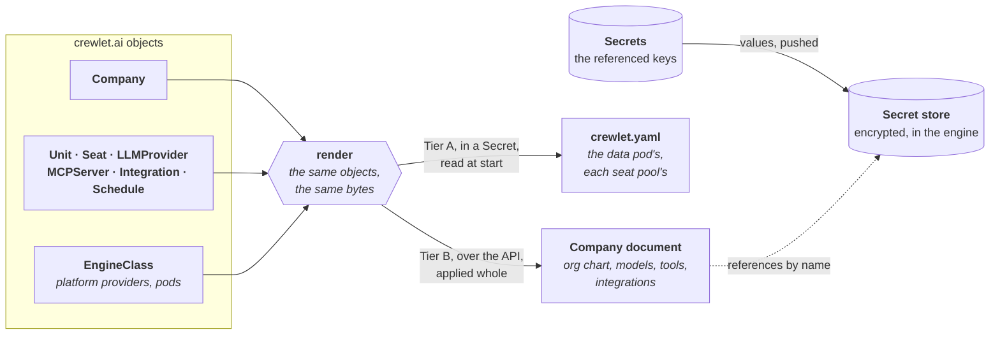

# What the Engine Is Given

The operator renders two documents from the `crewlet.ai` objects: the company
document the engine runs, and the `crewlet.yaml` each engine pod boots from.

The **company document** (Crewlet's Tier B: the company, its org chart,
models, tools and integrations) is applied over the engine's API. Each engine
pod's **`crewlet.yaml`** (Tier A: how the node boots), a data pod's or a seat
pool's, is kept in a Secret and mounted into the pod. This page says what they
contain, so that what the engine reports can be traced back to an object.

Both documents are rendered deterministically: the same objects always give
the same bytes, whatever order the API server lists them in. Keys are
sorted, units and their child units are ordered by `metadata.name`, seats by
handle, and model providers and tool servers by name.

---

## The company document

| Object | Becomes |
|---|---|
| `Company` | `name`, `mission`, `vision`, `policies`, `timezone`, `tracker`, `knowledge`, `token_budget`, `providers.embeddings`, `providers.sandbox`, `providers.llm_order`, `integrations.check_interval_seconds`, and one top-level key per `spec.engineConfig` entry |
| `EngineClass` | `providers.llm.<name>` for each of its `platformLLMProviders`, when the Company sets `spec.llm.usePlatformProviders` |
| `LLMProvider` | `providers.llm.<metadata.name>`; a `CLIAgent` provider's `cli.state_dir` is `/var/lib/crewlet/llm-cli/<loginName>`, on the data volume |
| `MCPServer` | one entry of `mcp_servers`, named by its `metadata.name` |
| `Integration` | one of `integrations.slack`, `github`, `gitlab`, `mattermost`, `jira`, `confluence`, `datadog` and `atlassian`; a Seat it names (Datadog's `routeTo`, GitLab's `accessLevels`) by the seat's handle |
| `Unit` | one entry of `units`, or of its parent's `children` |
| `Seat` | one entry of its Unit's `roles`, or of the top-level `roles` when it has no Unit |
| `Schedule` | one entry of the `schedules` of the Seat's role or the Unit it targets, named by its `metadata.name` |

Where the engine is reached is not part of the document: the engine reads its
addresses from the data pod's `crewlet.yaml`
([below](#the-data-pods-crewletyaml)), since its sign-in and the origin it
accepts a person's write from are decided before any document is loaded.

### Names and identities

- A Unit's `metadata.name` is its Crewlet `id`, and its `displayName` (or,
  unset, its `metadata.name`) its Crewlet `name`.
- A Seat's handle is always written out (`spec.handle`, or its
  `metadata.name`), so its identity never depends on how Crewlet would derive
  one from its name. Its Crewlet `name` is its `displayName`, or its handle.
- A unit's `lead` names its Seat by **handle**, and a seat's `manages`
  entries name a Seat by handle and a Unit by its `metadata.name`, its key.
  Crewlet refuses anything else there, and holds no display name unique, so
  two Seats or two Units may share one. It reads a token that is both a
  seat's handle and a unit's key as the seat, so a Seat that manages a Unit
  whose name is another Seat's handle cannot be rendered (see below).
- Each Seat's `spec.email` is its own: Crewlet finds a seat by its address,
  compared lower-cased and with any plus tag dropped, and refuses two seats
  that declare one.

### Models

`providers.llm_order` is written out in full: the Company's `spec.llm.order`,
then its own `LLMProvider`s by name, then the class's platform providers by
name. A seat with no `default` chain runs on the first one alone: Crewlet
tries no other provider of the order when that one's keys are all cooling
down, so a seat that needs a fallback names a chain. No provider may be named
`default`, since Crewlet would run every such seat on the provider keyed
`default` instead, whatever the order says.

Each Seat's `spec.llm` becomes Crewlet's per-phase `llm` mapping, each chain
naming providers by their key in `providers.llm`.

### Schedules

A Schedule is written into the entry of what it targets: a Seat's role, or a
Unit. Within one, schedules are ordered by `metadata.name`, which is also the
schedule's Crewlet `name`, half of the identity the engine claims each fire
under; since a `metadata.name` never changes, editing a Schedule never lets a
fire run twice.

| Field | Crewlet's | Notes |
|---|---|---|
| `spec.schedule` | `cron` | Five fields. The API checks the shape; the engine's dry run checks each field's values against the grammar its scheduler evaluates with |
| `spec.timeZone` | `timezone` | Unset fires on the company's clock (`timezone`, from the Company's `spec.timeZone`) |
| `spec.prompt` | `task` | |
| `spec.target.fanOut` | `target` | `each` or `lead`; a unit's schedule only. Unset is Crewlet's own default, `each` |
| `spec.suspend: true` | `enabled: false` | Unset or `false` is left out: Crewlet's default fires the schedule |
| `spec.timeoutSeconds` | `timeout_seconds` | Unset is Crewlet's default, 180 seconds |
| `spec.catchUp` | `catchup` | Unset is Crewlet's default, `true` |

Crewlet refuses a schedule on a person's seat, since it runs no turn for a
person: a Schedule whose `target.seatRef` names a Human seat holds the
document, and reports `ResolvedRefs=False` with the reason `HumanSeat`. The
mistakes only the engine can see — a cron value out of range, a zone it
cannot load, `Each` on a unit with no agent seat directly in it, `Lead` on a
unit whose lead is a person — are refused by its dry run at the schedule's
own place in the document, and so reported on the Schedule.

The engine does not report when a schedule last fired in a form a status
field could carry: its record of the fires it dispatched is each node's own
table, which the answering node serves, while the fleet's claim on each fire
is internal to its coordination store. A Schedule therefore has no
`lastScheduleTime`; the engine's dashboard (**Agents › Schedules**) shows
each schedule's next fire and its history.

### Placement

Every agent seat runs in a pool: the one its Seat's `spec.placement.pool`
names, or else the Company's `spec.topology.defaultSeatPool` (`data` unless
it says otherwise). `data` is the data pods; any other pool is one of the
Company's `spec.topology.seatPools`, stateless pods that run seats and hold
nothing (see [A seat pod's `crewlet.yaml`](#a-seat-pods-crewletyaml)). Each
agent seat is rendered with Crewlet's `role.placement`, a hard pin: the engine
runs the seat only on a node carrying every label it names, and never widens
it, so a seat whose pool has no pod runs nowhere and its messages wait.

| The seat is placed in | Its `placement` | The `node.labels` of the pods that run it |
|---|---|---|
| `data` | `{labels: {crewlet.ai/pool: data}}` | the data pods: `{crewlet.ai/pool: data}` |
| a Shared pool `P` | `{labels: {crewlet.ai/pool: P}}` | every pod of `P`: `{crewlet.ai/pool: P}` |
| a PerSeat pool, as seat `h` | `{labels: {crewlet.ai/seat: h}}` | the seat's own pods: `{crewlet.ai/seat: h}` |
| a pool `U` the Company does not declare | `{labels: {crewlet.ai/undeclared-pool: U}}` | none: no pod carries the label |

Every agent seat is pinned, those on the data pods included: an unpinned
seat could land on any pod that runs seats, a seat pod among them, which
cannot serve everything a data pod does (an agent-mode CLI, a login kept as
a credential bundle; see [Running seats on a coding CLI](../guides/cli-agents.md#seat-pools)).
Every pod that runs seats carries exactly one of these labels, so each pod is
in exactly one of Crewlet's placement groups, and the operator can read where
a seat runs, and whether its pool is settled, off one workload per pod.
Crewlet holds a node to its share of each group it matches separately, and
never pools the shares into one capacity, so the single label is not what
keeps a pinned seat from being stranded; its `internal/seat/placement` states
that rule. Pins are literal values, since Crewlet expands no `${NAME}` in a
placement. Human seats are never run by the engine and have no placement.

A seat in a pool the Company does not declare is pinned to a label of its
own rather than to `crewlet.ai/pool: U`, because the pods of `U`, once the
Company declares it, carry that label: the engine would place the seat on
them under the revision it already runs, before a revision placing it there
had been checked against what those pods can run (a CLI login kept as a
credential bundle holds that revision; see [What blocks a
document](#what-blocks-a-document)). The label is no pool's either, so it
keeps no seat pool's StatefulSet running and opens no listener on the data
pods.

### Credentials

Every credential position holds a reference, `${NAME}`, to an entry of the
engine's encrypted secret store, never a value. Each referenced Secret key
gets its own entry, whose value the operator pushes into the store.
[Credential Positions](credentials.md) lists every position and the field
that fills it.

---

## The data pod's `crewlet.yaml`

The data pod holds the company's estate, serves the API on port 8080
(`api.port`), the routes outside parties call on port 8081 (`api.public`,
which every data pod opens, whatever its class routes), and, while the
company has an artifact origin, artifacts on port 8082 (`api.artifacts`), runs
the background workers and runs the seats placed in `data` (`node.roles:
[data, ingress, seats, workers]`, `node.labels: {crewlet.ai/pool: data}`).
Its `crewlet.yaml` is shaped for a company that adds seat pods, so that
adding them moves nothing on the data pod's disk: coordination is Crewlet's
replicated `embedded-kv`, and the event stream is persisted on the data
volume under `/var/lib/crewlet`.

It tells the engine where it is reached, which Crewlet requires of a node
that serves its API and reads only at start:

| Key | Where it is reached | From |
|---|---|---|
| `api.external_url` | Where a browser reaches the engine: its dashboard and its people's sign-in. The engine takes from it the origin a person's write must come from, whether the session cookie is `Secure`, and every link a person follows, an invitation's included. | The Company's `status.endpoints.dashboardBaseURL`: its `spec.exposure.dashboardBaseURL`, else the class's API route, else `http://localhost:8080`, the address `kubectl port-forward` serves it at |
| `api.public.external_url` | Where vendors and sandboxes reach the public listener: the base of every webhook address and app manifest the engine builds. | The Company's `status.endpoints.publicBaseURL`, else the listener's address inside the cluster, `http://<company>-engine.<namespace>.svc:8081`, which no vendor reaches |
| `api.auth.allowed_origins` | Another origin a browser reaches the engine on. | The class's API route, when the Company's `spec.exposure.dashboardBaseURL` is somewhere else |
| `api.artifacts.external_url` | Where a browser reaches the artifact listener (`api.artifacts.port: 8082`), written only for a company that has one. | The Company's `status.endpoints.artifactsBaseURL` ([ADR-0007](../../adr/0007-open-the-artifact-origin-only-where-it-is-reached.md)) |

A change of any of them restarts the data pod
([ADR-0006](../../adr/0006-tell-the-engine-an-address-it-is-reached-at.md)
records why each is chosen as it is). Crewlet refuses to start on an address
of a shape no client can use, such as a browser's address whose host a
browser rewrites before it sends it or a port outside 1 to 65535: the API
refuses each where a Company or its class states it, and the operator holds
the pods back on one it derives (`RuntimeReady=False AddressRefused`;
[Where people reach the
dashboard](../guides/exposure.md#where-people-reach-the-dashboard)).

When the EngineClass's `seatPools.policy` is `Allowed`, the data pod also
opens the leaf listener seat pods join the event stream through
(`stream.leaf.port: 7422`), from its first start and whether or not the
Company has a pool yet: the class decides it, not the Company, so a company
that adds its first pool restarts nothing, and a class that changes its
policy restarts its companies' data pods. Like every port of Crewlet's
embedded broker, the listener accepts any connection that reaches it, with no
authentication and no TLS.

The event stream is given three quarters of the data volume
(`stream.store_max_bytes`), measured from the size the pod's volume claim
requests. Left unset, Crewlet would take three quarters of the free space it
finds on the filesystem, which is the volume only when the volume is a disk
of its own: a provisioner that carves claims out of one node filesystem
(local-path, hostPath, kind's default) shows every engine on the node the
node's whole free space, and engines that share it over-commit it until the
last one is refused with `insufficient storage resources available`. A fresh
node reserves what it keeps on the stream when it starts, and refuses to boot
on a stream that cannot hold it
([the minimum room for a fresh node](https://github.com/crewlet/crewlet/blob/main/docs/guides/deployment.md#the-minimum-room-for-a-fresh-node)):
the ceilings of its seven state logs, 6979321856 bytes at their smallest,
and, with the class's `objects.backend` `NATS` (the default), the object
store's bucket beside them at a quarter of the stream, 9305762474 bytes in
all. So an EngineClass's `data.storage.size` is at least `12Gi`, whose three
quarters is 9 GiB, or `9Gi` for a class that keeps its files in S3. That is
the least that boots: the mailboxes and the coordination buckets grow into
what is left. Nor does Crewlet start on more
than 64 TiB, a guard against a unit mistake rather than a limit on the
volume, so a volume larger than about 85 TiB gives the stream 64 TiB and
leaves the rest to the store and its snapshots.

It holds the node's credentials as values: the two API tokens (the
operator's own, and the one published for consumers in
`status.apiAccessSecretRef`), every key of the secret store's keyring, and
the object store's keys when the class keeps files in S3 and the Company
names its own (`spec.objects.credentialsSecretRef`). That is why it lives in a Secret,
`<company>-bootstrap`, and why the pod mounts that one key of it, readable
by the engine's user alone. Its one reference is `${CREWLET_NODE_ID}`, the
pod's name and the node's stable identity, which the pod's environment
carries.

> **None of these credentials is an environment variable, on purpose.** Crewlet
> resolves a `${NAME}` in the company document from its secret store and then
> from its process environment, and it does so in fields that hold no
> credential as well, such as an MCP server's `url` or a model provider's
> `base_url`. A credential in the engine's environment would be one anyone who
> can write such a field, or hold the API's access token, could have the
> engine send to a server of their choosing.

Every route of the engine's API needs a credential but its health probes,
the vendors' webhooks and a sandbox's per-run endpoints: its reads include
every seat's conversations and memory. A person signs in at the engine's
dashboard; a machine sends a bearer token. The data pod serves admin
(`api.auth.admin: serve`): it is the company's only API node and the one the
operator administers the company through, and Crewlet refuses a token granted
admin on a node that refuses it. Both tokens hold admin
(`grants: [admin]`). Every route the operator calls (the document, the secret
store, the fleet, the integrations and the pause tools) is admin's in
Crewlet's authority table, and admin cannot be split, so it is the least the
operator's token can hold; the access token holds what the operator does, so
that a platform can do the same, the company's first person included.

Under the management policy `Enforce` it also names the operator's token the
company document's only writer (`api.auth.company_writers: [operator]`), so the
engine refuses every other credential a change to the document, which the
operator would otherwise overwrite at its next look: the access token, a
person signed in at the dashboard (whatever they signed in with), and a
person's own machine token. Under `Observe` and `Seed` the list is absent:
there Crewlet's authority table decides who may change the document, an
administrator or a lead inside their own part of the chart. The pod reads
`crewlet.yaml` only at start, so changing the policy to or from `Enforce`
restarts it ([Switching policies](../guides/management-policies.md#switching-policies)).

How people sign in is the class's (`spec.signIn`). Its `secondFactor:
Optional` is `api.auth.totp: optional`, and `Required`, the default, leaves
`totp` out: an absent `totp` is Crewlet's `required`, and written out it
would change, and so restart, every data pod whose class says nothing about
sign-in. Its `acceptInsecure: true` is `api.auth.accept_insecure: true`. A
class that lets people sign in with a password alone at an address Crewlet
does not read as loopback, without the acknowledgement, renders no new
`crewlet.yaml`: Crewlet refuses to start on one, so the pod is held as it is,
on the one it runs ([Two-step verification](../guides/people.md#two-step-verification)).

---

## A seat pod's `crewlet.yaml`

A seat pool's pods hold no data: they run seats and nothing else
(`node.roles: [seats]`), and need no company document, since they take the
one the data pod runs from the company's coordination store. Each pool's
pods share one `crewlet.yaml`, kept like the data pod's in a Secret,
`<company>-bootstrap-<pool>-<hash>` ([Seat pools](runtime.md#seat-pools)):

| Block | What it holds, and why |
|---|---|
| `node` | `id: ${CREWLET_NODE_ID}`, the pod's name; the pool's placement label, `crewlet.ai/pool: <pool>` for a Shared pool and `crewlet.ai/seat: ${CREWLET_SEAT}` for a PerSeat pool, whose pods are each given their seat's handle in `CREWLET_SEAT`; and `max_concurrent`, the pool's `maxConcurrentTurns` or the class's `seatPools.defaults.maxConcurrentTurns`, left to the engine's default of 32 when neither says. |
| `store` | `scratch: true`: the store at `/var/lib/crewlet/store/crewlet.db` is deleted at every start. It is a cache of the pod's seats' memory and its working rows, rebuilt from the event stream when the pod claims a seat; the pod's tracker and audit records go to a data pod. `objects` is the data pod's block, value for value: every node checks the object store it names against the one the company recorded and refuses to start on another. |
| `stream` | `type: embedded` with `leaf.urls`, one `nats-leaf://` URL on port 7422 for every data pod, by its name in the data StatefulSet's headless Service: the pod's broker joins the data pods' as a leaf, with JetStream off, holding nothing and voting in nothing, through any member that answers. `replicas` is the data pod's, since a leaf that is first to use a stream creates it on the members with its own count. |
| `coordination` | `embedded-kv`, over the same link. |
| `secrets` | The company's keyring, as the data pod has it: the pod opens the company document and the secret store itself. |
| `retention` | The class's `backupOwner`, as the data pod has it. |

Its `api` block is `host: 0.0.0.0` and `port: 8080`, with no `auth`, no API
token and no `public` listener: a node without the `ingress` role serves
only `/health` and `/ready` on its `api.port`, which the pod's probes ask,
and refuses every other route as an unknown one. Nobody signs in on it, so
nothing of the class's `spec.signIn` reaches it either. Without the port the
engine would bind nothing, and nothing could tell a seat pod that has joined
the fleet from one still starting ([Seat pools](runtime.md#seat-pools)).

---

## What blocks a document

A document is applied whole or not at all, so a finding that holds it holds
the next revision for the whole company, and the last good revision keeps
running. The operator holds it for three reasons only
([ADR-0005](../../adr/0005-hold-a-document-only-for-what-cannot-be-applied-safely.md)):

- **Engine**: the engine cannot take the object as it is. It refuses the
  document on a write, or the document has no place to write the object.
  Holding it first only says so on the object at fault.
- **Harm**: applied, it would harm more than the object at fault: another
  object's identity, authority, credentials or work.
- **Class**: the EngineClass's administrator forbids it.

Anything else is applied and reported on the object at fault (see below).
The API server checks each object on its own; what only the set of objects
can show is found when the document is rendered, and reported on the object
that holds the reference:

| On | When | Reason | Holds for |
|---|---|---|---|
| `Seat` | a `spec.llm` entry names an `LLMProvider` that does not exist, or a platform provider while the Company does not set `spec.llm.usePlatformProviders`, which leaves every platform provider out of the document | `RefNotFound` | Engine |
| `Seat` | a `spec.llm` entry names a platform provider the class does not offer | `RefNotFound` | Class |
| `Seat` | `unitRef` names a Unit that does not exist: placed anywhere else, its unit's members and lead would change, and a running seat would retire | `RefNotFound` | Harm |
| `Seat` | a `manages` entry, a `spec.mcp` entry or a `sandbox.mcpServerRefs` entry names an object that does not exist: written by its name, the authority or the credentials would go to whichever object takes the name later | `RefNotFound` | Harm |
| `Seat` | a `manages` entry names a Unit whose key, its `metadata.name`, is also a Seat's handle, which Crewlet would read as the Seat | `Conflict` | Harm |
| `Seat` | another Seat has its handle, its email address (compared lower-cased, with any plus tag dropped), or one of its contact accounts | `Conflict` (on `Accepted`) | Engine |
| `Seat` | it is placed in a PerSeat pool, and the class does not set `seatPools.allowPerSeat` (reported on `Applied`) | `PerSeatNotAllowed` | Class |
| `Seat` | it is placed in a PerSeat pool, and the company's seat pods, its own included, would number more than the class's `seatPools.maxPods` with the PerSeat seats admitted before it: those the running revision already runs in pods of their own, then the older ones; every seat after the first refused is refused too (reported on `Applied`) | `PoolCapacityExceeded` | Class |
| `Seat` | it is placed in a seat pool, and a chain of it names a `CLIAgent` provider signed in with a credential bundle, which every seat pod would restore and refresh on its own, logging out every seat on that login, the data pod's included (reported on `Applied`) | `CLIAuthNotPortable` | Harm |
| `Seat` | it has `spec.sandbox`, its Company has one, its executor does not run in agent mode, and the provider its code work runs on (the head of `spec.llm.sandbox`, else of `spec.llm.default`, else of the Company's order) is a `CLIAgent` provider driving another CLI than its coding agent (reported on `Applied`) | `CodingAgentMismatch` | Engine |
| `Seat` | its executor runs in agent mode (a `CLIAgent` provider in `mode: Agent` heads its executor's chain), and its `spec.sandbox.codingAgent` names another CLI than that provider's: Crewlet never offers such a seat `run_sandbox`, as it codes in its executor's run, so the field drives nothing (reported on `Applied`) | `CodingAgentMismatch` | Engine |
| `Company` | it declares `spec.topology.seatPools`, and its class's `seatPools.policy` is not `Allowed` | `SeatPoolsNotAllowed` | Class |
| `Company` | its Shared pools' replicas alone number more than the class's `seatPools.maxPods` | `PoolCapacityExceeded` | Class |
| `Company` | `spec.llm.order` names an `LLMProvider` that does not exist, or a platform provider while it does not set `spec.llm.usePlatformProviders`: Crewlet drops the key, so every seat with no chain of its own would run on whichever provider comes first instead | `RefNotFound` | Harm |
| `Company` | `spec.llm.order` names a platform provider the class does not offer | `RefNotFound` | Class |
| `Unit` | `parentRef` names a Unit that does not exist, or its chain of parents leads back to it: left out, its whole subtree would go | `RefNotFound`, `Cycle` | Harm |
| `Unit` | `leadRef` names a Seat that does not exist: Crewlet would run the unit, and every unit below that inherits its lead, with no lead | `RefNotFound` | Harm |
| `Unit` | a `spec.mcp` entry names an MCPServer that does not exist | `RefNotFound` | Harm |
| `LLMProvider` | its name is also the name of a platform provider the company uses: one would replace the other | `Conflict` | Harm |
| `Integration` | another Integration of the company, earlier by name, connects the same vendor: a new one would displace the running one | `Conflict` | Harm |
| `Integration` | Datadog's `routeTo.seatRef` names a Seat that does not exist, or a Human seat | `RefNotFound`, `HumanSeat` | Engine |
| `Integration` | a GitLab `accessLevels` entry names a Seat that does not exist: written by its handle, the level would go to whichever seat takes it later | `RefNotFound` | Harm |
| `Schedule` | `target.seatRef` or `target.unitRef` names a Seat or Unit that does not exist: a schedule is written inside the entry of what runs it, so the document has no place for it | `RefNotFound` | Engine |
| `Schedule` | `target.seatRef` names a Human seat | `HumanSeat` | Engine |
| any, the `Company` included | a string it renders into the document, `engineConfig` included, holds a `${NAME}` reference | `ReferenceNotAllowed` | Harm |

The last row is the operator's, not Crewlet's. Crewlet resolves a `${NAME}`
from the engine's secret store and then its environment in many fields that
hold no credential (an MCP server's `url`, a provider's `base_url`, a skill
variable), so a reference an object holds itself would name values that are
not its own: the class's platform model keys in the store, or the engine's
environment. The only references in a rendered document are the ones the
operator writes for a Secret key the object references, and for a seat's
credentials the engine provisions
([Credential Positions](credentials.md#credentials-the-engine-provisions)).
The operator refuses every other reference, in the strings Crewlet passes
on as written too, such as a sandbox setup command and a stdio server's
`command` and `args`, so a field Crewlet starts expanding names nothing the
day it does. The API server refuses one in many typed fields as they are
written; the render check covers every string. Crewlet expands nothing in a
sandbox setup command: the sandbox's shell does, from the run's own
environment, so a command writes a variable as `$NAME`, and keeps shell
syntax such as `${1:-x}`.

Everything else Crewlet checks itself, when the operator dry-runs the
rendered document. Crewlet locates each problem by its path in the document
(`units[0].roles[1].llm`), and the operator traces that path back to the
object that rendered that part of it. A part (a Seat, Unit, LLMProvider,
MCPServer, Integration or Schedule) reports `Applied=False` with the reason
`Invalid` and the engine's own words; a place the Company renders itself (its
own fields, `spec.embeddings`, `spec.sandbox` and its setup steps) is
reported only in the Company's `ConfigApplied=False Invalid` message, which
carries every problem. The secret sync holds the
document too, before the engine is asked: for a referenced value over the
64 KiB the engine's store takes (`SecretTooLarge`, Engine), and for a
referenced Secret or key that does not exist (`SecretNotFound`, Harm: one
store entry serves every object that references the key, and a deleted
Secret is often a revoked credential, which applying would either leave
working or take from every object that uses it). [How the document is
applied](applying.md) covers the rest of what is reported where.

What the operator applies and reports instead holds nothing back, so that
one object that cannot do its job does not hold the company's next
revision:

- A reference that names what is not there, which the engine applies and
  only the object at fault suffers, reported as `ResolvedRefs=False` while
  `Applied` is `True`: a Seat placed in a pool that is neither `data` nor
  one of the Company's `spec.topology.seatPools` (`PoolNotFound`), which is
  pinned to the label `crewlet.ai/undeclared-pool`, which no pod carries,
  and so runs nowhere, or keeps running where it ran, until the Company
  declares the pool and a revision placing it there is applied; it reports
  `Ready=False`, `PoolNotFound` too while no pod holds it;
  a Seat that names a provisioned credential while no Integration of the
  company has `provisioning: Engine` (`NoProvisioner`), whose tool or chat
  app starts without the value until one does; a GitLab `accessLevels`
  entry naming a Human seat (`HumanSeat`), which grants nothing, as the
  engine creates no GitLab account for a person; and a person's
  `contact.atlassianAccount` that is no Atlassian account id, such as an
  email address, while the company reaches Jira or Confluence on Atlassian
  Cloud, which names a person by account id alone (`NotAnAccountID`): what
  the person does there reaches nobody's seat, and an agent's mention of
  them names nobody
  ([A person's accounts](../guides/integrations.md#a-persons-accounts)).
- Two pairings of a seat's code work that no coding run can use:
  `ClaudeCode` on a provider of type `OpenAI` or `OpenAICompatible` while
  the seat's sandbox environment names no variable that signs Claude Code in
  (`SandboxModelUnsupported`), and a `CLIAgent` provider of the coding
  agent's own CLI whose login cannot reach the remote sandbox
  (`SandboxLoginNotPortable`). The Seat reports them on its
  `CodeWorkRunnable` condition ([Code work](../guides/cli-agents.md#code-work)).
- A seat whose executor's chain starts with a `CLIAgent` provider in
  `mode: Agent` (the one entry Crewlet runs as an agentic run), where the
  node that holds it serves no tool bridge for the run to call the seat's
  tools back through: the seat is placed in a seat pool, for whose pods the
  operator publishes no address (`AgentModeBridgeUnsupported`), or the
  company has no public address at all (`NotExposed`). Crewlet refuses each
  of the seat's turns, so the Seat reports `Ready=False` with the reason,
  and an `LLMProvider` in `mode: Agent` reports `AgentModeRunnable=False`,
  `NotExposed`, while the company has no public address
  ([Text mode and agent mode](../guides/cli-agents.md#text-mode-and-agent-mode)).

Each is applied (`Applied=True`), and the operator records a Warning event
on the object when it turns so. The table in `internal/render/basis_test.go`
classifies every place the render finds one, `TestTheDocsStateTheBases`
holds this page's table and list to it, and the engine's contract tests hold
each held for the engine's sake, and each reported one, to the engine the
operator is tested against, Crewlet's `main`.

---

## See also

- [How the Document Is Applied](applying.md) — how the rendered document reaches the engine
- [Credential Positions](credentials.md) — every credential position and the field that fills it
- [Choosing Where Seats Run](../guides/topology.md) — when a company needs seat pools
- [Crewlet's configuration](https://github.com/crewlet/crewlet/blob/main/docs/concepts/configuration.md) — the engine's own account of both tiers
