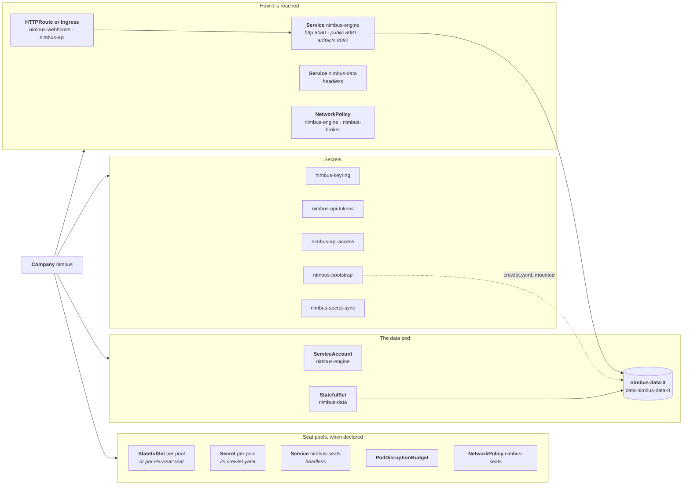
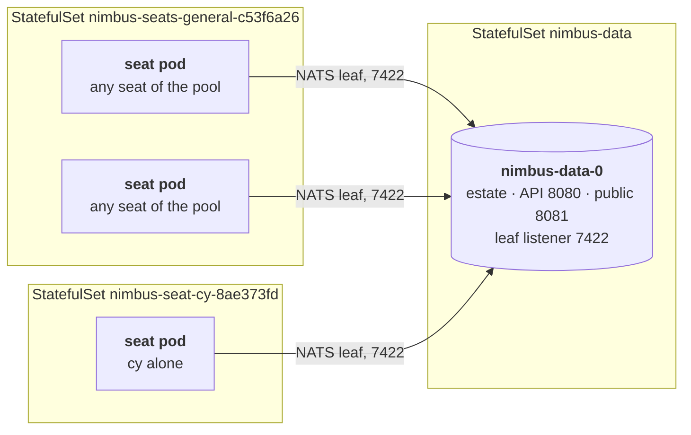

# How a Company's Engine Runs

For every accepted Company the operator runs one Crewlet engine: a data pod
holding its estate, and the seat pools it declares, where its class allows
them.

The data pod is a StatefulSet with one replica, which holds the estate,
serves the engine's API, runs the background workers and runs the seats
placed on it; when the Company declares seat pools and its class allows them,
StatefulSets of stateless seat pods run the other seats. This page describes
what the operator creates for it, how it is reached, how it changes, and what
happens when the Company is suspended or deleted.

An engine starts unconfigured, and its pod is not ready until the config
reconciler has applied the company document: [How the document is
applied](applying.md) describes that half.

---

## What the operator creates

Every object is in the Company's namespace, named after the Company, labelled
`app.kubernetes.io/*` and `crewlet.ai/company: <name>`, and owned by the
Company, so it is deleted with it. For a Company `nimbus`:



| Object | What it is |
|---|---|
| Secret `nimbus-keyring` | The keyring of the engine's encrypted secret store: one key per keyring key, named by the key's id (`key-1`), holding base64 of 32 random bytes, the form `crewlet secrets keygen` prints. The annotation `crewlet.ai/active-key-id` names the key that seals new writes. Generated once and never rewritten. |
| Secret `nimbus-api-tokens` | Two bearer tokens for the engine's API, `operator` (the operator's own, never handed out) and `access` (for the company's consumers). Generated once and never rewritten. |
| Secret `nimbus-api-access` | For consumers: the `access` token under `token` and the API's in-cluster URL under `url`. `status.apiAccessSecretRef` names it. |
| Secret `nimbus-bootstrap` | The data pod's `crewlet.yaml`, rendered as [What the engine is given](company-document.md#the-data-pods-crewletyaml) describes, with the keyring, the API tokens and the object store's keys in it; and the values the EngineClass takes from the platform's own Secrets for the engine's environment (the telemetry headers, `podTemplate.spec.env` values from Secrets), under `otlpHeaders` and `env.<NAME>`. |
| Secret `nimbus-secret-sync` | What the config reconciler last pushed into the engine's secret store: a keyed fingerprint of each value, never the value, by which it decides what to push or remove next ([Applying the document](applying.md)). |
| ServiceAccount `nimbus-engine` | The engine's identity, carrying the class's `serviceAccount.annotations` for a workload identity. Its token is never mounted: the engine does not call the Kubernetes API. |
| StatefulSet `nimbus-data` | The data pod. |
| Service `nimbus-engine` | ClusterIP routing to ready data pods, with three ports: `http` (8080), the engine's API, dashboard and probes, which `status.endpoints.api` and the API's route point at; `public` (8081), the engine's public listener, which the webhooks' route points at; and `artifacts` (8082), the artifact listener, which the artifacts' route points at. It carries the class's `service.annotations`, for a load balancer controller that reads a backend's health check there ([Load balancer health checks](../guides/exposure.md#load-balancer-health-checks)). |
| Service `nimbus-data` | Headless, the StatefulSet's governing Service, publishing each data pod's address before it is ready. |
| HTTPRoute or Ingress `nimbus-webhooks`, `nimbus-api`, `nimbus-artifacts` | The routes the class asks for; see [Exposure](#exposure). |
| NetworkPolicy `nimbus-engine` | With the class's `networkPolicy.mode: Isolated`; see [Network policy](#network-policy). |
| NetworkPolicy `nimbus-broker` | While the class's `seatPools.policy` is `Allowed`, whatever its `networkPolicy` says: who may reach the data pods' leaf listener; see [Network policy](#network-policy). |
| Secret `nimbus-bootstrap-<pool>-<hash>` | A seat pool's `crewlet.yaml` ([A seat pod's `crewlet.yaml`](company-document.md#a-seat-pods-crewletyaml)), with the class's environment values as in `nimbus-bootstrap`. One per pool, a PerSeat pool's seats included. |
| StatefulSet `nimbus-seats-<pool>-<hash>`, `nimbus-seat-<handle>-<hash>` | A Shared pool's pods, and a PerSeat seat's own; see [Seat pools](#seat-pools). |
| Service `nimbus-seats` | Headless, with no port: the seat StatefulSets' governing Service. |
| PodDisruptionBudget `nimbus-seats-<pool>-<hash>`, `nimbus-seat-<handle>-<hash>` | `maxUnavailable: 1` for each Shared pool, and for each PerSeat seat with two pods. |
| NetworkPolicy `nimbus-seats` | While the company runs seat pods: no connection reaches one. |

The operator writes an object only if it does not exist or the Company
controls it. An object of one of these names that someone else created (a
namespace's own `nimbus-engine` Service, a default-deny policy that happens to
share the name) is left alone: the operator would otherwise rewrite it and,
through the owner reference it adds, have the garbage collector delete it with
the Company. The Company reports `RuntimeReady=False` (`Exposed=False` for a
route), reason `NameConflict`, naming the object; rename or delete it, or give
the Company another name. Objects an earlier Company of the same name left
behind are taken over.

The keyring and the tokens are the only objects the operator generates rather
than derives. If a Secret of that name already exists it is used as it is: one
that no object controls is adopted (a [Retain](#deletion) deletion of an
earlier Company of the same name leaves its keyring behind), and one another
controller owns, such as an ExternalSecret, is left to it. That is how a
platform supplies the keyring from its own secret store instead.

Two cases are refused rather than guessed at:

- A keyring Secret that disappears while the company's data StatefulSet or
  data volume claims exist is not generated again: the pods would roll onto
  keys that cannot open the secret store and the configuration revisions
  sealed on the volume. The operator holds the pod back with
  `RuntimeReady=False`, reason `KeyringMissing`, until the Secret is restored
  from a backup (with its `crewlet.ai/active-key-id` annotation), or until
  the claims are deleted, which discards the data; it then generates a new
  keyring. Back the keyring Secret up with the volumes.
- A keyring or tokens Secret that an earlier Company of the same name still
  controls (one deleted with `deletionPolicy: Delete` moments ago, whose
  objects the garbage collector has not removed yet) is not used: it is about
  to be deleted. The pod waits, with `RuntimeReady=False`, reason
  `PreviousCompanyObjects`, and starts once the Secret is gone. The objects
  the operator writes whole (Services, the API access Secret, routes) are
  simply taken over from the earlier Company.

---

## The data pod

| | The data pod |
|---|---|
| **Image** | The class's `engine.image`; with `engine.allowVersionOverride`, its tag replaced by the Company's `spec.runtime.version`. |
| **Command** | `crewlet run -config /etc/crewlet/crewlet.yaml`, the bootstrap Secret's `crewlet.yaml` mounted read-only, readable by the engine's user alone (mode `0440`, group `fsGroup`). |
| **Storage** | One volume claim per pod (`data-nimbus-data-0`) at `/var/lib/crewlet`, from the class's `data.storage`: the store, the event stream (three quarters of the volume, [sized from the claim](company-document.md#the-data-pods-crewletyaml)), and the store's native library cache (`TURSO_GO_CACHE_DIR`), so a restart does not extract it again. Beside it, the `scratch` `emptyDir`, of the class's `data.scratchSizeLimit` (10Gi unless set), on the node's disk, holding `/tmp` and `HOME`: what the processes the engine runs write off the data volume and outside a box, a seat's `Direct` run's writes to `/tmp` or the engine's home among it. And the `sandboxes` `emptyDir` at `/var/lib/crewlet-sandboxes`, of the class's `data.sandboxSizeLimit` (20Gi unless set), on the node's disk: the boxes Crewlet makes on the pod for the seats' executor runs it places there (`Direct`), one for each agent seat of the pod whose run is running and one for each run parked on a person's question, each holding the run's checkout, its CLI's home and what it installs and builds. A pod that writes more to either is evicted; neither limit bounds the data volume ([Box storage](#box-storage)). |
| **Environment** | `CREWLET_NODE_ID`, the pod's name; `HOME`; `CREWLET_MCP_BRIDGE_URL`, the tool bridge's address, which is the Company's public address while it has one, on every engine pod alike (see [Exposure](#exposure)); the OpenTelemetry variables when the class sets `telemetry`, and with them `CREWLET_SANDBOX_OTEL_RECEIVER_URL`, the Company's public address, while the Company has one (see [Exposure](#exposure)); then the class's `podTemplate.spec.env` and the Company's `runtime.env`, merged by name. No credential of the engine's own is an environment variable (see [What the engine is given](company-document.md#the-data-pods-crewletyaml)). All of it is the engine's: a stdio tool server the engine starts is handed only the part of it [Crewlet's allowlist](https://github.com/crewlet/crewlet/blob/main/docs/guides/tools-and-mcp.md#what-a-stdio-servers-environment-is) names, the proxy and TLS variables among it, a coding CLI that part and the variables its Crewlet profile passes through, a box Crewlet makes on the pod (a seat's `Direct` executor run, a deep-work run) that part alone, and a box in `E2B` none of it ([Stdio and HTTP](../guides/tool-servers.md#stdio-and-http)). |
| **Ports** | 8080 (`http`), the API, the dashboard and the probes; 8081 (`public`), the public listener: the webhooks, the telemetry receiver, `/otlp/`, which every seat's executor run exports its traces to at the Company's public address, and the tool bridge, `/mcp/`, which a seat's box on the pod itself dials on loopback and every other run at the public address; 8082 (`artifacts`), the artifact listener, while the company has an artifact origin; and 7422 (`leaf`), the leaf listener seat pods join the event stream through, while the class's `seatPools.policy` is `Allowed`. The headless Service `nimbus-data` names 8080 and 7422; `nimbus-engine` names 8080, 8081 and 8082. |
| **Probes** | `/health` for startup and liveness, `/ready` for readiness. Startup allows at least the class's `data.startupSeconds`, counted from the container's start, or, unset, 1,746 seconds (1,886 when the class keeps files in S3) plus six seconds per GiB of the data volume. The first figure is every bound the engine puts on a data pod's boot, laid end to end, and the API refuses a `startupSeconds` below it: its waits for its own broker and store, never for a peer. One of them grows with what the node holds and is left to the second figure, as the recovery is: the claim of each batch of a seat pod's events the node kept and could not settle, 15 s a batch. The second is for what the engine waits out unbounded: it recovers what it holds on the volume before `/health` answers `200`, which takes longer the more it holds, and a pod restarted mid-recovery starts it again. What the company configures does not count: `/health` answers once the recovery is over, and only then does the engine read the company's secrets, start its tool servers and restore its CLIs' logins, while `/ready` answers `503` `starting` until it serves. Liveness allows a minute of failures before a restart, longer than the 45 seconds in which the engine's watchdog ends a wedged process itself. `/health` answers while the engine drains, so liveness never kills a pod finishing its turns. |
| **Stopping** | A five-second `preStop` sleep, so the endpoint is gone from the Services and Gateways before the engine drains, and the class's `data.terminationGracePeriodSeconds` (default five minutes) for the drain: the turn segments the engine runs in its own process finish, waiting turns are handed back. A seat's executor run is detached from its turn and does not hold the drain: one in `E2B` runs on, and the pod that holds the seat next resumes its turn; one running `Direct` on the pod ends with it, and its box with the pod's `sandboxes` volume, so Crewlet ends it once the pod is back, without resuming its turn (`collect_unreachable`; [When a Direct run's pod stops](#when-a-direct-runs-pod-stops)). |
| **Updates** | `RollingUpdate` with `maxUnavailable: 1`, `podManagementPolicy: Parallel`. |
| **Scheduling** | The class's `podTemplate`: labels, annotations, node selector, tolerations, affinity, topology spread, runtime and priority class; and its `data.resources`. |

The pod runs under the `restricted` Pod Security Standard: as the image's
user (uid 10001, `runAsNonRoot`), with the `RuntimeDefault` seccomp profile,
no privilege escalation and every capability dropped. Its root filesystem is
read-only. The engine writes only to its data volume, its home, `/tmp` and
its sandboxes volume ([Box storage](#box-storage)). A stdio MCP server it
starts is handed the engine's `HOME` and writes to its home and `/tmp`,
which share the scratch `emptyDir` and its limit, and `HOME` is set
explicitly so an image built on another base still has a writable one. A
coding CLI is handed a home, a `TMPDIR` and XDG directories of its seat's
own instead, under
`/var/lib/crewlet/llm-cli` on the data volume (`llm-cli-platform` for a
model the class provides). A seat's executor runs as its CLI's own run in a
box: placed `Direct`, a process tree of the pod in a box on its sandboxes
volume, as the engine's user, with the pod's `PATH`, locale, `TERM`, `TZ`,
TLS trust and proxy variables and none of the rest of its environment;
placed in `E2B`, outside the pod. The sockets a CLI the engine runs in the pod for a seat's
other phases reaches its seat's tools through are the engine's own, in a
directory it makes under its `TMPDIR`, open to its user alone; the operator
leaves `TMPDIR` unset, so that is `/tmp`, on a data pod and a seat pod alike
([Where a seat's executor runs](../guides/cli-agents.md#where-a-seats-executor-runs)).

The pod template carries the annotation `crewlet.ai/bootstrap-hash`, the hash
of the bootstrap Secret's data, which rolls the pod when what it reads at
start changes: a token, a keyring key, the object store's keys, a platform
value, an address the engine is reached at (a Company's `dashboardBaseURL` or
`publicBaseURL`, the class's routes, a Gateway's listener turning HTTPS), or
the document itself. Kubernetes reads a Secret into an environment
variable, and the engine its `crewlet.yaml`, only when the container starts.
It hashes the values rather than naming the Secrets' versions, so a label or
an annotation written to a Secret restarts nothing. A Secret the Company's own
`runtime.env` references is read the same way, but the operator does not
watch it: restart the pod after changing one.

### Box storage

Every engine pod, a data pod and a seat pod alike, has a volume for the boxes
Crewlet makes on the pod itself: the seats' executor runs it places in its
`direct` cell, each a process tree of the pod with a directory of its own under
`/var/lib/crewlet-sandboxes` that holds the run's home, its checkout and
whatever it installs and builds. A seat runs one such run at a time, but a
run parked on a person's question does not hold its seat: the seat runs on,
and its next run gets a box of its own. So a pod holds a box for each agent
seat whose run is running, and one for each run parked on a question, kept
with its processes stopped, and their memory, until the run resumes on its
answer or its pause TTL expires: the Seat's `spec.sandbox.pauseTTLSeconds`,
else the Company's `spec.sandbox.defaultPauseTTLSeconds` (30 minutes unless
set), where 0 removes the box at once. A box is removed when its run is
over.

- **A volume of its own.** Not the data volume, which is the company's
  estate, three quarters of it the event stream: a run that filled it would
  stop the store and the broker, and the company with them. Not `HOME`
  either, where Crewlet keeps its boxes by default: an engine pod's `HOME`
  is on its scratch volume, sized for what the engine's processes write
  outside a box.
- **An `emptyDir` on the node's disk.** A box's run is a process of the pod
  and ends with it. The volume keeps the box through a restart of the
  engine's container, so Crewlet reads back a run the restart cut short, and
  goes with the pod, whose replacement ends the run without resuming its
  turn ([When a Direct run's pod stops](#when-a-direct-runs-pod-stops)). A
  volume that outlived the pod would keep that turn only by giving every
  engine pod, a seat pod too, a volume claim of its own; and a memory-backed
  volume would charge a checkout to the engine container's memory limit.
- **Bounded, not reserved.** The class's `data.sandboxSizeLimit`, for the
  data pods, and `seatPools.defaults.sandboxSizeLimit`, for every seat pod,
  cap it: 20Gi unless set, and at least 1Gi. A pod whose boxes write more is
  evicted by the kubelet, with every run and turn on it (on a data pod, the
  company's API too), and its StatefulSet starts it again on an empty
  volume. The limit takes nothing from the node until the boxes write it:
  the scheduler places the pod by the ephemeral-storage request in
  `data.resources` (`seatPools.defaults.resources`), and an
  ephemeral-storage limit there bounds the container's own writes and every
  `emptyDir` of the pod together, so a class that sets one gives it room for
  the boxes. Changing a limit rolls the pods it sizes.
- **The box, not the run.** The volume bounds what a run writes inside its
  box. Crewlet confines a seat's `Direct` run to nothing: it points the
  run's home and temporary directories (`TMPDIR`, `TMP`, `TEMP`,
  `CLAUDE_CODE_TMPDIR`) into the box, and a command that names a path
  outright writes where the path is. `/tmp` and the engine's home are on the
  pod's scratch volume, whose limit (`data.scratchSizeLimit`,
  `seatPools.defaults.scratchSizeLimit`, 10Gi unless set) evicts the pod as
  this one does, on a seat pod beside its scratch store. On a data pod a
  path under `/var/lib/crewlet` is the data volume, which no `emptyDir`
  limit bounds: a run that filled it would stop the store and the broker.
  Every other place an engine pod writes is bounded, so a run that writes
  without end is stopped at its own pod and never fills the node's disk.
- **Not a deep-work run's.** The Dashboard Assistant's deep work, when it
  runs on the data pod rather than in `E2B`, is a box Crewlet makes beside
  its store, on the data volume (`/var/lib/crewlet/store/assistant-boxes`),
  whatever this volume: no `sandboxSizeLimit` bounds what it writes, and a
  run that filled the data volume would stop the store and the broker
  ([Deep work](../guides/cli-agents.md#deep-work)).

### When a Direct run's pod stops

A seat's `Direct` executor run is a process tree of the engine's container:
detached from the engine's process, but not from its container, and no drain
waits for it. What Crewlet makes of a run cut short turns on whether its box
is still on the pod's `sandboxes` volume when the pod's engine is back:

- **The engine's container restarts in its pod**, a liveness restart or the
  container killed for its memory: the `emptyDir` keeps the box. The engine
  finds the run's processes gone and collects the run from its box as one
  that did not finish, and the seat's turn resumes with what it did.
- **The pod is replaced**, by a rolling update, a drain, an eviction or the
  loss of its node: the pod that comes back under the same name starts on
  an empty volume. The engine finds the box gone and ends the run at once,
  without resuming its turn: `sandbox_run_failed`, reason
  `collect_unreachable`. The turn is lost; what the run pushed is on its
  branch.
- **The pod does not come back** within the Company's
  `spec.sandbox.defaultTimeoutSeconds` (15 minutes unless set), as when a
  seat pool is scaled down or removed: the fleet ends the run as
  `launch_node_gone`, its turn lost the same way.

Nothing relaunches a run that ends either way; the seat's next turn starts a
new one. A run in `E2B` is outside the pod, carries on through all three,
and the pod that holds its seat next resumes its turn.

---

## Seat pools

A Company's `spec.topology.seatPools` are stateless pods that run seats:
Crewlet with `node.roles: [seats]` alone, a scratch store deleted at every
start, joined to the data pods' event stream as a NATS leaf. The class's
`seatPools.policy` must be `Allowed`, with a `maxPods`; its `allowPerSeat`
and `maxPods` bound what a Company may run, and its
`seatPools.defaults.resources` what each seat pod may take. Where each seat runs is decided by its `Seat`'s
`spec.placement.pool` ([Placement](company-document.md#placement)).
[Choosing where seats run](../guides/topology.md) says when a company needs
pools, and which kind.



| | Shared pool `general` | PerSeat pool, seat `cy` |
|---|---|---|
| StatefulSet | `nimbus-seats-general-c53f6a26` | `nimbus-seat-cy-8ae373fd`, one for each seat placed in the pool |
| Replicas | the pool's `replicas`, 0 to 100 | the pool's `replicas`, 1 or 2 (a warm standby) |
| Selector | `crewlet.ai/pool: general`, and no `crewlet.ai/seat` label | `crewlet.ai/seat: cy` |
| Environment | `CREWLET_NODE_ID`, the pod's name; `HOME`; `TURSO_GO_CACHE_DIR` on the scratch volume; the OpenTelemetry variables, `CREWLET_SANDBOX_OTEL_RECEIVER_URL` and `CREWLET_MCP_BRIDGE_URL` as on a data pod; the class's and the Company's variables, as on a data pod | the same, and `CREWLET_SEAT: cy` |
| Storage | one `emptyDir` at `/var/lib/crewlet`, of the class's `seatPools.defaults.scratchSizeLimit` (10Gi unless set), holding the scratch store, the store's native library, `/tmp` and `HOME`: the limit bounds what the processes the engine runs write too, a seat's `Direct` run's writes to `/tmp` or the engine's home among it; and the `sandboxes` `emptyDir` at `/var/lib/crewlet-sandboxes`, of the class's `seatPools.defaults.sandboxSizeLimit` (20Gi unless set), for the boxes of the pod's seats, as on a data pod ([Box storage](#box-storage)) | the same |
| Stopping | the pool's `terminationGracePeriodSeconds`, else the class's default, else five minutes: the turn segments the engine runs in its own process finish, waiting turns are handed back, and the seats are released with their mailboxes for another pod to claim. A seat's executor run is not waited for: one in `E2B` runs on, and the pod that holds the seat next resumes its turn; one running `Direct` on the pod ends with it, and its box with the pod's `sandboxes` volume, so Crewlet ends it without resuming its turn, as `collect_unreachable` once a pod of the same name is back, or as `launch_node_gone` once the pod has been gone for the Company's `spec.sandbox.defaultTimeoutSeconds` ([When a Direct run's pod stops](#when-a-direct-runs-pod-stops)) | the same |
| Port and probes | 8080, the probes, and the tool bridge and telemetry receiver of the pod's own `Direct` boxes, to loopback alone: `/health` for startup (1,142 seconds, 1,192 with an S3 object store) and liveness, `/ready` for readiness | the same |
| Updates | `RollingUpdate`, `maxUnavailable: 1`, `podManagementPolicy: Parallel`, `minReadySeconds: 10` | the same |
| Resources | the class's `seatPools.defaults.resources`: the class sizes every seat pod, as it sizes the data pods, and a Company chooses only how many its pools run, within `maxPods` | the same |

A seat pod runs as a data pod does, under the `restricted` Pod Security
Standard, as the engine's ServiceAccount with no token mounted, scheduled by
the class's `podTemplate`, and on the data pods' image: it never runs another
version than the data pods.

A seat pod binds **port 8080 for its probes and its own boxes**, and no
public listener. A node
without the `ingress` role serves `/health` and `/ready` on its `api.port`,
and, to a caller on the pod's own loopback alone, the tool bridge and the
telemetry receiver its seats' `Direct` boxes dial, which needs the port
bound on every interface, as the operator binds it; it refuses every other
route, and every other caller of those two, as an unknown one, with no API
token to accept. A seat's executor run in `E2B` calls the data pods' bridge
at the Company's public address, which every engine pod is given as
`CREWLET_MCP_BRIDGE_URL`, and the data pod a call reaches relays it back
over the broker the seat pod dials out to (see [Exposure](#exposure)).
Nothing off the pod dials the port but the kubelet, which probes the pod from
its own node, and traffic from a pod's own node is not policed (Kubernetes
documents it as always allowed, and Calico and Cilium hold to that; see
[Network policy](#network-policy)): the seat pods' policy, which admits no
pod at all, leaves the probes alone. The headless Service that governs the
pods publishes no port.

The probes are the data pod's: `/health` answers while the process is alive,
through a drain, and liveness restarts it after a minute of failures, the
backstop for a process too wedged for the engine's own watchdog to end
(with code 75) within 45 seconds. Startup allows at least 1,142 seconds,
about 19 minutes, or 1,192 when the class keeps files in S3: every bound
the engine puts on a seat pod's boot, laid end to end. Most of them wait on
the data pod: a minute for the leaf link to reach it and its JetStream to
answer, five for the streams the seat pod uses, five more for the
coordination buckets, and the object store's three minutes on the event
stream, or four for the probe of an S3 bucket. Past any of them the engine
exits by itself (a seat pod that cannot reach a data pod at all exits after
the first minute), so the kubelet never ends a boot the engine would
finish. Nothing on it grows with what the company holds: the engine lists the
company's secrets after `/health` answers. `/ready` answers whether the pod is
**doing its work**, and is `503`, its JSON body naming the first reason in
`reason`, while it

- has not finished its boot (`starting`): it is building what the company
  configures, the company's secrets first, and while the secret store does
  not answer it logs `secret_store_unreadable` and asks again for as long as
  it runs;
- is stopping (`draining`);
- cannot reach the data pods' broker (`broker_unlinked`);
- runs no company document yet (`unconfigured`);
- cannot apply the revision its peers run (`shed`, `stuck`);
- does not hold its presence lease, so the fleet does not count it
  (`no_presence`);
- was not admitted by its latest placement pass, every five seconds, to
  claim seats (`admission_withheld`): no data pod has answered yet that its
  copy of the company's records admits a seat, or the pod cannot serve the
  seats it holds.

A seat pod is ready, then, once it has joined the fleet and may claim seats,
and a rollout replaces the next pod only after that and
`minReadySeconds` (two placement passes, in which the pods already running
give back to it what is past their share of the pool's seats). The engine
would judge a node started in one of its maintenance modes without
`admission_withheld`, since such a node claims no seat by design; the
operator runs every engine in the normal mode, so on a seat pod the reason
always means what it says.

A seat pod that is not ready may still hold seats: one its placement pass
does not admit keeps what it holds, and one that lost its link or its
presence keeps its leases until they lapse. Stopping it drains it, which
hands back what it holds.

The operator leaves a seat StatefulSet's rollout to the StatefulSet
controller. With the `MaxUnavailableStatefulSet` feature on, as it is by
default, a rolling update of a `Parallel` StatefulSet first replaces every
pod of an older template that is not available, all at once and past
`maxUnavailable`: one that is not ready, and one ready for less than
`minReadySeconds`. Then it replaces the available ones, highest ordinal
first, one at a time for a seat StatefulSet: the next once no pod of it is
unavailable. So a seat pod that only a new template would let join is
replaced as soon as that template lands. What it costs is that every seat
pod of the StatefulSet that is not available then, ready or not, stops at
once and hands back the seats it holds. A change that rolls the data pods
and the seat pods alike (an image, the keyring) gives the seat StatefulSets
their new template as soon as every data pod is ready again, so every seat
pod that has not rejoined the restarted data pods by then is replaced
together.

A seat pool's objects are named `<company>-seats-<pool>`,
`<company>-seat-<handle>` and `<company>-bootstrap-<pool>`, then a dash and
eight hexadecimal digits of a hash of the Company's name, the kind of object
and the pool or handle. The hash keeps a pool or a handle from spelling
another Company's fixed name in a shared namespace (a pool named `keyring`
of Company `a` would otherwise make `a-bootstrap-keyring`, Company
`a-bootstrap`'s keyring). Names are held to 52 characters, the most a
StatefulSet's pods' `controller-revision-hash` label leaves room for: a
longer one keeps its first 43 characters before the hash. Each Seat's
`status.placement.workload` names the StatefulSet that runs it.

### The seat pods follow the data pods

- **Start.** A seat StatefulSet is created, and a pool gains pods, only while
  every data pod is ready and runs the current template: a leaf that finds
  no data pod to join within a minute fails to start. Taking pods away
  never waits.
- **Rollout.** A change that rolls the data pods (an image, the keyring, the
  class's `seatPools.policy`) rolls them first. The seat StatefulSets keep
  their template, and their Secrets, until every data pod is ready on the
  new one, and then every seat StatefulSet takes its new template in the
  same reconcile. Meanwhile the Company reports `SeatsPlaced=False`, reason
  `RolloutBlocked`, naming each seat StatefulSet whose template differs from
  the one it would be given now, whatever differs in it. A change to a pool
  alone rolls its pods at once.
- **Suspension.** `spec.suspend` scales every seat StatefulSet to zero, and
  the data StatefulSet only once no seat pod is left: a stopping seat pod
  hands its last records to a data pod, the only kind that keeps them.
  Each seat StatefulSet records how many pods it ran
  (`crewlet.ai/suspended-replicas`). Resuming starts the data pods, and the
  seat pods once those are ready: as many as each pool's `replicas` asks,
  and for a StatefulSet kept only for the running revision, or frozen while
  the Company is refused `PoolCapacityExceeded`, as many as it ran.
- **A data pod outage.** Every seat pod turns unready (`broker_unlinked`,
  or `admission_withheld` while no data pod admits it), and the Company
  reports `SeatsPlaced=False`, `PoolEmpty`, for every pool. A seat pod that
  cannot reach the estate for more than a minute releases its seats, and one
  that restarts meanwhile crash-loops; with Kubernetes' back-off it may take
  up to about five minutes to rejoin after the data pod returns. Liveness
  does not restart a pod for the outage: `/health` answers while the process
  runs. One data pod is a single point of failure for the whole company.

### A pool removed while seats still run in it

The engine places a seat only on a pod whose labels match its pin, never
anywhere else, so a pod stopped while its seat is still pinned to it leaves
the seat held by nobody until another revision moves it. The config
reconciler records where the revision the engine runs pins its seats, in
`status.config.placement` ([What each object
reports](applying.md#what-each-object-reports)). A seat StatefulSet the
Company no longer asks for, because its pool was removed or its seat moved
elsewhere, keeps running, at the size it is, for as long as that record pins
a seat to it, and is deleted with its disruption budget and, once no
StatefulSet of the pool is left, the pool's Secret, as soon as a revision
that pins nothing to it runs. Meanwhile it still follows the data pods: it
takes their new image and keyring once they are ready on them, with the
grace period and turns its pool had when the operator last wrote it (the
annotation `crewlet.ai/seat-pool` records them), and the class's current
resources, since a pod restarted from an image or a keyring the data pods
have left would not join them. A document that cannot be applied therefore
keeps the pool running with the revision that needs it. A Seat still placed
in the removed pool does not hold the document: it is reported
(`ResolvedRefs=False`, `PoolNotFound`) and applied pinned where it runs
(`Applied=False`, `PlacementPending`, below), so the removed pool's
StatefulSet keeps running it as the operator last wrote it until the Seat
names a pool the Company declares. `SeatsPlaced` names the StatefulSets kept
that way.

A seat moved to another pool keeps running where it runs until a pod of its
new pool is ready: the config reconciler keeps it pinned where the revision
the engine runs pins it, reports `Applied=False`, reason `PlacementPending`,
on the Seat, and moves the pin with the first revision it writes once the
StatefulSet of the new pool (the seat's own, for a PerSeat pool) has a ready
pod. The old pods stay for as long as that revision pins the seat to them,
so the move is one release and one claim, a turn boundary apart, rather than
a seat held by nobody while the new pod is scheduled, pulled and started. A
pool that never gets a ready pod (one at `replicas: 0`) keeps the seat where
it is, and says so.

### What the class allows

| The class | What the operator runs |
|---|---|
| `seatPools.policy` is not `Allowed` | No new seat pod, and the Company's document is refused while it declares pools: `SeatsPlaced=False`, `SeatPoolsNotAllowed`. The engine keeps running its last revision, so the seat StatefulSets that revision pins seats to keep running, and the data pods keep their leaf listener open for them, until a revision that pins every seat to the data pods runs; then the seat pods go and the data pods roll to close the listener. A company with no seat pinned to a seat pod has its data pods rolled at once: changing the policy opens or closes the listener. |
| A Seat in a PerSeat pool without `allowPerSeat`, or one whose pods would pass `maxPods` | No pod for that seat; the Seat reports `Applied=False`. The PerSeat seats are admitted in one order: first those the running revision already runs in pods of their own, then the rest, each group oldest first (by creation, then by handle). The first seat whose pods would pass `maxPods` is refused, and so is every seat after it, so a seat moved into a full pool is refused rather than the one already running there. |
| `maxPods` that the Shared pools' replicas alone pass | Every seat StatefulSet keeps its size, and none is created: `SeatsPlaced=False`, `PoolCapacityExceeded`. Their pods still follow the data pods' image and keyring. |

### Disruptions

A Shared pool's StatefulSet, and a PerSeat seat's with two pods, has a
PodDisruptionBudget of `maxUnavailable: 1`, so a node drain takes one pod at
a time while the others keep the seats; a PerSeat seat with one pod has
nothing to keep and gets none. Pods that are not ready may always be
evicted (`unhealthyPodEvictionPolicy: AlwaysAllow`). Such a pod may still
hold seats, but an eviction drains it like any stop, which hands them
back, and a budget that counted it would hold up a node drain for as long
as the pod stays unready, for ever for one that cannot start. Moving seats
between pods interrupts them: each move releases the seat, starts its tool
servers on the new pod and rehydrates its memory there.

---

## Changes, versions and suspension

A change to the class or the Company that changes the pod (an image, the
resources, a toleration, the bootstrap document) rolls the data pod. The data
volume is the exception: a StatefulSet's volume claims cannot change, so a
class's `data.storage` applies to companies created after it changes, and an
existing company keeps its volume until its owner grows it.

### Growing a company's data volume

A company's event stream is three quarters of its data volume, and the
engine refuses to boot on a stream smaller than what a fresh node reserves
([the class's floor](company-document.md)). A volume made under an older
floor, or before an engine that keeps more on its stream, can fall short, and
a company that keeps more than its volume holds needs room too. Grow the
claim, not the class:

1. The claim's StorageClass must allow it (`allowVolumeExpansion: true`);
   the API server refuses an expansion otherwise.
2. Expand the data pod's claim, `data-<company>-data-0`:

   ```bash
   kubectl patch pvc data-acme-data-0 -n acme \
     -p '{"spec":{"resources":{"requests":{"storage":"16Gi"}}}}'
   ```

3. Once the volume has grown (the claim's `status.capacity` shows the new
   size; some drivers finish the resize only when the pod mounts the volume
   again, which a pod the engine refused to boot does by itself), the
   operator gives the stream three quarters of it, the startup window grows
   with it, and the data pod rolls onto the new `crewlet.yaml`.

The operator reads the size the claim has, the smaller of what it asks for
and what it was given, and never less than the size it was made with, so an
expansion counts once it has landed and a provisioner that rounded a claim up
moves nothing. The class's `data.storage.size` is not involved, and the
StatefulSet keeps the template it was created with. A StorageClass that
cannot expand leaves only a new volume: take a backup and keep the keyring
Secret with it ([Backups](#backups)), then restore it onto a large enough
volume as Crewlet's backup guide describes.

The engine migrates its data forward only. The operator records the image the
data pod last ran *and was ready on* in `status.engine.image`, and its tag in
`status.engine.version`, and records that version on each data volume claim
as the annotation `crewlet.ai/engine-version`, which outlives the status: a
Company created again over retained volumes, or restored from a backup that
dropped its status, still knows what its data was last run on. A Company or
class that asks for an image whose tag is older, as a semantic version, than
the newest of the two is refused with `RuntimeReady=False`, reason
`DowngradeRefused`; the pod keeps running the newer image, and every other
change still applies. A version that never became ready is never recorded, so
a rollout that failed can be taken back. Tags that are not versions
(`latest`, Crewlet's `main`, a commit) are not compared, and neither is an
image named by digest alone, so nothing refuses a move back to an older
commit of Crewlet's `main`: a platform that runs one keeps its classes
moving forward, or tags its copies with versions
([Engine image](../guides/installing.md#engine-image)).
`spec.runtime.version` on a class without `allowVersionOverride` is refused
the same way, with `VersionOverrideNotAllowed`.

`spec.suspend: true` scales the StatefulSet to zero and keeps the volume claim
(the StatefulSet's retention policy keeps claims on scale-down whatever
`deletionPolicy` says). A company with seat pools stops them first, and its
data pods only once no seat pod is left ([The seat pods follow the data
pods](#the-seat-pods-follow-the-data-pods)): meanwhile `RuntimeReady` is
`False` with the reason `Suspending`. Once the data pods are stopped the
Company reports `Ready=False` and `RuntimeReady=False`, both with the reason
`Suspended`. Setting it back starts the engine on the same volume. Suspending takes effect whatever else is wrong
with the Company: one that is not `Accepted` (its class is gone, or it is over
its class's limits) is still scaled to zero, so a tenant cannot keep a
suspended engine running by breaking its own Company. `Ready` says the engine
is stopped only once `RuntimeReady` reports it for the current generation.

When the operator cannot give the pod what it needs, it holds the pod back
and keeps what runs: a keyring Secret it cannot read as a keyring
(`KeyringInvalid`; the operator never rewrites a keyring, since the engine's
sealed data opens only with its keys), a tokens Secret the platform supplied
that lacks a token or holds one shorter than 43 characters or outside
base64, base64url and hex (`APITokensInvalid`), a platform Secret the
class references that is missing (`SecretNotFound`), or a class that lets
people sign in with a password alone at an address Crewlet does not read as
loopback without acknowledging it (`InsecureSignInNotAcknowledged`; Crewlet
refuses to start so, [Two-step
verification](../guides/people.md#two-step-verification)), or an address the
engine would be told it is reached at that Crewlet refuses to start on
(`AddressRefused`): the API refuses such an address where a Company or its
class states it, so this is in practice the class's API route made of a
Company's namespace or name, whose last label is a number as
`{{name}}.{{namespace}}`'s is in a namespace named `4711` or `0x1f` ([Reach
the API from elsewhere](../guides/exposure.md#reach-the-api-from-elsewhere)).
Suspending still scales the pod to zero meanwhile.

---

## Exposure

A data pod's engine listens on two ports. Port 8080 (`api.port`) serves its
API, its configuration and secret store, the dashboard and the probes, and
stays inside the cluster unless the class routes the API through an
internal gateway. Port 8081 (`api.public`), the **public listener**, serves
only the routes outside parties call without an operator credential:
vendors' webhooks under `/webhooks/`, and a coding run's per-run
telemetry (`/otlp/{token}`) and tool bridge (`/mcp/{token}`). Crewlet
decides which routes are public, from one list of its own; the public
listener answers every other path as one nothing serves, and port 8080
answers a public route with `404` and a hint naming the public listener.
Every data pod opens both, whatever its class routes, so which routes each
port serves is a fact about the pod and the API's route never serves
`/webhooks/`. The engine is told where each is reached (its `crewlet.yaml`'s
`api.external_url` and `api.public.external_url`), which it reads only at
start, so a class that starts or stops routing either restarts the data pod.
A change of the public address restarts the seat pods too, once the data pod
is ready again: each is given that address as the tool bridge's (below).

| Class `exposure.webhooks.mode` | What the operator creates | `status.endpoints.publicBaseURL` |
|---|---|---|
| `Gateway` | HTTPRoute `<name>-webhooks` on the class's Gateways: the expanded `hostname`, every path, to the engine Service's port `public` | `spec.exposure.publicBaseURL`, else `https://<hostname>` |
| `Ingress` | Ingress `<name>-webhooks`: the class's IngressClass, annotations and TLS Secret, the expanded `hostname`, every path, to port `public` | the same |
| `External` | Nothing: something outside the operator forwards to `<name>-engine:8081` | `spec.exposure.publicBaseURL`, which is required |
| `None` | Nothing | unset |

While `status.endpoints.publicBaseURL` is unset, the engine is told its public
listener is reached at its address inside the cluster,
`http://<name>-engine.<namespace>.svc:8081`, since Crewlet requires an address
of a listener it opens: a webhook address or an app manifest the engine builds
on it is one no vendor can reach.

The route names no path prefix. The public listener is the boundary: the
admin API is not on its port to be reached by any path, and a route that
repeated the engine's list of public prefixes would only be a second list,
which a Crewlet release that serves a new public route would outgrow with
nothing to say so ([Exposure and network policy](../guides/exposure.md)).

The public address is also where a coding run calls the engine back:

- Every engine pod is given the public address as `CREWLET_MCP_BRIDGE_URL`,
  the address of the engine's [tool
  bridge](https://github.com/crewlet/crewlet/blob/main/docs/concepts/code-sandbox.md#the-tool-bridge--a-seats-own-tools-from-inside-a-box):
  every agent seat's executor is its coding CLI's run in a box, which calls
  the seat's own tools back at `/mcp/{token}`, each request carrying a token
  signed for its one run, which expires with it. A seat's box on its engine
  pod's own host, a `Direct` one, dials that pod's own listener on loopback,
  which the engine derives itself: a data pod's public listener, and a seat
  pod's port 8080, which serves the route to loopback alone. So the variable
  is for every other run: a box in the Company's E2B sandbox, wherever its
  seat runs, which reaches Crewlet's bridge at the fleet's address, the same
  on every node, the data pod a call reaches relaying it over the broker to
  the pod holding the run's seat, a seat pod included (see [Seat
  pools](../guides/cli-agents.md#seat-pools)); and the Dashboard Assistant's
  deep work, which Crewlet holds to the fleet's address wherever it runs, a
  `Direct` run on the data pod included. The data pods must therefore be
  able to reach the public address: under `networkPolicy: Isolated` the
  operator lets them reach the route's proxies, where such a call lands
  inside the cluster, and a load balancer the call leaves the cluster
  through must be outside the class's `egress.exceptCIDRs` ([Network
  policy](#network-policy)). A company with no public address gives no pod
  the variable, and Crewlet refuses the launch of every run in `E2B` and of
  deep work, while every seat's `Direct` run still runs; each Seat whose
  runs need it says so on its `Ready` condition. The variable follows the
  public address alone, never the cells the company's runs are placed in,
  which the engine applies with the document and no restart, so moving a
  provider between them rolls no pod.
- While the class sends the engine's telemetry to a collector
  (`spec.telemetry`), every engine pod is given the public address as
  `CREWLET_SANDBOX_OTEL_RECEIVER_URL`: a seat's executor run in `E2B`
  exports its traces to `/otlp/{token}` there, with a token signed for its
  run, and the engine forwards them to the collector with the class's
  headers, which never enter a box. Any engine pod of the company verifies
  the token, since all share the keyring. A `Direct` run exports the same
  way to its own engine pod's listener on loopback, with or without a
  public address.

`exposure.api.mode` `Gateway` or `Ingress` creates `<name>-api` the same way,
for every path of port `http`, and `status.endpoints.exposedAPI` is its
address once the route is accepted: `https://` when the Ingress has TLS or a
Gateway listener the route attaches to is HTTPS. `status.endpoints.api` is
always the in-cluster address, `http://<name>-engine.<namespace>.svc:8080`.

`exposure.artifacts.mode` `Gateway` or `Ingress` creates `<name>-artifacts`
for every path of port `artifacts` (8082, `api.artifacts`), on `*.<hostname>`
or, under `origins: Shared`, `<hostname>`. `status.endpoints.artifactsBaseURL`
is the Company's `spec.exposure.artifactsBaseURL`, else the route's address
while it serves `https`; the data pod opens the artifact listener only while
it is set ([Serve artifacts from an origin of their own](../guides/exposure.md#serve-artifacts-from-an-origin-of-their-own)).

`status.endpoints.dashboardBaseURL` is where a browser reaches the engine,
its dashboard and its people's sign-in: the Company's
`spec.exposure.dashboardBaseURL`, else the API route's address on the same
scheme as `exposedAPI`, without waiting for the route to be accepted, since a
flip of acceptance would otherwise restart the data pod, else
`http://localhost:8080`, where `kubectl port-forward svc/<name>-engine 8080`
serves it. It is the engine's `api.external_url`, never the public address,
whose listener serves no dashboard: the engine accepts a person's write only
from its origin, makes the session cookie `Secure` when it is `https`, and
builds every link a person follows on it, an invitation's included. With the
third, those links lead to a `localhost` only a port-forwarding browser
reaches, and the `Exposed` condition's message says so. When the Company's
own address is not the route's, the route stays an origin the engine accepts
(`api.auth.allowed_origins`).

The `Exposed` condition is `True` with the reason `RouteAccepted` once every
route exists and was accepted: an HTTPRoute when each Gateway it names reports
it `Accepted`, an Ingress when its controller published an address for it.
Until then it is `False` with `RouteNotAccepted` and what the controller
reported. A class that routes nothing gives `Exposed=True` with `NoRoutes`.
`External` without the Company's `publicBaseURL` is `PublicBaseURLMissing`, and
an artifacts route with no HTTPS Gateway listener `RouteNotHTTPS`.

The Gateway API is optional. The operator checks for its HTTPRoute kind when
it starts and runs without it; a class that routes through Gateways is then
reported as `GatewayAPINotInstalled`. Install the Gateway API and restart the
operator to use it. An HTTPRoute in a tenant's namespace attaches to a Gateway
in another only if the Gateway's listener admits routes from that namespace
(`allowedRoutes.namespaces`).

---

## Network policy

With the class's `networkPolicy.mode: Isolated` (the default) the operator
creates a NetworkPolicy that selects the company's data pods and admits
traffic to port 8080 only from:

- the operator's own pods, so it can reach the engines it configures;
- the class's `networkPolicy.apiConsumers`, for a platform's own components;
- the namespaces the API's route arrives from: `exposure.api`'s
  `gateway.proxyNamespaces`, or the namespaces of its Gateways when unset
  (right for implementations that run a proxy beside each Gateway), or its
  `ingress.controllerNamespaces`, which `Isolated` requires;

and to port 8081 only from where the webhooks' route arrives from: the same
fields of `exposure.webhooks`, or its `external.forwarders`; and to port 8082
only from where the artifacts' route arrives from. No port admits another's
sources, so a webhook's proxy reaches no admin route and an API consumer
cannot reach the port published to the internet. Everything
else is refused. Outward, the engine, which runs code its tenant
supplies, may reach DNS, the pods of its own namespace, the class's
`networkPolicy.egress.to`, whatever port 8081 admits (the webhooks route's
proxies or forwarders), and every address but the cloud metadata
endpoints and the class's `networkPolicy.egress.exceptCIDRs`, where the
cluster's own networks belong ([Network policy](../guides/exposure.md#network-policy)).
The route's proxies are there because a data pod calls the Company's own
public address, for the Dashboard Assistant's deep work, and inside the
cluster that call usually lands on a proxy's pod without leaving it, where
an address outside `exceptCIDRs` does not admit it.

Two more policies come with seat pools:

- `nimbus-broker` exists while a data pod opens the leaf listener, **whatever
  `networkPolicy.mode` says**: while the data pods' template opens it (the
  class allows seat pools, or the running revision still pins a seat to a
  seat pod), and for as long as any data pod that runs, or is stopping, was
  started from a template that opened it (the pod's annotation
  `crewlet.ai/leaf-listener: open`), however long the rollout that closes it
  takes or is held back. Crewlet's leaf listener accepts any
  connection, with no authentication and no TLS, and whoever joins it reads
  and writes the company's whole event stream. It selects the data pods and
  admits port 7422 only from pods labelled as this company's seat pods. Under
  `None` it also admits ports 8080, 8081 and 8082 from anywhere, which keeps
  the API, the public listener and the artifact listener as open as they are
  without a policy and closes only the broker.
- `nimbus-seats` exists while the company runs seat pods. It selects them and
  admits nothing: a seat pod serves no other pod, and the kubelet probes it
  from its own node, which no policy polices, nor the pod's own `Direct`
  boxes, which call it on loopback. Under `Isolated` it also holds them to
  the data pods' egress, without the route's proxies, which nothing on a
  seat pod calls, and with port 7422 of the data pods.

NetworkPolicies are additive: a pod two policies select is open to what
either admits. That is why `nimbus-engine` and `nimbus-broker` select the data
pods alone and never a seat pod, and why the isolation of the seat pods holds
only while no policy of anyone else's selects them.

> **Caution: the namespace is the trust boundary.** A policy selects pods by
> their labels, and whoever can create a pod in the namespace can give it a
> seat pod's labels and join the company's event stream; they can also mount
> the company's keyring Secret into it and open its secret store, which no
> policy governs. Companies that must not read each other's streams and
> secrets need namespaces of their own, or a namespace where nobody but the
> operator creates pods.

Two more limits hold for every NetworkPolicy, on most CNIs (Calico and
Cilium among them): traffic from the node itself, and from `hostNetwork` pods
on the data pod's node, is not policed. And the leaf link carries the event
stream (turn transcripts, tool results) unencrypted over the pod network:
where that network is not trusted, run a CNI that encrypts it (WireGuard or
IPsec, as Calico and Cilium offer).
A CNI that enforces NetworkPolicy is required for any of this to hold. Some
Gateway implementations deliver traffic from the node rather than from a pod
(Cilium's, for example), which no NetworkPolicy can admit by namespace; with
those, set `networkPolicy.mode: None` and isolate the engines with the CNI's
own policy.

---

## Deletion

A Company carries the finalizer `crewlet.ai/company`. When it is deleted, the
operator:

1. deletes every seat StatefulSet and waits until no seat pod is left, each
   draining into a data pod as on any stop; then
2. deletes the data StatefulSet and waits until no data pod is left, each
   draining as on any stop. Under `Retain` the StatefulSet is deleted with
   the `Orphan` propagation policy and the operator deletes its pods itself:
   a claim the StatefulSet controller made while the policy was `Delete`
   carries an owner reference to the StatefulSet until that controller next
   syncs, and a background deletion would have the garbage collector delete
   the claim with it. Orphaning releases every claim first;
3. settles the data volume claims as `spec.deletionPolicy` says: `Delete`
   deletes them; `Retain` (the default) keeps them, and releases the keyring
   Secret from the Company so it is kept too, since the volumes cannot be read
   without it;
4. removes the finalizer, after which Kubernetes deletes the rest.

A Company created again with the same name and namespace after a `Retain`
deletion adopts the kept keyring and finds its volume, and with it its estate.
To discard a retained company for good, delete the claims first and the
keyring Secret after them: a Company that finds its claims without its
keyring holds its pod back rather than generate a keyring that cannot open
them (`KeyringMissing`).

---

## Status

The Company's status is written by two reconcilers, each owning its own
fields and writing them with an optimistic lock, so neither overwrites the
other:

| Field | Written by |
|---|---|
| `conditions` `Accepted`, `RuntimeReady`, `Exposed`, `SeatsPlaced`, `Ready` | the runtime reconciler (this page) |
| `observedGeneration`, `engine`, `topology`, `endpoints`, `apiAccessSecretRef` | the runtime reconciler |
| `conditions` `SecretsSynced`, `ConfigApplied`, `EngineHealthy`, `IdentityClaimed`; `config` | the config reconciler, which [applies the company document](applying.md) |

`Ready` is `True` when `Accepted`, `RuntimeReady`, `Exposed` and
`ConfigApplied` all are. Otherwise its reason is the reason of the first of
them that is not, in that order, or `ConfigPending` while `ConfigApplied` has
not been reported for the Company's current generation; a suspended Company
reports `Suspended`. `ConfigApplied` is `True` only once the engine reports
the epoch of the operator's revision applied, not when the write returns
(`Applying` in between, `ApplyFailed` when the engine did not apply it). So
`Ready=True` with an `observedGeneration` equal to `metadata.generation`
means the engine runs the document of that generation, which is what a
client waiting for a change to take effect checks.

`status.topology` counts the pods: `data` the data pods', and `seatPools`
each declared pool's, every seat's StatefulSet together for a PerSeat pool,
with how many agent seats the pool runs. `SeatsPlaced` says whether every
pool an agent seat is placed in, `data` included, has a ready pod (a seat
pod is ready once it has joined the fleet and may claim seats):

| Status | Reason | When |
|---|---|---|
| True | `AllPoolsServing` | Every pool with a seat has a ready pod. |
| False | `PoolEmpty` | A pool with a seat has no ready pod: a Shared pool at zero replicas, a PerSeat seat's pods down, pods that cannot reach or are not admitted by the data pods, or pods not created yet because the data pods are not ready. The message names them; their seats' messages wait. |
| False | `RolloutBlocked` | Seat StatefulSets keep their template until the data pods are ready on theirs. |
| False | `SeatPoolsNotAllowed`, `PoolCapacityExceeded` | The class runs none of the Company's seat pods, or keeps them as they are; see [What the class allows](#what-the-class-allows). |
| False | `Suspended` | The Company is suspended. |

`SeatsPlaced` is not part of `Ready`: a Shared pool scaled to zero parks its
seats on purpose. Its message also names the seat StatefulSets kept for the
running revision, and how many Seats are refused a pool.

Which pod runs each seat is the engine's to decide, and each agent Seat
reports what the engine says: `status.placement.node` names the pod that holds
its lease, and its `Ready` is `True` (`LeaseHeld`) while one does and `False`
(`Unplaced`) while none does ([What each object
reports](applying.md#what-each-object-reports)).

`EngineHealthy` is the engine's own alarm table, read from its `/health` each
time the config reconciler reaches it: `True` (`NoAlarms`), `False` (`Alarms`,
with how many and the one standing longest) or `Unknown`
(`AlarmsNotReported`, before the engine has evaluated them). `Ready` does not
include it: an engine with an alarm still runs the company.

---

## Backups

The operator takes no backup, and Crewlet needs them for more than recovery:
it trims every one of its state logs only behind a verified backup younger
than its `stream.tracker_retention.backup_max_age`, 24 hours by default,
which the operator leaves as it is
([a company that never backs up never trims](https://github.com/crewlet/crewlet/blob/main/docs/guides/retention.md#a-company-that-never-backs-up-never-trims)).
Without one the logs grow until they reach the ceilings the data volume is
sized for, and the engine then refuses ordinary writes. A new company raises the `backup_age` and `trim_blocked` alarms from
the start, which `EngineHealthy=False Alarms` shows.

Take backups through the engine, which is the only process that can read its
estate. `crewlet backup` writes a verified copy into a directory on the data
pod's volume, without stopping the engine:

```bash
kubectl exec -n acme acme-data-0 -- crewlet backup -config /etc/crewlet/crewlet.yaml \
  -url http://127.0.0.1:8080 -dir /var/lib/crewlet/backups/$(date -u +%Y-%m-%dT%H-%M)
```

Run it at least daily. Copy each backup off the volume (`kubectl cp`), since
one on the volume it protects survives nothing that loses the volume, and
delete old ones from the volume: they count against its size.

> **Back up the keyring with the volume.** Back up the `<company>-keyring`
> Secret with the volume's copies: one opens nothing without the other.

Crewlet's own guide, [Backups & Restore](https://github.com/crewlet/crewlet/blob/main/docs/guides/backup.md),
covers what a backup holds and how to restore one.

---

## Reaching the engine

A consumer in the cluster reads the Secret `status.apiAccessSecretRef` names
and sends its `token` as a bearer token to its `url`, from a pod the class's
`networkPolicy.apiConsumers` admit when the class isolates the engine.
The token holds Crewlet's `admin` grant, which takes in every app, so whoever
holds it can rewrite the company document where the operator does not manage
it, reveal every value in the secret store, platform model keys included, and
invite or create the company's people. Grant read on that Secret by
`resourceNames` to whoever may do that, and to no one else.

The `nimbus-engine` Service routes only to a ready pod, and an engine is ready
only once it runs a document; a client that has to reach an engine before
that, as the operator does to apply the first one, addresses the pod directly
through the headless Service:
`http://nimbus-data-0.nimbus-data.<namespace>.svc:8080`.

---

## See also

- [Exposure and Network Policy](../guides/exposure.md) — the routes and policies, set up
- [Choosing Where Seats Run](../guides/topology.md) — whether a company needs seat pools
- [How the Document Is Applied](applying.md) — the half that configures the engine
- [Crewlet's backups](https://github.com/crewlet/crewlet/blob/main/docs/guides/backup.md) — what a backup holds and how to restore one
