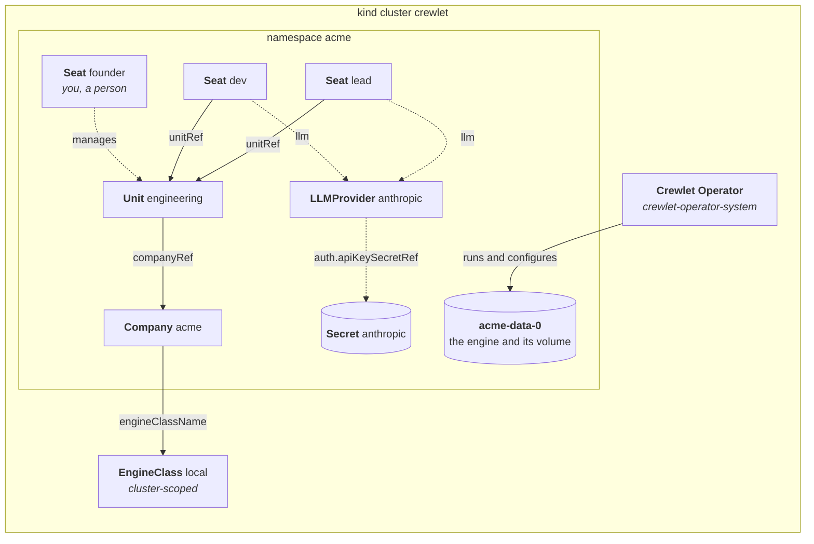

# Quickstart

Run the operator on a local [kind](https://kind.sigs.k8s.io/) cluster and
start a small company on it: an engine, a team of two agents, a seat for you
and a model provider, in about ten minutes.

Every command is a make target or a tool the Makefile pins into `bin/`, so
nothing beyond Go, Docker, make, git and curl has to be installed; most of the
ten minutes goes on building the operator's image.



> **Caution: alpha.** The `crewlet.ai/v1alpha1` API may change without
> notice.

## 1. Create a cluster

```bash
make kind kubectl
bin/kind create cluster --name crewlet
bin/kubectl cluster-info --context kind-crewlet
```

kind's default CNI, kindnet, enforces NetworkPolicy on a host whose kernel
has nftables' queue support (`CONFIG_NFT_QUEUE`, as common distributions
do), so the isolation the operator sets up around each engine applies here as
in production; see
[Exposure and network policy](guides/exposure.md).

## 2. Build and load the operator's image

The operator has no release yet, so its image is built from this checkout
and loaded into the kind node; nothing is pushed to a registry. The engine's
image needs nothing built: it is Crewlet's `main`, which Crewlet publishes
as `ghcr.io/crewlet/crewlet:main` and the operator is tested against, and
the node pulls it when the first company starts
([Engine image](guides/installing.md#engine-image)).

```bash
make docker-build IMG=crewlet-operator:dev
bin/kind load docker-image crewlet-operator:dev --name crewlet
```

## 3. Install the operator

With kustomize (`config/default`) or with the Helm chart (`dist/chart`):

```bash
make install deploy IMG=crewlet-operator:dev
# or
make helm-deploy IMG=crewlet-operator:dev HELM_EXTRA_ARGS="--set manager.replicas=1"
```

`make deploy` sets the image on a throwaway copy of `config/`, so the tree is
left as it was. The chart runs two replicas with leader election by default;
one is plenty on a laptop.

```bash
bin/kubectl -n crewlet-operator-system rollout status deploy/crewlet-operator-controller-manager
bin/kubectl api-resources --api-group=crewlet.ai
```

## 4. Create an EngineClass

An `EngineClass` is a platform's defaults and limits: the engine image, the
size of each company's data pod, and how companies are reached. This one runs
Crewlet's `main` image, exposes no webhooks (kind has no public address), and
gives each company the smallest data volume the API admits.

> **Watch for disk space.** The engine reserves three quarters of that volume
> for its event stream, and kind's provisioner puts it on the node's disk
> without enforcing the size: the Docker host needs about 12 GiB free for each
> company, or its pod never becomes ready.

```bash
bin/kubectl apply -f - <<'EOF'
apiVersion: crewlet.ai/v1alpha1
kind: EngineClass
metadata:
  name: local
spec:
  engine:
    image: ghcr.io/crewlet/crewlet:main
  data:
    resources:
      requests:
        cpu: 100m
        memory: 256Mi
    storage:
      size: 14Gi
  exposure:
    webhooks:
      mode: None
  retention:
    # Who the engine's backup alarms name: the engine trims its logs only
    # behind a recent backup (see Backups in docs/concepts/runtime.md).
    backupOwner: you
EOF
```

## 5. Start a company

A namespace for the company, the Secret holding its model provider's API key,
and the objects: the `Company`, a `Unit`, two agent `Seat`s in it, the
`LLMProvider` they run on, and a Human `Seat` for you, which manages the unit.
The provider is Claude Code on an Anthropic API key: every model Crewlet runs
is a coding CLI it drives. The key is only read when an agent works, so any
value brings the company up. For agents that can do something, put a real
Anthropic key in `ANTHROPIC_API_KEY` and give the class an engine image with
Claude Code installed, which Crewlet's own image is not
([The image needs the CLI](guides/cli-agents.md#the-image-needs-the-cli)).

```bash
bin/kubectl create namespace acme
bin/kubectl create secret generic anthropic -n acme \
  --from-literal=apiKey="${ANTHROPIC_API_KEY:-not-a-real-key}"

bin/kubectl apply -n acme -f - <<'EOF'
apiVersion: crewlet.ai/v1alpha1
kind: Company
metadata:
  name: acme
spec:
  engineClassName: local
  companyName: Acme
  mission: Make widgets people love.
  deletionPolicy: Delete
---
apiVersion: crewlet.ai/v1alpha1
kind: LLMProvider
metadata:
  name: anthropic
spec:
  companyRef:
    name: acme
  agent: ClaudeCode
  model: claude-sonnet-5
  auth:
    mode: APIKey
    apiKeySecretRef:
      name: anthropic
      key: apiKey
---
apiVersion: crewlet.ai/v1alpha1
kind: Unit
metadata:
  name: engineering
spec:
  companyRef:
    name: acme
  displayName: Engineering
  type: Department
  purpose: Build the widgets.
---
apiVersion: crewlet.ai/v1alpha1
kind: Seat
metadata:
  name: lead
spec:
  companyRef:
    name: acme
  displayName: Engineering Lead
  unitRef:
    name: engineering
  goal: Decide what Acme builds next and keep the team unblocked.
  llm:
    default:
      - name: anthropic
---
apiVersion: crewlet.ai/v1alpha1
kind: Seat
metadata:
  name: dev
spec:
  companyRef:
    name: acme
  displayName: Developer
  unitRef:
    name: engineering
  goal: Build what the lead decides.
  llm:
    default:
      - name: anthropic
---
apiVersion: crewlet.ai/v1alpha1
kind: Seat
metadata:
  name: founder
spec:
  companyRef:
    name: acme
  kind: Human
  displayName: Founder
  manages:
    - kind: Unit
      name: engineering
EOF
```

The operator creates the engine (a StatefulSet with one data pod and its
volume), pushes the API key into the engine's encrypted secret store, and
applies the company document. Wait for the Company to be ready, then look at
what it reports:

```bash
bin/kubectl wait company/acme -n acme --for=condition=Ready --timeout=5m
bin/kubectl get crewlet -n acme
bin/kubectl get company acme -n acme \
  -o jsonpath='{range .status.conditions[*]}{.type}={.status} {.reason}{"\n"}{end}' | sort
```

```text
Accepted=True Valid
ConfigApplied=True Applied
EngineHealthy=False Alarms
Exposed=True NoRoutes
IdentityClaimed=False Unclaimed
Ready=True Available
RuntimeReady=True PodsReady
SecretsSynced=True Synced
SeatsPlaced=True AllPoolsServing
```

`EngineHealthy=False Alarms` is the engine saying it has no backup yet
([Backups](concepts/runtime.md#backups)), and `IdentityClaimed=False Unclaimed`
that nobody has joined the company: step 7 brings you in. Neither keeps the
Company from `Ready`.

Each Seat reports its identity in the engine and the revision it is in:

```bash
bin/kubectl get seats -n acme \
  -o jsonpath='{range .items[*]}{.metadata.name}: {.status.seatID} {.status.conditions[?(@.type=="Applied")].message}{"\n"}{end}'
```

## 6. Change it

Edit an object and the operator applies the whole document again as a new
revision, once two seconds have passed without another change. The Seat's
`Applied` condition takes the Seat's new generation, says `Applying` while
the engine applies the revision, and then names it:

```bash
bin/kubectl patch seat dev -n acme --type merge \
  -p '{"spec":{"goal":"Build what the lead decides, with tests."}}'
bin/kubectl wait seat dev -n acme --timeout=1m \
  --for=jsonpath='{.status.conditions[?(@.type=="Applied")].observedGeneration}'=2
bin/kubectl wait seat dev -n acme --timeout=1m --for=condition=Applied
bin/kubectl get seat dev -n acme \
  -o jsonpath='{.status.conditions[?(@.type=="Applied")].message}{"\n"}'
```

Break a rule and the API server refuses the change with the rule's message:

```bash
bin/kubectl patch seat dev -n acme --type merge -p '{"spec":{"handle":"developer"}}'
```

Reference a Secret that does not exist and the next revision waits, while
the engine keeps running the last good one; the object at fault says why:

```bash
bin/kubectl patch llmprovider anthropic -n acme --type merge \
  -p '{"spec":{"auth":{"apiKeySecretRef":{"name":"missing","key":"apiKey"}}}}'
bin/kubectl wait llmprovider anthropic -n acme --for=condition=ResolvedRefs=false --timeout=1m
bin/kubectl get llmprovider anthropic -n acme \
  -o jsonpath='{.status.conditions[?(@.type=="ResolvedRefs")].message}{"\n"}'
bin/kubectl patch llmprovider anthropic -n acme --type merge \
  -p '{"spec":{"auth":{"apiKeySecretRef":{"name":"anthropic","key":"apiKey"}}}}'
```

[Troubleshooting](guides/troubleshooting.md) lists every condition and
reason an object can report.

## 7. Join your company

Crewlet signs people in as themselves, each on a Human seat, and a new
company has nobody in it. The way in is the access token the Company
publishes in the Secret `status.apiAccessSecretRef` names, which may invite
people. Print the token, and forward the engine's API port, which keeps
running until you stop it:

```bash
bin/kubectl get secret acme-api-access -n acme -o jsonpath='{.data.token}' | base64 -d; echo
bin/kubectl port-forward -n acme svc/acme-engine 8080:8080
```

Open exactly <http://localhost:8080>: the engine is told it is reached there,
and accepts a sign-in from that address and no other. While nobody has
joined, the sign-in page puts its token form first: paste the token and
choose **Sign in with token**. Then open **Agents › Org chart**, open the
founder seat, choose **Add person** with your email address and **Admin**
ticked, and open the password link it shows you once. Choose a password, sign
in with your address, and set up the authenticator app the engine asks for.
The Company says you have joined:

```bash
bin/kubectl wait company/acme -n acme --for=condition=IdentityClaimed --timeout=2m
```

The dashboard shows the company's configuration read-only: under the default
management policy, `Enforce`, the objects are its only source, and the engine
refuses any other change to it
([Choosing a management policy](guides/management-policies.md)). People are
the engine's own and not in the objects: invite the next one from their seat
in the org chart ([Bringing people in](guides/people.md)).

## 8. Try the full example

[`config/samples`](../config/samples) is one complete company, Nimbus: an
`EngineClass` that routes webhooks through a Gateway, two `Unit`s, three
`Seat`s (one of them a person) with their own Slack and GitHub credentials,
two `MCPServer`s, three `Integration`s and two `Schedule`s. On kind it shows what an object reports
when what it needs is missing: there is no Gateway API, none of the
Secrets the samples reference exist, and the `gitlab` tool server's `glab`
is not in the engine image (a stdio server's command needs an image derived
from the engine's: [Running tool servers](guides/tool-servers.md#the-image-needs-the-server)):

```bash
bin/kubectl create namespace nimbus
bin/kubectl apply -n nimbus -k config/samples
bin/kubectl get company nimbus -n nimbus \
  -o jsonpath='{range .status.conditions[*]}{.type}={.status} {.reason}: {.message}{"\n"}{end}'
```

## 9. Clean up

Delete the companies while the operator still runs: each Company's finalizer
stops its engine and settles its volume as `deletionPolicy` says (`Delete`
here; the Nimbus sample's `Retain` keeps the volume claim and the keyring,
which the namespace's deletion then removes).

```bash
bin/kubectl delete company --all -n acme
bin/kubectl delete company --all -n nimbus --ignore-not-found
bin/kubectl delete namespace acme nimbus --ignore-not-found
bin/kubectl delete engineclass --all
make undeploy            # the manager and the CRDs, and with them every crewlet.ai object
# or, if you installed the chart: make helm-uninstall uninstall   # the chart keeps the CRDs
bin/kind delete cluster --name crewlet
```

## Next steps

- [Installing the Operator](guides/installing.md) — a production install with the Helm chart
- [How the Operator Models a Company](concepts/overview.md) — the kinds, and how they become one document
- [Running Seats on a Coding CLI](guides/cli-agents.md) — the image with the CLI, and how each CLI signs in
- [Supplying Credentials](guides/credentials.md) — the Secret behind each credential
- [Connecting Integrations](guides/integrations.md) — Slack, GitHub, GitLab and the other vendors
- [Troubleshooting](guides/troubleshooting.md) — every condition and reason an object reports
