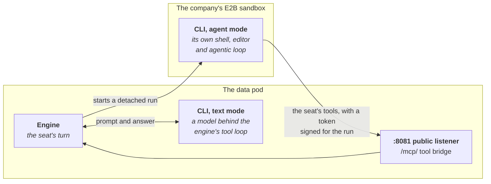

# Running Seats on a Coding CLI

An `LLMProvider` of type `CLIAgent` runs a seat on a coding CLI you already
subscribe to, such as Claude Code or Codex, rather than on a metered API key.

It renders Crewlet's `cli-agent` provider, which drives the CLI on a
subscription login; Crewlet's
[Subscription LLM backends](https://github.com/crewlet/crewlet/blob/main/docs/concepts/subscription-llm-backends.md)
describes what the engine does with it. This guide covers what changes when
the engine runs in a pod: the image, the login, and agent mode.

## The image needs the CLI

The CLI is a program the engine starts, in the engine's own container, and
Crewlet's image ships none: a derived image adds it, with whatever runtime it
needs (Node.js for most of them; Claude Code needs none, being one native
binary). Build one from the engine image you run, named by digest: the engine
of the operator's release, or the copy of Crewlet's `main` image that
[Installing](installing.md#engine-image) makes in your registry. Pin both the
engine and the CLI. For Claude Code, Anthropic's installer runs in a build
stage of its own and only the binary it installed is kept:

```dockerfile
# The engine image you run, by digest, and the Claude Code release to add.
ARG ENGINE_IMAGE
ARG CLAUDE_CODE_VERSION=2.1.296

# The installer needs curl, which the engine image does not ship, and leaves a
# download cache, a launcher and the build user's ~/.claude.json behind, none
# of which a seat reads: only the binary leaves this stage.
FROM ${ENGINE_IMAGE} AS claude-code
ARG CLAUDE_CODE_VERSION
USER root
RUN apt-get update && apt-get install -y --no-install-recommends curl
USER crewlet
SHELL ["/bin/bash", "-o", "pipefail", "-c"]
RUN curl -fsSL https://claude.ai/install.sh | bash -s "${CLAUDE_CODE_VERSION}"

FROM ${ENGINE_IMAGE}
ARG CLAUDE_CODE_VERSION
COPY --from=claude-code --chown=0:0 \
    /home/crewlet/.local/share/claude/versions/${CLAUDE_CODE_VERSION} /usr/local/bin/claude
# The image is how the CLI is updated. The engine starts it with an
# allowlisted environment, which an ENV here never reaches, so the switch goes
# in the managed settings every claude reads.
COPY <<'JSON' /etc/claude-code/managed-settings.json
{"env": {"DISABLE_UPDATES": "1"}}
JSON
```

The installer checks the binary's SHA-256 against Anthropic's release manifest
before it installs it, and a `CLAUDE_CODE_VERSION` that names no release fails
the build. Updates are off because, left on, Claude Code would download each
new release into each seat's home on the data volume, about 250 MB a copy that
nothing runs: the engine runs the `claude` on its `PATH`.

Build it from the engine image,

```bash
docker build --build-arg ENGINE_IMAGE=<your registry>/crewlet@sha256:<digest> \
  -t <your registry>/crewlet-claude-code:<crewlet commit> .
```

and name it in the class, which every company of the class then runs:

```yaml
# EngineClass with-claude-code, excerpt
spec:
  engine:
    image: <your registry>/crewlet-claude-code@sha256:<digest>   # crewlet <commit>
```

A class names one engine image, so a company that also runs stdio tool
servers needs one image with both: push this one, then build the Dockerfile
of [Building the image](tool-servers.md#building-the-image) on it, with its
`ENGINE_IMAGE` naming this image, rather than pasting one Dockerfile into the
other ([One image with a coding CLI](tool-servers.md#one-image-with-a-coding-cli)).

The engine's root filesystem is read-only: a CLI writes under the home the
engine gives each seat and under `/tmp`, both writable. Each running CLI
takes 200 to 400 MB, so size the class's `data.resources` for
`cli.maxConcurrent` of them per provider.

## Signing in

A subscription login is made at a terminal, by `crewlet llm login` or the
CLI's own command, and a pod has none. `cli.auth` therefore takes the login
from a Secret, in one of two forms; takes a metered key instead; or, for the
three CLIs that read their model provider's key from their environment,
takes none and signs in with that key in `cli.env`:

| Sign-in | What the Secret holds | Use it when |
|---|---|---|
| `auth.tokenSecretRef` | a long-lived headless token the CLI mints, such as the `CLAUDE_CODE_OAUTH_TOKEN` of `claude setup-token` | the CLI is Claude Code, the one CLI whose Crewlet profile names a token variable: it never needs refreshing, and it is the only one of Claude Code's subscription logins an agent-mode run can carry (an agent-mode OpenCode carries its model provider's key in `env` instead) |
| `auth.credentialBundleSecretRef` | a bundle of the CLI's credential files, from `crewlet llm export <key>` on a machine where you logged in | any CLI: the others mint no token Crewlet hands on |
| `auth.mode: APIKey` with one `apiKeySecretRefs` key | the CLI's metered API key | the CLI's Crewlet profile names a key variable ([below](#a-metered-key)) |
| `env`, with `auth.mode: Subscription` | the key of the model provider the CLI runs on, in the variable the CLI reads for it (`OPENROUTER_API_KEY`, `ANTHROPIC_API_KEY`, `NOUS_API_KEY`, ...) | the CLI is Hermes, Pi or OpenCode: with its model provider's key in its environment, it needs no login |

What each CLI takes, in the engine the operator is tested against, Crewlet's
`main` (Crewlet's profiles name the variables; a test holds the API's rules and this
table to that engine's own verdict on every CLI and every sign-in, so neither
can fall behind it):

| `cli.agent` | `tokenSecretRef` | `auth.mode: APIKey` fills | A key in `env` | `credentialBundleSecretRef` | `mode: Agent` |
|---|---|---|---|---|---|
| `ClaudeCode` | `CLAUDE_CODE_OAUTH_TOKEN` | `ANTHROPIC_API_KEY` | no | yes | on the token or the key |
| `Codex` | no | `OPENAI_API_KEY` | no | yes | no |
| `GeminiCLI` | no | `GEMINI_API_KEY` | no | yes | no |
| `QwenCode` | no | `DASHSCOPE_API_KEY` | no | yes | no |
| `CursorAgent` | no | `CURSOR_API_KEY`, a Cursor account's API key | no | yes | no |
| `Copilot` | no | `GITHUB_TOKEN` | no | yes | no |
| `Grok` | no | `XAI_API_KEY` | no | yes | no |
| `MuseCode` | no | `META_API_KEY` | no | yes | no |
| `KimiCode` | no | no: it reads a key only from its own `config.toml`, so give that in the bundle | no | yes | no |
| `OpenCode` | no | no | yes | yes | on the key in `env` ([below](#text-mode-and-agent-mode)) |
| `Hermes` | no | no | yes | yes | no |
| `Pi` | no | no | yes | yes | no |

A provider names one of the two logins: given both, which login the CLI acts
on would be its own choice between its environment and its files, so the
API server refuses the pair. Crewlet hands a token to a CLI only through the
variable its profile names, and the engine refuses a token for a CLI whose
profile names none, since it would reach nothing, so the API server
refuses `tokenSecretRef` on any agent but `ClaudeCode` first. A
Subscription provider that names neither is refused, with one exception:

- **Hermes, Pi and OpenCode on a key in `env`.** Each fronts many model
  providers and reads each provider's key from that provider's own
  variable, so Crewlet's profile for it names no key variable and marks it
  as signing in through its environment: Crewlet passes the CLI's `env` to
  it untouched, which is the route its profile documents for a metered key.
  Crewlet counts an entry as a sign-in only by its name
  ([below](#which-env-entries-sign-a-cli-in)).
- **Every other CLI** keeps to a token or a bundle. A CLI whose profile names
  a key variable takes its key with `auth.mode: APIKey`; the engine refuses
  that variable in `env` (below), and a key in `env` under any other name is
  one the CLI does not read.

`env` may never set the CLI's own token or key variable, the ones the table
names (`ANTHROPIC_API_KEY` for `ClaudeCode`, `CURSOR_API_KEY` for
`CursorAgent`, and so on), in any auth mode: `auth` owns them, and whether a
value in `env` reached the CLI would turn on the mode and on what else holds
a credential, so the engine refuses the document and the API server refuses
the provider first. Another CLI's variable is no such conflict:
`ANTHROPIC_API_KEY` is OpenCode's Anthropic key.

```yaml
apiVersion: crewlet.ai/v1alpha1
kind: LLMProvider
metadata:
  name: hermes
spec:
  companyRef: {name: acme}
  type: CLIAgent
  model: anthropic/claude-sonnet-5   # an OpenRouter model id: OPENROUTER_API_KEY selects OpenRouter
  cli:
    agent: Hermes
    auth:
      mode: Subscription
    env:
      - name: OPENROUTER_API_KEY
        valueFrom:
          secretKeyRef: {name: openrouter, key: apiKey}
```

OpenCode reads its model as `<provider>/<model>`, splitting it at the first
slash: `anthropic/claude-sonnet-5` runs Anthropic's model on
`ANTHROPIC_API_KEY`, and `openrouter/anthropic/claude-sonnet-5` runs it
through OpenRouter on `OPENROUTER_API_KEY` (`opencode models` lists the
providers it knows). A model with no slash, or with nothing but white space
before or after it, names no provider or no model, and every call the
provider made would fail inside OpenCode with `Model not found`, so the
engine refuses it and the API server refuses it first, at `spec.model`.

For Claude Code, on a headless token:

```bash
claude setup-token          # on your machine: prints the token
kubectl create secret generic claude-subscription -n acme --from-literal=oauthToken=...
```

```yaml
apiVersion: crewlet.ai/v1alpha1
kind: LLMProvider
metadata:
  name: claude-code
spec:
  companyRef: {name: acme}
  type: CLIAgent
  model: sonnet
  cli:
    agent: ClaudeCode
    auth:
      tokenSecretRef: {name: claude-subscription, key: oauthToken}
```

The login, and the homes the CLI keeps for each seat, live on the data
volume, under `/var/lib/crewlet/llm-cli/<loginName>`, so a restarted data pod
keeps them; a seat pod keeps them on a scratch volume it loses at every start
(see [Seat pools](#seat-pools)). That matters for a bundle: the engine restores one only while
the login there is empty, so the login the running engine refreshed wins
over the bundle in the Secret, whose refresh token the vendor may have
retired since. A bundle restored over a newer login is how a vendor that
rotates refresh tokens logs a deployment out, which is why a token is the
better of the two wherever the CLI mints one.

Providers that set the same `loginName` share one login and its seats'
homes, which is how several models run off one subscription; they must
drive the same CLI, or the engine refuses the document.

### Which `env` entries sign a CLI in

This is the sign-in of a Hermes, Pi or OpenCode provider in
`auth.mode: Subscription` with neither a token nor a bundle: a key in its
`env`. Crewlet counts an entry as that sign-in only when its name says it
holds a credential: one of its parts between underscores is, in any case,
`KEY`, `KEYS`, `APIKEY`, `ACCESSKEY`, `SECRETKEY`, `TOKEN`, `SECRET`,
`PASSWORD`, `PASSWD`, `CREDENTIAL`, `CREDENTIALS`, `AUTH`, `OAUTH` or `PAT`.
So `OPENROUTER_API_KEY` and `GH_TOKEN` sign the CLI in, and `HTTPS_PROXY` or
`HERMES_MAX_TOKENS` (a count of model tokens) do not; the API server refuses
such a provider when its `env` holds no such name, since `crewlet llm list`
would report it signed in to nothing. Write its `auth.mode: Subscription`
explicitly, as `auth` may not be empty. A key in `env` is a `${NAME}` the
engine resolves from its encrypted store, so it never refreshes and runs on a
seat pod too.

> **Name only the sign-in you mean the CLI to use.** Beside a credential
> bundle a key in `env` is a second sign-in, which the CLI settles by its own
> rules rather than by the order you wrote them in. Hermes, for one, loads its
> home's `.env` over its environment, so a variable the bundle's `.env` also
> sets takes the file's value, while a model provider's key in `env` wins over
> an OAuth login in the bundle's `auth.json`, so Hermes runs on the metered key
> and the subscription goes unused.

### A metered key

`auth.mode: APIKey` gives the CLI the provider's one `apiKeySecretRefs` key
instead, billing the metered account. Crewlet hands the key over in the
variable the CLI's profile names, and in Crewlet's `main` eight name one
(the table above); for the others the key would reach nothing, so the engine
refuses the mode for them and the API server refuses it first. Hermes,
Pi and OpenCode take their model provider's key in `env` instead, and
KimiCode its key in the bundle. `CursorAgent`'s key is a Cursor account's
API key, from the Cursor dashboard, not a model provider's.

```yaml
apiVersion: crewlet.ai/v1alpha1
kind: LLMProvider
metadata:
  name: cursor
spec:
  companyRef: {name: acme}
  type: CLIAgent
  model: auto
  apiKeySecretRefs:
    - {name: cursor, key: apiKey}
  cli:
    agent: CursorAgent
    auth:
      mode: APIKey
```

## Text mode and agent mode

`cli.mode: Text` (the default) runs the CLI as a model behind the engine's
own tool loop, as a process in the engine's pod. `cli.mode: Agent` runs a
seat's executor as the CLI's own agentic run, with its own shell and editor,
in the company's sandbox. Every other phase on the same provider (the
reviewer, a delegated worker, the summariser) is still a text call, so the
CLI must be in the engine's image either way.



In agent mode:

- The run is a sandbox run: the Company needs `spec.sandbox`. With no
  `spec.sandbox.e2b.template`, each run gets E2B's prebuilt template for its
  CLI (`claude` for Claude Code, `opencode` for OpenCode); a template you
  set is used for every run, so it must carry the CLI of every coding agent
  and agent-mode provider the company runs. `cli.runIn` is `E2B`, the only
  cell v1alpha1 offers: Crewlet's local cells would run every seat's code in
  the engine's pod, with its credentials.
- Claude Code and OpenCode run in agent mode: they are the CLIs the engine
  has a sandbox runner for, the coding agents `spec.sandbox` offers, and the
  API server refuses `mode: Agent` for any other. The run is handed `model`
  exactly as the provider's text calls pass it, so one model serves the
  executor's run and every other phase.
- The login must follow the run into the remote sandbox, which only a
  variable of the run's environment can: an agent-mode Claude Code takes
  `auth.tokenSecretRef` or `auth.mode: APIKey`, and an agent-mode OpenCode
  its model provider's key in `env`, under a name the engine reads as a
  credential, which the engine exports into the box. A credential bundle
  stays on the data volume, since its login carries a refresh token the
  engine keeps rotating there, so the API server refuses an agent-mode
  provider signed in with nothing else. A key in the Seat's
  `spec.sandbox.env` reaches the box as well, but the API server cannot see
  the Seat from the provider, so it does not count it.
- The run calls the seat's own tools back through the engine's tool bridge.
  While any LLMProvider of the company is in agent mode, the operator gives
  the engine its public address as the bridge's (`CREWLET_MCP_BRIDGE_URL`),
  and the engine serves the bridge on its public listener, beside the
  webhooks ([Exposure](exposure.md)). A company with no public address
  cannot run one: the engine applies the provider and refuses every turn
  of a seat whose executor's chain it heads. The operator applies it too
  and reports it, so the rest of the company still runs: the LLMProvider
  reports `AgentModeRunnable=False`, `NotExposed`, and each such Seat
  `Ready=False`, `NotExposed`. With an address, `AgentModeRunnable` is
  `True`, `ToolBridgeServed`, naming the bridge's address.

```yaml
spec:                       # LLMProvider claude-agent
  type: CLIAgent
  model: sonnet
  cli:
    agent: ClaudeCode
    mode: Agent
    loginName: claude-code        # the same login as the text-mode provider
    auth:
      tokenSecretRef: {name: claude-subscription, key: oauthToken}
```

or OpenCode, on its model provider's key:

```yaml
spec:                       # LLMProvider opencode-agent
  type: CLIAgent
  model: openrouter/anthropic/claude-sonnet-5
  cli:
    agent: OpenCode
    mode: Agent
    auth:
      mode: Subscription
    env:
      - name: OPENROUTER_API_KEY
        valueFrom:
          secretKeyRef: {name: openrouter, key: apiKey}
```

A seat runs on it by naming it in `spec.llm.default`; see the Seat's
`spec.llm` in the [API reference](../reference/api.md).

## Code work

A seat with `spec.sandbox` runs code in the company's sandbox with a coding
agent, `ClaudeCode` or `OpenCode` (`spec.sandbox.codingAgent`, else the
Company's `spec.sandbox.defaultCodingAgent`, else `ClaudeCode`), on the
provider at the head of `spec.llm.sandbox`, else of `spec.llm.default`, else
of the Company's order. That provider is the run's model and sign-in, unless
the seat's sandbox environment signs the coding agent in (below), so the
pairing has to be one the coding agent can read. The Seat reports whether it
is on its `CodeWorkRunnable` condition, saying what the run uses, and naming
the field to change when it cannot run. Only the first pairing below also holds the company's document
(`Applied=False`), because Crewlet refuses it on every write; Crewlet applies
a seat in either of the other two, which runs its turns while Crewlet refuses
each of its coding runs, so the operator applies it too and the company is
not held over one seat's code work. `CodeWorkRunnable` does not count towards
the Seat's `Ready`, and the operator records a Warning event on the Seat each
time the condition becomes `False` or its reason changes.

- **A `CLIAgent` provider must drive the coding agent's own CLI.** Its model
  is written for its CLI and its sign-in is that CLI's, so Crewlet refuses
  the pairing on every write (`CodingAgentMismatch`). Codex, Gemini CLI,
  Kimi Code, Hermes, Pi and the other CLIs have no coding agent, so they
  cannot back code work: put an API provider first in `spec.llm.sandbox`. A
  seat whose executor runs OpenCode in agent mode and that has
  `spec.sandbox` runs its code work on the same provider unless
  `spec.llm.sandbox` says otherwise, so it sets `spec.sandbox.codingAgent:
  OpenCode`.
- **`ClaudeCode` reads Anthropic's API alone.** On a provider of type
  `OpenAI` or `OpenAICompatible` it can read neither the model nor the key,
  and Crewlet refuses each coding run (`SandboxModelUnsupported`), unless
  the seat's sandbox environment (`spec.sandbox.env`, its setup steps' `env`,
  or the Company's `spec.sandbox.setup` steps') signs Claude Code in itself,
  with `CLAUDE_CODE_OAUTH_TOKEN`, `ANTHROPIC_API_KEY`,
  `ANTHROPIC_AUTH_TOKEN`, `CLAUDE_CODE_USE_BEDROCK`,
  `CLAUDE_CODE_USE_VERTEX` or `CLAUDE_CODE_USE_FOUNDRY`; it then runs on
  that sign-in and its own model choice (`ANTHROPIC_MODEL` in
  `spec.sandbox.env` picks one; like every variable there, it is read from
  a Secret key). `OpenCode` reads either wire.
- **The login must reach the remote sandbox.** A credential bundle never
  does, so a `ClaudeCode` provider signed in by a bundle, with neither
  `CLAUDE_CODE_OAUTH_TOKEN` nor `ANTHROPIC_API_KEY` in the seat's sandbox
  environment, or an `OpenCode` one with no credential-named variable in
  `cli.env` or the seat's sandbox environment, has each coding run refused
  (`SandboxLoginNotPortable`).

The operator sees the names of the seat's variables, not their values: a
variable named above whose Secret holds nothing passes it, and the engine
refuses the run. What the box receives from the provider is in
[What a coding box carries](credentials.md#what-a-coding-box-carries).

## Seat pools

A seat placed in a [seat pool](topology.md) runs on a seat pod, which keeps
nothing between starts and serves only its probes. Two things a data pod
does for a CLI it cannot do:

- **Agent mode.** A run calls the seat's tools back through the tool bridge
  of the very pod that holds the seat, on an address the sandbox reaches; the
  operator gives the data pod the company's public address for it. The
  engine would serve the bridge on a seat pod too, on the listener its
  probes use, but nothing publishes an address of a seat pod's own that a
  remote sandbox could dial: the company's public address reaches the data
  pod alone, and a seat pod is reached by its kubelet and nothing else.
  Without an address the engine refuses every agent-mode turn on the pod.
  Crewlet runs a turn in agent mode only when the HEAD of the executor's
  chain is in `mode: Agent`, so a seat in a seat pool whose executor's
  chain (`spec.llm.default`, or the Company's first provider when the seat
  names none) starts with such a provider can run no turn. The engine
  applies it all the same, and so does the operator, which reports it on
  the Seat as `Ready=False`, `AgentModeBridgeUnsupported`, with a Warning
  event, rather than hold the rest of the company's changes: place the seat
  in `data`, or put a provider in `mode: Text` at the head of the chain. The
  same provider behind another in that chain, or in another phase's chain,
  is a text call, and is fine.
- **A credential bundle.** The login lives under the CLI's state directory,
  which on a seat pod is its scratch volume, so every seat pod restores the
  bundle at each start and then refreshes the login on its own, beside the
  data pod. A vendor that rotates refresh tokens retires the token the other
  pods hold at each refresh, and logs them out. A seat in a seat pool that
  runs on a provider with `credentialBundleSecretRef`, in any phase, is
  refused with `Applied=False`, `CLIAuthNotPortable`, which holds the
  company's document: applied, it would log out every seat on that login,
  the data pod's included. Sign it in with
  `tokenSecretRef` (Claude Code), `auth.mode: APIKey` (a CLI the table
  above gives a key variable) or, for Hermes, Pi or OpenCode, its model
  provider's key in `env`, or place the seat in `data`.

## What v1alpha1 does not offer

Crewlet's `custom` CLI and the profile `overrides` of the built-in ones are
not offered: they name the binary and the arguments the engine's pod runs.
Nor are the `direct` and `container` cells, for the reason above.

Nor is Crewlet's `inherit-env` login, which gives the CLI whichever token or
key the engine's container environment holds. A credential there is outside
the engine's encrypted store: every process the engine runs (the CLI, a
stdio MCP server) can read it, and the engine resolves a `${NAME}` written in
any field of the company document from its environment too, so whoever can
write such a field can have the engine send the value anywhere. The operator
puts no credential of the engine's own into its environment for the same
reason ([Credential Positions](../concepts/credentials.md)); `tokenSecretRef`,
`credentialBundleSecretRef`, `auth.mode: APIKey` and a key in `env` for
Hermes, Pi or OpenCode take the login from a Secret instead.

## See also

- [Crewlet's subscription LLM backends](https://github.com/crewlet/crewlet/blob/main/docs/concepts/subscription-llm-backends.md) — what the engine does with a CLI
- [Choosing Where Seats Run](topology.md) — seat pools, and what a CLI cannot do there
- [Exposure and Network Policy](exposure.md) — the public listener the tool bridge is served on
