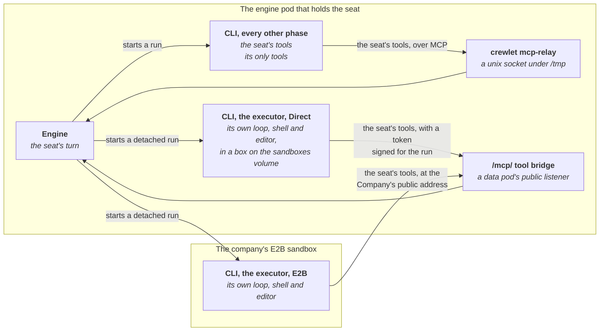

# Running Seats on a Coding CLI

Every model a seat runs on is a coding CLI the engine drives: Claude Code for
Anthropic's models, Codex for OpenAI's, OpenCode for open models on any
provider, and the other CLIs of the table below. An `LLMProvider` names the
CLI (`agent`), the model in that CLI's own grammar, and how it signs in: on a
subscription you already have, or on a metered API key.

It renders one entry of Crewlet's `providers.llm`; Crewlet's
[LLM backends](https://github.com/crewlet/crewlet/blob/main/docs/concepts/llm-backends.md)
describes what the engine does with it. This guide covers what changes when
the engine runs in a pod: the image, the login, and where a seat's executor
runs.

## The image needs the CLI

The CLI is a program the engine starts, in the engine's own container, and
Crewlet's image ships none, so a company whose seats should do any work runs
on a class that names a derived image. It adds the CLI, with whatever runtime
it needs (Node.js for most of them; Claude Code and OpenCode need none, each
being one native binary). Build one from the engine image you run, named by
digest: the engine of the operator's release, or the copy of Crewlet's `main`
image that [Installing](installing.md#engine-image) makes in your registry.
Pin both the engine and the CLI.

A class names one engine image, so a company that runs two CLIs, or a CLI
and stdio tool servers, needs one image with all of them. Each Dockerfile
here and the one of [Building the image](tool-servers.md#building-the-image)
takes the image it extends as `ENGINE_IMAGE`: push the first image, then
build the next Dockerfile with its `ENGINE_IMAGE` naming it, rather than
pasting one Dockerfile into another
([One image with a coding CLI](tool-servers.md#one-image-with-a-coding-cli)).

The engine's root filesystem is read-only: a CLI the engine runs in the pod
writes under the home the engine gives each seat and under `/tmp`, both
writable, and the engine keeps the socket each such run reaches the seat's
tools through in a directory of its own under `/tmp`. A seat's executor run
placed `Direct` runs in the pod too, in a box directory on the pod's
`sandboxes` volume, with the CLI's own shell, so whatever the seat's work runs
there (`git`, a compiler, a package manager) has to be in the image, or be
installed by the run into its box's home
([Where a seat's executor runs](#where-a-seats-executor-runs)). Each running
CLI takes 200 to 450 MB. Size the class's `data.resources` for
`maxConcurrent` of them per provider, which bounds the provider's CLI in every
phase but the executor's, and for one more, with whatever its shell runs, for
each agent seat whose executor runs `Direct` on the pod at once, which
`maxConcurrent` does not bound. One process lives for a phase's whole run, its
tool calls included, so where seats wait on each other for a place, raise
`maxConcurrent` and the pod's memory together. An OpenCode call is at
the top of that range: measured on OpenCode 2.0.32, one call held about 440
MB at its peak, some 365 MB of it the private server every call starts, and
each call running beside it about 250 to 350 MB more, the binary's pages
being shared between them; a short `opencode api session.get` reading a
call's usage follows each. OpenCode also unpacks about 19 MB of native
libraries into each seat's home, under the `TMPDIR` the engine gives it
(`<home>/tmp`), beside a database of about 7 MB while a seat's calls run:
about 26 MB per OpenCode seat on the data volume, and on a seat pod's
scratch volume (`scratchSizeLimit`) for each seat the pod holds.

### Claude Code

Anthropic's installer runs in a build stage of its own and only the binary it
installed is kept:

```dockerfile
# The engine image you run, by digest, and the Claude Code release to add.
ARG ENGINE_IMAGE
ARG CLAUDE_CODE_VERSION=2.1.303

# The installer needs curl, which the engine image does not ship, and leaves a
# download cache, a launcher and the build user's ~/.claude.json behind, none
# of which a seat reads: only the binary leaves this stage.
FROM ${ENGINE_IMAGE} AS claude-code
ARG CLAUDE_CODE_VERSION
USER root
RUN apt-get update && apt-get install -y --no-install-recommends curl
USER crewlet
SHELL ["/bin/bash", "-o", "pipefail", "-c"]
RUN curl -fsSL https://claude.ai/install.sh | bash -s "${CLAUDE_CODE_VERSION}"

FROM ${ENGINE_IMAGE}
ARG CLAUDE_CODE_VERSION
COPY --from=claude-code --chown=0:0 \
    /home/crewlet/.local/share/claude/versions/${CLAUDE_CODE_VERSION} /usr/local/bin/claude
# The image is how the CLI is updated. The engine starts it with only an
# allowlist of its own environment, which DISABLE_UPDATES is not on, so an ENV
# here would not reach it: the switch goes in the managed settings every
# claude reads.
COPY <<'JSON' /etc/claude-code/managed-settings.json
{"env": {"DISABLE_UPDATES": "1"}}
JSON
```

The installer checks the binary's SHA-256 against Anthropic's release manifest
before it installs it, and a `CLAUDE_CODE_VERSION` that names no release fails
the build. Updates are off because, left on, Claude Code would download each
new release into each seat's home on the data volume, about 250 MB a copy that
nothing runs: the engine runs the `claude` on its `PATH`.

> **Keep the managed settings to that switch.** Every `claude` the image
> starts reads them, a seat's executor run `Direct` on the pod included, and
> Crewlet starts that run with `--permission-mode bypassPermissions`: a policy
> there that disables the mode (`permissions.disableBypassPermissionsMode`),
> or that narrows the run's tools, breaks every executor run on the pod. An
> `E2B` run uses its template's Claude Code, and never reads this file.

Build it from the engine image,

```bash
docker build --build-arg ENGINE_IMAGE=<your registry>/crewlet@sha256:<digest> \
  -t <your registry>/crewlet-claude-code:<crewlet commit> .
```

and name it in the class, which every company of the class then runs:

```yaml
# EngineClass with-claude-code, excerpt
spec:
  engine:
    image: <your registry>/crewlet-claude-code@sha256:<digest>   # crewlet <commit>
```

### OpenCode

Crewlet drives OpenCode 2 only, npm's `@opencode/cli`. npm's `opencode-ai` is
OpenCode 1.x and rejects the `--standalone` every command of Crewlet's
profile carries, so on it every call fails. The package's install script
puts the binary of one of its platform packages in place, a self-contained
program that needs no Node.js. This Dockerfile takes that binary straight
from the platform package and checks it against the integrity npm's registry
records, as the Slack server's is ([Building the image](tool-servers.md#building-the-image)):

```dockerfile
# The engine image you run, by digest.
ARG ENGINE_IMAGE

# The platform package is fetched and checked here, with a curl the engine
# image does not ship: only the binary leaves this stage.
FROM ${ENGINE_IMAGE} AS opencode
ARG TARGETARCH
# The OpenCode 2 release, and each platform package's dist.integrity on npm's
# registry. amd64 takes the baseline build, which runs on any x86-64 node: the
# other needs AVX2, and the image runs on whichever node its pod lands on.
ARG OPENCODE_VERSION=2.0.32
ARG OPENCODE_INTEGRITY_AMD64=sha512-NrB4iglJb7vGZWJ6B0qVH1EMHhWBZ4ADsAG9W0xLanzgxJ6eLEEsGBvxRX0cm/KPag5E/N0yZGsDVDZYcnz/OQ==
ARG OPENCODE_INTEGRITY_ARM64=sha512-YR5O03irvmot/G0f8W49ehvhn5uqCFN3vf9JTsChvf47W6ldjKCNvsaCSXS2SP26dPOUMQBn7WqbKnyHzrNR5w==
USER root
RUN apt-get update && apt-get install -y --no-install-recommends curl
SHELL ["/bin/bash", "-euo", "pipefail", "-c"]
WORKDIR /fetch
RUN case "${TARGETARCH}" in \
      amd64) package=cli-linux-x64-baseline integrity=${OPENCODE_INTEGRITY_AMD64} ;; \
      arm64) package=cli-linux-arm64 integrity=${OPENCODE_INTEGRITY_ARM64} ;; \
      *) echo "no OpenCode build for ${TARGETARCH}" >&2; exit 1 ;; \
    esac; \
    curl -fsSLo opencode.tgz "https://registry.npmjs.org/@opencode/${package}/-/${package}-${OPENCODE_VERSION}.tgz"; \
    test "sha512-$(openssl dgst -sha512 -binary opencode.tgz | base64 -w0)" = "${integrity}"; \
    tar -xzf opencode.tgz --strip-components=2 package/bin/opencode

FROM ${ENGINE_IMAGE}
COPY --from=opencode --chown=0:0 /fetch/opencode /usr/local/bin/opencode
```

Pin the newest `@opencode/cli` of npm's `latest` tag, never its `beta` or
`dev`, within the major Crewlet's opencode profile is written for (OpenCode 2
today), with the `dist.integrity` of its `cli-linux-x64-baseline` and
`cli-linux-arm64` packages at that version. The obvious alternatives are
wrong:

- **OpenCode's own installer**, `curl https://opencode.ai/v2/install`,
  fetches the same package with no checksum, and picks the baseline or musl
  build from the CPU and libc of the machine running the build, not of the
  node the pod runs on.
- **No update switch** is needed, unlike Claude Code's. Every call the engine
  makes carries `update: disable` in the configuration it writes for that
  call, and the commands it runs outside a call (`auth import`, `auth
  export`, `auth list`, `--version`) check for no release. OpenCode's updater
  replaces only what a package manager (npm, pnpm, Bun, Yarn, Vite+,
  Homebrew or WinGet) or its own installer put in place, so it cannot touch
  `/usr/local/bin/opencode`, and the root filesystem is read-only anyway.
- **Never add an `/etc/opencode` configuration** to the image: OpenCode reads
  it as machine-wide managed configuration over every seat's call, and
  nothing the engine sets overrides it
  ([Isolation](https://github.com/crewlet/crewlet/blob/main/docs/concepts/llm-backends.md#isolation-the-part-that-actually-matters)).
- **The binary links glibc**, which the engine image's Debian has; the
  `musl` packages are for Alpine. Of the native libraries it unpacks, only
  its file watcher's needs more, libstdc++ and libgcc_s, which Debian has
  too. The engine switches the watcher off on every command it runs
  (`OPENCODE_FILEWATCHER_DISABLE`), and the check below loads it anyway,
  since a provider's `env` can switch it back on.

Build it from the engine image, or from another image of
[One image with a coding CLI](tool-servers.md#one-image-with-a-coding-cli),

```bash
docker build --build-arg ENGINE_IMAGE=<your registry>/crewlet@sha256:<digest> \
  -t <your registry>/crewlet-opencode:<crewlet commit> .
```

check that OpenCode runs in it as the engine's pod runs it, as uid 10001 on
a read-only root, with an empty `HOME` and `/tmp` that, like the pod's,
allow running what is written there, no capabilities and no network,

```bash
image=<your registry>/crewlet-opencode:<crewlet commit>
docker run --rm --read-only --network none --user 10001:10001 --cap-drop ALL \
  --tmpfs /tmp:exec --tmpfs /home/crewlet:exec,uid=10001,gid=10001 -e HOME=/home/crewlet \
  --entrypoint /usr/local/bin/opencode "$image" auth list --standalone --print-logs 2>&1 |
  grep -E 'level=ERROR|No authenticated integrations'
```

which passes when it prints one line, `No authenticated integrations`. It
starts the private server on loopback that every call the engine makes
starts, and loads every native library the binary unpacks, where
`--version` alone loads one. A library that does not load is no failure to
OpenCode: it carries on without it, prints the same answer, exits 0, and
says so only in its log, as `level=ERROR` with `watcher backend not
supported`, which is why the check reads the log. That is what a missing
libstdc++ looks like, and what a plain `--tmpfs` does, which mounts
`noexec`: the pod's `/tmp` and home are on an `emptyDir` volume, which
allows exec, and each seat's `TMPDIR` is on the data volume, which ordinarily does
too. Run the check on a machine of the platform the image is for: under
emulation, as `docker buildx` runs another platform's image, OpenCode
misses its own five-second deadline for activating its plugins and fails
with `Location plugins did not finish activating`. The binary adds about
210 MB to the image. Then name it in the class:

```yaml
# EngineClass with-opencode, excerpt
spec:
  engine:
    image: <your registry>/crewlet-opencode@sha256:<digest>   # crewlet <commit>
```

## Signing in

A subscription login is made at a terminal, by `crewlet llm login` or the
CLI's own command, and a pod has none. `auth` therefore takes the login
from a Secret, in one of two forms; takes a metered key instead; or, for the
three CLIs that read their model provider's key from their environment,
takes none and signs in with that key in `env`:

| Sign-in | What the Secret holds | Use it when |
|---|---|---|
| `auth.tokenSecretRef` | a long-lived headless token the CLI mints, such as the `CLAUDE_CODE_OAUTH_TOKEN` of `claude setup-token` | the CLI is Claude Code, the one CLI whose Crewlet profile names a token variable: it never needs refreshing, and it is the only one of Claude Code's subscription logins a seat's executor run in `E2B` can carry (OpenCode carries its model provider's key in `env` there instead) |
| `auth.credentialBundleSecretRef` | a bundle of the CLI's login (its credential files, or for OpenCode the document `opencode auth export --standalone` prints), from `crewlet llm export <key>` on a machine where you logged in | any CLI but `QwenCode`, which keeps no login: the others mint no token Crewlet hands on |
| `auth.mode: APIKey` with `auth.apiKeySecretRef` | the CLI's metered API key | the CLI's Crewlet profile names a key variable ([below](#a-metered-key)) |
| `env`, with `auth.mode: Subscription` | the key of the model provider the CLI runs on, in the variable the CLI reads for it (`OPENROUTER_API_KEY`, `ANTHROPIC_API_KEY`, `NOUS_API_KEY`, ...) | the CLI is Hermes, Pi or OpenCode: with its model provider's key in its environment, it needs no login |

What each CLI takes, in the engine the operator is tested against, Crewlet's
`main` (Crewlet's profiles name the variables; a test holds the API's rules and this
table to that engine's own verdict on every CLI and every sign-in, so neither
can fall behind it):

| `agent` | `tokenSecretRef` | `auth.mode: APIKey` fills | A key in `env` | `credentialBundleSecretRef` | Runs a seat's executor |
|---|---|---|---|---|---|
| `ClaudeCode` | `CLAUDE_CODE_OAUTH_TOKEN` | `ANTHROPIC_API_KEY` | no | yes | yes: `Direct` on any sign-in; `E2B` on the token or the key |
| `Codex` | no | `CODEX_API_KEY` | no | yes | no: the seat's other phases only |
| `GeminiCLI` | no | `GEMINI_API_KEY` | no | yes | no: the seat's other phases only |
| `QwenCode` | no | `OPENAI_API_KEY`, with `--auth-type openai`: DashScope's key by default, or another OpenAI-compatible service's with its `OPENAI_BASE_URL` in `env` | no | no: it keeps no login, so `auth.mode: APIKey` is its only sign-in | no: the seat's other phases only |
| `CursorAgent` | no | `CURSOR_API_KEY`, a Cursor account's API key | no | yes | no: the seat's other phases only |
| `Copilot` | no | `COPILOT_GITHUB_TOKEN`, the first of the three variables it reads, ahead of `GH_TOKEN` and `GITHUB_TOKEN` | no | yes | no: the seat's other phases only |
| `Grok` | no | `XAI_API_KEY` | no | yes | no: the seat's other phases only |
| `MuseCode` | no | `META_API_KEY` | no | yes | no: the seat's other phases only |
| `KimiCode` | no | no: it reads a key only from its own `config.toml`, so give that in the bundle | no | yes | no: the seat's other phases only |
| `OpenCode` | no | no | yes | yes | yes: `Direct` on any sign-in; `E2B` on the key in `env` ([below](#where-a-seats-executor-runs)) |
| `Hermes` | no | no | yes | yes | no: the seat's other phases only |
| `Pi` | no | no | yes | yes | no: the seat's other phases only |

A provider names one of the two logins: given both, which login the CLI acts
on would be its own choice between its environment and its files, so the
API server refuses the pair. Crewlet hands a token to a CLI only through the
variable its profile names, and the engine refuses a token for a CLI whose
profile names none, since it would reach nothing, so the API server
refuses `tokenSecretRef` on any agent but `ClaudeCode` first. A
Subscription provider that names neither is refused, with one exception:

- **Hermes, Pi and OpenCode on a key in `env`.** Each fronts many model
  providers and reads each provider's key from that provider's own
  variable, so Crewlet's profile for it names no key variable and marks it
  as signing in through its environment: Crewlet passes the provider's `env`
  to it untouched, which is the route its profile documents for a metered
  key. Crewlet counts an entry as a sign-in only by its name
  ([below](#which-env-entries-sign-a-cli-in)).
- **Every other CLI** keeps to a token, a bundle or a key. A CLI whose
  profile names a key variable takes its key with `auth.mode: APIKey`; the
  engine refuses that variable in `env` (below), and a key in `env` under any
  other name is one the CLI does not read.
- **QwenCode** keeps to a key alone. The builds of Qwen Code Crewlet supports
  refuse the OAuth login it once kept, so Crewlet's profile for it keeps no
  login and names no token variable: under `Subscription` it would sign in to
  nothing, a bundle included. The engine refuses that, and the API server
  refuses a QwenCode provider in any mode but `APIKey` first.

`env` may never set the CLI's own token or key variable, the ones the table
names (`ANTHROPIC_API_KEY` for `ClaudeCode`, `CURSOR_API_KEY` for
`CursorAgent`, and so on), in any auth mode: `auth` owns them, and whether a
value in `env` reached the CLI would turn on the mode and on what else holds
a credential, so the engine refuses the document and the API server refuses
the provider first. Another CLI's variable is no such conflict:
`ANTHROPIC_API_KEY` is OpenCode's Anthropic key.

Nor may `env` set a variable the engine sets on every call to keep the CLI
inside its seat's own home and the call's working directory: the home, the
XDG directories and the temporary directory of every CLI, and the CLI's own
configuration directory (and, for `Codex`, the directory of its state
database), or, for `OpenCode`, its configuration directory and
`OPENCODE_CONFIG_PROJECT_DISABLE`, the switch that keeps OpenCode from reading
project configuration from the directories above a seat's call, and, for
`ClaudeCode`, `CLAUDE_CODE_DISABLE_CLAUDE_MDS` and
`CLAUDE_CODE_DISABLE_AUTO_MEMORY`, the switches that keep every `CLAUDE.md`
above a seat's call, and Claude Code's auto-memory, out of it. `env` is
layered over them, so a value there would replace that isolation for every
seat on the provider: the engine refuses the document, and the API server
refuses the provider first. Another CLI's variable is no conflict here
either: `CODEX_HOME` means nothing to OpenCode. A test holds the API's rule,
its message and this table to the engine's lists:

| `env` may not set | For |
|---|---|
| `HOME`, `XDG_CONFIG_HOME`, `XDG_DATA_HOME`, `XDG_STATE_HOME`, `XDG_CACHE_HOME`, `TMPDIR` | every CLI |
| `CLAUDE_CONFIG_DIR`, `CLAUDE_CODE_DISABLE_CLAUDE_MDS`, `CLAUDE_CODE_DISABLE_AUTO_MEMORY` | `ClaudeCode` |
| `CODEX_HOME`, `CODEX_SQLITE_HOME` | `Codex` |
| `OPENCODE_CONFIG_DIR`, `OPENCODE_CONFIG_PROJECT_DISABLE` | `OpenCode` |
| `CURSOR_CONFIG_DIR` | `CursorAgent` |
| `KIMI_CODE_HOME` | `KimiCode` |
| `HERMES_HOME` | `Hermes` |
| `PI_CODING_AGENT_DIR` | `Pi` |

Under `auth.mode: Subscription`, `env` may not set a variable the engine sets
there to sign the CLI in with the login its seat's home holds either:
`GeminiCLI`'s `GOOGLE_GENAI_USE_GCA`, which the engine sets to `true`, since
Gemini CLI picks its sign-in from its environment and a login alone selects
nothing. The engine sets it after `env`, so a value there would be replaced on
every call: it refuses the document, and the API server refuses the provider
first. Under `APIKey` the engine sets nothing there, and the variable is yours.

```yaml
apiVersion: crewlet.ai/v1alpha1
kind: LLMProvider
metadata:
  name: hermes
spec:
  companyRef: {name: acme}
  agent: Hermes
  model: anthropic/claude-sonnet-5   # an OpenRouter model id: OPENROUTER_API_KEY selects OpenRouter
  auth:
    mode: Subscription
  env:
    - name: OPENROUTER_API_KEY
      valueFrom:
        secretKeyRef: {name: openrouter, key: apiKey}
```

OpenCode reads its model as `<provider>/<model>`, splitting it at the first
slash: `anthropic/claude-sonnet-5` runs Anthropic's model on
`ANTHROPIC_API_KEY`, and `openrouter/anthropic/claude-sonnet-5` runs it
through OpenRouter on `OPENROUTER_API_KEY` (`opencode models --standalone`
lists the providers it knows). A model with no slash, or with nothing but
white space before or after it, names no provider or no model, and every call
the provider made would fail inside OpenCode, which OpenCode 2 refuses with
`Invalid model reference`, so the engine refuses it and the API server
refuses it first, at `spec.model`.

For Claude Code, on a headless token:

```bash
claude setup-token          # on your machine: prints the token
kubectl create secret generic claude-subscription -n acme --from-literal=oauthToken=...
```

```yaml
apiVersion: crewlet.ai/v1alpha1
kind: LLMProvider
metadata:
  name: claude-code
spec:
  companyRef: {name: acme}
  agent: ClaudeCode
  model: sonnet
  auth:
    tokenSecretRef: {name: claude-subscription, key: oauthToken}
```

The login, and the homes the CLI keeps for each seat, live on the data
volume, under `/var/lib/crewlet/llm-cli/<loginName>`, so a restarted data pod
keeps them; a seat pod keeps them on a scratch volume it loses at every start
(see [Seat pools](#seat-pools)). That matters for a bundle: the engine
restores one, when it starts and at every revision it applies, only while the
login there is empty, so the login the running engine refreshed wins over the
bundle in the Secret, whose refresh token the vendor may have retired since,
and a new bundle in the Secret reaches nothing until the provider moves to
another `loginName` ([Rotating a credential](credentials.md#rotating-a-credential)).
Nor does it restore one into a login `crewlet llm logout` emptied
([A seat on a coding CLI runs signed out](troubleshooting.md#a-seat-on-a-coding-cli-runs-signed-out)).
A bundle restored over a newer login is how a vendor that rotates refresh
tokens logs a deployment out, which is why a token is the better of the two
wherever the CLI mints one.

Providers that set the same `loginName` and drive the same CLI share one
login and its seats' homes, which is how several models run off one
subscription. Each CLI keeps its files in a directory of its own under the
login (`/var/lib/crewlet/llm-cli/<loginName>/<cli>`, such as `claude-code` or
`codex`), so a provider of another CLI with that `loginName` shares the
directory and nothing in it
([Per-phase models](https://github.com/crewlet/crewlet/blob/main/docs/concepts/llm-backends.md#per-phase-models)).

**Moving a provider to another `agent`** is an ordinary change, applied
with no restart: the new CLI starts signed out in a login of its own beside
the old one's, which stays there for a move back. Sign the new CLI in. A
bundle belongs to the CLI it was exported from, so a provider's
`auth.credentialBundleSecretRef` still holds the old CLI's files after the
move, and the engine refuses to restore it into the new CLI's empty login,
logging `cli_agent_bundle_restore_failed`, until the Secret holds a bundle
exported from the new CLI
([An entry moved to another CLI](https://github.com/crewlet/crewlet/blob/main/docs/concepts/llm-backends.md#an-entry-moved-to-another-cli)).

### An OpenCode login in a bundle

OpenCode 2 keeps its logins in a database of its own rather than in files,
so an OpenCode bundle holds one file: the document `opencode auth export
--standalone` printed. The engine keeps it as the login of record
(`opencode/credentials/exported-credentials` under
`/var/lib/crewlet/llm-cli/<loginName>`), imports it into an empty database in
a seat's home before the seat's calls, and exports it back when OpenCode
refreshed it
([Token refresh across seats](https://github.com/crewlet/crewlet/blob/main/docs/concepts/llm-backends.md#token-refresh-across-seats)).

Make it on a machine with OpenCode 2, npm's `@opencode/cli`:
`crewlet llm login <key>` runs OpenCode's own `opencode auth login
--standalone` in a login home of the entry's own, or sign in with OpenCode
yourself and adopt that login with `crewlet llm login <key> -from-host`,
which reads it through your OpenCode's export
([Broker the vendor's own login](https://github.com/crewlet/crewlet/blob/main/docs/concepts/llm-backends.md#1-broker-the-vendors-own-login-any-cli));
then `crewlet llm export <key>`. The export prints every login the OpenCode
it runs in holds, keys stored with `opencode auth login` included, so a
bundle adopted from your own home carries every provider you signed in to
there: adopt from a home holding only the login the provider should run on
(`-from-host -home <dir>`), or sign in with `crewlet llm login`, whose login
home holds the entry's login alone.

A login OpenCode 1.x made (`~/.local/share/opencode/auth.json`) is not read:
a bundle holding one is refused when the engine restores it, which it logs
as `cli_agent_bundle_restore_failed`, and the provider runs signed out, so
export it again from OpenCode 2. A bundle signs in a seat's executor run
`Direct`, whose box is seeded with the login, and never one in `E2B`
([Where a seat's executor runs](#where-a-seats-executor-runs)).

### Which `env` entries sign a CLI in

This is the sign-in of a Hermes, Pi or OpenCode provider in
`auth.mode: Subscription` with neither a token nor a bundle: a key in its
`env`. Crewlet counts an entry as that sign-in only when its name says it
holds a credential: one of its parts between underscores is, in any case,
`KEY`, `KEYS`, `APIKEY`, `ACCESSKEY`, `SECRETKEY`, `TOKEN`, `SECRET`,
`PASSWORD`, `PASSWD`, `CREDENTIAL`, `CREDENTIALS`, `AUTH`, `OAUTH` or `PAT`.
So `OPENROUTER_API_KEY` and `GH_TOKEN` sign the CLI in, and `HTTPS_PROXY` or
`HERMES_MAX_TOKENS` (a count of model tokens) do not; the API server refuses
such a provider when its `env` holds no such name, since `crewlet llm list`
would report it signed in to nothing. Write its `auth.mode: Subscription`
explicitly, as `auth` may not be empty. A key in `env` is a `${NAME}` the
engine resolves from its encrypted store, so it never refreshes and runs on a
seat pod too.

> **Name only the sign-in you mean the CLI to use.** Beside a credential
> bundle a key in `env` is a second sign-in, which the CLI settles by its own
> rules rather than by the order you wrote them in. Hermes, for one, loads its
> home's `.env` over its environment, so a variable the bundle's `.env` also
> sets takes the file's value, while a model provider's key in `env` wins over
> an OAuth login in the bundle's `auth.json`, so Hermes runs on the metered key
> and the subscription goes unused.

### A metered key

`auth.mode: APIKey` gives the CLI the key of `auth.apiKeySecretRef` instead,
billing the metered account: Claude Code on an Anthropic API key, Codex on an
OpenAI one. Crewlet hands the key over in the variable the CLI's profile
names, and in Crewlet's `main` eight name one (the table above); for the
others the key would reach nothing, so the engine refuses the mode for them
and the API server refuses it first. Hermes, Pi and OpenCode take their
model provider's key in `env` instead, and KimiCode its key in the bundle.
`CursorAgent`'s key is a Cursor account's API key, from the Cursor
dashboard, not a model provider's.

```yaml
apiVersion: crewlet.ai/v1alpha1
kind: LLMProvider
metadata:
  name: claude-metered
spec:
  companyRef: {name: acme}
  agent: ClaudeCode
  model: claude-sonnet-5
  auth:
    mode: APIKey
    apiKeySecretRef: {name: anthropic, key: apiKey}
```

The key is one key: a CLI holds one sign-in and rotates nothing, so a second
key is a second provider, later in a seat's chain, which a seat falls back to
when the first is out of its limits. The API server refuses
`apiKeySecretRef` without `auth.mode: APIKey`, and the mode without it:
Crewlet would read the CLI's key variable from its own secret store and the
engine's environment then, which hold no key this provider names. A gateway
or proxy in front of the vendor is a variable the CLI reads from its
environment, which goes in `env` from a Secret, such as Claude Code's
`ANTHROPIC_BASE_URL`.

## Where a seat's executor runs

In every phase of a seat the CLI drives its own loop: it asks the model,
calls the seat's tools, which reach it as the MCP tools of one server, and
asks again, until the model stops or the engine ends the run. Every call goes
through the engine's gates on its way to the tool, so a seat's tools are the
same in every phase. Where the loop runs is the phase's to decide, never the
provider's, and there is no setting for it:

- **Every phase but the executor** (the reviewer, a delegated worker, the
  summariser) runs the CLI in the engine's pod that holds the seat, a data pod
  or a seat pod alike, turn by turn, with the CLI's own shell and editor
  denied, so the seat's tools are the only ones it has. The CLI reaches them
  through `crewlet mcp-relay`, the engine's own binary, which it starts as a
  stdio MCP server and which carries its calls over a unix socket in a
  directory the engine makes for itself under the pod's `/tmp`, open to the
  engine's user alone: no listener, no token and no network.
- **The seat's executor** is the CLI's own run, detached from the turn, in a
  box: the vendor's whole harness, with its own shell and editor, the seat's
  tools reached back over the engine's tool bridge. The turn waits until the
  run reports, and resumes then, on whichever engine pod holds the seat.



**The provider it runs on.** Crewlet runs a seat's executor on `ClaudeCode`
or `OpenCode` alone, the CLIs it has an in-box runner for. Each launch walks
the seat's executor chain, `spec.llm.default`, else the head of the Company's
`spec.llm.order`, and takes the first provider driving one of them that is not
sitting out its spent plan on the node; a provider of another CLI is passed
over, as it serves the seat's other phases. A run that hits its plan's limit
is not moved to the next provider, but the next launch skips the spent one. A
seat whose chain holds no `ClaudeCode` or `OpenCode` provider could run no
turn, so Crewlet refuses it on every write and the operator refuses it first,
on the Seat (`Applied=False`, `NoExecutorCLI`, at `spec.llm.default`, or at
`spec.llm` for a seat that names no chain and runs on the head of the
Company's order). A chain holding a provider of each kind is applied, and the
Seat's `Ready` message names the providers that never run its executor.

**The cell it runs in** is the provider's `runIn`, else the Company's
`spec.sandbox.defaultRunIn`:

| | `Direct` | `E2B` |
|---|---|---|
| Where | a process tree of the engine pod that holds the seat, in a box directory on the pod's `sandboxes` volume | the Company's E2B sandbox |
| The CLI | the engine image's ([The image needs the CLI](#the-image-needs-the-cli)) | the E2B template's |
| Its sign-in | any: the box is seeded with the provider's login, and writes a refreshed one back | a variable of the run's environment only: Claude Code's headless token or key, OpenCode's model provider's key in `env`, or a sign-in in the Seat's `spec.sandbox` |
| The seat's tools | on a data pod, the pod's own listener, on loopback; on a seat pod, the Company's public address | the Company's public address |
| A restart of the pod | ends the run | leaves it running |

Crewlet refuses a company with an agent seat and a model provider whose
`spec.sandbox` places no run, and the operator refuses it first, on the
Company (`SandboxRequired`); `defaultRunIn` is required of a `spec.sandbox`,
and `E2B` needs `spec.sandbox.e2b`. A provider whose `runIn` is `E2B`, which a
seat's executor or the Company's deep work can launch on, in a Company with no
`spec.sandbox.e2b`, is refused on the LLMProvider
(`SandboxPlacementNotOffered`). The API refuses `runIn` on a provider of any
other CLI, since no run is ever launched on it. Want both cells? Make two
providers and point each seat at the one that is right for it.
[ADR-0008](../../adr/0008-run-a-seats-executor-in-its-own-engine-pod-or-e2b.md)
records why these are the cells, and what was ruled out: Crewlet's
`container` cell, and a class setting that forbids `Direct`.

```yaml
spec:                       # Company acme
  sandbox:
    defaultRunIn: Direct
---
spec:                       # LLMProvider opencode-e2b
  agent: OpenCode
  model: openrouter/anthropic/claude-sonnet-5
  runIn: E2B                    # needs the Company's spec.sandbox.e2b
  auth:
    mode: Subscription
  env:
    - name: OPENROUTER_API_KEY
      valueFrom:
        secretKeyRef: {name: openrouter, key: apiKey}
```

**A Direct run is a process of the engine pod**, running as the engine's user
with the CLI's shell: it reads and writes what that user can on the pod, a
data pod's data volume and the engine's secret store included. What confines
it is the pod's own boundary, the restricted security context and the network
policy the class sets ([Exposure](exposure.md)), and nothing between it and
the engine. Place agent seats in a [seat pool](topology.md) to keep their runs
off the data volume, or run them in `E2B`. Its box is a directory on the pod's
`sandboxes` volume, an `emptyDir` the class bounds (`data.sandboxSizeLimit`
for the data pods, and `seatPools.defaults.sandboxSizeLimit` for every seat
pod): a box past it has the kubelet evict the pod. Crewlet points the run's
temporary directories into its box and confines it to nothing else, so a
command that names `/tmp` or the engine's home outright writes to the pod's
scratch volume (`scratchSizeLimit`), which evicts the pod the same way, and
one that names a path under `/var/lib/crewlet` on a data pod writes to its
data volume ([Box storage](../concepts/runtime.md#box-storage)). Whatever the run's shell runs (`git`, a compiler, a package manager) is
the image's, or what the run installs into its box's home. A Direct run is
detached from the engine's process, but not from its container: a restart of
the engine's container or pod ends it, and Crewlet collects it as a run that
did not finish, with nothing relaunching it. An E2B run is not touched.

**A Direct box's environment** is the pod's `PATH`, locale, TLS trust and
proxy variables, the box's home and temporary directories, and the run's own:
the seat's identity, the Company's and the Seat's setup steps' `env`, the
Seat's `spec.sandbox.env`, and the provider's sign-in. An E2B box gets the
run's own alone. Of the provider's `env`, only its sign-in reaches an executor
run, in either cell: a gateway's `ANTHROPIC_BASE_URL`, or a Bedrock or Vertex
switch and its region, reach the provider's other phases and no executor run,
so give a run such a variable in the Seat's `spec.sandbox.env`. What each box
carries of a credential is in
[What a coding box carries](credentials.md#what-a-coding-box-carries).

**An E2B run** gets, with no `spec.sandbox.e2b.template`, E2B's prebuilt
template for its CLI (`claude` for Claude Code, `opencode` for OpenCode); a
template you set is used for every run, so it must carry every CLI an E2B run
of the company drives. For OpenCode that is OpenCode 2, the `@opencode/cli`
package (`opencode --version` prints `opencode v2.…`): Crewlet's runner ends
a run at once in a box that has OpenCode 1.x, npm's `opencode-ai`, with `this
box runs OpenCode 1.…; the opencode runner drives OpenCode 2 (the
@opencode/cli package)` in the run's report. E2B does not say which OpenCode
its prebuilt `opencode` template carries, so where runs end that way, set
`spec.sandbox.e2b.template` to a template built with `@opencode/cli`
([Crewlet's OpenCode runner](https://github.com/crewlet/crewlet/blob/main/docs/concepts/code-sandbox.md#opencode)).
The run's login must follow it there, which only a variable of its
environment can: a credential bundle stays on the engine's data volume, since
its login carries a refresh token the engine keeps rotating there.

**The seat's tools** reach a run through the engine's tool bridge, at `/mcp/`
on the data pods' public listener ([Exposure](exposure.md)). A Direct run on
a data pod dials its own pod on loopback, and needs nothing more. Every other
run dials the Company's public address, which the operator gives every engine
pod while the Company has one (`CREWLET_MCP_BRIDGE_URL`): a data pod relays
each call over the broker to the pod that holds the run's seat, which the seat
pod already dials out to, so nothing dials a seat pod.

**What the operator reports.** Crewlet applies a seat whose executor it can
launch nowhere, and refuses each of its launches, while every other seat runs;
so the operator applies it too and reports it on the Seat's `Ready`, rather
than hold the company's document over it, with a Warning event on the Seat
each time `Ready` turns to it:

- `NotExposed`: its run goes to `E2B`, and the Company has no public address
  for the box to call the seat's tools back at.
- `BridgeUnreachable`: its run goes `Direct` on a seat pod, and the Company has
  no public address: a seat pod serves no tool bridge of its own.
- `SandboxLoginNotPortable`: its run goes to `E2B`, and nothing in the run's
  environment signs its CLI in: a Claude Code provider signed in with a
  credential bundle alone, or an OpenCode one with no key in `env`, and no
  sign-in in the Seat's `spec.sandbox`.

The verdict judges the first provider a launch takes, as Crewlet's own guard
does: a launch the box's login refuses fails, it does not move on down the
chain. Each message names the field to change. While a node holds a seat
whose executor can run, `Ready` is `True`, `LeaseHeld`, and its message names
the provider, the CLI and the cell the seat's executor runs in, and the
providers a launch falls back to.

A seat whose own `spec.sandbox` signs Claude Code in, with
`CLAUDE_CODE_OAUTH_TOKEN`, `ANTHROPIC_API_KEY`, `ANTHROPIC_AUTH_TOKEN`,
`CLAUDE_CODE_USE_BEDROCK`, `CLAUDE_CODE_USE_VERTEX` or
`CLAUDE_CODE_USE_FOUNDRY` in its `env` or its setup steps' or the Company's
setup steps' `env`, runs its Claude Code executor on that sign-in alone, with
the provider's model, in either cell: Crewlet hands the run none of the
provider's sign-in then, since Claude Code ranks its sign-ins by name, and a
provider's key beside the seat's plan token would win.

**Its bounds.** Two fields bound a provider's CLI in the engine's pod, in
every phase but the executor's, and since a run of the CLI asks the model many
times and calls the seat's tools in between, neither is a bound on one
request:

- `timeoutSeconds` bounds one stretch of the CLI's model work with no tool
  call in flight, from its launch or the answer to its last tool call to its
  next call or its end (600 seconds unset). A tool call stops the clock,
  however long a delegation or a slow tool server takes, and the next
  stretch starts afresh. A stretch past it ends the run with a timeout,
  which is retryable: a seat's chain moves on to its next provider.
- `maxConcurrent` bounds the provider's live CLI processes in each pod (4
  unset). One process lives for a whole run and holds its place through the
  run's tool calls, so it is also how many seats' runs the provider has going
  at once in the pod, and a run past it waits. A model call made on the same
  provider from inside a run's tool call, such as a delegated worker's,
  borrows that run's place: waiting for one of its own could leave every
  place held by runs that are each waiting on such a call.

An executor run is bounded by neither: it is never stopped on a clock, and
its rounds are capped by the CLI's own turn cap, the Seat's
`spec.sandbox.maxTurns`, else the Company's `spec.sandbox.defaultMaxTurns`,
else Crewlet's 96. A token ceiling (`tokenBudget`) on the Seat or the Company
below `turn_engine.executor_min_budget_tokens` (25000 unless
`spec.engineConfig` sets it) leaves no room for any launch: Crewlet's dry run
refuses it, reported `Invalid` on the object.

### A value a run may go without

A seat's executor run is given the values of its environment and files that
hold something, and starts without every one that resolves to nothing, as
refusing it would fail the seat's turn: a value read from a Secret that holds
an empty value, and one whose Secret or key does not exist under a key its
block lists as one the run can do without. The list says which absences are
expected: Crewlet leaves those out quietly, and logs every other one as a gap
of the run (`sandbox_env_unresolved`). A value is listed by its key: in
`spec.sandbox.optionalKeys`, a variable of `spec.sandbox.env`; in a setup
step's `optionalKeys`, the Company's or the Seat's, a variable of the step's
`env` or a path of its `files`.

```yaml
spec:                       # Company nimbus
  sandbox:
    setup:
      - name: npm-registry
        files:
          - path: .npmrc
            valueFrom:
              secretKeyRef: {name: nimbus-npm, key: npmrc}
        optionalKeys: [.npmrc]
```

Under a listed key, such a value is left out: the variable is not set, or
the file not written, and the run starts without it. A missing Secret or key
there holds nothing back, and the object that gives the value names it in its
`ResolvedRefs=True` message, with the list that lets it go: the Seat for its
own `spec.sandbox` and steps, and the Company, which has no `ResolvedRefs`,
in its `SecretsSynced` message for its own steps. Once the Secret is back,
the operator pushes its value and applies the document again. When it is
deleted, the operator, under the `Enforce` policy, takes the value out of the
engine's secret store and has the engine read the store again, by applying
the next document or, while that one is held, by activating the revision the
engine runs again, so no run starts with a deleted Secret's value. A revision
the engine runs that reads the key as required, as one from before the key
was listed does, or whose reading the operator does not know, keeps the value
instead, until no engine pod runs, or would start on, such a revision, the
new revision activating once with it and then again without it. A pod that
refused the next document keeps running the revision before it, which keeps
the value while it does; only a data pod starts on that revision again if it
restarts, while a seat pod starts on nothing and tries the fleet's revision
again, and a pod that runs no company and would start on none holds nothing
back. A pod whose revision the operator cannot learn keeps every value, as a
data pod does while it is down or cut off from the engine's fleet
([Applying a document](../concepts/applying.md#what-one-reconcile-does)). A
Secret key also read where it is required holds the document instead, and
keeps its value in a revision the engine runs that requires it too until the
next one applies. The layers of a run's environment are laid in order, the
Company's steps, then the Seat's, then `spec.sandbox.env`, a later one
winning a variable, and the list beside the value that wins is the one that
counts for it; a step's files are its own. A provisioned value an
Integration mints for the seat is never left out quietly, whatever the list
says: until it is minted, each run starts without it, and Crewlet logs it as
awaited (`sandbox_env_unresolved`, at info). One nothing mints, while no
Integration of the company has `provisioning: Engine`, is left out (Crewlet's
[Credentials and the run environment](https://github.com/crewlet/crewlet/blob/main/docs/concepts/code-sandbox.md#credentials-and-the-run-environment)).

The API refuses an entry naming no variable or path of its own block. A
Secret key that holds an empty value under a key nothing lists does not hold
the document, since Crewlet applies the seat and starts each run without the
value: the object that gives the value reports `ResolvedRefs=False
SecretValueEmpty`, with a Warning event, or the Company's `SecretsSynced` for
its own steps, as the Seat does a provisioned value nothing mints
(`NoProvisioner`). Either is reported only where it is the value a run is
given: a step's variable the Seat's own `env` replaces is none.

The executor verdict ([What the operator reports](#where-a-seats-executor-runs))
reads the variables that sign the seat's CLI in once the reconcile has read
their Secrets: one a run goes without, listed and missing or empty, signs
nothing in, and the box is given the provider's sign-in as it is with no
variable of the seat's. What the box receives from the provider is in
[What a coding box carries](credentials.md#what-a-coding-box-carries).

## Seat pools

A seat placed in a [seat pool](topology.md) runs on a seat pod, which keeps
nothing between starts and serves only its probes. Every phase but the
executor runs its CLI there as it does on a data pod, reaching the seat's
tools through a socket under the seat pod's own `/tmp`. The seat's executor
runs `Direct` on the seat pod, in a box on its own `sandboxes` volume, or in
`E2B`, and either run calls the seat's tools back through the company's tool
bridge, at the public address every engine pod is given: the data pod a call
reaches relays it over the broker to the seat pod holding the seat, which the
seat pod already dials out to. Nothing dials a seat pod for it, and a seat pod
serves no bridge of its own, so a Company with no public address runs no
executor in a seat pool (`BridgeUnreachable`, or `NotExposed` in `E2B`, on the
Seat's `Ready`). One thing a data pod does for a CLI a seat pod cannot do:

- **A credential bundle.** The login lives under the CLI's state directory,
  which on a seat pod is its scratch volume, so every seat pod restores the
  bundle at each start and then refreshes the login on its own, beside the
  data pod. A vendor that rotates refresh tokens retires the token the other
  pods hold at each refresh, and logs them out. A seat in a seat pool that
  runs on a provider with `credentialBundleSecretRef`, in any phase, is
  refused with `Applied=False`, `CLIAuthNotPortable`, which holds the
  company's document: applied, it would log out every seat on that login,
  the data pod's included. Sign it in with
  `tokenSecretRef` (Claude Code), `auth.mode: APIKey` (a CLI the table
  above gives a key variable) or, for Hermes, Pi or OpenCode, its model
  provider's key in `env`, or place the seat in `data`.

## A provider for the Dashboard Assistant

A seat keeps its CLI's own web tools. The Company's Dashboard Assistant
(`spec.assistant`) does not: it reads only what the signed-in person's own
requests return, so Crewlet requires every provider in `spec.assistant.llm`
to drive a CLI Crewlet runs with no tool of its own (no shell, no file
reader, no tool server but the engine's own, which serves the person's
assistant tools), with its web tools off. The assistant runs its providers in
the engine's pod, as a seat's phases but the executor run, so a provider's
`runIn` means nothing to it. Today that is
`ClaudeCode` or `Pi`: `Codex` keeps a shell its read-only sandbox only
confines, and `OpenCode`'s deny-all policy has not been measured to take its
tools away, so both are refused for the assistant though either may still
turn its web off for a seat. `webTools: Denied` turns them off, and renders as the
entry's `overrides: {web_tools: denied}`:

```yaml
apiVersion: crewlet.ai/v1alpha1
kind: LLMProvider
metadata:
  name: assistant
spec:
  companyRef:
    name: nimbus
  agent: ClaudeCode
  model: sonnet
  timeoutSeconds: 90
  maxConcurrent: 4
  webTools: Denied
  auth:
    mode: APIKey
    apiKeySecretRef:
      name: anthropic
      key: apiKey
```

The API admits `webTools: Denied` only for a CLI Crewlet can turn the web off
for: `ClaudeCode`, `Codex`, `OpenCode` and `Pi`. Every other CLI's profile
carries no measured web denial, and Crewlet refuses the setting. A provider
of its own keeps the person in the drawer from queueing behind a seat's long
call, and its timeout is sized for one round rather than for a coding task.
Crewlet refuses an assistant chain naming a provider that keeps its web
tools, or one on a CLI that keeps a tool of its own, in the dry run before
every apply, and the refusal is reported on the Company. Crewlet's
[configuration reference](https://github.com/crewlet/crewlet/blob/main/docs/getting-started/configuration.md)
describes the block and each bound.

### Deep work

`spec.assistant.deepWork` lets the assistant hand a large task (research,
scripts, files, many steps) to a coding CLI running its own tools: its shell,
its files and its web tools, which are the point of the escalation. The run
reaches Crewlet only through the signed-in person's own assistant tools, over
the tool bridge, so every read is still their request and every write still a
proposal they approve. Unset, the assistant answers in quick mode only.

Deep work runs on a provider driving `ClaudeCode`, an `LLMProvider` or a
platform model provider: its run is confined around that CLI's own install
and temporary directories, which no other CLI has been measured against. It is
a provider of its own, beside the assistant's chain, whose web tools stay on:

```yaml
apiVersion: crewlet.ai/v1alpha1
kind: LLMProvider
metadata:
  name: assistant-deep
spec:
  companyRef:
    name: nimbus
  agent: ClaudeCode
  model: sonnet
  auth:
    mode: Subscription
    tokenSecretRef:
      name: claude
      key: token
```

```yaml
spec:
  assistant:
    enabled: true
    llm:
      - name: assistant
    deepWork:
      llm:
        name: assistant-deep
      timeoutSeconds: 1200   # 60 to 1200; one run lives inside the turn's read grant
      maxSteps: 150          # 10 to 400 agentic rounds and Crewlet calls
      maxTokens: 3000000     # 10000 to 20000000; the person's and the company's budgets still apply
  sandbox:
    defaultRunIn: Direct     # where the seats' executors run; deep work has its own order
    e2b:
      apiKeySecretRef:
        name: e2b
        key: apiKey
```

**Where it runs.** Crewlet places a deep-work run in its provider's own
`runIn`, else in the Company's E2B sandbox when `spec.sandbox.e2b` configures
one, else on the data pod that opened the turn, in a box it confines with
bubblewrap where the pod lets it start a namespace, else with the kernel's
Landlock: kept from the engine's data, its configuration, its keyring and
every other box. A pod that enforces neither starts no such run, and says so
as the reason. Crewlet makes that box beside its store, on the data volume
(`/var/lib/crewlet/store/assistant-boxes`), and not on the pod's `sandboxes`
volume as a seat's `Direct` box: no `sandboxSizeLimit` bounds what the run
writes there, and it counts against the volume the store and the event
stream live on, which a run that filled it would stop, and the company with
them ([Box storage](../concepts/runtime.md#box-storage)). A Company that will
not take that risk places deep work in `E2B`. `spec.sandbox.defaultRunIn`
does not place it: that places the seats' executors, and a seat's `Direct`
box is not confined. The API refuses
`deepWork` on a Company without `spec.sandbox` all the same, so that whether
deep work runs in E2B or on the engine pod is a choice the Company states
rather than one its absence makes. In E2B its sign-in follows it as an E2B
executor run's does: a headless token (`tokenSecretRef`) or
`auth.mode: APIKey`, never a credential bundle alone. Wherever it runs, it
calls the person's tools back at the Company's public address, so a Company
with none runs no deep work.

Crewlet refuses a provider driving another CLI in the dry run before every
apply, and the refusal is reported on the Company, as the assistant chain's
is; the API cannot refuse it, since the rule turns on the provider's own
spec. A provider placed in `E2B` by its `runIn` in a Company with no
`spec.sandbox.e2b` is refused on the LLMProvider
(`SandboxPlacementNotOffered`).

## What v1alpha1 does not offer

Crewlet's `custom` CLI and the profile `overrides` of the built-in ones are
not offered, but for the web stance above: they name the binary and the
arguments the engine's pod runs. Nor is the `container` cell: an engine pod
has no container runtime to start one in.

Nor is Crewlet's `inherit-env` login, which gives the CLI whichever token or
key the engine's container environment holds. A credential there is outside
the engine's encrypted store: every process the engine runs (the CLI, a
stdio MCP server) can read it, and the engine resolves a `${NAME}` written in
many fields of the company document from its environment too, so whoever can
write such a field can have the engine send the value anywhere. The operator
puts no credential of the engine's own into its environment for the same
reason ([Credential Positions](../concepts/credentials.md)); `tokenSecretRef`,
`credentialBundleSecretRef`, `auth.mode: APIKey` and a key in `env` for
Hermes, Pi or OpenCode take the login from a Secret instead.

## See also

- [Crewlet's LLM backends](https://github.com/crewlet/crewlet/blob/main/docs/concepts/llm-backends.md) — what the engine does with a CLI
- [Choosing Where Seats Run](topology.md) — seat pools, and what a CLI cannot do there
- [Exposure and Network Policy](exposure.md) — the public listener the tool bridge is served on
