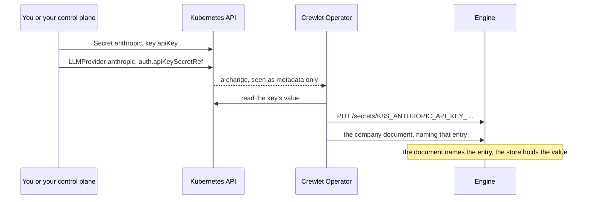

# Supplying Credentials

Every credential a company uses is a key of a Kubernetes Secret that a field
refers to. This guide supplies each one, rotates it, and finds a missing one.

No field accepts the value itself: a model provider's API key, an agent's
Slack app and a tool server's token all come from Secrets.
[Credential Positions](../concepts/credentials.md) is the complete reference:
every credential position Crewlet has and the field that fills it.

## How a value reaches the engine



1. You write a Secret in the object's namespace. Who writes it does not
   matter to the operator: `kubectl`, External Secrets, a CSI driver's
   synced Secret, or a control plane.
2. An object refers to one of its keys (`SecretKeyReference`, `{name, key}`)
   or to the whole Secret (`SecretReference`, `{name}`, where the field
   documents the keys it must hold).
3. The operator reads the value, pushes it into the company's engine, into its
   encrypted secret store, and writes only the entry's name into the company
   document as `${K8S_…}`.

> **The company document holds only the entry's name.** The value never
> appears in a pod template, an environment variable, an annotation, a status,
> an event or a log line. The operator reads Secrets from the API server when
> it applies a document and does not keep them in its cache.

A Secret must exist before the document that references it can be applied.
Until it does, the next revision waits and the engine keeps running the last
one; the object that references it reports `ResolvedRefs=False` with the
reason `SecretNotFound`, naming the Secret and key, and the Company reports
`SecretsSynced=False`. Create the Secret first, or in the same apply: the
operator waits two quiet seconds before it renders, so objects and Secrets
written together are applied together.

A tool server or a coding run may go without a value whose key an
`optionalKeys` list names (the MCPServer's for a tool server, the Seat's
`spec.sandbox` or a setup step's for a coding run), the way a pod goes without
an `optional` `secretKeyRef`: a missing Secret or key there holds nothing
back, the engine starts the server or the run without the value, and the
object that gives the value names it in its `ResolvedRefs=True` message, or
the Company, which has no `ResolvedRefs`, in its `SecretsSynced` message for
its own setup steps
([A key that may go without its value](tool-servers.md#a-key-that-may-go-without-its-value),
[A value a run may go without](cli-agents.md#a-value-a-run-may-go-without)).
Every other value a server or a run is started with must hold something:
Crewlet starts neither with an empty one.

## Each credential

### A model provider's API key

Every model provider is a coding CLI, and its metered key is one key, which
`auth.mode: APIKey` hands the CLI in the variable it reads:

```bash
kubectl create secret generic anthropic -n acme --from-literal=apiKey=sk-ant-...
```

```yaml
apiVersion: crewlet.ai/v1alpha1
kind: LLMProvider
metadata:
  name: anthropic
spec:
  companyRef: {name: acme}
  agent: ClaudeCode
  model: claude-sonnet-5
  auth:
    mode: APIKey
    apiKeySecretRef: {name: anthropic, key: apiKey}
```

A CLI holds one sign-in and rotates nothing: a second key is a second
provider, later in a seat's chain, which the seat falls back to while the
first is out of its limits. Hermes, Pi and OpenCode take their model
provider's key in `env` instead, and a subscription's login is a headless
token or a credential bundle ([A coding CLI's login](#a-coding-clis-login)).

A model the platform provides is declared once on the `EngineClass`, in
`spec.platformLLMProviders`, with references that name their namespace:
the Secret stays in the platform's namespace, which tenants cannot read, and
a Company opts in with `spec.llm.usePlatformProviders: true`. A platform
provider signs in with a key alone, `auth.apiKeySecretRef` or a model
provider's key in `env`, never a subscription's login, which is one
account's.

### Embeddings and the code sandbox

```yaml
spec:                       # Company
  embeddings:
    type: OpenAI
    model: text-embedding-3-large
    apiKeySecretRef: {name: openai, key: apiKey}
  sandbox:
    e2b:
      apiKeySecretRef: {name: e2b, key: apiKey}
```

Variables and files the sandbox sets up for every run (`sandbox.setup[].env`,
`sandbox.setup[].files`) and a Seat's own sandbox variables
(`Seat.spec.sandbox.env`) take `valueFrom.secretKeyRef` for every entry.

A file's `path` is where the seat's E2B box writes it. Name it relative to
the box's home, `/home/user` (`.npmrc`), or under `~/` (`~/.npmrc`); a `..`
that climbs out of the home lands where it resolves. An absolute path works
only where the box's account may write, which is not `/root`, and a path that
names a directory, such as `/tmp`, fails every box at setup. The API refuses
a path of white space alone or under another account's home (`~root/…`).
Crewlet refuses one that names the home itself or a directory above it (`~`,
`/home`): a step of the Company's own reports it on the Company as
`ConfigApplied=False Invalid`, and a Seat's on the Seat as
`Applied=False Invalid`.

### What a coding box carries

A seat's code work signs its coding agent in with the provider it runs on:
the head of `spec.llm.sandbox`, else of `spec.llm.default`, else of the
Company's order, an `LLMProvider` or a platform provider, which drives the
coding agent's own CLI. The engine exports into every box of such a seat the
provider's headless token or its `auth.apiKeySecretRef` key, under the
variable its CLI reads (`CLAUDE_CODE_OAUTH_TOKEN`, `ANTHROPIC_API_KEY`), or
for OpenCode the credential-named variables of its `env`, and never its
credential bundle. A gateway address in its `env` (`ANTHROPIC_BASE_URL`)
is no credential, and stays in the engine's pod: a run that needs it is
given it in `spec.sandbox.env`.

The box runs in the Company's own E2B account, and the coding agent in it
runs with every permission, so it can read the key; the report the run
sends back is redacted by the shape of a credential, not by its value. A
box holds the key it started with and never rotates it, so rotating the
provider's key reaches a running box only when its next run starts. Give
code work a key of its own: a provider whose key is scoped and limited for
code work, first in `spec.llm.sandbox`.

A seat that signs Claude Code in itself, with `CLAUDE_CODE_OAUTH_TOKEN`,
`ANTHROPIC_API_KEY`, `ANTHROPIC_AUTH_TOKEN` or a `CLAUDE_CODE_USE_*` toggle
in `spec.sandbox.env` or a setup step's `env`, gets none of the provider's
sign-in: its own is what the run uses, as Claude Code ranks its sign-ins by
name and a provider's key beside a seat's plan token would win. A sign-in
the run goes without, its key listed in `optionalKeys` and its Secret or key
missing or empty, signs nothing in: the run is given the provider's sign-in,
as one with no sign-in of its own is. Under OpenCode the provider's key is
added beneath the seat's variables, so a seat variable of the same name
wins.

A seat whose executor runs in agent mode has no code work of its own, but
its executor's every run is a box of the same sandbox, with the same
setup and the seat's sandbox environment, and the engine exports into it
the executor's own provider's headless token, its key, or the
credential-named variables of its `env`, beneath the seat's variables,
never its credential bundle
([Text mode and agent mode](cli-agents.md#text-mode-and-agent-mode)). The
CLI runs there with every permission and can read them, as a coding agent
can.

### An agent's Slack app

Each agent seat is its own Slack app, so it posts and is mentioned as itself.
One Secret per seat, with the two keys Slack issues:

```bash
kubectl create secret generic lead-slack -n acme \
  --from-literal=botToken=xoxb-... --from-literal=signingSecret=...
```

```yaml
spec:                       # Seat lead
  integrations:
    slack:
      credentialsSecretRef: {name: lead-slack}   # keys botToken, signingSecret
```

The app's request URL is in the Seat's status,
`status.integrations.slack.requestURL`, as soon as the Company has a Slack
`Integration` and a public address; it does not depend on the credentials,
so it can go into the app's manifest before the app exists.

### An agent's GitHub App

```bash
kubectl create secret generic lead-github-app -n acme \
  --from-file=privateKey=lead.private-key.pem --from-literal=webhookSecret=...
```

```yaml
spec:                       # Seat lead
  code:
    access: Review          # how much the app may do; ReadOnly when unset
  integrations:
    github:
      repos: [acme/widgets]
      app:
        id: 1234567
        slug: acme-lead
        installationID: 89012345
        credentialsSecretRef: {name: lead-github-app}   # keys privateKey, webhookSecret
```

The webhook URL for the app is `status.integrations.github.webhookURL`. How
much the app may do is the seat's `spec.code.access`, not a field of its
GitHub identity: Crewlet keeps one tier for every code host it drives, and
creates the app with that tier's permissions.

### The company's GitHub organization

```yaml
apiVersion: crewlet.ai/v1alpha1
kind: Integration
metadata:
  name: github
spec:
  companyRef: {name: acme}
  github:
    webhookSecretRef: {name: acme-github, key: webhookSecret}
    tokenSecretRef: {name: acme-github, key: orgToken}
```

### An agent's Mattermost bot

Each agent seat speaks on Mattermost as its own bot, whose one token covers
everything it does there:

```yaml
spec:                       # Seat lead
  integrations:
    mattermost:
      botToken:
        secretKeyRef: {name: lead-mattermost, key: botToken}
```

### The other integrations

GitLab's signing token and read token, Jira's and Confluence's administrator
tokens and webhook secrets, Datadog's webhook token and organization keys,
and the administrator credentials the engine creates the seats' accounts
with are each a `SecretKeyReference` of the vendor's `Integration`;
[Connecting integrations](integrations.md) shows every one.

### Credentials the engine provisions

Under an `Integration` with `provisioning: Engine`, the engine creates each
agent seat's account at the vendor and mints its credential itself, into its
own secret store. No Secret holds that value, so the seat names it as
**provisioned** where it would name a Secret key:

```yaml
spec:                       # Seat lead
  mcp:
    - name: gitlab
      env:
        - name: GITLAB_TOKEN
          valueFrom:
            provisioned: {name: gitlab-token}
```

The engine rotates and heals it; the operator never writes, rewrites or
deletes it. [Credential Positions](../concepts/credentials.md#credentials-the-engine-provisions)
says how it is named.

### A coding CLI's login

A provider signs its CLI in with a headless subscription token or with a
credential bundle `crewlet llm export` wrote (for OpenCode, its exported
login: [An OpenCode login in a bundle](cli-agents.md#an-opencode-login-in-a-bundle)),
each a Secret key; with `auth.mode: APIKey`, with the key of
`auth.apiKeySecretRef`; or, for Hermes, Pi and OpenCode, with its model
provider's key in `env`, which may never set the CLI's own token or key
variable, since `auth` owns it, nor a variable the engine sets to keep the
CLI inside its seat's home ([Signing in](cli-agents.md#signing-in)):

```yaml
spec:                       # LLMProvider claude-code
  agent: ClaudeCode
  model: sonnet
  auth:
    tokenSecretRef: {name: claude-subscription, key: oauthToken}
  env:
    - name: HTTPS_PROXY       # every variable comes from a Secret
      valueFrom:
        secretKeyRef: {name: claude-subscription, key: proxy}
```

[Running seats on a coding CLI](cli-agents.md) says which to use.

### A tool server's token

An `MCPServer` shared by every seat takes its credentials as environment
variables (Stdio) or headers (HTTP), each from a Secret:

```yaml
spec:                       # MCPServer linear
  transport: HTTP
  url: https://mcp.linear.app/mcp
  headers:
    - name: Authorization
      valueFrom:
        secretKeyRef: {name: linear, key: authorization}   # "Bearer lin_api_..."
```

A server with `shared: false` starts one instance for each agent seat that
names it in `spec.mcp`, and each Seat (or the Unit it is in) brings its own
credentials for it there:

```yaml
spec:                       # Seat lead
  mcp:
    - name: github          # the MCPServer's name
      env:
        - name: Authorization
          valueFrom:
            secretKeyRef: {name: lead-github, key: authorization}
```

Crewlet treats every value of a tool server's `env` and `headers`, and every
value a seat gives it, as a credential, and cannot tell a setting from one; the
name can. A setting that is no credential, such as an address, a switch or a
seat's own cache path, is written out as `value` instead, under any name
that does not say it holds a credential: the API refuses a `value` under a
name with a part such as `TOKEN`, `KEY`, `SECRET` or `PASSWORD`, and under the
`Authorization`, `Proxy-Authorization` and `Cookie` headers
([Settings and credentials](tool-servers.md#settings-and-credentials) has
the rule). The other lists of variables a credential goes in, a sandbox's,
its setup steps' and a coding CLI's, take no literal value.

### What the platform supplies

An `EngineClass` may reference Secrets in the platform's own namespace for the
engine's pods: telemetry headers (`telemetry.headersSecretRef`) and
class-wide environment variables (`podTemplate.spec.env[].valueFrom`). The
operator copies those values into the Secret it owns in each company's
namespace for the engine's pod (`<company>-bootstrap`), because a pod can
read only Secrets in its own namespace.

The keys of a class's S3 bucket are each company's own, in its namespace:

```yaml
apiVersion: v1
kind: Secret
metadata: {name: acme-objects, namespace: acme}
stringData:
  accessKeyID: AKIA...          # a key whose policy admits the company's prefix only
  secretAccessKey: ...
---
# Company acme
spec:
  objects:
    credentialsSecretRef: {name: acme-objects}
```

Issue them per company, with a policy that admits only the company's prefix
of the bucket (the class's `objects.s3.prefix`, expanded): a key the class
shared would let every tenant read and write every other tenant's files,
because whatever reaches an engine pod reaches code the tenant runs there. A Company's own `spec.runtime.env` reads Secrets in its
namespace directly.

## Rotating a credential

Write the new value into the same Secret and key. The operator sees the
change, pushes the new value into the engine's secret store, and applies a
revision with the same document, because the engine reads a value when a
revision activates. The revision's summary names the Secret. The engine does
not restart and no seat loses its conversation.

```bash
kubectl create secret generic anthropic -n acme --from-literal=apiKey=sk-ant-new... \
  --dry-run=client -o yaml | kubectl apply -f -
kubectl get company acme -n acme -o jsonpath='{.status.config.revisionID}{"\n"}'
```

A change that leaves every referenced value as it was (a label, an
annotation, another key nothing references) writes nothing.

To rotate a provider's key without a moment where the vendor refuses the
one in use, mind the order: write the new key into the Secret, wait for the
revision that carries it, and only then revoke the old key at the vendor.
Every CLI call after that revision is handed the new key. A coding box holds
the key it started with and never rotates it
([What a coding box carries](#what-a-coding-box-carries)), so for a
provider that backs code work wait too for the coding runs already going to
end before you revoke.

A provider's `auth.credentialBundleSecretRef` is an exception. The
engine restores a bundle only into an empty login, when it starts and at
every revision it applies, so a new bundle in the Secret reaches nothing
while the provider's login on the data volume exists, and that refreshed
login is the one to keep ([Signing in](cli-agents.md#signing-in)). To move a
provider onto a new bundle, give it, and every provider sharing its login, a
new `loginName`: its login directory is then empty, and the revision that
moves it restores the bundle there, with no restart. The old directory's
login and seat homes stay on the data volume. A bundle belongs to the CLI it
was exported from: after a provider moves to another `agent`, the new CLI's
login is empty, and the bundle in the Secret is refused there until it holds
one exported from the new CLI ([Signing in](cli-agents.md#signing-in)).

What the engine reads when it starts is the other exception. The values in its
`crewlet.yaml` (the API tokens, the keyring, the Company's object-store keys,
the class's telemetry headers and env values) are read once: the operator
watches the Secrets they come from and rolls the data pod when one changes.
A Secret a Company's `spec.runtime.env` references is not watched; restart
the data pod after changing it
(`kubectl rollout restart statefulset/<company>-data`).

## The engine's own Secrets

The operator generates two Secrets for every company and never rewrites them:

- `<company>-keyring`: the keys that seal the engine's secret store. With
  `deletionPolicy: Retain` it outlives the Company along with the data
  volume, since neither is readable without the other. A platform may
  supply it instead (an ExternalSecret, say): a Secret of that name that
  another controller owns is used as it is. Its annotation
  `crewlet.ai/active-key-id` names the key that seals new writes.
- `<company>-api-tokens`: the operator's own token and the one for the
  company's consumers, which is also published, with the API's address, in
  the Secret `status.apiAccessSecretRef` names. A platform may supply this
  one too; each token must be at least 43 characters of base64, base64url
  or hex (32 random bytes: `openssl rand -base64 32`), or the pod is held
  back with `RuntimeReady=False APITokensInvalid`.

Deleting the tokens Secret makes the operator generate new tokens and roll
the data pod; consumers then read the new one from the access Secret. The
tokens keep their ids, and Crewlet keeps a dashboard session opened with a
token by its id rather than its value, so a session opened with the old
access token lasts out its hour; sign in with the new token and sign out
everywhere to end those sooner
([Rotating the access token](people.md#rotating-the-access-token)). A
rotation does not undo what a leaked token did: it holds `admin`, so it could
read and replace every value in the engine's secret store and add people and
service accounts, and each needs its own clean-up
([If the access token leaked](people.md#if-the-access-token-leaked)). Never
delete the keyring of a company that has data: the values sealed with it
cannot be read without it.

Rotating the keyring is not supported in v1alpha1. Crewlet rotates a key by
adding the new one, making it active, re-sealing both its secret store and
its stored company configuration under it (`crewlet secrets rekey` and
`crewlet config rekey`), and only then dropping the old one; the operator
runs none of those steps, and a key removed before the re-seal leaves
whatever it sealed unreadable. No engine boots while its secret store holds
a value its keyring cannot open, so such a removal stops every data pod and
seat pod of the company, each restarting until the key is back in
`<company>-keyring`
([The data pod is not ready](troubleshooting.md#the-data-pod-is-not-ready)).
Adding a key to the Secret is safe (the pod rolls onto a keyring that opens
everything it did); removing one is not.

## When a credential does not arrive

| You see | It means |
|---|---|
| `ResolvedRefs=False SecretNotFound` on an object, `SecretsSynced=False SecretNotFound` on the Company | The Secret or the key is missing in the object's namespace. The message names both. |
| `SecretTooLarge` | The value is over the 64 KiB the engine's secret store accepts. |
| `SecretsSynced=False EngineUnavailable` | The values could not be written to the engine; the message says why. The operator retries. |
| `SecretsSynced=Unknown NotManaged` | The management policy keeps the operator out of the engine's secret store (`Observe`, and `Seed` once seeded). |
| `RuntimeReady=False SecretNotFound` | A Secret the EngineClass references for the pods is missing in the platform's namespace, or the Company's `spec.objects.credentialsSecretRef` is. |
| `RuntimeReady=False APITokensInvalid` | A supplied `<company>-api-tokens` lacks a token or holds one the engine should not be guarded by; the message says which. |
| `Integration` `Healthy=False CheckFailed` | The engine reached the vendor and the credential did not work; the message carries the vendor's answer. |
| `ResolvedRefs=False SecretValueEmpty` | A Secret key the object gives a tool server or a coding run holds an empty value, under a key no `optionalKeys` lists: the object is applied, and the engine does not start the server, or refuses each coding run, until the key holds a value. The message names the Secret, the key, the variable, and the `optionalKeys` that could list it where Crewlet offers one: never for a Seat's or a Unit's value for a tool server, the identity the seat's instance acts as. The Company's own setup steps say it in `SecretsSynced`. |
| `Seat` `ResolvedRefs=False NoProvisioner` | The Seat names a provisioned credential, and no Integration of its company has `provisioning: Engine` to create it. The seat is applied; until one does, the engine starts none of its tool servers that take the value and refuses each of its coding runs, unless the `optionalKeys` that governs the value lets them go without it (the MCPServer's, or the seat's `spec.sandbox.optionalKeys`), and its chat app runs without it. |

[Troubleshooting](troubleshooting.md) lists every condition.

## See also

- [Credential Positions](../concepts/credentials.md) — every position, and who can read a value
- [Connecting Integrations](integrations.md) — each vendor's credentials
- [Troubleshooting](troubleshooting.md) — `SecretNotFound` and the other reasons
