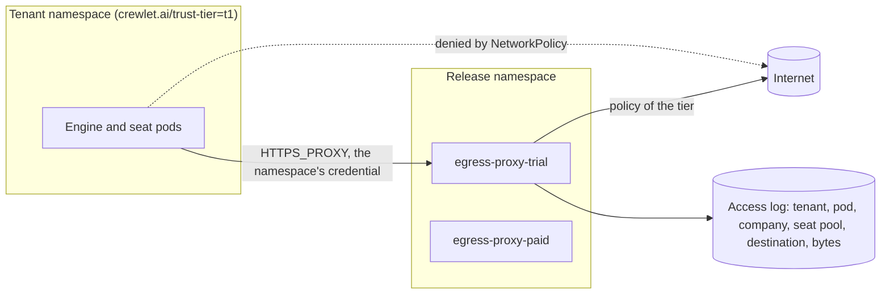

# Running the Tier Egress Proxy

A tenant's engine runs code the tenant supplies: harnesses, stdio tool
servers, and whatever its agents have them run. On a platform that hosts
many tenants, that code should not reach the internet straight from the
node, where every tenant shares the node's addresses and nothing records
which tenant made a connection. The chart's egress proxy is the one way out
for such namespaces once their NetworkPolicies deny every other.



## What it does

One proxy runs per tier, each a Deployment, Service, ConfigMap and
NetworkPolicy named `<release>-egress-proxy-<tier>`. A proxy:

- Serves HTTP `CONNECT` tunnels and plain `http` requests in absolute
  form. A client tunnels `https` with `CONNECT`, as every client that reads
  `HTTPS_PROXY` does.
- Names the pod behind each connection from its source address, through an
  informer on the cluster's pods and namespaces. A pod on the host network,
  a finished pod, and an address two pods claim name no one, and are refused.
- Requires the source namespace's credential as `Proxy-Authorization:
  Basic`, user name the namespace and password its token, so a proxy URL of
  `http://<namespace>:<token>@<service>:3128` works as `HTTPS_PROXY`. The
  token is an HMAC of the namespace's name and UID under the signing key: the
  proxy keeps no table of credentials, a credential copied out of one
  namespace does nothing from another, a namespace recreated under the same
  name gets a new one, and rotating the key revokes every credential at once.
- Refuses a namespace without the `crewlet.ai/tenant` label, a namespace
  that carries `crewlet.ai/quarantine` (any value), and a namespace whose
  `crewlet.ai/trust-tier` is not one of the tier's `trustTiers`.
- Holds the destination to the tier's policy: its ports, its `allowHosts`
  and `denyHosts`, and, unless `allowIPLiterals` is on, a name rather than an
  address.
- Refuses, whatever the tier says, every address in a special-purpose range:
  private (10.0.0.0/8, 172.16.0.0/12, 192.168.0.0/16, fc00::/7), loopback,
  link-local (the cloud metadata endpoints 169.254.169.254 and fd00:ec2::254
  among them), shared address space (100.64.0.0/10), unspecified, multicast,
  reserved, IPv6 documentation, discard-only, 6to4 and Teredo (both tunnel
  to any IPv4 address), NAT64 forms of any of these, and any IPv6 address
  with a zone, plus the tier's `deniedCIDRs`. It resolves a name once, as a
  fully qualified name, refuses it if any address is denied, and dials the
  checked address itself, so a second lookup cannot swap one in.
- Refuses names of the cluster's own: a single-label name (`kubernetes`)
  and any name under `clusterDomain` (`cluster.local` by default). Names are
  resolved with a trailing dot, so the proxy pod's search list never turns
  `kubernetes.default.svc` into a Service address.
- The special-purpose ranges hold the Pod, Service and node networks of most
  clusters, but not all. When the cluster's pod, Service or node ranges are
  not private (public IPv4, or global IPv6 outside fc00::/7), list them in
  `deniedCIDRs`: otherwise a tenant reaches them through the proxy.
- Ends a connection idle for `idleTimeoutSeconds` (300) or older than
  `maxConnectionSeconds` (1800), so it is no long-lived tunnel; a client
  that stops reading a response and a destination that stops sending one
  are held to the same idle bound. A kept-alive client connection with no
  request in flight is closed after 60 seconds. It never follows a
  redirect: the client does, through the proxy again.
- Caps open connections at `maxConnectionsPerNamespace` (256) for one
  namespace, refused with 429, and `maxConnections` (8192) for the proxy,
  refused with 503, so that one tenant cannot hold every connection.

### The access log

Each connection, served or refused, is one JSON line on the proxy's
standard output:

| Field | Meaning |
|---|---|
| `time` | When the request arrived, UTC |
| `decision`, `reason` | `allowed` or `denied`, and why a denial was made or a tunnel was ended |
| `tenant`, `namespace`, `trustTier` | The source namespace's tenant label, name and trust tier |
| `pod`, `company`, `component`, `seatPool` | The source pod, its `crewlet.ai/company`, `app.kubernetes.io/component` and `crewlet.ai/seat-pool` labels |
| `method`, `host`, `port`, `ip` | What was asked for, and the address dialed or refused |
| `bytesUp`, `bytesDown`, `durationMs` | What passed each way, and for how long |

`tenant`, `namespace` and `trustTier` come from the namespace, which only
the platform labels. `company`, `component` and `seatPool` come from the
source pod's own labels, so they are as trustworthy as whoever may create
pods in the namespace: in a hosted cell, where only the operator creates
them, they are the operator's word; where a tenant may create pods, read
them as the tenant's claim and attribute by namespace and pod name.

The credential is never logged. The log names the seat pool, not the seat
run: a pool's pod runs many seats, and only the engine knows which run made
a connection. Naming the run needs a short-lived credential per run, stamped
by the engine; until the engine issues one, join a log line to a run by the
pod and time against the engine's executor records.

## Installing it

Create the signing key in the release namespace. The chart never creates
it, because whatever mints the tenants' credentials must sign with the same
bytes, used as they are (a trailing newline is part of the key):

```bash
kubectl -n crewlet-operator-system create secret generic egress-signing-key \
  --from-literal=signing-key="$(openssl rand -base64 48)"
```

Then enable the proxy with a tier per trust tier:

```yaml
egressProxy:
  enabled: true
  signingKeySecret:
    name: egress-signing-key
  tiers:
    - name: trial
      trustTiers: [t1]
      ports: [443]
      allowHosts: ["*.github.com", registry.npmjs.org, pypi.org, files.pythonhosted.org]
    - name: paid
      trustTiers: [t2, t3]
      ports: [443, 80]
      denyHosts: [example-tunnel.invalid]
      nodeSelector:
        crewlet.ai/egress-pool: paid
```

Place each tier's pods with `nodeSelector` and `tolerations` on nodes whose
traffic leaves from that tier's addresses, so that one tier's abuse never
lands on another's. The proxy runs from the operator's own image, as its
`/egress-proxy` command, so a release pins both to one build.

The tier's NetworkPolicy admits the proxy port only from namespaces with the
`crewlet.ai/tenant` label and one of the tier's trust tiers. Its egress is
open, and named so: the proxy's work is to connect out, the addresses it must
never reach are refused in the proxy itself, and a CNI that denies whatever
no policy allows (the VPC CNI's strict mode) would otherwise cut it off.

## What the tenant namespace needs

The proxy is the way out only when nothing else is. Each tenant namespace
needs:

- Egress denied except DNS, the namespace's own pods, and its tier's proxy
  Service on port 3128. A NetworkPolicy that allows more, anywhere in the
  namespace, opens it again, since policies add up.
- `HTTPS_PROXY` and `HTTP_PROXY` set to the proxy URL with the namespace's
  credential, and `NO_PROXY` covering the cluster's own names, on every pod
  that runs tenant code.

An EngineClass's `networkPolicy.egress.proxy` does the first two for every
engine pod of its companies: its NetworkPolicies allow DNS, the namespace and
the proxy's pods alone, and it gives each pod the variables with the
credential, minted from the same signing key
([Through an egress proxy](exposure.md#through-an-egress-proxy)).
- The labels `crewlet.ai/tenant` and `crewlet.ai/trust-tier`, set only by
  the platform (see [Hosting Many Tenants on the Operator](multi-tenancy.md)).

Setting `crewlet.ai/quarantine` on the namespace cuts it off at the proxy at
once, on the next connection, without touching its pods or volumes.
