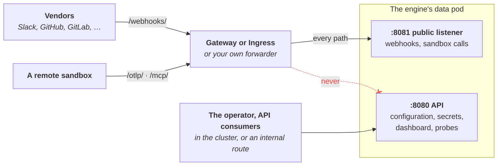
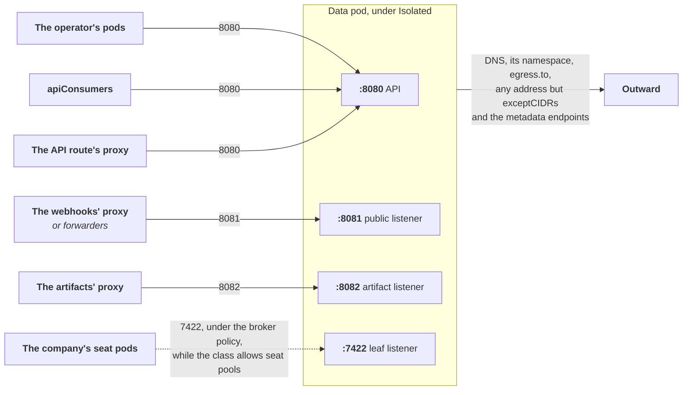

# Exposure and Network Policy

A company's engine listens on two ports: 8080 for its API, dashboard and
probes, and 8081, its public listener, the only one vendors and sandboxes call.
A company with an artifact origin opens a third, 8082
([Serve artifacts from an origin of their own](#serve-artifacts-from-an-origin-of-their-own)).

Port 8081 serves only the routes outside parties call, each of which
authenticates itself without an operator credential: vendors' webhooks
(`/webhooks/`), and a remote sandbox's telemetry (`/otlp/{token}`) and tool
calls (`/mcp/{token}`), with a token signed for its one run in the path. Only
the public listener needs to be reachable from the internet, and only it is
routed there; port 8080 stays in the cluster unless the class gives it an
internal route ([Reach the API from elsewhere](#reach-the-api-from-elsewhere)).
This guide sets up the webhook routes, the public address vendors are given,
the address people reach the dashboard at, an internal route to the API, and
the network policy around each engine. The objects involved are described in
[How a company's engine runs](../concepts/runtime.md#exposure).



The split is the engine's own (Crewlet's `api.public`): the public listener
answers every other path, `/config` and `/health` included, as a path
nothing serves, whatever credential is sent, and the API port answers a
public route with `404` and a hint naming the public listener. Every data
pod opens both ports, whatever its class routes.

All of it is the platform's choice, made once per `EngineClass` in
`spec.exposure` and `spec.networkPolicy`; a Company only states its own
address when the class leaves that to it.

## Choose how webhooks arrive

| `exposure.webhooks.mode` | Use it when | The Company's public address |
|---|---|---|
| `Gateway` | The cluster runs a Gateway API implementation | `https://<hostname>`, or the Company's `spec.exposure.publicBaseURL` |
| `Ingress` | The cluster has an Ingress controller | the same |
| `External` | Something outside the operator (a CDN, a tunnel, a load balancer you manage) forwards to the engine | the Company's `spec.exposure.publicBaseURL`, which is then required |
| `None` (the default) | Nothing reaches the engine from outside: development, or companies whose integrations deliver no webhooks (Mattermost, an Atlassian organization) | none; integrations that need inbound delivery report `Healthy=False NotExposed` |

Whatever the mode, the route sends every path of its host to the public
listener (the engine Service's port `public`, 8081), and never to the API
port. It names no path prefix: the listener itself is the boundary, and
Crewlet decides which routes are public from one list of its own, so a
route that repeated `/webhooks/`, `/otlp/` and `/mcp/` would add no
protection the listener does not give (the admin API is not on that port to
be reached by any path) and would be a second list to keep in step, which a
Crewlet release serving a new public route would outgrow with nothing to
say so. What the public listener serves depends on what the engine is given:

- `/webhooks/`: always. A delivery for a vendor the company has not
  connected is refused (`503`).
- `/mcp/{token}`, the tool bridge, while an `LLMProvider` of the company runs
  a CLI in `mode: Agent`: that run happens in a remote sandbox, which calls
  the seat's tools back through it ([Running seats on a coding
  CLI](cli-agents.md)). The operator then gives the engine the public address
  as the bridge's (`CREWLET_MCP_BRIDGE_URL`); without one the engine mounts
  no bridge and `/mcp/` is a path nothing serves, and every agent-mode turn
  fails: the provider reports `AgentModeRunnable=False`, `NotExposed`, and
  each seat whose executor's chain it heads `Ready=False`, `NotExposed`,
  while the rest of the company's document applies.
- `/otlp/{token}`, the sandbox telemetry receiver, while the class sends the
  engine's telemetry to a collector (`spec.telemetry`): a remote sandbox's
  coding agent exports its traces there, and the engine forwards them to the
  collector with the class's headers, which never enter the sandbox. The
  operator gives the engine the public address as the receiver's
  (`CREWLET_SANDBOX_OTEL_RECEIVER_URL`).

Crewlet reads both variables at every start, as a sandbox's URL parser (the
WHATWG URL Standard's) will, and refuses to start on a value that parser
cannot read: a host with an IPv6 zone, with a `%`, `<`, `>` or `]` in its name
(an unfilled placeholder such as `<engine-host>` among them), or whose last
label is a number and that is no IPv4 address. So the API refuses such a
`publicBaseURL`, and takes an IPv4 address there as four decimal octets alone,
and refuses a class's `webhooks.hostname` whose last label is a number, such
as `{{uid}}.hooks.123`. A last label a variable fills is a number only for
some Companies ([Reach the API from elsewhere](#reach-the-api-from-elsewhere)
says which), and while the operator hands such a Company's address to
sandboxes it holds that Company's engine back, with `RuntimeReady=False
AddressRefused`, rather than start one that refuses to boot.

The address appears in the Company's `status.endpoints.publicBaseURL`, and
each Seat's and Integration's status carries the exact URL to register with
the vendor.

### Through a Gateway

```yaml
apiVersion: crewlet.ai/v1alpha1
kind: EngineClass
metadata:
  name: standard
spec:
  # engine, data: as for any class
  exposure:
    webhooks:
      mode: Gateway
      gateway:
        parentRefs:
          - namespace: gateway-system
            name: public
            sectionName: https        # optional: one listener
      hostname: "{{uid}}.hooks.example.com"
```

The operator creates an HTTPRoute `<company>-webhooks` in each company's
namespace, attached to the Gateway, for the expanded host name. The template
must contain `{{uid}}`, or `{{name}}` and `{{namespace}}` joined by a `.`, so
that no two companies share a host. A `-` between them is refused: names and
namespaces hold dashes, so `{{namespace}}-{{name}}` is `team-a-b-web` for both
`team-a`/`b-web` and `team-a-b`/`web`, and whichever route came first would
receive the other tenant's deliveries. `{{uid}}` keeps the address stable for
the Company's lifetime and reveals nothing about the tenant. Point a wildcard DNS record
(`*.hooks.example.com`) and a wildcard certificate at the Gateway.

The Gateway's listener must admit routes from the tenants' namespaces
(`allowedRoutes.namespaces`), for example by a label every tenant namespace
carries:

```yaml
listeners:
  - name: https
    protocol: HTTPS
    port: 443
    hostname: "*.hooks.example.com"
    allowedRoutes:
      namespaces:
        from: Selector
        selector:
          matchLabels:
            platform.example.com/tenant: "true"
```

The Company reports `Exposed=True RouteAccepted` once every Gateway the route
names reports it accepted, and `Exposed=False RouteNotAccepted` with the
Gateway's reason until then. The operator looks for the Gateway API when it
starts: if you install it later, restart the operator, or every company of a
Gateway class reports `GatewayAPINotInstalled`.

### Through an Ingress

```yaml
spec:
  exposure:
    webhooks:
      mode: Ingress
      ingress:
        className: nginx
        annotations:
          cert-manager.io/cluster-issuer: letsencrypt
        tls:
          secretName: "{{name}}-webhooks-tls"     # in the Company's namespace
        controllerNamespaces: [ingress-nginx]   # required with networkPolicy.mode: Isolated
      hostname: "{{uid}}.hooks.example.com"
```

The Ingress `<company>-webhooks` is accepted once the controller publishes an
address for it. Its TLS Secret lives in the Company's namespace, so it is
issued per company, here by a certificate controller from the Ingress's
annotations.

### Load balancer health checks

The public port answers `404` on every path it does not serve, `/` and the
probe paths included, so a load balancer that health-checks a backend on the
port it routes to marks every engine unhealthy and drops every delivery.
Controllers that run in the cluster (ingress-nginx, Envoy Gateway and most
Gateway implementations) send no such check by default; cloud load balancers
do. Point their check at port `http` (8080), path `/ready`, which every engine
pod answers `200` once it serves:

- **AWS Load Balancer Controller** (ALB, `target-type: ip`): checks `GET /`
  and expects `200`. Set the class's `ingress.annotations`:

  ```yaml
  alb.ingress.kubernetes.io/target-type: ip
  alb.ingress.kubernetes.io/healthcheck-port: "8080"
  alb.ingress.kubernetes.io/healthcheck-path: /ready
  ```

- **GKE Ingress**: takes its check from the pod's readiness probe only when
  that probe is on the port the Ingress sends to, and otherwise checks
  `GET /` there. Create a `BackendConfig` in each company's namespace whose
  `healthCheck` is `{type: HTTP, port: 8080, requestPath: /ready}`, and name
  it on the engine Service through the class's `service.annotations`:

  ```yaml
  spec:                       # EngineClass
    service:
      annotations:
        cloud.google.com/backend-config: '{"ports": {"public": "crewlet-public"}}'
  ```

- **GKE Gateway**: create a `HealthCheckPolicy` in each company's namespace
  whose `targetRef` is the Service `<company>-engine`, with the same check.

These load balancers deliver to the pods from addresses outside the pod
network, which a NetworkPolicy cannot admit by namespace: run their classes
with `networkPolicy.mode: None` and isolate the engines with your cloud's or
CNI's own policy.

### From outside the operator

With `mode: External` the operator creates no route. Forward everything
under `https://<your address>/` to the public port of the Service
`<company>-engine.<namespace>.svc:8081` (port name `public`), keeping the
path, and give each Company its address:

```yaml
spec:                       # Company
  exposure:
    publicBaseURL: https://acme.hooks.example.com
```

> **Never forward to port 8080.** That is the admin API, and it answers a
> webhook `404` anyway.

The address is an `https` URL with a host, and a path if your forwarder
routes by one. Its host is a name, an IPv4 address or an IPv6 address in
brackets, followed by at most one port, of 1 to 65535: Crewlet refuses to
start on any other, so the API refuses the Company rather than the data pod
crash-looping. Crewlet also refuses a query or a fragment, and the API
refuses even an empty one, a bare `?` or `#`, which Crewlet would take,
since every address the engine builds on this one appends a path to it;
and it refuses a user name, which Crewlet would take too, since a
credential is never written into an address.

Under `networkPolicy.mode: Isolated`, name the pods that
forward (a tunnel's or a relay's pods in the cluster) in the class, so the
policy admits them to the public port and to nothing else. The class is
refused without them, since the policy would then refuse everything
forwarded, and refused with them under any other mode, which has no policy
to admit them to:

```yaml
spec:                       # EngineClass
  exposure:
    webhooks:
      mode: External
      external:
        forwarders:
          - namespaceSelector:
              matchLabels: {kubernetes.io/metadata.name: tunnel}
            podSelector:
              matchLabels: {app: cloudflared}
```

A forwarder whose traffic does not come from a pod (a load balancer of your
own that delivers from the nodes or from outside the cluster) cannot be
admitted by namespace; isolate those engines with your CNI's own policy and
`networkPolicy.mode: None`.

A Company may set `publicBaseURL` under the other modes too, when the
address vendors use differs from the route's host (a CDN in front of the
Gateway, say).

## Reach the API from elsewhere

`status.endpoints.api` is always the in-cluster address,
`http://<company>-engine.<namespace>.svc:8080`, and that is all most
consumers need: see [Reaching the engine](../concepts/runtime.md#reaching-the-engine).
To reach the API from outside the cluster, for a dashboard behind your own
single sign-on for instance, route it through an internal Gateway or
Ingress:

```yaml
spec:
  exposure:
    api:
      mode: Gateway
      gateway:
        parentRefs:
          - {namespace: gateway-system, name: internal}
      hostname: "{{name}}.{{namespace}}.crewlet.internal.example.com"
```

The route `<company>-api` carries every path of the API port (8080): the
API, the dashboard and the probes, and none of the public routes, which
that port does not serve. Put it only on a listener that is not public. Its
host name must differ from the webhooks' (the class is refused otherwise):
both routes take every path of their host, so on one host the Gateway or
Ingress controller would pick which port answers, and the public host could
serve the admin API.
`status.endpoints.exposedAPI` is its address once accepted. Every request
still needs a credential: a person signed in at the dashboard, or a token.

The route's address is also where a browser reaches the engine, and an
origin the engine accepts a person's write from ([Where people reach the
dashboard](#where-people-reach-the-dashboard)), so its host's last label
may not be a number: a browser reads `{{uid}}.123` or `{{uid}}.0x1f` as an
IPv4 address and rewrites it before it sends it, and Crewlet refuses to
start on such an address, so the API refuses the class. A last label a
variable fills, as in `{{name}}.{{namespace}}`, is a number only for some
Companies: one whose namespace is a number, `4711` or `0x1f` say, or whose
namespace or name makes one with the template's own characters beside it,
as `{{uid}}.0x{{name}}` does for a Company named `cafe` (a Company's name
begins with a letter, so it is never a number alone). The operator then
holds that Company's engine back, with `RuntimeReady=False AddressRefused`,
rather than start one that refuses to boot. End the template in a domain of
your own, as above, and no Company meets it.

## Where people reach the dashboard

A browser reaches the engine at one address, which the engine must be told
and reads only at start: Crewlet's `api.external_url`, in the data pod's
`crewlet.yaml`
([what Tier A must state](https://github.com/crewlet/crewlet/blob/main/docs/concepts/configuration.md#what-tier-a-must-state-once-the-api-is-served)).
The engine takes from it:

- the origin it accepts a person's write and a socket from: a browser's
  request from another origin is refused;
- whether the session cookie a person signs in with is `Secure` (with an
  `https` address) or travels in the clear (with an `http` one);
- every link a person follows: an invitation
  (`<base>/dashboard#/invite/...`), a password link, a tool skill's
  `${crewlet_base_url}`, the link in a page change's notification.

It is never the public address, whose listener serves no dashboard. The
operator writes it from, in order:

1. the Company's `spec.exposure.dashboardBaseURL`, an `http` or `https` URL,
   for an address people reach the dashboard at that the class does not
   route (a single sign-on proxy in front of the API's route, a VPN
   address);
2. the API route's address: its expanded `api.hostname`, on `https` when
   the Ingress has `tls.secretName` or a Gateway listener the route can
   attach to is HTTPS, and on `http` otherwise. Unlike `exposedAPI`, it
   does not wait for the route to be accepted, so a Gateway controller
   re-evaluating the route, or an Ingress controller that publishes no
   address, restarts nothing;
3. `http://localhost:8080`, where
   `kubectl port-forward svc/<company>-engine 8080` serves the engine's API
   port: the one address every company has. Crewlet reads `localhost` as
   loopback, so the cookie needs no TLS there and nothing warns, and a class
   that lets people sign in with a password alone needs no acknowledgement
   there ([Two-step verification](people.md#two-step-verification)).

The result is `status.endpoints.dashboardBaseURL`, and a change of it
restarts the data pod. With the third, every link the engine gives a person,
an invitation's included, leads to a `localhost` only a port-forwarding
browser reaches, and the Company's `Exposed` condition says so in its
message. An `http` address on a routable host works, but its cookie travels
unencrypted: route the API over HTTPS for anyone who signs in from
elsewhere. The data pod says so in its log at every start, as a
`config_advisory` line at `WARN` for `api.external_url`
([Read what the engine is worth telling you](troubleshooting.md#read-what-the-engine-is-worth-telling-you)).

When the Company's own address is not on the route's origin, the route is
still an address the engine is reached on: the operator adds the route's
origin to the engine's `api.auth.allowed_origins`, so a person who signs in
through the route can write as well as read.

A link an agent composes is the base followed by one of the engine
dashboard's own routes, such as `<base>/#/worklet/ENG-42` for a work item
and `<base>/#/doclet/pages/<page id>` for a page. So an address other than
the API route's must serve the engine there, its `/dashboard` and `/auth`
routes included, since a person signs in through it: the part after `#`
never reaches a server, so the dashboard reads it in the browser.

```yaml
spec:                       # Company
  exposure:
    dashboardBaseURL: https://crewlet.sso.example.com/acme
```

The engine compares the origin a browser sends with this address in the
browser's own spelling, and refuses to start on an address whose host a
browser rewrites before it sends it, or that is not a host and a port at
all. So the API refuses, on the Company rather than in a crash-looping data
pod:

| Refused | Write instead |
|---|---|
| A host outside ASCII, as it is or percent-encoded: `https://bücher.example`, `https://b%C3%BCcher.example` | Its ASCII (`xn--`) form, the one a browser sends: `https://xn--bcher-kva.example` |
| A host whose last label is a number and that is not four decimal octets: `http://127.1`, `http://2130706433`, `http://0x7f.0.0.1`, `http://192.168.010.1` (a leading zero is octal to a browser), `http://1.2.3.4.`, `https://crewlet.123` | The IPv4 address as four decimal octets, `http://127.0.0.1`, or a host name whose last label is not a number |
| An IPv6 address with a zone, which no browser can address: `http://[fe80::1%25eth0]:8080` | An address a browser reaches without one, such as a host name |
| A second `:` after the host, or brackets around anything but an IPv6 address: `http://h.example:80:80`, `http://::1:8080`, `http://[1.2.3.4]` | One port after the host, and an IPv6 address in brackets: `http://[::1]:8080` |
| A port outside 1 to 65535: `:0`, `:65536` | A port in that range, or none for the scheme's own |

The API checks the host and the port itself rather than leaving them to the
API server's URL parser, which is Go's `net/url` as the API server was built
and is run: an API server run with Go's `GODEBUG=urlstrictcolons=0` parses
`http://h.example:80:80`, and Crewlet does not.

It also refuses three things Crewlet would take: an empty query or
fragment, a bare `?` or `#` (Crewlet refuses any other, as the API does),
since every link the engine builds on the address appends a path to it; a
user name, with or without a password, since a credential is never written
into an address; and white space around the address. Write the address
alone, with a path if a proxy serves the engine under one.

An IPv4 address of four decimal octets, an IPv6 address in brackets,
`localhost` in any case, a path and a trailing `/` are all taken.

## Serve artifacts from an origin of their own

The dashboard frames HTML pages and designs from the engine's artifact
listener, port 8082 (Crewlet's `api.artifacts`), which serves artifacts, the
page runtime and kit, and the files of the company's adopted brand, and
nothing else, so a page somebody wrote never runs where the dashboard's
session does. The data pod opens it only while the Company has an address
for it, `status.endpoints.artifactsBaseURL`: its
`spec.exposure.artifactsBaseURL`, else the class's artifacts route while it
serves `https`. Without one, every other kind of artifact still opens.

```yaml
spec:                       # EngineClass
  exposure:
    artifacts:
      mode: Gateway
      gateway:
        parentRefs:
          - {namespace: gateway-system, name: usercontent}
      hostname: "{{uid}}.crewletusercontent.example"
```

| `exposure.artifacts.origins` | The route's host | The engine is told |
|---|---|---|
| `PerArtifact` (unset) | `*.<hostname>`, with a wildcard DNS name and certificate | `https://{artifact}.<hostname>` |
| `Shared` | `<hostname>`; every artifact is opaque, with no browser storage | `https://<hostname>` |

Crewlet refuses an artifact origin over plain `http` on a routable host, so
an `Ingress` needs `ingress.tls`, and a Gateway route without an HTTPS
listener opens nothing and reports `Exposed=False RouteNotHTTPS`. Give
`hostname` a domain of its own: on the dashboard's site Crewlet serves every
artifact opaque and says so in the data pod's log. It must differ from
`api.hostname` and `webhooks.hostname`, and neither may be under it.

A Company may state its own address instead, `https://`, or `http://` on
`localhost` for a browser that port-forwards port 8082:

```yaml
spec:                       # Company
  exposure:
    artifactsBaseURL: https://{artifact}.acme.crewletusercontent.example
```

Publishing an artifact uploads its files through the API port: raise an
Ingress controller's request body limit there (ingress-nginx's default is
1 MiB) with `api.ingress.annotations`.

A shared cache in front of the artifacts route may keep `/_crewlet/kit/` and
`/_crewlet/runtime/` keyed without the host, since they are the same on every
company's origin. It must keep the host in the key for `/_crewlet/brand/`,
which serves one company's adopted brand, and must never cache a `/t/` path
([what a proxy in front of it must do](https://github.com/crewlet/crewlet/blob/main/docs/guides/artifacts-serving.md#a-reverse-proxy-in-front-of-it)).

## Name the proxies in front of the engine

Behind a route, every request reaches the engine from the Gateway's proxy or
the Ingress controller, and the engine sees that address for every caller
unless it is told the request came through a proxy it trusts. Crewlet then
counts every person's failed sign-ins at one login together, so a stranger
guessing at somebody's login holds up that person's own sign-in, and the
audit trail records the proxy rather than the caller. While the API's
address is `https` and the class lists no proxy, the data pod says so in its
log at every start, as a `config_advisory` line at `WARN` for
`api.trusted_proxies`: Crewlet cannot tell a proxy that hides the caller from
a load balancer that passes the caller's own address through, so it warns
rather than refuses.

List the address blocks of whatever forwards to the engine in the class's
`spec.exposure.trustedProxies`, Crewlet's `api.trusted_proxies`: the Gateway's
proxies or the Ingress controller, and a load balancer in front of them that
does not pass the client's address through. The engine then reads the
client's address from `X-Forwarded-For` on a request from one of them, and
believes the header from nobody else.

**Every address in the list can choose the client address the engine sees**,
and with it its own place in the sign-in throttle, so list the narrowest
blocks that hold only the proxies: the proxies' own addresses where they are
stable, or the pod range of a node pool that runs nothing else. Not the whole
pod network. That includes the data pod itself, whose tool servers and local
sandbox runs can reach its API at its own address whatever the network
policy says, and under `networkPolicy.mode: None` every workload in the
cluster.

```yaml
spec:                       # EngineClass
  exposure:
    trustedProxies:
      - 10.244.12.0/24      # the pod range of the node pool that runs only
                            #   the Gateway's proxies
```

Each entry is a canonical CIDR; a single host is a `/32` or `/128`, and a
block of the whole address space (`0.0.0.0/0`, `::/0`) is refused, since it
would believe a forwarded address any caller sends. A change rolls the data
pods, which read it at start.

## Network policy

With `networkPolicy.mode: Isolated`, the default, the operator creates a
NetworkPolicy `<company>-engine` around the company's data pods. It admits
each of the engine's ports from its own sources and from nothing else.
The API port, 8080, only from:

- the operator's own pods (its namespace, and the pod labels its
  `--operator-pod-labels` flag names), so it can apply documents;
- the class's `networkPolicy.apiConsumers`, for your platform's components
  that call the engines' APIs;
- the namespaces the API's route arrives from: `exposure.api`'s
  `gateway.proxyNamespaces` (its Gateways' own namespaces when unset) or
  `ingress.controllerNamespaces`.

The public port, 8081, only from where webhooks arrive: `exposure.webhooks`'
`gateway.proxyNamespaces` (its Gateways' own namespaces when unset),
`ingress.controllerNamespaces`, or `external.forwarders`. Under
`webhooks.mode: None` nothing is admitted to it.

The artifact port, 8082, only from where the artifacts' route arrives, by
the same fields of `exposure.artifacts`.



So a webhook's proxy reaches no admin route, and an API consumer cannot
reach the port published to the internet. Everything else, other tenants and
the tenant's own other pods included, is refused. Name your consumers in the
class, by namespace and pod labels:

```yaml
spec:
  networkPolicy:
    mode: Isolated
    apiConsumers:
      - namespaceSelector:
          matchLabels: {kubernetes.io/metadata.name: platform}
        podSelector:
          matchLabels: {app: control-plane}
```

Only whoever writes EngineClasses decides this; no label a tenant or a
namespace editor can set admits anything.

The engine runs code its tenant supplies in its own pod: stdio MCP servers,
coding CLIs, and whatever its agents have them do. So the policy also limits
where the engine connects to. A seat's code work and an agent-mode
executor's run, a sandbox's setup commands included, run in the Company's
E2B sandbox, which this policy does not reach. The engine may reach DNS (port 53), the pods of its own namespace,
and every address except the cloud metadata endpoints (`169.254.169.254`,
`fd00:ec2::254`), which hand the node's credentials to whatever asks. A
NetworkPolicy cannot tell an address inside the cluster from one outside it,
so list the cluster's pod, Service and node networks in `egress.exceptCIDRs`;
without them, an engine reaches other tenants' pods, the Kubernetes API
server and the nodes. Admit what the engine needs inside the cluster (an
in-cluster model gateway, the telemetry collector, an object store) with
`egress.to`:

```yaml
spec:
  networkPolicy:
    mode: Isolated
    egress:
      exceptCIDRs: [10.244.0.0/16, 10.96.0.0/12, 172.18.0.0/16]
      to:
        - namespaceSelector:
            matchLabels: {kubernetes.io/metadata.name: observability}
          podSelector:
            matchLabels: {app: otel-collector}
```

On AWS, also require IMDSv2 with a hop limit of 1 on the nodes, so that a
pod that gets past the policy still cannot read the node's role.

Set `gateway.proxyNamespaces` when your Gateway implementation runs its proxy
somewhere other than the Gateway's namespace:

```yaml
gateway:
  parentRefs:
    - {namespace: gateway-system, name: public}
  proxyNamespaces: [envoy-gateway-system]
```

A class that allows seat pools (`seatPools.policy: Allowed`) also has the
operator create two more policies per company, under either mode:

- `<company>-broker` admits the data pods' leaf listener (port 7422) from the
  company's own seat pods and from nothing else, since Crewlet's broker port
  takes any connection without authentication or TLS. Under `None` it also
  admits ports 8080, 8081 and 8082 from anywhere, so the data pods stay as
  open as they are without a policy.
- `<company>-seats`, while the company runs seat pods, admits no connection to
  a seat pod from any pod and, under `Isolated`, holds the seat pods to the
  egress above. A seat pod's probes (port 8080, `/health` and `/ready`) still
  answer its kubelet, whose traffic comes from the pod's own node, which a
  NetworkPolicy does not police.

> **Do not add a policy that selects every pod of a tenant's namespace.**
> NetworkPolicies are additive, so the seat pods' isolation holds only while
> no other policy selects them. A policy selects pods by label, so it cannot
> keep apart companies that share a namespace either, whose pods anyone who
> creates pods there can label as either's: give each company a namespace of
> its own where that matters, and see
> [Network policy](../concepts/runtime.md#network-policy) for what no
> NetworkPolicy governs (the node's own traffic, `hostNetwork` pods) and for
> the leaf link's lack of encryption.

The policy holds only on a CNI that enforces NetworkPolicy, egress included
(Calico, Cilium, Antrea, and kind's kindnet on a kernel with nftables' queue
support). Some Gateway implementations
deliver traffic from the node rather than from a pod, which no NetworkPolicy
can admit by namespace; with those, set `networkPolicy.mode: None` and isolate
the engines with the CNI's own policy.

## Check it

```bash
kubectl get company acme -n acme -o jsonpath='{.status.endpoints}{"\n"}'
kubectl get company acme -n acme \
  -o jsonpath='{.status.conditions[?(@.type=="Exposed")].reason}: {.status.conditions[?(@.type=="Exposed")].message}{"\n"}'
kubectl get httproutes,ingresses,networkpolicies -n acme -l crewlet.ai/company=acme
```

## See also

- [How a Company's Engine Runs](../concepts/runtime.md#exposure) — the objects behind each route
- [Connecting Integrations](integrations.md) — where each vendor's webhooks arrive
- [Troubleshooting](troubleshooting.md#webhooks-do-not-arrive) — when webhooks do not arrive
