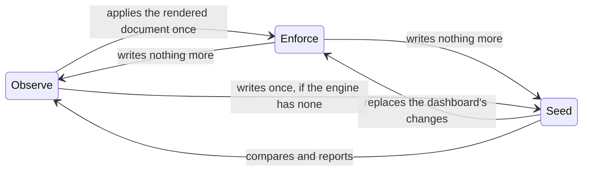

# Choosing a Management Policy

A company document can be changed through the objects or live in the engine's
dashboard; the management policy says which of the two owns it.

`Company.spec.config.managementPolicy` sets it. This guide helps you choose,
and shows how to move between policies.
[How the document is applied](../concepts/applying.md#management-policies)
describes exactly what each one writes and reports.

| Policy | Who owns the document | Choose it when |
|---|---|---|
| `Enforce` (default) | The objects. The engine refuses an edit in its dashboard or API, which shows the document read-only. | The objects are the source of truth: GitOps, or a platform that writes them for its tenants. |
| `Observe` | The engine. The operator compares and reports, and writes nothing. | You are taking back a company that was run from its dashboard (under `Seed`, or created again over the volumes a `Retain` deletion kept), or trying the operator out without letting it write. |
| `Seed` | The objects once, then the engine. | You want a company started from YAML and run from the dashboard afterwards. |

```yaml
spec:                       # Company
  config:
    managementPolicy: Enforce
```

## Enforce

Every change to an object becomes a revision, and nothing else changes the
document. The data pod's `crewlet.yaml` names the operator's own API token as
the document's only writer (Crewlet's `api.auth.company_writers`), so the
engine refuses every other credential a change to the document with
`403 config_managed`: the access token the Company publishes, a person signed
in at the dashboard, whatever they signed in with, and a person's own machine
token. Its dashboard draws the document read-only. Make the change in the
objects instead.

What stays open to whoever holds admin is what changes no byte of the
document: reading it, the engine's secret store and a reload. So a person can still
rotate a leaked credential in the engine when the objects cannot be changed in
time; rotate it in its Secret as well, since the operator writes the Secret's
value back at its next look. This keeps the document from drifting silently;
it is not a privilege boundary: a credential that may write the secret store
can still change what a value the document references holds.

Every five minutes, and whenever anything changes, the operator also compares
the document the engine runs with the rendered one. A revision the operator
did not write can still appear: one the engine records itself (a provisioning
pass writing down what it found at a vendor), or one made in the seconds
between a switch to `Enforce` and the data pod's restart. The operator applies
the rendered document over it, records a `Drifted` event on the Company
naming the places that differed, and reports `ConfigApplied=True` with the
reason `DriftCorrected` until its next write. The other revision is not lost:
it stays in the engine's revision history.

```bash
kubectl get events -n acme --field-selector involvedObject.name=acme,reason=Drifted
```

## Observe

The operator renders the document, has the engine dry-run it, and compares
it with what the engine runs, and changes nothing: no revision, no value in
the secret store. It reports the comparison:

```bash
kubectl get company acme -n acme \
  -o jsonpath='{.status.conditions[?(@.type=="ConfigApplied")].reason}: {.status.conditions[?(@.type=="ConfigApplied")].message}{"\n"}'
kubectl get seats -n acme \
  -o jsonpath='{range .items[*]}{.metadata.name}: {.status.conditions[?(@.type=="Applied")].reason}{"\n"}{end}'
```

`InSync` means the engine runs exactly what the objects render; `Drifted`
names the places that differ, on the Company and on each object whose part
differs.

One kind of value is not compared: a tool server's setting written as a
literal `value` ([Settings and credentials](tool-servers.md#settings-and-credentials)).
The engine treats a tool server's whole environment as credentials and serves
every literal there redacted, so it shows nothing to compare the setting
with: a setting changed to another literal through the engine is not found,
while one replaced by a `${VAR}` reference, or a credential replaced by a
literal, is.

### Taking a company back under Enforce

Observe is the way to hand a company the engine already runs (one run from
its dashboard under `Seed`, or one created again over the volumes a `Retain`
deletion kept) to the objects without a moment where the engine runs
something else:

1. Set the Company's `managementPolicy` to `Observe` (or create it with
   `Observe`, over the kept volumes), with the Secrets its objects reference.
2. Edit the objects until the Company reports `ConfigApplied=True InSync`.
3. Switch the Company to `Enforce`. The operator pushes the Secret values
   into the engine's secret store and applies the same document once, as a
   revision of its own.

## Seed

The operator writes the document once, into an engine that has none, with
the Secret values it references, and from then on leaves the engine alone.
The Company reports `ConfigApplied=True Seeded`; every object reports
`Applied=False NotManaged`, because a change to it is no longer applied, and
`SecretsSynced` is `Unknown`. An engine that already had a document is never
written to.

> **Under Seed, rotate in the engine.** Rotating a Secret is not applied under
> Seed either: rotate the credential through the engine's own secret store
> (`crewlet secrets set`, or the dashboard).

## Seat pauses

A seat's pause is kept outside the document, in the engine's coordination
store, and the policies apply to it only through `Seat.spec.paused`. Under
`Enforce`, a Seat that sets `spec.paused` owns its pause: the operator pauses
or resumes the seat to match, and undoes a change made in the dashboard. A
Seat that leaves it unset leaves the pause to the dashboard under every
policy, and reports it. `Observe` and `Seed` change no pause.
[Pausing a seat](../concepts/applying.md#pausing-a-seat) has the details.

## Switching policies

The policy may change at any time. Whether the engine refuses edits from
other credentials is part of the data pod's `crewlet.yaml`, which the engine reads
only at start, so a switch to or from `Enforce` restarts the data pod: the
operator writes the new `crewlet.yaml` into `<company>-bootstrap`, and the
pod template's `crewlet.ai/bootstrap-hash` changes with it.



| From → to | What happens | Data pod |
|---|---|---|
| `Observe` → `Enforce` | The rendered document is applied once, with its Secret values; anything the engine had that the objects do not say is replaced. From the restart on, the engine refuses every other credential's edits. | Restarts |
| `Seed` → `Enforce` | The same: the dashboard's changes since seeding are replaced by the rendered document. Copy what you want to keep into the objects first; `Observe` first shows you the differences. | Restarts |
| `Enforce` → `Observe` or `Seed` | Nothing is written. The engine keeps the last revision, the objects stop being applied, and from the restart on whoever Crewlet's authority table admits may change the document again: an administrator, the access token, or a lead inside their own part of the chart. | Restarts |
| `Observe` ↔ `Seed` | What the operator writes changes as above; the engine's `crewlet.yaml` does not. | Keeps running |

## See also

- [How the Document Is Applied](../concepts/applying.md#management-policies) — exactly what each policy writes and reports
- [Hosting Many Tenants on the Operator](multi-tenancy.md#who-owns-the-companys-document) — the policy a platform runs tenants under
