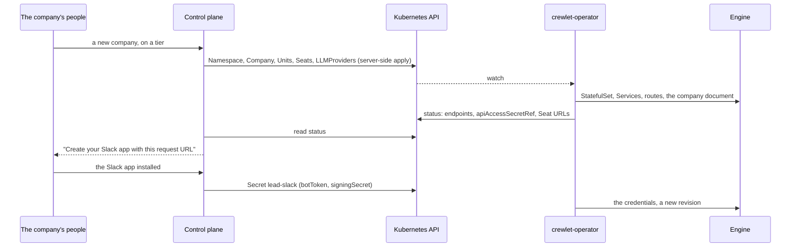

# Hosting many tenants on the operator

A platform that runs Crewlet companies for many tenants usually has a control
plane of its own: it decides which tenants exist and which service tier each
runs on, connects each company to its people's Slack and GitHub, and shows
them their company. With the operator, that control plane does not run
engines. It writes Kubernetes objects, one namespace per tenant, and reads
back what the operator reports. This guide describes what the operator does
for such a control plane, and what the control plane has to do itself.



## The platform's side

The platform's administrators install the operator
([Installing](installing.md)) and write each service tier as an
`EngineClass` (a tier here has nothing to do with Crewlet's Tier A and Tier B
configuration): the engine image, the size of a company's data pod and
volume, how webhooks reach it, limits on seats and tool servers, and the
model providers the platform offers. A class is cluster-scoped and
references the platform's own Secrets in the platform's namespace. Tenants cannot read those Secrets, but
every value a class gives an engine reaches the tenant: see
[What a tenant can read](#what-a-tenant-can-read).

```yaml
apiVersion: crewlet.ai/v1alpha1
kind: EngineClass
metadata:
  name: team
spec:
  # Only the namespaces the control plane put on this tier.
  allowedNamespaces:
    matchLabels: {example.com/tier: team}
  engine:
    image: <your registry>/crewlet@sha256:<digest>   # <CREWLET_VERSION>
  data:
    resources:
      requests: {cpu: 500m, memory: 1Gi}
      limits: {memory: 4Gi}
    storage: {size: 20Gi}
  exposure:
    webhooks:
      mode: Gateway
      gateway:
        parentRefs: [{namespace: gateway-system, name: public}]
      hostname: "{{uid}}.hooks.example.com"
  networkPolicy:
    mode: Isolated
    # The control plane calls every engine of the class.
    apiConsumers:
      - namespaceSelector: {matchLabels: {kubernetes.io/metadata.name: platform}}
        podSelector: {matchLabels: {app: control-plane}}
    # The cluster's pod, Service and node networks: an engine runs code its
    # tenant supplies.
    egress:
      exceptCIDRs: [10.0.0.0/8]
  limits:
    maxSeats: 20
    maxMCPServers: 10
  platformLLMProviders:
    # Every opted-in tenant can read this key: give the class a gateway's
    # per-tenant virtual key, never the platform's own.
    - name: platform-claude
      type: Anthropic
      model: claude-sonnet-5
      apiKeySecretRefs:
        - {namespace: platform, name: llm-gateway-team, key: apiKey}
```

A Company opts in to the class's model providers with
`spec.llm.usePlatformProviders: true`; its seats and its model order then
name them with kind `PlatformLLMProvider`.

The control plane runs with the chart's tenant provisioner role
(`tenantProvisioner` in the chart's values). It creates each tenant's
namespace, with the tenant label (`crewlet.ai/tenant` unless
`tenantProvisioner.namespaceLabels.tenant` names another) and exactly the
labels the chart requires under its protected prefixes (the Pod Security
level, by default), and binds the chart's tenant-access role in it, which is
how it writes that tenant's Secrets and crewlet.ai objects. An admission
policy the chart installs with the role keeps those writes to tenants'
namespaces: the control plane cannot write a Secret, bind a role, or relabel
or delete a namespace anywhere else, may not set, change or remove a label
under a protected prefix, and holds no access to the operator's namespace,
to the engines' pods, or to write EngineClasses
([A tenant provisioner](installing.md#a-tenant-provisioner)). A label that
grants something the control plane is not the one to decide, such as a
Gateway's `allowedRoutes` selector, belongs under a protected prefix; the
tier label above is the control plane's to set, so it does not.

## One namespace per tenant

Give every tenant a namespace of its own, and create it before anything in
it: the operator never creates namespaces. A namespace is what keeps tenants
apart:

- Every reference in a tenant's objects stays in its namespace, so one
  tenant's objects cannot name another's Secrets.
- The engine's NetworkPolicy refuses traffic from other tenants' namespaces,
  and, given the cluster's networks in the class's
  `networkPolicy.egress.exceptCIDRs`, keeps the engine, which runs code the
  tenant supplies, from reaching other tenants, the API server, the nodes and
  the cloud metadata endpoint ([Network policy](exposure.md#network-policy)).
- ResourceQuotas and LimitRanges bound what a tenant's engine may use, as
  they do any workload.
- Deleting the namespace deletes the tenant, after each Company's finalizer
  has stopped its engine.

Within a namespace nothing keeps two Companies apart: whoever can create a
pod there can mount either's keyring Secret, or label the pod as either's
seat pod and join its event stream, which no NetworkPolicy prevents. Run one
Company per tenant namespace, and let nobody but the operator create pods
in it ([Network policy](../concepts/runtime.md#network-policy)).

Label tenant namespaces so a Gateway admits their routes, a class admits
their Companies and your policies can select them. Namespaces are
cluster-scoped, so a tenant's own editors cannot change these labels:

```yaml
apiVersion: v1
kind: Namespace
metadata:
  name: tenant-7f3a9c
  labels:
    crewlet.ai/tenant: "true"
    example.com/tier: team
    pod-security.kubernetes.io/enforce: restricted
```

Use an opaque id for the namespace, not the tenant's name: namespace names
appear in DNS names, logs and metrics. The Company's `metadata.name` becomes
part of the engine's object names; `spec.companyName` is the name people see,
and it cannot change, because Crewlet derives every seat's identity from it.

## Writing the objects: server-side apply

Write every object with server-side apply under a field manager of your own,
and resend the whole desired object on every change. The API server then
owns the merge: fields you stop sending are removed, fields another manager
set (one of the platform's administrators running `kubectl`, a policy
engine) are left alone, and two writers that disagree get a conflict instead
of overwriting each other.

The types are the Go module `github.com/crewlet/crewlet-operator/api`, which
depends on `k8s.io/api` and `k8s.io/apimachinery` only. It has no generated
apply configurations, because they would bring in `k8s.io/client-go`; apply
the typed objects themselves. Encode them with `encoding/json`, which drops
every optional field that is unset, so the request carries exactly the fields
you mean to own. With controller-runtime's client:

```go
import (
	"context"
	"encoding/json"

	"k8s.io/apimachinery/pkg/apis/meta/v1/unstructured"
	"sigs.k8s.io/controller-runtime/pkg/client"
)

const fieldManager = "platform-control-plane"

// apply server-side applies a typed object under the control plane's field
// manager.
func apply(ctx context.Context, c client.Client, obj client.Object) error {
	gvk, err := c.GroupVersionKindFor(obj)
	if err != nil {
		return err
	}
	obj.GetObjectKind().SetGroupVersionKind(gvk)
	data, err := json.Marshal(obj)
	if err != nil {
		return err
	}
	u := &unstructured.Unstructured{}
	if err := u.UnmarshalJSON(data); err != nil {
		return err
	}
	return c.Apply(ctx, client.ApplyConfigurationFromUnstructured(u),
		client.FieldOwner(fieldManager), client.ForceOwnership)
}
```

```go
err := apply(ctx, c, &crewletv1.Seat{
	ObjectMeta: metav1.ObjectMeta{Namespace: ns, Name: "lead"},
	Spec: crewletv1.SeatSpec{
		CompanyRef:  crewletv1.CompanyReference{Name: "acme"},
		DisplayName: "Engineering Lead",
		UnitRef:     crewletv1.LocalObjectReference{Name: "engineering"},
		Goal:        "Decide what Acme builds next.",
	},
})
```

The client's scheme needs the API's types (`crewletv1.AddToScheme`).

`ForceOwnership` makes the control plane win a conflict over the fields it
sends, which is right when it is the source of truth for them; leave it out
to be told about the conflict instead. The operator's end-to-end suite writes
its objects exactly this way.

Lists that more than one writer may share are keyed, so each entry has its
own owner: a Seat's or a Unit's `spec.mcp` by server name, a Company's
`spec.engineConfig` by name, and `env` and `headers` by name. A control plane
can own the GitHub server's entry in `spec.mcp` while a person adds another.

The operator coalesces writes: after a change it waits for two quiet seconds
and then applies everything as one revision, so a tenant provisioned with
twenty Seats becomes one revision, not twenty
([How the document is applied](../concepts/applying.md)). There is no need
to batch on your side.

## Reading what the operator reports

Wait for the Company's `Ready` condition, for the generation your last
write produced, before telling the company's people that it runs. `kubectl
wait --for=condition=Ready` alone may answer from the status of an earlier
generation, so wait for `status.observedGeneration` to reach it first:

```bash
gen=$(kubectl get company/acme -n tenant-7f3a9c -o jsonpath='{.metadata.generation}')
kubectl wait company/acme -n tenant-7f3a9c --timeout=10m \
  --for=jsonpath='{.status.observedGeneration}'="$gen"
kubectl wait company/acme -n tenant-7f3a9c --for=condition=Ready --timeout=10m
```

| Field | What the control plane does with it |
|---|---|
| `Company.status.conditions` | `Ready` is the summary; when it is `False`, its reason is that of the first condition that is not `True`. Show the company's people the message of the one at fault ([Troubleshooting](troubleshooting.md)). |
| `Company.status.endpoints.api` | The engine's API inside the cluster, `http://<company>-engine.<namespace>.svc:8080`. |
| `Company.status.endpoints.publicBaseURL` | Where vendors deliver webhooks: the engine's public listener, which serves nothing else a vendor or a sandbox does not call. |
| `Company.status.endpoints.dashboardBaseURL` | Where the engine's agents send people in the links they write: `spec.exposure.dashboardBaseURL`, or the API's route. A control plane that is its tenants' dashboard sets `spec.exposure.dashboardBaseURL` to its own view of the company, so those links lead there and not to the engine; a link is the base followed by the engine dashboard's own route (`/#/work/ENG-42`, `/#/knowledge/pages/<id>`), which that view has to serve or redirect ([Where people reach the dashboard](exposure.md#where-people-reach-the-dashboard)). |
| `Company.status.apiAccessSecretRef` | A Secret with the engine's API token under `token` and the API's address under `url`, for the control plane's own calls to the engine: its dashboard data, its seats' activity. |
| `Company.status.config.revisionID` | The revision the engine runs. Every part reports the revision it is in. |
| `Company.status.topology` | The pods that run the company: the data pod's, and each seat pool's. `SeatsPlaced` says whether every pool with a seat has a ready pod. |
| `Seat.status.seatID` | The seat's identity in the engine, derived from the company's name and the seat's handle: stable for the seat's life, and the same if a deleted Seat is created again with the handle. Key your own records about a seat by it. |
| `Seat.status.placement`, a Seat's `Ready` | The pool and StatefulSet that run the seat, and the pod whose engine holds it as the engine reports it: `Ready=False Unplaced` while none does and the seat's messages wait. |
| a Seat's `CodeWorkRunnable` | On an Agent seat with `spec.sandbox`, in a Company with one, whether its coding runs can start. `False` with `SandboxModelUnsupported` or `SandboxLoginNotPortable` leaves the seat applied and working, every coding run refused: show the message, which names the field to change. |
| `Seat.status.integrations.slack.requestURL` | The request URL of the seat's own Slack app, for the app's manifest. |
| `Seat.status.integrations.github.webhookURL` | The webhook URL of the seat's own GitHub App. |
| `Integration.status.webhookURL` | The company-wide address a vendor delivers to (GitHub's organization webhook). |
| each object's `Accepted`, `ResolvedRefs`, `Applied` | Whether that object is in the running revision, and if not, why. |

The Seat's URLs are set as soon as the Company has the vendor's `Integration`
and a public address, before the seat has any credentials, so the control
plane can create the vendor app with the right URL first and supply its
credentials after.

To call the engine's API, admit the control plane's pods in each class's
`networkPolicy.apiConsumers`, which the engines' NetworkPolicy admits, and
read the token from the Secret `apiAccessSecretRef` names in the tenant's
namespace. The operator uses a token of its own, so rotating the consumers'
token never locks the operator out. Hand that token to no one the platform
would not let administer the engine (see
[What a tenant can read](#what-a-tenant-can-read)): a tenant's own dashboard
should call the engine through the control plane, not with the token.

## Handing credentials to the operator

Each agent seat is its own Slack app and its own GitHub App, so it posts,
reviews and is mentioned as itself. The control plane typically creates the
app from a manifest (with the request URL from the Seat's status), has the
company's people install it through the vendor's own flow, and receives the
credentials. It writes them into a Secret in the tenant's namespace and
references it from the Seat:

```go
secret := &corev1.Secret{
	ObjectMeta: metav1.ObjectMeta{Namespace: ns, Name: "lead-slack"},
	Type:       corev1.SecretTypeOpaque,
	Data: map[string][]byte{
		crewletv1.SlackBotTokenKey:      botToken,
		crewletv1.SlackSigningSecretKey: signingSecret,
	},
}
// apply(ctx, c, secret), then the Seat with
// Spec.Integrations.Slack.CredentialsSecretRef = crewletv1.SecretReference{Name: "lead-slack"}
```

Write the Secret first, or in the same burst: until it exists, the Seat
reports `ResolvedRefs=False SecretNotFound` and the next revision waits. A
refreshed token is a rewrite of the same Secret; the operator applies it
without restarting anything ([Supplying credentials](credentials.md#rotating-a-credential)).
The Secret keys are constants in the API module (`SlackBotTokenKey`,
`GitHubAppPrivateKeyKey`, ...), so the control plane never repeats the
strings.

Keep credentials out of everything else: the control plane's own database
needs the Secret's name, not its value. The operator pushes a referenced
value into the engine's encrypted store and nowhere else; the values the
engine's pod itself needs (its keyring, its API tokens, its object-store
keys, the class's telemetry headers and env) go into the Secret
`<company>-bootstrap` in the tenant's namespace.

## Who owns the company's document

A control plane that writes its tenants' objects is the source of truth for
them, which is what `Company.spec.config.managementPolicy: Enforce`, the
default, is for: the engine refuses every token but the operator's own a
change to the company document (`403 config_managed`), the access token in
`apiAccessSecretRef` included, and its dashboard shows the document
read-only. The company's people change their company through the control
plane, which writes the objects. A revision the operator did not write is
applied over, recorded as a `Drifted` event, and reported as
`ConfigApplied=True DriftCorrected`.

Two other policies hand the document to the engine's own dashboard instead.
`Seed` writes it once, into an engine that has none, and then leaves it to
the company's people: every object reports `Applied=False NotManaged`, and a
rotated Secret is no longer applied. `Observe` writes nothing and reports how
the engine's document differs from the objects, which is how a company run
from its dashboard, or created again over the volumes a `Retain` deletion
kept, is taken back under `Enforce`. A switch to or from `Enforce` restarts
the data pod. A seat's pause follows `Seat.spec.paused` under `Enforce` when
the Seat sets it, and is left to the dashboard when it does not
([Choosing a management policy](management-policies.md)).

## What a tenant can read

Treat a tenant's namespace and its engine's pod as readable by the tenant.
The engine runs the tenant's code: a `Stdio` MCP server's command, a sandbox
setup step's commands, agents' tool calls. That code runs as the engine's
user, so it can read the engine's environment and its `crewlet.yaml`, and
open the secret store on the data volume with the keyring the pod holds.
And the access token in `status.apiAccessSecretRef` is the engine's
administrator: Crewlet has no token scopes, so whoever holds it can reveal
every value in the secret store and write new ones. Under `Enforce` the
engine refuses it a change to the company document (the operator's own token
is the document's only writer), but that keeps the document from drifting
rather than the token from the company: a value the document references can
still be rewritten in the secret store and picked up with a reload.

So whatever a class gives its companies' engines reaches every tenant of the
class:

- **Platform model providers** (`platformLLMProviders`): their keys are in
  each opted-in engine's secret store, and a platform provider at the head
  of a seat's code work puts its first key into every box of that seat, in
  the tenant's own E2B account, where the tenant's coding agent reads it
  ([What a coding box
  carries](credentials.md#what-a-coding-box-carries)). Give the class keys
  you would hand each tenant: one per tenant, or the per-tenant virtual
  keys of an LLM gateway with a spend limit, never the platform's own.
- **Object storage**: give each Company keys of its own
  (`spec.objects.credentialsSecretRef`), with a policy that admits its
  prefix of the bucket only. A workload identity set through the class's
  `serviceAccount.annotations` is every company's: scope it per tenant (a
  role per company, or a session policy on the company's prefix).
- **Telemetry headers and class env from Secrets**: in every engine's
  environment, the seat pods' included, copied into the bootstrap Secret of
  each pod they are given to. Use credentials that may only write telemetry.

Within a tenant's namespace, grant the people and services that call the
engine `get` on `<company>-api-access` by `resourceNames`: read on every
Secret of the namespace also exposes `<company>-api-tokens` (the operator's
own token), `<company>-keyring`, `<company>-bootstrap` and each seat pool's
`<company>-bootstrap-<pool>-<hash>`, which hold the keyring, the object-store
keys and the class's env values too.

## Tiers, limits and offboarding

- **Moving a tenant to another tier** is changing
  `Company.spec.engineClassName`. The new class's pod settings roll the data
  pod; its volume keeps the size it was created with. Any Company may name
  any class, so give each class `spec.allowedNamespaces`, selecting the
  tenant namespaces on that tier by a label the control plane sets
  (`example.com/tier: team` above), and relabel the namespace in the same
  move; a Company in a namespace the class does not select reports
  `Accepted=False ClassNotAllowed`.
- **Limits** are the class's: a Company over `maxSeats` or `maxMCPServers`
  reports `Accepted=False LimitExceeded` and its next revision waits. They
  are the cluster's defence in depth; the control plane stays the place the
  company's people are told what their tier admits.
- **Seat pools** are a tier's too. A class with `seatPools.policy: Allowed`
  lets its Companies declare `spec.topology.seatPools`, stateless pods that
  run seats beside the data pod (more concurrent turns, a pod that can fail
  without stopping the company); `maxPods`, which a class that allows pools
  must set, caps a company's seat pods, `defaults.resources` sizes every one
  of them (a Company chooses how many its pools run, never how large), and
  `allowPerSeat` admits a pod for one seat alone. A move to a class that
  allows pools restarts the data pod once, to open the listener seat pods
  join; adding a pool afterwards restarts nothing. A move to a class that
  forbids them stops nothing at once: the company's next revision is refused
  while it declares pools, and the seat pods its running revision pins seats
  to keep running, listener and all, until the tenant's Seats are moved to
  `data` and that revision runs. Scale a Shared pool by writing
  `spec.topology.seatPools[name=P].replicas` with server-side apply: the
  operator never scales one itself, and moving seats between pods interrupts
  them ([Seat pools](../concepts/runtime.md#seat-pools)). Tiers map onto a
  class's `seatPools`: the smallest forbids pools and runs every seat on the
  data pod; a larger one allows Shared pools up to a `maxPods`; the largest
  adds `allowPerSeat` for chosen agents. Own `replicas` from the control
  plane's field manager, and only that field of the pool if a person may
  change the rest. [Choosing where seats run](topology.md) says what each
  shape buys, and what a pod of its own does not isolate: every pod of a
  company can read all of its credentials.
- **Suspending** a tenant's company is `spec.suspend: true`: the engine stops
  and its volume is kept, whatever else the Company reports, so a tenant
  cannot keep a suspended engine running by declaring more than its class
  allows. The Company reports `Ready=False Suspended` meanwhile. Vendors keep
  delivering webhooks to a suspended engine, and some disable the
  subscription after a long run of failed deliveries, so a company back from
  a long suspension may need its vendors' subscriptions enabled again.
  Setting it back resumes it on the same data.
- **Offboarding** is deleting the Company, then the namespace.
  `spec.deletionPolicy` says what the Company's deletion does with the data
  volume: `Delete` deletes it with the Company; `Retain`, the default, keeps
  the volume claims and the keyring Secret that opens them in the namespace.
  A Company created again with the same name in that namespace adopts both
  and runs on the same data, so keep the namespace for as long as the
  company may come back, and delete it when that grace period ends, which
  deletes what was kept ([Deletion](../concepts/runtime.md#deletion)). Two
  things can outlive it: a volume whose StorageClass has
  `reclaimPolicy: Retain` survives its claim, and the operator never deletes
  the company's prefix of an S3 bucket (the class's `objects.s3.prefix`).
  Delete both yourself when the company's data must go.
