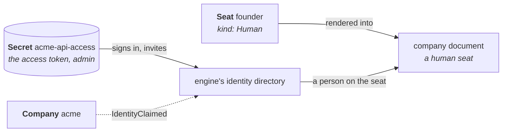

# Bringing People In

Crewlet signs people in as themselves: each person holds a Human seat of the
company, signs in to its dashboard with a password and two-step verification,
and acts as that seat. A new company has nobody in it. This guide brings the
first person in, then everyone after them, and says what the operator does
and does not do about people.

The operator manages seats, not people. A Human `Seat` is a place in the org
chart; who holds it lives in the engine's own identity directory, which the
operator never reads a person out of and never writes, under every management
policy. Nobody's address, login or password passes through a Kubernetes
object. Crewlet's
[Identity and Access](https://github.com/crewlet/crewlet/blob/main/docs/concepts/identity-and-access.md)
describes the directory, its permissions and its sessions in full.



## A Human seat for each person

A person joins onto a Human seat, so declare one for each person who signs
in, alongside the agents:

```yaml
apiVersion: crewlet.ai/v1alpha1
kind: Seat
metadata:
  name: founder
spec:
  companyRef:
    name: acme
  kind: Human
  displayName: Founder
  manages:
    - kind: Unit
      name: engineering
```

- `contact` is optional. It names the person's chat accounts, so that an
  agent can mention or message them on Slack or Mattermost; a person who
  works only through the dashboard needs none. Crewlet warns of a Human seat
  without one, which the operator reports as an `EngineWarnings` event
  ([A person's accounts](integrations.md#a-persons-accounts)).
- `email` is optional too, and unique: two Seats of one company may not
  declare one address, compared as Crewlet compares them (case aside, and
  without a `+tag`). It is the seat's address, which the engine finds the
  seat by; the address a person signs in with is the one they are invited or
  created with.
- The seat's handle (`spec.handle`, or its name) is what a person is
  invited onto, and what `crewlet iam` and the dashboard call the seat.

A company with no Human seat can admit nobody, and the Company says so
(`IdentityClaimed=False NoHumanSeat`).

## Where people sign in

People sign in at `status.endpoints.dashboardBaseURL`, which is also the
address the engine builds every link a person follows on, an invitation's
and a password link's included. It is, in order: the Company's
`spec.exposure.dashboardBaseURL`, the address of its class's API route, or
`http://localhost:8080` through a port-forward
([Where people reach the dashboard](exposure.md#where-people-reach-the-dashboard)).

The engine accepts a person's sign-in and every write only from that
address's origin. With no route, forward exactly that port and open exactly
that address:

```bash
kubectl port-forward -n acme svc/acme-engine 8080:8080
```

Open <http://localhost:8080>. Another local port, or `127.0.0.1` in place of
`localhost`, is another origin: the dashboard loads, and the engine refuses
the sign-in.

## The first person

Until somebody joins, the Company reports `IdentityClaimed=False Unclaimed`,
naming its Human seats:

```bash
kubectl get company acme -n acme \
  -o jsonpath='{.status.conditions[?(@.type=="IdentityClaimed")].message}{"\n"}'
```

The way in is the access token the Company publishes in the Secret
`status.apiAccessSecretRef` names, which holds Crewlet's `admin`, the
permission that invites and creates people:

```bash
kubectl get secret acme-api-access -n acme -o jsonpath='{.data.token}' | base64 -d; echo
```

In the dashboard, the sign-in page puts its token form first while nobody
has joined (**Sign in with token**; once somebody has, it is folded under
**Use an API token instead**). Paste the token, open **Agents › Org chart**,
open your seat (drawn **Open seat**) and choose:

- **Invite**: your address, and **Admin** ticked. The invitation link is
  shown once; open it, choose a login and a password, and you are signed in.
- **Add person**: your address, and **Admin** ticked. You are created on the
  seat at once and handed a first password link, shown once; open it to
  choose your password, then sign in with your login or your address.

Or from a shell, with `crewlet iam` in the data pod, which reads the token
from `CREWLET_API_TOKEN` and the node to reach from its `crewlet.yaml`:

```bash
kubectl get secret acme-api-access -n acme -o jsonpath='{.data.token}' | base64 -d |
  kubectl exec -i -n acme acme-data-0 -- sh -c 'CREWLET_API_TOKEN=$(cat) exec crewlet iam invite \
    you@example.com -seat founder -grants admin -config /etc/crewlet/crewlet.yaml -api http://127.0.0.1:8080'
```

`crewlet iam create -email you@example.com -seat founder -grants admin`
creates you instead and prints the first password link. Either link is good
for a week.

Give the first person `admin`: anybody after them is invited by a person who
holds it, and otherwise only the token can. Crewlet requires two-step
verification by default, and the operator does not change that: the first
sign-in with a password asks you to set up an authenticator app before
anything else.

The Company turns `IdentityClaimed=True PersonEnrolled` within half a
minute: while nobody has joined, the operator asks the engine every 30
seconds, since nothing it watches says when somebody does. `Ready` does not
wait for it: a company nobody has joined runs its agents all the same.

## Everyone after

People with `admin` invite and create the others in the dashboard (**Agents ›
Org chart**, on the person's seat; **Settings › People & access** to change,
suspend or remove them), or with `crewlet iam`. Each needs a vacant Human
seat: add the Seat first. Under `Enforce` the company document is read-only in
the dashboard, so a seat is added as a `Seat` object, not there
([Choosing a management policy](management-policies.md)); the people
themselves are never in the document, and are managed in the engine under
every policy.

A Human Seat somebody holds cannot be taken away while they hold it: deleting
it, or turning it into an Agent seat, is refused by the engine, and the
Company reports `ConfigApplied=False SeatHeld` naming the seat and what holds
it, while the engine keeps running the revision it runs. Move the person to
another Human seat or remove them first, or cancel the invitation that holds
the seat ([The engine refuses a change to the
document](troubleshooting.md#the-engine-refuses-a-change-to-the-document)).

## The tokens are nobody's seat

The operator's own token and the access token sign in as themselves, by
their ids (`token:operator`, `token:access`), with no seat. Crewlet lets an
admin bind a token to a seat, as a service account with the token's login
(`crewlet iam create -kind machine -login token:<id> -seat <handle>`), after
which the token acts as that seat. Bind neither: the operator does not need it
and does not expect it, and a token bound to a seat the company later drops is
refused every request (`ConfigApplied=False NotGranted` for the operator's).
A person who needs a token of their own creates one in the dashboard
(**Account**), or with `crewlet iam token`.

## Rotating the access token

Delete `<company>-api-tokens` and the operator generates new tokens and rolls
the data pod ([The engine's own
Secrets](credentials.md#the-engines-own-secrets)). The tokens keep their ids,
and a dashboard session somebody opened with the old access token is kept by
id rather than by value: it lasts out its hour. To end those sessions at
once, sign in with the new access token and sign out everywhere
(`POST /auth/logout/all`), which ends every session the token's id opened, or
run `crewlet iam invalidate-all` as above, which ends every person's sessions
and machine tokens too. People's own sessions and passwords are not touched
by a rotation.

## See also

- [Exposure and Network Policy](exposure.md) — the address people sign in at, and the routes to it
- [Choosing a Management Policy](management-policies.md) — who may change the document, and who may change people
- [Troubleshooting](troubleshooting.md) — `IdentityClaimed`, `SeatHeld` and `NotGranted`
- [Crewlet's Identity and Access](https://github.com/crewlet/crewlet/blob/main/docs/concepts/identity-and-access.md) — the directory, permissions, sessions and the command line in full
