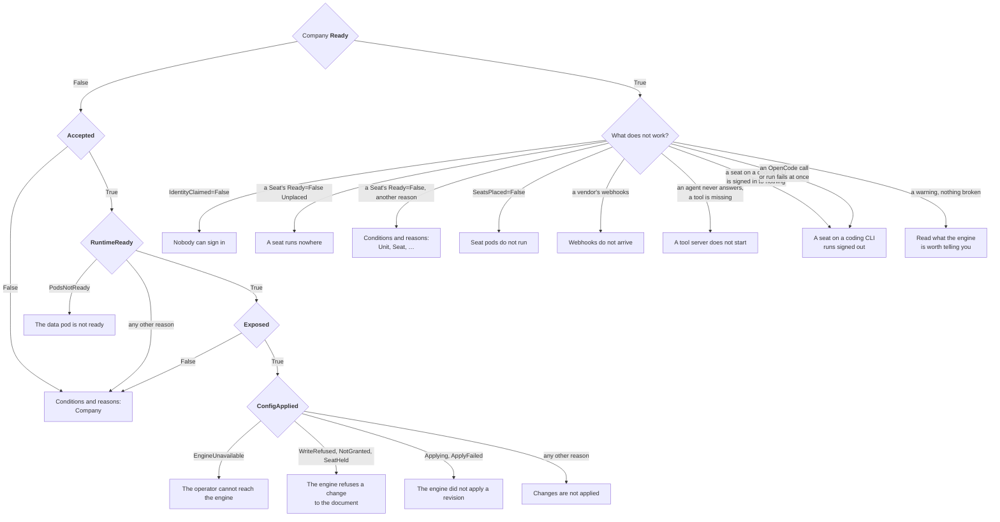

# Troubleshooting

Every object the operator reconciles says what is wrong with it in its
conditions. Start at the Company, and follow the first condition that is not
True.

The Company's `Ready` condition, when `False`, carries the reason of the first
of `Accepted`, `RuntimeReady`, `Exposed` and `ConfigApplied` that is not
`True`, and the message says what to do:

```bash
kubectl get crewlet -n acme
kubectl get company acme -n acme \
  -o jsonpath='{range .status.conditions[*]}{.type}={.status} {.reason}: {.message}{"\n"}{end}'
kubectl get seats,units,llmproviders,mcpservers,integrations,schedules -n acme \
  -o jsonpath='{range .items[*]}{.kind}/{.metadata.name}{range .status.conditions[?(@.status!="True")]} {.type}={.status} {.reason}: {.message}{end}{"\n"}{end}'
kubectl events -n acme --for company/acme
```

Where each one leads, below:



Each condition's `observedGeneration` says which generation of the object it
describes; a condition older than `metadata.generation` has not caught up
with your last change yet.

## Conditions and reasons

### Company

| Condition | Status | Reason | What it means, and what to do |
|---|---|---|---|
| `Ready` | True | `Available` | The engine runs the current revision and is reachable as the class asks. |
| | False | `Suspended` | `spec.suspend` is set: the engine is stopped, its volume kept. |
| | False | `ConfigPending` | The engine runs and is exposed; the document of the Company's current generation has not been reported applied yet. Wait a few seconds. |
| | False | any other | The reason of the first condition below that is not True. |
| `Accepted` | True | `Valid` | The class exists and the company is within its limits. |
| | False | `EngineClassNotFound` | `spec.engineClassName` names no class, or it is unset and there is not exactly one class annotated `crewlet.ai/is-default-class: "true"`. Create the class or name one. |
| | False | `ClassNotAllowed` | The class's `spec.allowedNamespaces` does not select the Company's namespace (or is not a valid selector; the message says which). Name another class, or have the platform label the namespace. |
| | False | `LimitExceeded` | The company has more Seats or MCPServers than the class's `limits` allow. Remove some or move to a larger class. Nothing new is applied meanwhile. |
| `RuntimeReady` | True | `PodsReady` | The data pod runs the current template and is ready. |
| | False | `PodsNotReady` | The data pod is missing, starting or failing its readiness check. See [The data pod is not ready](#the-data-pod-is-not-ready). |
| | False | `Suspended` | `spec.suspend` is set, and the engine's pods are stopped. |
| | False | `Suspending` | `spec.suspend` is set, and the seat pods are still stopping; the data pod stops once they have. Seat pods finish their running turns first, for up to their grace period. |
| | False | `DowngradeRefused` | The image asked for is an older version than the data was last written by; the engine migrates forward only. The pod keeps the newer image; every other change still applies. |
| | False | `VersionOverrideNotAllowed` | `spec.runtime.version` is set and the class's `engine.allowVersionOverride` is not. |
| | False | `KeyringInvalid` | The `<company>-keyring` Secret is not a keyring the engine can open. The operator never rewrites it: repair it from a backup, keeping the key ids, and set `crewlet.ai/active-key-id` to the key that seals new writes. The pod is held as it is. |
| | False | `KeyringMissing` | The `<company>-keyring` Secret is gone while the company's data StatefulSet or volume claims exist. A new keyring could not open the data, so none is generated. Restore the Secret from a backup, with its `crewlet.ai/active-key-id` annotation; or, to discard the data, delete the data volume claims, after which a new keyring is generated. The pod is held as it is. |
| | False | `PreviousCompanyObjects` | The keyring or tokens Secret of an earlier Company of the same name, deleted with `deletionPolicy: Delete`, has not been removed by the garbage collector yet. The pod starts once it is gone; nothing to do unless it stays, in which case check that the garbage collector runs. |
| | False | `NameConflict` | An object the operator writes for the Company (a Service, Secret, ConfigMap, ServiceAccount, StatefulSet, PodDisruptionBudget or NetworkPolicy named after it) exists and is someone else's. The message names it. The operator never changes or adopts it: rename or delete it, or give the Company another name. The pod is held as it is. |
| | False | `SecretNotFound` | A Secret the pods are given values from is missing: one the class references (telemetry headers, `podTemplate.spec.env`) in the platform's namespace, or the Company's own object-store keys (`spec.objects.credentialsSecretRef`). The pod is held as it is. |
| | False | `APITokensInvalid` | `<company>-api-tokens`, as a platform supplied it, lacks a token or holds one shorter than 43 characters or outside base64, base64url and hex. Repair it, or delete it to have the operator generate it. The pod is held as it is. |
| | False | `InsecureSignInNotAcknowledged` | The class lets people sign in with a password alone (`spec.signIn.secondFactor: Optional`), and the Company is reached at an address Crewlet does not read as loopback, which the message names: Crewlet refuses to start so without the class's `spec.signIn.acceptInsecure: true`. The platform acknowledges it on the class or requires a second factor again ([Two-step verification](people.md#two-step-verification)). The pod is held as it is. |
| | False | `AddressRefused` | An address the engine would be told it is reached at, or would hand its sandboxes (`CREWLET_MCP_BRIDGE_URL`, `CREWLET_SANDBOX_OTEL_RECEIVER_URL`), is one Crewlet refuses to start on; the message names it, its key in `crewlet.yaml` or its variable, and where it came from. In practice it is a route of the class: its API route, or its webhooks route while the engine hands that address to sandboxes, whose host name template's last label holds `{{namespace}}` or `{{name}}`, and the Company's namespace is a number, such as `4711` or `0x1f`, or its namespace or name makes one with the characters beside it (`0x{{name}}` for a Company named `cafe`), so the host's last label is a number, which a browser and a sandbox read as an IPv4 address. The platform ends the template in a domain of its own (`{{name}}.{{namespace}}.crewlet.example.com`), or the Company runs in a namespace of another name ([Reach the API from elsewhere](exposure.md#reach-the-api-from-elsewhere)). An address the Company states is refused by the API when it is written instead, unless it was admitted before the API refused it: the message then says to correct the Company's field. An artifact origin that meets the dashboard's is refused here too: give artifacts a domain of their own. The pod is held as it is. |
| `Exposed` | True | `RouteAccepted` | Every route the class asks for was accepted. When the message adds that the engine is told people reach it at `http://localhost:8080`, every link it gives a person, an invitation's included, leads there through a port-forward: set the Company's `spec.exposure.dashboardBaseURL`, or route the API ([Where people reach the dashboard](exposure.md#where-people-reach-the-dashboard)). |
| | True | `NoRoutes` | The class routes nothing (webhooks `None` or `External`, API `ClusterInternal`, artifacts `None`). The message says the same about the dashboard's address as under `RouteAccepted`. |
| | False | `RouteNotAccepted` | A Gateway has not attached the HTTPRoute, or the Ingress controller has not published an address. The message carries the controller's own reason; a Gateway listener's `allowedRoutes` that does not admit the tenant's namespace is the usual cause. |
| | False | `NameConflict` | An HTTPRoute or Ingress of the route's name (`<company>-webhooks`, `<company>-api`, `<company>-artifacts`) exists and is someone else's; rename or delete it. |
| | False | `GatewayAPINotInstalled` | The class routes through Gateways and the cluster had no Gateway API when the operator started. Install it and restart the operator. |
| | False | `PublicBaseURLMissing` | The class's webhooks mode is `External` and the Company has no `spec.exposure.publicBaseURL`. |
| | False | `RouteNotHTTPS` | No Gateway listener the artifacts route attaches to is HTTPS, so the data pod opens no artifact origin; add one with a certificate for the route's host. |
| `SecretsSynced` | True | `Synced` | The engine's secret store holds every referenced value. The message counts the values a tool server or a coding run may go without whose Secret or key does not exist, which the store does not hold, so the engine leaves each out ([A key that may go without its value](tool-servers.md#a-key-that-may-go-without-its-value)); names, in a sentence of its own, those the store keeps as they were for the revision the engine runs, because that revision reads them as required or is one whose reading the operator does not know (another document somebody else activated), each to go once a revision that lets it go runs; and, the Company having no `ResolvedRefs`, names the values of its own setup steps a run goes without, under a key a step's `optionalKeys` lists, and a value of theirs that holds nothing under a key none lists, which has every `run_sandbox` coding run refused. |
| | False | `SecretNotFound` | A referenced Secret or key is missing; the message names each. |
| | False | `SecretTooLarge` | A value is over the 64 KiB the store accepts. |
| | False | `EngineUnavailable` | Writing to the store failed; the message says why. Retried. |
| | False | `NameConflict` | A Secret `<company>-secret-sync`, where the operator keeps what it pushed, exists and is someone else's. Rename or delete it; nothing is applied meanwhile. |
| | Unknown | `NotManaged` | The management policy keeps the operator out of the store (`Observe`; `Seed` once seeded). |
| `SeatsPlaced` | True | `AllPoolsServing` | Every pool an agent seat is placed in, `data` included, has a ready pod. Not part of `Ready`. |
| | False | `PoolEmpty` | A pool with a seat has no ready pod: a Shared pool at zero replicas, a PerSeat seat's pods down, or seat pods not created yet because the data pod is not ready. Their seats' messages wait. See [Seat pods do not run](#seat-pods-do-not-run). |
| | False | `PoolNotFound` | An agent Seat is placed in a pool the Company does not declare, whose pods never start, so the seat does not run in it. A seat that ran elsewhere keeps running there (its `Applied` is `PlacementPending`); no pod runs any other. The message names each such Seat and pool. Declare the pool, or place the Seat in another. |
| | False | `RolloutBlocked` | The seat pods keep their template until the data pod is ready on its new one; they roll right after it. |
| | False | `SeatPoolsNotAllowed` | The class does not allow seat pools, so the operator runs none, and the seats placed in them run nowhere. |
| | False | `PoolCapacityExceeded` | The Shared pools' replicas alone pass the class's `seatPools.maxPods`; the operator keeps the seat pods as they are and starts none. Lower the replicas. |
| | False | `Suspended` | The Company is suspended. |
| `EngineHealthy` | True | `NoAlarms` | The engine raises no alarm. |
| | False | `Alarms` | The engine raises alarms; the message names the one standing longest. `backup_age` and `trim_blocked` mean it has no recent verified backup and trims no log: see [Backups](../concepts/runtime.md#backups). |
| | Unknown | `AlarmsNotReported` | The engine has not evaluated its alarms yet, or could not be asked. |
| `IdentityClaimed` | True | `PersonEnrolled` | A person has joined the company. Not part of `Ready`. |
| | False | `Unclaimed` | Nobody has joined the company yet: the engine signs nobody in until a person is invited or added onto a Human seat. The message names the seats and the Secret holding the access token to do it with. The operator asks the engine again every 30 seconds while it reads so. |
| | False | `NoHumanSeat` | Nobody can join: the company the engine runs has no Human seat. Add a Seat of kind `Human` for each person who signs in. |
| | Unknown | `IdentityNotReported` | The engine could not read its identity directory, did not say, or could not be asked. |
| `ConfigApplied` | True | `Applied` | The engine runs the rendered document: it reports the epoch of the revision `status.config.revisionID` names applied. |
| | True | `DriftCorrected` | Under `Enforce`, someone changed the document in the engine and the operator applied the rendered one over it. A `Drifted` event names what differed. |
| | True | `InSync` | Under `Observe`, the engine runs exactly the rendered document. |
| | True | `Seeded` | Under `Seed`, the engine has a document and owns it from now on. |
| | False | `RefNotFound`, `Cycle`, `Conflict`, `ReferenceNotAllowed`, `HumanSeat`, `SecretNotFound`, `SecretTooLarge`, `PerSeatNotAllowed`, `CLIAuthNotPortable`, `CodingAgentMismatch`, `OptionalKeyUnused` | An object of the company keeps the document from rendering. The object at fault reports the same reason on `Applied`; fix it there ([What blocks a document](../concepts/company-document.md#what-blocks-a-document)). Meanwhile, under `Enforce`, the operator still takes out of the engine's secret store the value of a deleted Secret the document lets go without, and activates the running revision again so the engine reads the store without it, with a `Reactivated` event, where the running revision lets the value go too, or a Warning `Reactivated` when the revision activated again is not the document it read; one that reads it as required, or another document somebody else activated, keeps it until the next document runs, with a `SecretKept` event, the only report of it here, since the Secrets are not read ([A key that may go without its value](tool-servers.md#a-key-that-may-go-without-its-value)). |
| | False | `NameConflict` | The Secret `<company>-secret-sync`, where the operator keeps what it pushed to the engine's store, exists and is someone else's; `SecretsSynced` says the same. Rename or delete it; nothing is applied meanwhile. |
| | False | `SeatPoolsNotAllowed` | The Company declares `spec.topology.seatPools`, and its class's `seatPools.policy` is not `Allowed`. Remove the pools, or run the company with a class that allows them. |
| | False | `PoolCapacityExceeded` | The company's seat pods would number more than its class's `seatPools.maxPods`: its Shared pools' replicas alone (the message says so; lower them), or with the pods of its PerSeat seats, each of which reports it too. |
| | False | `Invalid` | The engine's dry run refused the document, in its own words, every problem in this message. A problem at a place a part rendered (a Seat, Unit, LLMProvider, MCPServer, Integration or Schedule) is also reported on that part, as `Applied=False Invalid`; one at a place the Company renders itself (its own fields, `spec.embeddings`, `spec.sandbox` and its setup steps) is in this message alone. |
| | False | `Drifted` | Under `Observe`, the engine runs another document; the message names the places that differ. |
| | False | `Applying` | The operator activated the revision and the engine has not applied it yet; it runs the previous one meanwhile. Usually gone within seconds; it turns into `ApplyFailed` when the engine fails the revision or has not applied it 72 seconds after the write. |
| | False | `ApplyFailed` | The engine did not apply the revision, and keeps running the one it applied last. The message carries the engine's status, its posture (`isolated` on a single node, `shed` or `stuck` beside peers that applied it) and its own account of the failure; see [The engine did not apply a revision](#the-engine-did-not-apply-a-revision). |
| | False | `EngineUnavailable` | The operator cannot reach the engine, the engine does not know its token, or the engine asked to be asked again later (`503`). Retried every ten seconds, or sooner when the engine says when; see [The operator cannot reach the engine](#the-operator-cannot-reach-the-engine). |
| | False | `WriteRefused` | The engine refuses the operator's own token a change to the document (`403 config_managed`): its `api.auth.company_writers` names other tokens. See [The engine refuses a change to the document](#the-engine-refuses-a-change-to-the-document). |
| | False | `NotGranted` | The engine knows the operator's token and will not let it make a request the operator needs (`403`): the token lacks the grant the message names, or the engine's identity directory binds it to a seat the company no longer has. See [The engine refuses a change to the document](#the-engine-refuses-a-change-to-the-document). |
| | False | `SeatHeld` | The document takes a human seat out of the company, or makes it an agent's, while a person, a service account or an open invitation holds it in the engine (`409 seat_held`). The message names each seat and what holds it; the engine keeps running the revision it runs. See [The engine refuses a change to the document](#the-engine-refuses-a-change-to-the-document). |

### EngineClass

`Accepted` checks what the class's schema cannot: that the objects it names
in other namespaces exist. It is advisory; Companies of a class that is not
accepted still run, and report what the problem does to them on their own
conditions. `kubectl get engineclasses` shows it.

| Condition | Status | Reason | What it means, and what to do |
|---|---|---|---|
| `Accepted` | True | `Valid` | Every Secret, Secret key and Gateway the class names exists. |
| | False | `SecretNotFound` | A Secret the class references (a platform model provider's key, the telemetry headers, a pod environment value) does not exist or lacks the key; the message names each, never a value. Create it in the namespace the reference names. |
| | False | `GatewayAPINotInstalled` | The class routes through Gateways, and the cluster had no Gateway API when the operator started. Install it and restart the operator. |
| | False | `GatewayNotFound` | A Gateway a route names with its namespace does not exist. A `parentRef` without a namespace is in each Company's namespace and is not checked here. |

### Unit, Seat, LLMProvider, MCPServer, Integration, Schedule

| Condition | Status | Reason | What it means, and what to do |
|---|---|---|---|
| `Accepted` | True | `Valid` | Its Company exists and nothing collides with it. |
| | False | `CompanyNotFound` | `spec.companyRef` names no Company in the namespace. |
| | False | `CompanyNotAccepted` | Its Company is not `Accepted` (its class is gone, or it is over its class's limits); the message carries why. Nothing of the company is applied until it is. |
| | False | `Conflict` | Crewlet would read it and another object as one: two Seats with one handle, email address or contact account; two Integrations for one vendor; an LLMProvider named like a platform provider of the class; a Seat's header for an HTTP tool server spelled unlike its Unit spells it (`authorization` beside `Authorization`), which Crewlet would send either of. The message names the other object. |
| `ResolvedRefs` | True | `Resolved` | Every object and Secret key it references exists; or the message names the values it gives a tool server or a coding run that it goes without, whose Secret or key does not exist or holds an empty value, under a key an `optionalKeys` list lets the engine leave out, and that list: the MCPServer's for a value of a tool server's, a Seat's or Unit's included ([A key that may go without its value](tool-servers.md#a-key-that-may-go-without-its-value)). A line that adds that the engine keeps the value it held for the revision it runs names a deleted Secret's value that revision reads as required, or whose reading the operator does not know; it goes once a revision that lets it go runs. It says so while a Secret another object requires holds the document too; while another object keeps the document from rendering, the Secrets are not read, and the message says only that every object it references exists. |
| | False | `RefNotFound` | It references an object that does not exist (a Unit, a Seat, an LLMProvider, an MCPServer); the message names it. |
| | False | `Cycle` | A Unit's `parentRef` chain leads back to itself. |
| | False | `PoolNotFound` | A Seat's `spec.placement.pool` is neither `data` nor one of its Company's `spec.topology.seatPools`. The seat is applied all the same, pinned to the label `crewlet.ai/undeclared-pool`, which no pod carries: it runs nowhere (`Ready=False`, `PoolNotFound`), or keeps running where it ran (`Applied=False`, `PlacementPending`), until the Company declares the pool or the Seat names another. Nothing else is held. |
| | False | `HumanSeat` | A Schedule's `target.seatRef` or a Datadog Integration's `routeTo.seatRef` names a Human seat, for whom the engine runs no turn, which holds the document. Name an Agent seat (a Schedule may target the person's unit with `fanOut: Each`). On a GitLab Integration's `accessLevels` entry it holds nothing: the engine creates no GitLab account for a person, so the entry grants nothing, and the Integration is applied. |
| | False | `NoProvisioner` | A Seat names a provisioned credential, and no Integration of its company has `provisioning: Engine`, so nothing creates the value: the engine starts none of the seat's tool servers that take it ([A tool server does not start](#a-tool-server-does-not-start)) and refuses each of the seat's coding runs, unless the `optionalKeys` that governs the value lets them go without it (the MCPServer's, or the seat's `spec.sandbox.optionalKeys`), and the seat's chat app runs without it; `CodeWorkRunnable=False NoProvisioner` says the coding runs are refused. The seat is applied all the same, and gets the value once an Integration provisions. Give the value from a Secret, or provision the vendor with the engine ([Connecting integrations](integrations.md#who-creates-the-seats-accounts)). |
| | False | `NotAnAccountID` | A person's Seat sets `contact.atlassianAccount` to something that is no Atlassian account id, such as an email address, while its company reaches Jira or Confluence on Atlassian Cloud, which names a person by account id alone: what the person does there reaches no seat, and an agent's mention of them names nobody. The message names each product on Cloud. The seat is applied all the same. Give the person's account id ([A person's accounts](integrations.md#a-persons-accounts)). |
| | False | `ReferenceNotAllowed` | A string it renders into the document holds a `${NAME}` reference. The operator refuses every one it did not write, since in many fields the engine resolves one from its own secret store and environment ([What blocks a document](../concepts/company-document.md#what-blocks-a-document)). The message names the place in the document. Give a credential with a Secret reference; in a sandbox command, write a variable as `$NAME`, which the sandbox's shell expands. |
| | False | `SecretNotFound` | A Secret or key it references is missing, where it does not let a tool server or a coding run go without the value. |
| | False | `SecretValueEmpty` | A value it gives a tool server or a coding run is read from a Secret key that holds an empty value, under a key no `optionalKeys` lists, and it is the value the engine starts with (not one every seat replaces with its own). Crewlet starts no tool server, and no `run_sandbox` coding run, with a value that resolves to nothing, so the server it is given to is not started, for the company or the seat ([A tool server does not start](#a-tool-server-does-not-start)), and each of the seat's coding runs is refused before a box exists, which the Seat's `CodeWorkRunnable` says too; an agent-mode executor's run starts without it. The object is applied all the same, with a Warning event. Give the key a value, or list it in the `optionalKeys` the message names: the MCPServer's `spec.optionalKeys` for a server's own value, the Seat's `spec.sandbox.optionalKeys` or the step's for a coding run's. A Seat's or a Unit's value for a tool server is the identity the seat's instance acts as, and the message offers no list for it. |
| | False | `OptionalKeyUnused` | An MCPServer's `optionalKeys` names a key no value read from a Secret, or provisioned, is written under, not by its own `env` or `headers` nor by any Seat's or Unit's `spec.mcp` for it: none at all, or literal `value`s only, which the message names. It leaves nothing out, and Crewlet refuses it, which holds the document. Remove the entry, name the key it was meant for (a Stdio server's keys are compared as written, and the message names the spelling a key is written in), or read one of the literals from a Secret. Removing a Seat's value, or the Seat, can cause it. |
| | False | `SecretTooLarge` | A value it references is over 64 KiB. |
| `Applied` | True | `InRevision` | It is in the revision the engine runs, which the message names; the condition's `observedGeneration` is the generation that revision holds. |
| | False | `Invalid` | The engine refused its part of the document; the message is the engine's. |
| | False | `PerSeatNotAllowed` | A Seat is placed in a PerSeat pool, and its Company's class does not set `seatPools.allowPerSeat`. Place it in `data` or a Shared pool. |
| | False | `PoolCapacityExceeded` | A Seat is placed in a PerSeat pool, and its pods would take the company's seat pods past the class's `seatPools.maxPods`. The seats already running in pods of their own are admitted first, then the rest oldest first; the first seat that does not fit is refused, and every seat after it. Place it in a Shared pool, or lower a pool's replicas. |
| | False | `PlacementPending` | The Seat moves to another pool, whose StatefulSet has no ready pod yet: it keeps running where the revision the engine runs pins it, and is moved once a pod of its new pool is ready. A pool at `replicas: 0` never gets one, and neither does a pool the Company does not declare (`ResolvedRefs=False`, `PoolNotFound`). |
| | False | `CLIAuthNotPortable` | A Seat is placed in a seat pool, and runs on an `LLMProvider` signed in with a credential bundle, which every seat pod would restore and refresh on its own. Sign the CLI in with `tokenSecretRef` (Claude Code), `auth.mode: APIKey` or, for Hermes, Pi or OpenCode, its model provider's key in `env`, in place of the bundle ([Signing in](cli-agents.md#signing-in)), or place the seat in `data`. |
| | False | `CodingAgentMismatch` | A Seat whose executor runs in agent mode (an `LLMProvider` in `mode: Agent` heads its executor's chain) names another CLI than that provider's in `spec.sandbox.codingAgent`: Crewlet never offers such a seat `run_sandbox`, as it codes in its executor's run, so it refuses a coding agent that would drive nothing on every write, at `spec.sandbox.codingAgent`. Leave the field out. Otherwise, a Seat's code work (`spec.sandbox`) runs on a provider driving another CLI than the seat's coding agent (`spec.sandbox.codingAgent`, else the Company's `spec.sandbox.defaultCodingAgent`, else `ClaudeCode`). The provider is the head of `spec.llm.sandbox`, else of `spec.llm.default`, else of the Company's order, and the message names the field. Its model is written for its own CLI and its sign-in is that CLI's, so Crewlet refuses the pairing on every write, and the Seat reports it on `CodeWorkRunnable` too. Put a provider of the coding agent's CLI first in `spec.llm.sandbox`, or set `spec.sandbox.codingAgent` to the provider's CLI where it is `ClaudeCode` or `OpenCode` ([Code work](cli-agents.md#code-work)). |
| | False | `SeatHeld` | A Human Seat turned Agent while a person, a service account or an open invitation holds the seat in the engine's identity directory: the engine refuses the document until an admin of the company frees the seat, and the Company's `ConfigApplied` says how ([The engine refuses a change to the document](#the-engine-refuses-a-change-to-the-document)). |
| | False | `Blocked` | It is fine, and another object keeps the document from being applied (a document is applied whole). Fix the object the Company's `ConfigApplied` names. A part whose current generation already runs keeps `True` meanwhile. |
| | False | `Applying` | Its current generation is in a revision the engine is applying. |
| | False | `ApplyFailed` | Its current generation is in a revision the engine did not apply; the Company's `ConfigApplied` says why. |
| | False | `Drifted` | Under `Observe`, the engine's document differs from this object's part. |
| | False | `NotManaged` | Under `Seed`, the engine owns the document; changes to this object are not applied. |
| `Paused` (Agent Seat) | True | `SeatPaused` | The engine holds the seat paused: it starts no new turn and its mail waits. The message and `status.pause` say who paused it, when and why. To let it work, set `spec.paused: false` (or, with `spec.paused` unset, resume it in the engine's dashboard). |
| | False | `SeatRunning` | The engine runs the seat. |
| | True or False | `PauseNotManaged` | The seat's pause differs from `spec.paused`, and the Company's policy is `Observe` or `Seed`, under which the operator changes no pause. |
| | Unknown | `PauseUnknown` | The engine may or may not have recorded the operator's pause or resume, or did not answer; the operator asks again in ten seconds. |
| | Unknown | `PauseRefused` | The engine refused the operator's pause or resume; the message is the engine's. The operator asks again in ten seconds: a refusal for contention passes by itself. |
| `CodeWorkRunnable` (Agent Seat with `spec.sandbox`, in a Company with `spec.sandbox`, whose executor does not run in agent mode) | True | `CodeWorkSupported` | The seat's coding agent can run on the provider at the head of its sandbox chain, or on the sign-in the seat's sandbox environment gives it; the message says which. It does not count towards `Ready`. |
| | False | `CodingAgentMismatch` | As under `Applied`, for a seat's code work: Crewlet refuses the pairing on every write, so the seat holds the document too. |
| | False | `SecretValueEmpty` | A value the seat's coding runs are given (its `spec.sandbox.env`, a setup step's variable or file, the Company's or its own) is read from a Secret key that holds an empty value, under a key no `optionalKeys` lists, so Crewlet refuses each run before a box exists; the message names the value and the list to put it in. The object that gives the value reports it on `ResolvedRefs`, or the Company on `SecretsSynced`. Give the key a value, or list it ([A value a run may go without](cli-agents.md#a-value-a-run-may-go-without)). |
| | False | `NoProvisioner` | A variable of the seat's `spec.sandbox.env` is a provisioned credential no Integration of the company creates, under a key `spec.sandbox.optionalKeys` does not list, so Crewlet refuses each coding run; see `ResolvedRefs`. |
| | False | `SandboxLoginNotPortable` | A Seat's code work runs on an `LLMProvider` whose login cannot reach the Company's remote sandbox: a `ClaudeCode` signed in by a credential bundle with nothing in the seat's sandbox environment that signs Claude Code in, or an `OpenCode` with no credential-named variable in its `env` or the seat's sandbox environment. A bundle stays on the data volume, so Crewlet refuses each of the seat's coding runs. The seat is applied and runs its turns. Sign `ClaudeCode` in with `tokenSecretRef` or `auth.mode: APIKey`, or give the seat a Claude Code sign-in in `spec.sandbox.env` (`CLAUDE_CODE_OAUTH_TOKEN`, `ANTHROPIC_API_KEY`, `ANTHROPIC_AUTH_TOKEN`, `CLAUDE_CODE_USE_BEDROCK`, `CLAUDE_CODE_USE_VERTEX` or `CLAUDE_CODE_USE_FOUNDRY`); sign `OpenCode` in with its model provider's key in `env`, or give the seat that key in `spec.sandbox.env` ([Code work](cli-agents.md#code-work)). |
| `AgentModeRunnable` (LLMProvider in `mode: Agent`) | True | `ToolBridgeServed` | Its runs reach the tool bridge at the Company's public address, which the message names. A seat in a seat pool still cannot run on it (see the Seat's `Ready`). |
| | False | `NotExposed` | The Company has no public address, so every turn of a seat whose executor's chain it heads fails. The provider is applied, and still serves a text call behind a chain's head or in another phase. Give the class a webhooks route or the Company `spec.exposure.publicBaseURL`, or use `mode: Text`. |
| `Ready` (agent Seat) | True | `LeaseHeld` | An engine pod holds the seat and runs it; `status.placement.node` names the pod. The message says so when the pod is not one of the seat's StatefulSet yet: the engine moves it there once it runs the revision that places it. |
| | False | `Unplaced` | No engine pod holds the seat; its messages wait. The message says why: the seat is not in the revision the engine runs yet (see `Applied`); its pool runs no pod (see the Company's `SeatsPlaced`, and [A seat runs nowhere](#a-seat-runs-nowhere)); or a pod that may run it is up and the engine has not claimed it yet, which takes seconds. |
| | False | `PoolNotFound` | No engine pod holds the seat, and none can: its pool is not one the Company declares, so no pod carries the label it is pinned to (see `ResolvedRefs`). |
| | False | `AgentModeBridgeUnsupported` | The Seat is placed in a seat pool, and the head of its executor's chain is an `LLMProvider` in `mode: Agent`, whose runs call the seat's tools back through the tool bridge of the pod that holds the seat, at an address the operator publishes for no seat pod. The engine applies the seat and refuses every one of its turns, whichever pod holds it (the message names it); the rest of the company is applied. Place it in `data`, or run its executor on a provider in `mode: Text` ([Seat pools](cli-agents.md#seat-pools)). |
| | False | `NotExposed` | The Seat is in `data`, the head of its executor's chain is an `LLMProvider` in `mode: Agent`, and the Company has no public address for the run to call the seat's tools back through, so the engine refuses every one of its turns. Give the class a webhooks route or the Company `spec.exposure.publicBaseURL`, or run the executor on a provider in `mode: Text`. |
| | False | `Suspended` | The Company is suspended. |
| | Unknown | `EngineUnavailable` | The operator could not read the engine's fleet; the message says why, and the Company's `ConfigApplied` usually does too. `status.placement.node` is what the engine said last. |
| `Healthy` (Integration) | True | `CheckPassed` | The engine reports the vendor connected. |
| | False | `CheckFailed` | The engine's check against the vendor failed; the message carries why (a revoked token, a missing scope). |
| | False | `NotExposed` | The Company has no public address, so no webhook can reach it: the class's webhooks mode is `None`. Mattermost and an Atlassian organization deliver no webhooks and never report it. |

## The data pod is not ready

An engine is ready only once it runs a document, so a new company's pod is
not ready until `ConfigApplied` is `True`. When `ConfigApplied` is `True` and
`RuntimeReady` stays `False`, read the engine's log:

```bash
kubectl describe pod acme-data-0 -n acme
kubectl logs acme-data-0 -n acme | grep -E 'WARN|ERROR' | tail
kubectl logs acme-data-0 -n acme | grep -E 'api_bound|engine_recovered|api_listening'
```

- **`the broker refused to reserve the … log's ceiling`**, ending
  `insufficient storage resources available`: the engine could not reserve
  what a fresh node keeps on its event stream. The stream is given three
  quarters of the data volume, and a fresh node reserves at least 10737418239
  bytes of it, or 8053063680 when the class keeps its files in S3; the
  message names the figure it needed and breaks it down. The class's
  `data.storage.size` admits no less than `14Gi` (`10Gi` with the files in
  S3), so this is a company whose volume was made smaller: under an older
  floor, or before an engine that keeps more on its stream.
  [Grow its volume](../concepts/runtime.md#growing-a-companys-data-volume).
  A company made at the floor before Crewlet's code host (`12Gi`, or `9Gi`
  with the files in S3) is one: the engine that adds the host's log,
  `CREWLET_CODE_LOG`, reserves 1 GiB for it beside the logs the node already
  holds, whether or not the company hosts code, and finds no room
  (`the broker refused to reserve the code log's ceiling`); grow its volume
  to the floor. Raise every EngineClass stored below the floor as well: each
  Company created under it gets a volume of its size, on which no fresh node
  boots, and the API refuses a change to the class's spec until its
  `data.storage.size` reaches the floor (with the files in S3, only a change
  of the size that leaves it below).
- **`config_apply_failed`**: the revision was stored but this node could not
  start it; the message says why. The engine keeps running the previous
  revision, and the Company reports `ConfigApplied=False ApplyFailed` (see
  [The engine did not apply a revision](#the-engine-did-not-apply-a-revision)).
- **The pod restarts** (`kubectl get pod` shows restarts): the engine refused
  its own configuration at boot, and the first lines of the previous log say
  why (`kubectl logs acme-data-0 -n acme --previous`). Or its broker did not
  answer a request the boot waits on: the engine gives each up within a
  bound the startup window counts (a read of a state log, which it asks
  again while nobody answers and logs nothing for, after thirty seconds),
  and the previous log ends on `crewlet:` and the request nobody answered,
  such as a state log's `read "…"'s state`. What the broker itself reported
  is in the previous log under `queue.nats.server`
  (`kubectl logs acme-data-0 -n acme --previous | grep queue.nats.server`;
  [The embedded broker's own logs](https://github.com/crewlet/crewlet/blob/main/docs/guides/deployment.md#the-embedded-brokers-own-logs)).
- **The pod restarts, its events saying `Startup probe failed`, and the
  previous log has no `engine_recovered` line**: the recovery of what the
  volume holds took longer than the startup probe allows, and every restart
  starts it again. The window is 1,461 seconds (1,601 when the class keeps
  files in S3) plus six seconds per GiB of the volume; a disk that reads
  slower than that needs a longer one. Set the class's `data.startupSeconds`
  (up to a day), which rolls the data pods once, and let the next boot
  finish. A broker that does not answer is not this case: the window counts
  every bound the engine puts on a boot's requests, so the engine ends such
  a boot itself, as the row above says.
- **The log has `engine_recovered` and no `api_listening` after it**: the
  engine has recovered what the volume holds and is starting what the company
  configures. It reads the company's secrets first, and while the secret
  store does not answer it logs `secret_store_unreadable` and asks again for
  as long as it runs; then come its shared tool servers above all. `/health`
  answers `200` there, so no probe restarts the pod, and a restart would wait
  on the same thing: the lines after `engine_recovered` say what the engine is
  starting.
  A tool server that never answers is its MCPServer's to fix
  ([A tool server does not start](#a-tool-server-does-not-start)).
- **The pod restarts after its log has `engine_recovered`, and the previous
  log ends on `the secret store holds a value this node cannot open`**,
  naming the secret: a key was removed from `<company>-keyring` before what
  it sealed was sealed again under another. No engine of the company starts
  while its secret store holds a value its keyring cannot open, so its seat
  pods restart the same way, and no restart changes the answer. Put the key
  back in the Secret, keeping its id; the data pod rolls onto it and starts,
  and the seat pods follow it
  ([The engine's own Secrets](credentials.md#the-engines-own-secrets)).
- **The pod restarts, and the previous log refuses a setting of its
  `crewlet.yaml` by name**: `"external_url" isn't a setting. Check the
  spelling and the block it's under`, or, for a setting Crewlet has removed,
  `` `api.auth.bootstrap` was removed `` followed by what replaced it. The
  engine and the operator come from different points of Crewlet's `main`.
  The operator writes the pod's `crewlet.yaml` in the settings of the engine
  it was tested against, and this engine refuses one of them: it is older
  than that engine and does not know the setting yet, or newer, and Crewlet
  has renamed or removed it since. The image the pod runs is the class's
  `engine.image`, with the Company's `spec.runtime.version` as its tag when
  that is set. Run the
  engine the operator was tested against
  ([Engine image](installing.md#engine-image)): with a release of the
  operator, the engine image its notes name; with an operator built from a
  commit of this repository, a copy of Crewlet's `main` image of the day that
  commit's CI ran, whose log names the Crewlet commit. A class that names
  `ghcr.io/crewlet/crewlet:main` itself runs an engine newer than an
  operator built before Crewlet's change: build the operator from this
  repository's newest `main` instead, or move the class to the engine the
  operator was tested against. The data pod rolls to the image and starts.
- **`Pending`**: the volume claim is not bound (no default StorageClass, or
  the class's `storageClassName` does not exist), or no node fits the class's
  resources, tolerations or affinity.

## Seat pods do not run

Seat pods are created, and gain replicas, only while the data pod is ready on
its current template, so a company whose data pod is not ready runs none;
start with [The data pod is not ready](#the-data-pod-is-not-ready). A seat
pod is ready once it has joined the company's fleet and may claim seats; one
that runs and is not ready says why in the body of its `/ready`, which the
kubelet does not show. Ask the pod itself, and read its log:

```bash
kubectl port-forward -n acme pod/acme-seats-general-159f80d7-0 8080 &
curl -s localhost:8080/ready
# {"ready":false,"node":"acme-seats-general-159f80d7-0","configured":true,"draining":false,"posture":"serve","reason":"admission_withheld"}
kubectl logs -n acme acme-seats-general-159f80d7-0
```

| `reason` | What it means for a seat pod |
|---|---|
| `starting` | `/health` answers, and it is still building what the company configures, the company's secrets first: while the secret store does not answer, its log has `secret_store_unreadable` and it asks again for as long as it runs, as a data pod does ([The data pod is not ready](#the-data-pod-is-not-ready)). |
| `broker_unlinked` | Its leaf link to the data pod is down; `detail` says why. See below. |
| `unconfigured` | No company document has reached it yet: it has just joined. |
| `shed`, `stuck` | It cannot apply the revision the data pod runs; its log has `config_apply_failed`. |
| `no_presence` | It does not hold its presence lease, so the fleet does not count it. |
| `admission_withheld` | No data pod has answered that its copy of the company's records admits a seat (the data pod is starting, catching up, or unreachable), or the pod cannot serve the seats it holds. It claims nothing until then. |

A seat pod restarted every 19 minutes or so (20 when the class keeps files
in S3), its events saying `Startup probe failed` with `connection refused`
while its log shows it running, binds no
port for its probes: the engine it runs (the class's `engine.image`, with the
Company's `spec.runtime.version` as its tag when that is set) and the
operator come from different points of Crewlet's `main`, older or newer than
the engine the operator was tested against. Run that engine, as for a data
pod that refuses a setting
([The data pod is not ready](#the-data-pod-is-not-ready)).

A seat pod that cannot join the data pod's leaf listener within a minute
exits, and Kubernetes restarts it with a growing back-off: after a data pod
outage, a seat pod can take up to about five minutes to rejoin. A leaf that
never joins is usually stopped by a NetworkPolicy: `<company>-broker` admits
the company's own seat pods to port 7422 of its data pod, and a policy of
yours that selects the data pod or the seat pods may refuse what it admits
by adding isolation of its own.

A seat pod's leaf can also reach the data pod and be refused. Its log says
the same `made no link to any member`, naming the `secrets.keys` id it
presents, and the data pod logs `broker_peer_refused` with `listener` `leaf`
and `presented` `unknown`, at most once a minute; that line names the leaf's
public nkey rather than the id. A seat pod presents a key derived from its
keyring's active key, and a data pod admits only the keys of the keyring it
started with. The operator moves the seat pods onto a new keyring only once
every data pod is ready on it, so this follows an edit of `<company>-keyring`
that removed the key the seat pods presented: the data pods rolled onto a
keyring without it, and each seat pod is refused until it rolls onto the new
keyring after them. A key added and made active in one edit does not cause
it. The data pods do not boot at all while the secret store holds a value
sealed under the removed key
([The engine's own Secrets](credentials.md#the-engines-own-secrets)).

After a pool is removed, its StatefulSet keeps running until a revision that
pins no seat to it runs: `SeatsPlaced` names it, and the Company's
`status.config.placement` says what the running revision pins.

## A seat runs nowhere

A Seat with `Ready=False Unplaced` is held by no engine pod, and its messages
wait for one. Its `status.placement` says which pool and StatefulSet should
run it; the engine's own view is its `GET /fleet`, with the API token
(`nodes` lists every engine pod with its labels, `seats` the holder of every
seat, `unplaceable` the seats no running pod may take):

```bash
kubectl get seat triage -n acme -o jsonpath='{.status.placement}{"\n"}'
kubectl get statefulset acme-seats-general-159f80d7 -n acme
```

- **The StatefulSet has no ready pod**: a Shared pool at zero replicas, a
  PerSeat seat's pod restarting, or seat pods not started because the data
  pod is not ready ([Seat pods do not run](#seat-pods-do-not-run)). The seat
  runs once a pod does.
- **The pods run, and the message says the engine has not claimed it yet**: a
  pod that has just started claims no seat before a data pod reports its copy
  of the company current, then a few every five seconds; a seat whose pod
  was killed waits out its 45-second lease. The operator looks again every
  fifteen seconds while this lasts. After three minutes it is no longer
  settling: read the pods' logs for `seats_unplaceable` and for errors
  joining the data pod.
- **The seat is not in the revision the engine runs**: its `Applied`
  condition says why.

## The operator cannot reach the engine

`ConfigApplied=False EngineUnavailable` while the pod runs means the operator's
requests to `http://<company>-data-0.<company>-data.<namespace>.svc:8080` fail:

- A NetworkPolicy of your own refuses the operator's namespace. The operator's
  own policy admits it; check others selecting the data pods.
- The operator's pods do not carry the labels its `--operator-pod-labels`
  flag names (the default is `app.kubernetes.io/name=crewlet-operator,
  control-plane=controller-manager`), so the engine's policy does not admit
  them: a chart `nameOverride` changes the first.
- The operator runs outside the cluster (`make run`): it cannot resolve the
  pod's DNS name.
- The `<company>-api-tokens` Secret was changed by hand and the pod has not
  restarted yet: it rolls on its own once the operator sees the change.
- The engine is still starting: the message names `starting`. Until the
  engine serves, it answers every request but its probes `503 starting`,
  with a `Retry-After` the operator follows, so `ConfigApplied` turns once
  the boot is over. One that never ends is
  [The data pod is not ready](#the-data-pod-is-not-ready).

## Nobody can sign in

A new company has nobody in it, and the engine signs nobody in until a person
is invited or added onto a Human seat: the Company reports
`IdentityClaimed=False Unclaimed`, naming its Human seats and the Secret of
the access token to do it with. Sign in to the dashboard with that token and
add yourself on your seat, or invite yourself with `crewlet iam`
([Bringing people in](people.md#the-first-person)). `NoHumanSeat` instead
means the company has no Human seat to put anybody on: add a `Seat` of kind
`Human` first.

A person who has joined and cannot sign in is usually at the wrong address.
The engine accepts a sign-in only from the origin of
`status.endpoints.dashboardBaseURL`: through a port-forward, exactly
`http://localhost:8080`, and not `127.0.0.1` or another local port
([Where people sign in](people.md#where-people-sign-in)). A link the engine
sent (an invitation, a password link) leads to that address too.

## The engine refuses a change to the document

Under `Enforce` the engine lets only the operator's token change the company
document: a change made with any other credential, the published access
token and a person signed in at the dashboard included, is answered
`403 config_managed`, and the engine's dashboard shows the document
read-only. That is the policy working, not a fault. Change the
objects, or switch the Company to `Observe` or `Seed` to hand the document to
the dashboard ([Choosing a management policy](management-policies.md)); the
switch restarts the data pod, and the dashboard may edit again once it has.

`ConfigApplied=False WriteRefused` is the other direction: the engine refuses
the operator's own token, so its `crewlet.yaml` names writers the operator did
not render. The operator renders `<company>-bootstrap` from the Company alone
and writes it back when it differs, so this is an engine that has not
restarted since the Secret changed, or an image whose entrypoint reads another
`crewlet.yaml`. The message names the writers the engine reported.

```bash
kubectl get secret acme-bootstrap -n acme -o jsonpath='{.data.crewlet\.yaml}' | base64 -d | grep -A2 company_writers
kubectl rollout restart statefulset/acme-data -n acme
```

`ConfigApplied=False NotGranted` is the engine refusing the operator's token
a request for want of authority rather than for the document's sake. The
message says which of two things it is:

- The token lacks a grant, which the message names (`admin`). The operator
  renders its token with `admin` in `<company>-bootstrap`, so this too is an
  engine that runs a `crewlet.yaml` the operator did not render: check the
  token's `grants` there and restart the data pod as above.
- The engine's identity directory binds the token, which it knows as
  `token:operator`, to a seat the company no longer has, so every request
  made with it is refused (`403 seat_unavailable`). Someone made the token a
  service account on a seat; an admin of the company unbinds it in the
  engine's dashboard or with `crewlet iam unbind`. The operator's token needs
  no seat.

`ConfigApplied=False SeatHeld` is a valid document the engine will not
apply yet: it removes a human seat, or turns a Human Seat into an Agent one,
while something in the engine's identity directory holds that seat. A person
holds a human seat for as long as they are in the company, an open invitation
holds the seat it invites to, and a service account may be bound to one. The
engine keeps running the revision it runs, and the operator tries again every
ten seconds. The message names each seat and what kind of thing holds it,
never who; a Seat that still exists and is held reports `Applied=False
SeatHeld` too. An admin of the company frees each seat first, in the engine's
dashboard or with [`crewlet iam`](https://github.com/crewlet/crewlet/blob/main/docs/concepts/identity-and-access.md):
moves the person to another human seat or removes them, unbinds the service
account, or cancels the invitation. `crewlet iam seats` lists what holds each
seat. The operator does neither for you: whoever holds a seat is a person, or
something a person set up. Or keep the seat: restore its Seat as a Human seat.

## The engine did not apply a revision

`ConfigApplied=False ApplyFailed` means the engine stored and activated the
revision the operator wrote and then could not apply it, or never did. It
keeps serving the revision it applied last; the dry run accepted the new one,
so what failed is something only applying it meets on this engine: a
subsystem it could not start (Worklet, the code sandbox, the inbound
edge), or a rule that needs the data pod's own configuration. The
condition's message carries the engine's account of the failure, its
`status` and its `posture`:

- `isolated`: the only node, or every node, failed the revision. It keeps
  serving and stays ready, and retries the revision three times at most.
- `shed` or `stuck`: peers applied it and this node cannot, or its apply has
  run longer than 45 seconds while they did; it refuses new work and fails
  `/ready` (`stuck` once out of retries). On a data pod the peers are the
  company's seat pods, which apply the revision too.

Read the log for `config_apply_failed`, fix the cause in the objects (or in
the class, for the pod's own configuration), and the next change is a new
revision the engine tries afresh. When the message says the engine
has neither applied the revision nor concluded that it failed within 72
seconds (its posture still reads `wait`), the engine is not polling its
activation pointer at all, or an apply hangs with no peer to compare it
against; its log says which, and a restart of the data pod is the usual
remedy.

```bash
kubectl logs acme-data-0 -n acme | grep -E 'config_apply_failed|reconcile_tick_failed' | tail
kubectl get events -n acme --field-selector involvedObject.name=acme,reason=ApplyFailed
```

## Changes are not applied

- The object's `Applied` condition is `Blocked`: another object keeps the
  document back; the Company's `ConfigApplied` message names it.
- The object's `Applied` condition is `Applying` for more than a few seconds,
  or `ApplyFailed`: see
  [The engine did not apply a revision](#the-engine-did-not-apply-a-revision).
- The Company is under `Observe` or `Seed`
  ([Choosing a management policy](management-policies.md)).
- A change made in the engine's dashboard or API under `Enforce` is refused,
  not lost: see
  [The engine refuses a change to the document](#the-engine-refuses-a-change-to-the-document).
- A Secret change that leaves the value as it was writes nothing; a change to
  a value is applied as a new revision.
- Changes are coalesced: the operator waits for two quiet seconds after the
  last one, and ten seconds at most for a burst that never pauses.

## Webhooks do not arrive

Check `Exposed` on the Company and `Healthy` on the Integration, then that the
vendor has the address the status gives (`Seat.status.integrations`,
`Integration.status.webhookURL`) — they never change for a seat, and
`publicBaseURL` changes only with the class's host name template or the
Company's own `spec.exposure.publicBaseURL`.
[Exposure and network policy](exposure.md) covers the routes.

Webhooks reach the engine's public listener, port 8081 of the
`<company>-engine` Service (port name `public`), never port 8080:

- **The vendor reports `404` with a body naming `api.public`**: the delivery
  reached port 8080, the API, which does not serve webhooks. Under
  `External`, forward to port 8081.
- **The vendor reports `404 no_route` with a generic hint**: the delivery
  reached the public listener on a path that is not a public route, such as
  a webhook URL registered by hand with a typo; compare it with the URL the
  status gives.
- **The vendor's requests time out** under `networkPolicy.mode: Isolated`:
  the policy `<company>-engine` admits port 8081 only from where the class
  says webhooks arrive (`gateway.proxyNamespaces`, the Gateways' namespaces,
  `ingress.controllerNamespaces`, or `external.forwarders`). An `External`
  forwarder must be listed in `exposure.webhooks.external.forwarders`;
  `networkPolicy.apiConsumers` admits port 8080 only.
- **The load balancer reports every backend unhealthy** (`502` or `503`
  from the load balancer itself, never reaching the engine): it
  health-checks the port it routes to, where the public listener answers
  `/` and the probe paths `404`. Point the check at port 8080, path `/ready`
  ([Load balancer health checks](exposure.md#load-balancer-health-checks)).

## A tool server does not start

An agent that receives its Mattermost or Slack messages, runs its turns and
never answers has no chat tool server, or one it cannot post through: it
posts only through one. An `MCPServer` reports `Applied=True` once the engine
runs the document that names it; whether its process starts is the engine's
to see, at run time, and a server that does not start costs the seats its
tools and nothing else. The engine logs each failure, with the last lines the
server wrote, on the pod that started it. A server with `shared: false`, as
each integration's server is, runs for each seat on the pod that holds the
seat, which the Seat's `status.placement.node` names (unset while none does:
[A seat runs nowhere](#a-seat-runs-nowhere)); a shared one runs on every
engine pod:

```bash
pod=$(kubectl get seat triage -n acme -o jsonpath='{.status.placement.node}')
kubectl logs "$pod" -n acme | grep -E 'mcp_server_(failed|credential_missing|awaiting_credential)|server_stderr_tail|empty_env_vars'
kubectl logs acme-data-0 -n acme | grep -E 'mcp_server_(failed|credential_missing)|server_stderr_tail|empty_env_vars'   # a shared server
```

The engine's dashboard shows every server's state on every pod, as does its
API's [`GET /mcp-servers`](https://github.com/crewlet/crewlet/blob/main/docs/reference/api-endpoints.md#get-mcp-servers).

- **The command is not in the engine image.** Crewlet's image has no Python
  or Node.js: build one with the server installed and name its command
  ([Running Tool Servers](tool-servers.md#the-image-needs-the-server)).
- **The server reads a variable it is not given.** The engine hands a stdio
  server only the part of its environment Crewlet's allowlist names, and
  the server's `env` and the seat's values
  ([Stdio and HTTP](tool-servers.md#stdio-and-http)). A variable the image
  sets with `ENV`, or the class or the Company sets on the pod, does not
  reach it otherwise, and the server fails or behaves as though it were
  unset, often naming the variable in `server_stderr_tail`. Give it in the
  server's `env`.
- **The server waits for a value, or is not started without it.** The
  engine starts a server, shared or a seat's, only once every value it is
  started with from a Secret or a provisioning pass has one, its own `env`
  or `headers` and what the Seat, or its Unit, gives it in `spec.mcp`:
  handed an empty token, a vendor's server refuses to start, or starts and
  acts as nobody. One the engine's own provisioning has yet to mint is
  waited for (`mcp_server_awaiting_credential`, at info, and *Waiting for
  credentials* on the engine's dashboard), and the server starts once the
  value is sealed. Any other is `mcp_server_credential_missing`, an error
  naming the variable, `K8S_…` for a Secret's key and `PROVISIONED_…` for a
  provisioned value
  ([Names in the engine's secret store](../concepts/credentials.md#names-in-the-engines-secret-store)):
  a Secret key that holds an empty value, which the object that gives it
  reports as `ResolvedRefs=False SecretValueEmpty`; a provisioned value
  nothing creates, of which the Seat reports `ResolvedRefs=False
  NoProvisioner`; or one its Integration cannot mint until somebody acts,
  such as by giving it a working administrator credential, which the line
  says in the integration's own words. A setting the server can run
  without, rather than a seat's own credential, is listed in the MCPServer's
  `optionalKeys`, whichever object gives it, and left out instead
  ([A key that may go without its value](tool-servers.md#a-key-that-may-go-without-its-value)).
  Once the value is there the server starts: at the next revision for a
  Secret's, which the operator applies once it has pushed the new value
  ([Rotating a credential](credentials.md#rotating-a-credential)), and as
  soon as the engine has sealed a provisioned one. A running server whose
  credential stops resolving is stopped, its `mcp_server_retired` line
  naming the variable (Crewlet's
  [Shared vs per-role servers](https://github.com/crewlet/crewlet/blob/main/docs/guides/tools-and-mcp.md#shared-vs-per-role-servers)).
- **`empty_env_vars` names a variable.** A `value` written empty, which
  the engine starts the server with: one written so on purpose needs
  nothing, such as the Atlassian server's per-product proxy variables
  beside a proxy auto-config
  ([Jira and Confluence](tool-servers.md#jira-and-confluence)). A value
  read from a Secret never arrives empty: it holds the server back, or is
  left out (above).
- **The server started without a tool you expected.** Some servers offer a
  tool only when a setting asks for it, such as Slack's posting tool
  ([Slack](tool-servers.md#slack)).
- **Mattermost's server runs, and no post arrives.** Mattermost does not
  answer its API at the server's `MATTERMOST_URL`, which is then not the
  Integration's `url`: the engine fails at such an address too, and no seat
  would receive a message. A path outside the Site URL's path is
  redirected, and the server follows no redirect; a longer path reaches the
  web app, which answers a write `405`; and the other scheme is redirected
  or refused, as by Mattermost's own `Forward80To443`, which answers a write
  over `http://` with `400 Use HTTPS`. Give it the Integration's `url`
  ([Mattermost](integrations.md#mattermost)).

## A seat on a coding CLI runs signed out

An LLMProvider reports `Applied=True` once the engine runs the
document that names it; whether its CLI signs in is the engine's to see, at
run time, and a provider signed in to nothing fails every call, so its
seats' chains move on to the next provider. The engine restores a
credential bundle on the data pod, when it starts and at every revision it
applies, and runs the CLI on the pod that holds each seat, which the Seat's
`status.placement.node` names (a seat on a bundle runs in `data`:
[Seat pools](cli-agents.md#seat-pools)):

```bash
pod=$(kubectl get seat triage -n acme -o jsonpath='{.status.placement.node}')
kubectl logs "$pod" -n acme | grep -E 'cli_agent_(carry_out_failed|sweep_failed|login_superseded)'
kubectl logs acme-data-0 -n acme | grep -E 'cli_agent_bundle_(restore_failed|withheld)'
```

- **`cli_agent_bundle_restore_failed`** names the provider whose bundle did
  not restore, and why, and the provider runs signed out. An OpenCode bundle
  holding a login OpenCode 1.x made (its `auth.json`) is refused: export it
  again from OpenCode 2
  ([An OpenCode login in a bundle](cli-agents.md#an-opencode-login-in-a-bundle)).
  So is a bundle exported from another CLI than the provider's `agent`, as
  it is after the provider moved to another one: put a bundle exported from
  the new CLI in the Secret
  ([Signing in](cli-agents.md#signing-in)).
  The login is still empty, so a good bundle in the Secret is restored at
  the next revision the operator applies, with no restart.
- **`cli_agent_bundle_withheld`** names a provider somebody logged out with
  `crewlet llm logout` on the data pod. The logout is recorded in the
  provider's login directory on the data volume, and while it stands the
  engine restores the bundle there at no start and no revision, until a
  login is written there again, by one of the commands the warning names
  for that CLI (a headless token does not end it). To run the provider on
  its bundle without one, give it, and every provider sharing its login, a
  new `loginName`
  ([Rotating a credential](credentials.md#rotating-a-credential)).
- **Every call fails, saying the CLI refused to import the shared login.**
  OpenCode cannot read the login the bundle restored, usually because
  another 2.x release than the image's exported it. The error names three
  ways out, each run on the data pod (`kubectl exec`), and none fits a pod:
  `crewlet llm login`, which replaces the login (and logs
  `cli_agent_shared_login_refused`), signs in at a terminal; `-from-host`
  adopts a login made at one in the pod's own home; and `crewlet llm
  logout`, which needs neither, empties the login and then keeps the bundle
  out of it, as above. Export the bundle again with the OpenCode release
  the image runs, and move the provider onto it with a new
  `loginName`.
- **Every call of an OpenCode provider fails, the CLI rejecting
  `--standalone`.** The image has npm's `opencode-ai`, OpenCode 1.x, where
  Crewlet drives OpenCode 2 alone ([OpenCode](cli-agents.md#opencode)).
- **`cli_agent_carry_out_failed`** names a seat whose home was left open
  (its last call could not carry its login out, or the engine stopped
  mid-call) and which another seat of the provider, sweeping such homes
  before its own call, could not carry out either, such as an OpenCode
  export that failed, whether or not the CLI had refreshed anything; it says
  when the other seats try again (`retry_in`), after a minute, doubling to
  half an hour. The seat's own next call tries every time and is refused
  meanwhile, so its chain moves on. If it repeats, the export cannot
  succeed, as after an image moved to an OpenCode that broke it; Crewlet's
  [Token refresh across seats](https://github.com/crewlet/crewlet/blob/main/docs/concepts/llm-backends.md#token-refresh-across-seats)
  says how to discard a login that can never be handed back.
- **`cli_agent_sweep_failed`**: the engine could not list the provider's
  seat homes on the volume to hand their logins back, and says why.
- **`cli_agent_login_superseded`** names the provider, the login file and
  how its shared login moved (`shared=changed` or `removed`): a seat's
  refreshed login was dropped because the shared login moved after the seat
  started from it, at another seat's refresh, a `crewlet llm login` or
  `-from-host`, or a `crewlet llm logout`. The newer login is kept, so it
  is informational; a run of them on one provider is worth a look.
- **An OpenCode coding run, or an agent-mode OpenCode turn, ends at once**
  with `this box runs OpenCode 1.…` in the run's report, which the engine's
  dashboard shows on the run. The box has OpenCode 1.x: name a template
  built with `@opencode/cli`
  ([Text mode and agent mode](cli-agents.md#text-mode-and-agent-mode)). No
  condition of the operator's can see it.

## Read what the engine is worth telling you

Some settings the engine runs are still worth knowing about. Plain `http` on
a routable address sends passwords unencrypted. An `https` address with no
proxy listed shows every caller as the proxy. A class may let people sign in
with a password alone at a routable address, which it acknowledged. A company
may have no human seat anyone can sign in to, or a token ceiling another
leaves idle. A seat's `spec.code.access` may grant nothing, for want of a
GitHub `Integration` in the company or of `spec.integrations.github` on the
seat. None of these stops the engine. It says so in two places:

- **The Company's events**: the engine's answer to each revision the operator
  writes, as an `EngineWarnings` event (`The engine runs revision … with
  warnings: …`).
- **The data pod's log**: a `config_advisory` line at `WARN` for each one.
  - `config=company`: the company's, again each time the node applies a
    revision.
  - `config=bootstrap`: those of the pod's own `crewlet.yaml`, once per start.
    No write answers for that file: the operator renders it from the class and
    the Company, and only the engine reads it.

```bash
kubectl events -n acme --for company/acme | grep EngineWarnings
kubectl logs acme-data-0 -n acme | grep config_advisory
```

A line's `path` is the Crewlet setting at fault, and `detail` says what to do.
The operator writes the `crewlet.yaml` settings from the objects:

- `api.external_url`: the Company's address
  ([Where people reach the dashboard](exposure.md#where-people-reach-the-dashboard)).
- `api.trusted_proxies`: the class's `spec.exposure.trustedProxies`
  ([Name the proxies in front of the engine](exposure.md#name-the-proxies-in-front-of-the-engine)).
- `api.auth.accept_insecure`: the class's `spec.signIn.acceptInsecure`, which
  the engine says at every start while it is set
  ([Two-step verification](people.md#two-step-verification)).

## Collecting what to report

```bash
kubectl get crewlet,statefulsets,pods,pvc,services,networkpolicies -n acme -o wide
kubectl get company acme -n acme -o yaml
kubectl events -n acme
kubectl logs acme-data-0 -n acme --tail=300
kubectl logs -n crewlet-operator-system -l control-plane=controller-manager --prefix --tail=300
```

The manager runs two replicas by default and only the leader reconciles, so
read every replica's log (`-l ... --prefix`, as above), or the leader's alone:
the Lease `839a0df8.crewlet.ai` names it, as its pod's name and a suffix.

```bash
kubectl get lease 839a0df8.crewlet.ai -n crewlet-operator-system -o jsonpath='{.spec.holderIdentity}{"\n"}'
```

Conditions, events and logs name Secrets and keys, never their values, so
they are safe to paste into an issue. Do not paste Secrets.

## See also

- [How the Document Is Applied](../concepts/applying.md#what-each-object-reports) — what every condition means
- [How a Company's Engine Runs](../concepts/runtime.md#status) — who writes which status field
- [Crewlet's alarms](https://github.com/crewlet/crewlet/blob/main/docs/reference/alarms.md) — what `EngineHealthy=False Alarms` names
