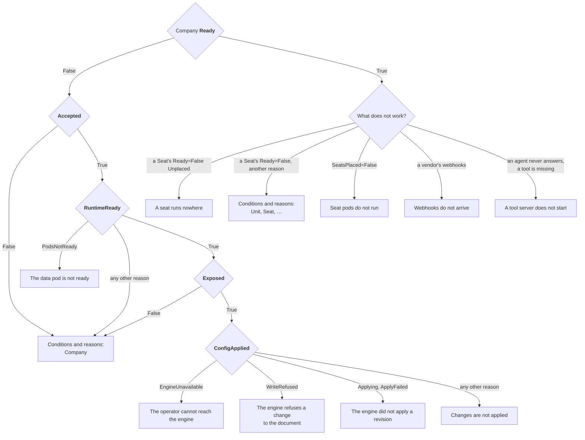

# Troubleshooting

Every object the operator reconciles says what is wrong with it in its
conditions. Start at the Company, and follow the first condition that is not
True.

The Company's `Ready` condition, when `False`, carries the reason of the first
of `Accepted`, `RuntimeReady`, `Exposed` and `ConfigApplied` that is not
`True`, and the message says what to do:

```bash
kubectl get crewlet -n acme
kubectl get company acme -n acme \
  -o jsonpath='{range .status.conditions[*]}{.type}={.status} {.reason}: {.message}{"\n"}{end}'
kubectl get seats,units,llmproviders,mcpservers,integrations,schedules -n acme \
  -o jsonpath='{range .items[*]}{.kind}/{.metadata.name}{range .status.conditions[?(@.status!="True")]} {.type}={.status} {.reason}: {.message}{end}{"\n"}{end}'
kubectl events -n acme --for company/acme
```

Where each one leads, below:



Each condition's `observedGeneration` says which generation of the object it
describes; a condition older than `metadata.generation` has not caught up
with your last change yet.

## Conditions and reasons

### Company

| Condition | Status | Reason | What it means, and what to do |
|---|---|---|---|
| `Ready` | True | `Available` | The engine runs the current revision and is reachable as the class asks. |
| | False | `Suspended` | `spec.suspend` is set: the engine is stopped, its volume kept. |
| | False | `ConfigPending` | The engine runs and is exposed; the document of the Company's current generation has not been reported applied yet. Wait a few seconds. |
| | False | any other | The reason of the first condition below that is not True. |
| `Accepted` | True | `Valid` | The class exists and the company is within its limits. |
| | False | `EngineClassNotFound` | `spec.engineClassName` names no class, or it is unset and there is not exactly one class annotated `crewlet.ai/is-default-class: "true"`. Create the class or name one. |
| | False | `ClassNotAllowed` | The class's `spec.allowedNamespaces` does not select the Company's namespace (or is not a valid selector; the message says which). Name another class, or have the platform label the namespace. |
| | False | `LimitExceeded` | The company has more Seats or MCPServers than the class's `limits` allow. Remove some or move to a larger class. Nothing new is applied meanwhile. |
| `RuntimeReady` | True | `PodsReady` | The data pod runs the current template and is ready. |
| | False | `PodsNotReady` | The data pod is missing, starting or failing its readiness check. See [The data pod is not ready](#the-data-pod-is-not-ready). |
| | False | `Suspended` | `spec.suspend` is set, and the engine's pods are stopped. |
| | False | `Suspending` | `spec.suspend` is set, and the seat pods are still stopping; the data pod stops once they have. Seat pods finish their running turns first, for up to their grace period. |
| | False | `DowngradeRefused` | The image asked for is an older version than the data was last written by; the engine migrates forward only. The pod keeps the newer image; every other change still applies. |
| | False | `VersionOverrideNotAllowed` | `spec.runtime.version` is set and the class's `engine.allowVersionOverride` is not. |
| | False | `KeyringInvalid` | The `<company>-keyring` Secret is not a keyring the engine can open. The operator never rewrites it: repair it from a backup, keeping the key ids, and set `crewlet.ai/active-key-id` to the key that seals new writes. The pod is held as it is. |
| | False | `KeyringMissing` | The `<company>-keyring` Secret is gone while the company's data StatefulSet or volume claims exist. A new keyring could not open the data, so none is generated. Restore the Secret from a backup, with its `crewlet.ai/active-key-id` annotation; or, to discard the data, delete the data volume claims, after which a new keyring is generated. The pod is held as it is. |
| | False | `PreviousCompanyObjects` | The keyring or tokens Secret of an earlier Company of the same name, deleted with `deletionPolicy: Delete`, has not been removed by the garbage collector yet. The pod starts once it is gone; nothing to do unless it stays, in which case check that the garbage collector runs. |
| | False | `NameConflict` | An object the operator writes for the Company (a Service, Secret, ConfigMap, ServiceAccount, StatefulSet, PodDisruptionBudget or NetworkPolicy named after it) exists and is someone else's. The message names it. The operator never changes or adopts it: rename or delete it, or give the Company another name. The pod is held as it is. |
| | False | `SecretNotFound` | A Secret the pods are given values from is missing: one the class references (telemetry headers, `podTemplate.spec.env`) in the platform's namespace, or the Company's own object-store keys (`spec.objects.credentialsSecretRef`). The pod is held as it is. |
| | False | `APITokensInvalid` | `<company>-api-tokens`, as a platform supplied it, lacks a token or holds one shorter than 43 characters or outside base64, base64url and hex. Repair it, or delete it to have the operator generate it. The pod is held as it is. |
| `Exposed` | True | `RouteAccepted` | Every route the class asks for was accepted. When the message adds that no address of the dashboard is known, the engine's agents compose no link for a person: set the Company's `spec.exposure.dashboardBaseURL` ([Where people reach the dashboard](exposure.md#where-people-reach-the-dashboard)). |
| | True | `NoRoutes` | The class routes nothing (webhooks `None` or `External`, API `ClusterInternal`). The message says the same about the dashboard's address as under `RouteAccepted`. |
| | False | `RouteNotAccepted` | A Gateway has not attached the HTTPRoute, or the Ingress controller has not published an address. The message carries the controller's own reason; a Gateway listener's `allowedRoutes` that does not admit the tenant's namespace is the usual cause. |
| | False | `NameConflict` | An HTTPRoute or Ingress of the route's name (`<company>-webhooks`, `<company>-api`) exists and is someone else's; rename or delete it. |
| | False | `GatewayAPINotInstalled` | The class routes through Gateways and the cluster had no Gateway API when the operator started. Install it and restart the operator. |
| | False | `PublicBaseURLMissing` | The class's webhooks mode is `External` and the Company has no `spec.exposure.publicBaseURL`. |
| `SecretsSynced` | True | `Synced` | The engine's secret store holds every referenced value. |
| | False | `SecretNotFound` | A referenced Secret or key is missing; the message names each. |
| | False | `SecretTooLarge` | A value is over the 64 KiB the store accepts. |
| | False | `EngineUnavailable` | Writing to the store failed; the message says why. Retried. |
| | False | `NameConflict` | A Secret `<company>-secret-sync`, where the operator keeps what it pushed, exists and is someone else's. Rename or delete it; nothing is applied meanwhile. |
| | Unknown | `NotManaged` | The management policy keeps the operator out of the store (`Observe`; `Seed` once seeded). |
| `SeatsPlaced` | True | `AllPoolsServing` | Every pool an agent seat is placed in, `data` included, has a ready pod. Not part of `Ready`. |
| | False | `PoolEmpty` | A pool with a seat has no ready pod: a Shared pool at zero replicas, a PerSeat seat's pods down, or seat pods not created yet because the data pod is not ready. Their seats' messages wait. See [Seat pods do not run](#seat-pods-do-not-run). |
| | False | `PoolNotFound` | An agent Seat is placed in a pool the Company does not declare, whose pods never start, so the seat does not run in it. A seat that ran elsewhere keeps running there (its `Applied` is `PlacementPending`); no pod runs any other. The message names each such Seat and pool. Declare the pool, or place the Seat in another. |
| | False | `RolloutBlocked` | The seat pods keep their template until the data pod is ready on its new one; they roll right after it. |
| | False | `SeatPoolsNotAllowed` | The class does not allow seat pools, so the operator runs none, and the seats placed in them run nowhere. |
| | False | `PoolCapacityExceeded` | The Shared pools' replicas alone pass the class's `seatPools.maxPods`; the operator keeps the seat pods as they are and starts none. Lower the replicas. |
| | False | `Suspended` | The Company is suspended. |
| `EngineHealthy` | True | `NoAlarms` | The engine raises no alarm. |
| | False | `Alarms` | The engine raises alarms; the message names the one standing longest. `backup_age` and `trim_blocked` mean it has no recent verified backup and trims no log: see [Backups](../concepts/runtime.md#backups). |
| | Unknown | `AlarmsNotReported` | The engine has not evaluated its alarms yet, or could not be asked. |
| `ConfigApplied` | True | `Applied` | The engine runs the rendered document: it reports the epoch of the revision `status.config.revisionID` names applied. |
| | True | `DriftCorrected` | Under `Enforce`, someone changed the document in the engine and the operator applied the rendered one over it. A `Drifted` event names what differed. |
| | True | `InSync` | Under `Observe`, the engine runs exactly the rendered document. |
| | True | `Seeded` | Under `Seed`, the engine has a document and owns it from now on. |
| | False | `RefNotFound`, `Cycle`, `Conflict`, `ReferenceNotAllowed`, `HumanSeat`, `SecretNotFound`, `SecretTooLarge`, `PerSeatNotAllowed`, `CLIAuthNotPortable`, `CodingAgentMismatch` | An object of the company keeps the document from rendering. The object at fault reports the same reason on `Applied`; fix it there ([What blocks a document](../concepts/company-document.md#what-blocks-a-document)). |
| | False | `NameConflict` | The Secret `<company>-secret-sync`, where the operator keeps what it pushed to the engine's store, exists and is someone else's; `SecretsSynced` says the same. Rename or delete it; nothing is applied meanwhile. |
| | False | `SeatPoolsNotAllowed` | The Company declares `spec.topology.seatPools`, and its class's `seatPools.policy` is not `Allowed`. Remove the pools, or run the company with a class that allows them. |
| | False | `PoolCapacityExceeded` | The company's seat pods would number more than its class's `seatPools.maxPods`: its Shared pools' replicas alone (the message says so; lower them), or with the pods of its PerSeat seats, each of which reports it too. |
| | False | `Invalid` | The engine's dry run refused the document, in its own words. Each problem is also reported on the object that rendered it, as `Applied=False Invalid`. |
| | False | `Drifted` | Under `Observe`, the engine runs another document; the message names the places that differ. |
| | False | `Applying` | The operator activated the revision and the engine has not applied it yet; it runs the previous one meanwhile. Usually gone within seconds; it turns into `ApplyFailed` when the engine fails the revision or has not applied it 72 seconds after the write. |
| | False | `ApplyFailed` | The engine did not apply the revision, and keeps running the one it applied last. The message carries the engine's status, its posture (`isolated` on a single node, `shed` or `stuck` beside peers that applied it) and its own account of the failure; see [The engine did not apply a revision](#the-engine-did-not-apply-a-revision). |
| | False | `EngineUnavailable` | The operator cannot reach the engine or is refused by it. Retried every ten seconds; see [The operator cannot reach the engine](#the-operator-cannot-reach-the-engine). |
| | False | `WriteRefused` | The engine refuses the operator's own token a change to the document (`403 config_managed`): its `api.auth.company_writers` names other tokens. See [The engine refuses a change to the document](#the-engine-refuses-a-change-to-the-document). |

### EngineClass

`Accepted` checks what the class's schema cannot: that the objects it names
in other namespaces exist. It is advisory; Companies of a class that is not
accepted still run, and report what the problem does to them on their own
conditions. `kubectl get engineclasses` shows it.

| Condition | Status | Reason | What it means, and what to do |
|---|---|---|---|
| `Accepted` | True | `Valid` | Every Secret, Secret key and Gateway the class names exists. |
| | False | `SecretNotFound` | A Secret the class references (a platform model provider's key, the telemetry headers, a pod environment value) does not exist or lacks the key; the message names each, never a value. Create it in the namespace the reference names. |
| | False | `GatewayAPINotInstalled` | The class routes through Gateways, and the cluster had no Gateway API when the operator started. Install it and restart the operator. |
| | False | `GatewayNotFound` | A Gateway a route names with its namespace does not exist. A `parentRef` without a namespace is in each Company's namespace and is not checked here. |

### Unit, Seat, LLMProvider, MCPServer, Integration, Schedule

| Condition | Status | Reason | What it means, and what to do |
|---|---|---|---|
| `Accepted` | True | `Valid` | Its Company exists and nothing collides with it. |
| | False | `CompanyNotFound` | `spec.companyRef` names no Company in the namespace. |
| | False | `CompanyNotAccepted` | Its Company is not `Accepted` (its class is gone, or it is over its class's limits); the message carries why. Nothing of the company is applied until it is. |
| | False | `Conflict` | Crewlet would read it and another object as one: two Seats with one handle, display name or contact account; two Units that answer to one key (a display name or a name, compared without case); two Integrations for one vendor; an LLMProvider named like a platform provider of the class. The message names the other object. |
| `ResolvedRefs` | True | `Resolved` | Every object and Secret key it references exists. |
| | False | `RefNotFound` | It references an object that does not exist (a Unit, a Seat, an LLMProvider, an MCPServer); the message names it. |
| | False | `Cycle` | A Unit's `parentRef` chain leads back to itself. |
| | False | `PoolNotFound` | A Seat's `spec.placement.pool` is neither `data` nor one of its Company's `spec.topology.seatPools`. The seat is applied all the same, pinned to the label `crewlet.ai/undeclared-pool`, which no pod carries: it runs nowhere (`Ready=False`, `PoolNotFound`), or keeps running where it ran (`Applied=False`, `PlacementPending`), until the Company declares the pool or the Seat names another. Nothing else is held. |
| | False | `HumanSeat` | A Schedule's `target.seatRef` or a Datadog Integration's `routeTo.seatRef` names a Human seat, for whom the engine runs no turn, which holds the document. Name an Agent seat (a Schedule may target the person's unit with `fanOut: Each`). On a GitLab Integration's `accessLevels` entry it holds nothing: the engine creates no GitLab account for a person, so the entry grants nothing, and the Integration is applied. |
| | False | `NoProvisioner` | A Seat names a provisioned credential, and no Integration of its company has `provisioning: Engine`, so nothing creates the value, and the seat's tool or chat app starts without it. The seat is applied all the same, and gets the value once an Integration provisions. Give the value from a Secret, or provision the vendor with the engine ([Connecting integrations](integrations.md#who-creates-the-seats-accounts)). |
| | False | `NotAnAccountID` | A person's Seat sets `contact.atlassianAccount` to something that is no Atlassian account id, such as an email address, while its company reaches Jira or Confluence on Atlassian Cloud, which names a person by account id alone: what the person does there reaches no seat, and an agent's mention of them names nobody. The message names each product on Cloud. The seat is applied all the same. Give the person's account id ([A person's accounts](integrations.md#a-persons-accounts)). |
| | False | `ReferenceNotAllowed` | A string it renders into the document holds a `${NAME}` reference, which the engine would resolve from its own secret store and environment. The message names the place in the document. Give a credential with a Secret reference; in a sandbox command, write a variable as `$NAME`. |
| | False | `SecretNotFound` | A Secret or key it references is missing. |
| | False | `SecretTooLarge` | A value it references is over 64 KiB. |
| `Applied` | True | `InRevision` | It is in the revision the engine runs, which the message names; the condition's `observedGeneration` is the generation that revision holds. |
| | False | `Invalid` | The engine refused its part of the document; the message is the engine's. |
| | False | `PerSeatNotAllowed` | A Seat is placed in a PerSeat pool, and its Company's class does not set `seatPools.allowPerSeat`. Place it in `data` or a Shared pool. |
| | False | `PoolCapacityExceeded` | A Seat is placed in a PerSeat pool, and its pods would take the company's seat pods past the class's `seatPools.maxPods`. The seats already running in pods of their own are admitted first, then the rest oldest first; the first seat that does not fit is refused, and every seat after it. Place it in a Shared pool, or lower a pool's replicas. |
| | False | `PlacementPending` | The Seat moves to another pool, whose StatefulSet has no ready pod yet: it keeps running where the revision the engine runs pins it, and is moved once a pod of its new pool is ready. A pool at `replicas: 0` never gets one, and neither does a pool the Company does not declare (`ResolvedRefs=False`, `PoolNotFound`). |
| | False | `CLIAuthNotPortable` | A Seat is placed in a seat pool, and runs on a `CLIAgent` provider signed in with a credential bundle, which every seat pod would restore and refresh on its own. Sign the CLI in with `tokenSecretRef` (Claude Code), `auth.mode: APIKey` or, for Hermes, Pi or OpenCode, its model provider's key in `cli.env`, in place of the bundle ([Signing in](cli-agents.md#signing-in)), or place the seat in `data`. |
| | False | `CodingAgentMismatch` | A Seat's code work (`spec.sandbox`) runs on a `CLIAgent` provider driving another CLI than the seat's coding agent (`spec.sandbox.codingAgent`, else the Company's `spec.sandbox.defaultCodingAgent`, else `ClaudeCode`). The provider is the head of `spec.llm.sandbox`, else of `spec.llm.default`, else of the Company's order, and the message names the field. Its model is written for its own CLI and its sign-in is that CLI's, so Crewlet refuses the pairing on every write, and the Seat reports it on `CodeWorkRunnable` too. Put a provider of type `Anthropic` (or, for `OpenCode`, `OpenAI` or `OpenAICompatible`) or a `CLIAgent` provider of the coding agent's CLI first in `spec.llm.sandbox`, or set `spec.sandbox.codingAgent` to the provider's CLI where it is `ClaudeCode` or `OpenCode` ([Code work](cli-agents.md#code-work)). |
| | False | `Blocked` | It is fine, and another object keeps the document from being applied (a document is applied whole). Fix the object the Company's `ConfigApplied` names. A part whose current generation already runs keeps `True` meanwhile. |
| | False | `Applying` | Its current generation is in a revision the engine is applying. |
| | False | `ApplyFailed` | Its current generation is in a revision the engine did not apply; the Company's `ConfigApplied` says why. |
| | False | `Drifted` | Under `Observe`, the engine's document differs from this object's part. |
| | False | `NotManaged` | Under `Seed`, the engine owns the document; changes to this object are not applied. |
| `Paused` (Agent Seat) | True | `SeatPaused` | The engine holds the seat paused: it starts no new turn and its mail waits. The message and `status.pause` say who paused it, when and why. To let it work, set `spec.paused: false` (or, with `spec.paused` unset, resume it in the engine's dashboard). |
| | False | `SeatRunning` | The engine runs the seat. |
| | True or False | `PauseNotManaged` | The seat's pause differs from `spec.paused`, and the Company's policy is `Observe` or `Seed`, under which the operator changes no pause. |
| | Unknown | `PauseUnknown` | The engine may or may not have recorded the operator's pause or resume, or did not answer; the operator asks again in ten seconds. |
| | Unknown | `PauseRefused` | The engine refused the operator's pause or resume; the message is the engine's. The operator asks again in ten seconds: a refusal for contention passes by itself. |
| `CodeWorkRunnable` (Agent Seat with `spec.sandbox`, in a Company with `spec.sandbox`) | True | `CodeWorkSupported` | The seat's coding agent can run on the provider at the head of its sandbox chain, or on the sign-in the seat's sandbox environment gives it; the message says which. It does not count towards `Ready`. |
| | False | `CodingAgentMismatch` | As under `Applied`: Crewlet refuses the pairing on every write, so the seat holds the document too. |
| | False | `SandboxModelUnsupported` | A Seat's code work runs the `ClaudeCode` coding agent on a provider of type `OpenAI` or `OpenAICompatible`, which Claude Code cannot read, and nothing in its sandbox environment signs Claude Code in, so Crewlet refuses each of the seat's coding runs. The seat is applied and runs its turns. Put an `Anthropic` provider first in `spec.llm.sandbox`, set `spec.sandbox.codingAgent: OpenCode`, or give the seat a Claude Code sign-in in `spec.sandbox.env` (`CLAUDE_CODE_OAUTH_TOKEN`, `ANTHROPIC_API_KEY`, `ANTHROPIC_AUTH_TOKEN`, `CLAUDE_CODE_USE_BEDROCK`, `CLAUDE_CODE_USE_VERTEX` or `CLAUDE_CODE_USE_FOUNDRY`), on which it runs under its own model choice ([Code work](cli-agents.md#code-work)). |
| | False | `SandboxLoginNotPortable` | A Seat's code work runs on a `CLIAgent` provider whose login cannot reach the Company's remote sandbox: a `ClaudeCode` signed in by a credential bundle with neither `CLAUDE_CODE_OAUTH_TOKEN` nor `ANTHROPIC_API_KEY` in the seat's sandbox environment, or an `OpenCode` with no credential-named variable in `cli.env` or the seat's sandbox environment. A bundle stays on the data volume, so Crewlet refuses each of the seat's coding runs. The seat is applied and runs its turns. Sign `ClaudeCode` in with `tokenSecretRef` or `auth.mode: APIKey`, or give the seat `CLAUDE_CODE_OAUTH_TOKEN` or `ANTHROPIC_API_KEY` in `spec.sandbox.env`; sign `OpenCode` in with its model provider's key in `cli.env`, or give the seat that key in `spec.sandbox.env` ([Code work](cli-agents.md#code-work)). |
| `AgentModeRunnable` (LLMProvider of type `CLIAgent` in `mode: Agent`) | True | `ToolBridgeServed` | Its runs reach the tool bridge at the Company's public address, which the message names. A seat in a seat pool still cannot run on it (see the Seat's `Ready`). |
| | False | `NotExposed` | The Company has no public address, so every turn of a seat whose executor's chain it heads fails. The provider is applied, and still serves a text call behind a chain's head or in another phase. Give the class a webhooks route or the Company `spec.exposure.publicBaseURL`, or use `mode: Text`. |
| `Ready` (agent Seat) | True | `LeaseHeld` | An engine pod holds the seat and runs it; `status.placement.node` names the pod. The message says so when the pod is not one of the seat's StatefulSet yet: the engine moves it there once it runs the revision that places it. |
| | False | `Unplaced` | No engine pod holds the seat; its messages wait. The message says why: the seat is not in the revision the engine runs yet (see `Applied`); its pool runs no pod (see the Company's `SeatsPlaced`, and [A seat runs nowhere](#a-seat-runs-nowhere)); or a pod that may run it is up and the engine has not claimed it yet, which takes seconds. |
| | False | `PoolNotFound` | No engine pod holds the seat, and none can: its pool is not one the Company declares, so no pod carries the label it is pinned to (see `ResolvedRefs`). |
| | False | `AgentModeBridgeUnsupported` | The Seat is placed in a seat pool, and the head of its executor's chain is a `CLIAgent` provider in `mode: Agent`, whose runs call the seat's tools back through the tool bridge of the pod that holds the seat, at an address the operator publishes for no seat pod. The engine applies the seat and refuses every one of its turns, whichever pod holds it (the message names it); the rest of the company is applied. Place it in `data`, or run its executor on a provider in `mode: Text` ([Seat pools](cli-agents.md#seat-pools)). |
| | False | `NotExposed` | The Seat is in `data`, the head of its executor's chain is a `CLIAgent` provider in `mode: Agent`, and the Company has no public address for the run to call the seat's tools back through, so the engine refuses every one of its turns. Give the class a webhooks route or the Company `spec.exposure.publicBaseURL`, or run the executor on a provider in `mode: Text`. |
| | False | `Suspended` | The Company is suspended. |
| | Unknown | `EngineUnavailable` | The operator could not read the engine's fleet; the message says why, and the Company's `ConfigApplied` usually does too. `status.placement.node` is what the engine said last. |
| `Healthy` (Integration) | True | `CheckPassed` | The engine reports the vendor connected. |
| | False | `CheckFailed` | The engine's check against the vendor failed; the message carries why (a revoked token, a missing scope). |
| | False | `NotExposed` | The Company has no public address, so no webhook can reach it: the class's webhooks mode is `None`. Mattermost and an Atlassian organization deliver no webhooks and never report it. |

## The data pod is not ready

An engine is ready only once it runs a document, so a new company's pod is
not ready until `ConfigApplied` is `True`. When `ConfigApplied` is `True` and
`RuntimeReady` stays `False`, read the engine's log:

```bash
kubectl describe pod acme-data-0 -n acme
kubectl logs acme-data-0 -n acme | grep -E 'WARN|ERROR' | tail
```

- **`insufficient storage resources available`**: the engine could not
  reserve its event stream's logs. The stream is given three quarters of the
  data volume and needs at least 5 GiB of it; the class's `data.storage.size`
  admits no less than `7Gi`, but a provisioner that hands out less than it
  was asked for can leave it too small. Give the company a larger volume.
- **`config_apply_failed`**: the revision was stored but this node could not
  start it; the message says why. The engine keeps running the previous
  revision, and the Company reports `ConfigApplied=False ApplyFailed` (see
  [The engine did not apply a revision](#the-engine-did-not-apply-a-revision)).
- **The pod restarts** (`kubectl get pod` shows restarts): the engine refused
  its own configuration at boot, and the first lines of the previous log say
  why (`kubectl logs acme-data-0 -n acme --previous`).
- **The pod restarts, and the previous log ends in `unknown field: "…" is
  not a setting`**, such as `api.auth.company_writers: unknown field:
  "company_writers" is not a setting`: the engine and the operator come from
  different points of Crewlet's `main`. The operator writes the pod's
  `crewlet.yaml` in the settings of the engine it was tested against, and
  this engine refuses one of them: it is older than that engine and does not
  know the setting yet, or newer, and Crewlet has renamed or removed it
  since. The image the pod runs is the class's `engine.image`, with the
  Company's `spec.runtime.version` as its tag when that is set. Run the
  engine the operator was tested against
  ([Engine image](installing.md#engine-image)): with a release of the
  operator, the engine image its notes name; with an operator built from a
  commit of this repository, a copy of Crewlet's `main` image of the day that
  commit's CI ran, whose log names the Crewlet commit. A class that names
  `ghcr.io/crewlet/crewlet:main` itself runs an engine newer than an
  operator built before Crewlet's change: build the operator from this
  repository's newest `main` instead, or move the class to the engine the
  operator was tested against. The data pod rolls to the image and starts.
- **`Pending`**: the volume claim is not bound (no default StorageClass, or
  the class's `storageClassName` does not exist), or no node fits the class's
  resources, tolerations or affinity.

## Seat pods do not run

Seat pods are created, and gain replicas, only while the data pod is ready on
its current template, so a company whose data pod is not ready runs none;
start with [The data pod is not ready](#the-data-pod-is-not-ready). A seat
pod is ready once it has joined the company's fleet and may claim seats; one
that runs and is not ready says why in the body of its `/ready`, which the
kubelet does not show. Ask the pod itself, and read its log:

```bash
kubectl port-forward -n acme pod/acme-seats-general-159f80d7-0 8080 &
curl -s localhost:8080/ready
# {"ready":false,"node":"acme-seats-general-159f80d7-0","configured":true,"draining":false,"posture":"serve","reason":"admission_withheld"}
kubectl logs -n acme acme-seats-general-159f80d7-0
```

| `reason` | What it means for a seat pod |
|---|---|
| `broker_unlinked` | Its leaf link to the data pod is down; `detail` says why. See below. |
| `unconfigured` | No company document has reached it yet: it has just joined. |
| `shed`, `stuck` | It cannot apply the revision the data pod runs; its log has `config_apply_failed`. |
| `no_presence` | It does not hold its presence lease, so the fleet does not count it. |
| `admission_withheld` | No data pod has answered that its copy of the company's records admits a seat (the data pod is starting, catching up, or unreachable), or the pod cannot serve the seats it holds. It claims nothing until then. |

A seat pod restarted every six minutes, its events saying `Startup probe
failed` with `connection refused` while its log shows it running, binds no
port for its probes: the engine it runs (the class's `engine.image`, with the
Company's `spec.runtime.version` as its tag when that is set) and the
operator come from different points of Crewlet's `main`, older or newer than
the engine the operator was tested against. Run that engine, as for a data
pod that refuses a setting
([The data pod is not ready](#the-data-pod-is-not-ready)).

A seat pod that cannot join the data pod's leaf listener within a minute
exits, and Kubernetes restarts it with a growing back-off: after a data pod
outage, a seat pod can take up to about five minutes to rejoin. A leaf that
never joins is usually stopped by a NetworkPolicy: `<company>-broker` admits
the company's own seat pods to port 7422 of its data pod, and a policy of
yours that selects the data pod or the seat pods may refuse what it admits
by adding isolation of its own.

After a pool is removed, its StatefulSet keeps running until a revision that
pins no seat to it runs: `SeatsPlaced` names it, and the Company's
`status.config.placement` says what the running revision pins.

## A seat runs nowhere

A Seat with `Ready=False Unplaced` is held by no engine pod, and its messages
wait for one. Its `status.placement` says which pool and StatefulSet should
run it; the engine's own view is its `GET /fleet`, with the API token
(`nodes` lists every engine pod with its labels, `seats` the holder of every
seat, `unplaceable` the seats no running pod may take):

```bash
kubectl get seat triage -n acme -o jsonpath='{.status.placement}{"\n"}'
kubectl get statefulset acme-seats-general-159f80d7 -n acme
```

- **The StatefulSet has no ready pod**: a Shared pool at zero replicas, a
  PerSeat seat's pod restarting, or seat pods not started because the data
  pod is not ready ([Seat pods do not run](#seat-pods-do-not-run)). The seat
  runs once a pod does.
- **The pods run, and the message says the engine has not claimed it yet**: a
  pod that has just started claims no seat before a data pod reports its copy
  of the company current, then a few every five seconds; a seat whose pod
  was killed waits out its 45-second lease. The operator looks again every
  fifteen seconds while this lasts. After three minutes it is no longer
  settling: read the pods' logs for `seats_unplaceable` and for errors
  joining the data pod.
- **The seat is not in the revision the engine runs**: its `Applied`
  condition says why.

## The operator cannot reach the engine

`ConfigApplied=False EngineUnavailable` while the pod runs means the operator's
requests to `http://<company>-data-0.<company>-data.<namespace>.svc:8080` fail:

- A NetworkPolicy of your own refuses the operator's namespace. The operator's
  own policy admits it; check others selecting the data pods.
- The operator's pods do not carry the labels its `--operator-pod-labels`
  flag names (the default is `app.kubernetes.io/name=crewlet-operator,
  control-plane=controller-manager`), so the engine's policy does not admit
  them: a chart `nameOverride` changes the first.
- The operator runs outside the cluster (`make run`): it cannot resolve the
  pod's DNS name.
- The `<company>-api-tokens` Secret was changed by hand and the pod has not
  restarted yet: it rolls on its own once the operator sees the change.

## The engine refuses a change to the document

Under `Enforce` the engine lets only the operator's token change the company
document: a change made with any other credential, the published access
token and a person signed in at the dashboard included, is answered
`403 config_managed`, and the engine's dashboard shows the document
read-only. That is the policy working, not a fault. Change the
objects, or switch the Company to `Observe` or `Seed` to hand the document to
the dashboard ([Choosing a management policy](management-policies.md)); the
switch restarts the data pod, and the dashboard may edit again once it has.

`ConfigApplied=False WriteRefused` is the other direction: the engine refuses
the operator's own token, so its `crewlet.yaml` names writers the operator did
not render. The operator renders `<company>-bootstrap` from the Company alone
and writes it back when it differs, so this is an engine that has not
restarted since the Secret changed, or an image whose entrypoint reads another
`crewlet.yaml`. The message names the writers the engine reported.

```bash
kubectl get secret acme-bootstrap -n acme -o jsonpath='{.data.crewlet\.yaml}' | base64 -d | grep -A2 company_writers
kubectl rollout restart statefulset/acme-data -n acme
```

## The engine did not apply a revision

`ConfigApplied=False ApplyFailed` means the engine stored and activated the
revision the operator wrote and then could not apply it, or never did. It
keeps serving the revision it applied last; the dry run accepted the new one,
so what failed is something only applying it meets on this engine: a
subsystem it could not start (the native tracker, the code sandbox, the
inbound edge), or a rule that needs the data pod's own configuration. The
condition's message carries the engine's account of the failure, its
`status` and its `posture`:

- `isolated`: the only node, or every node, failed the revision. It keeps
  serving and stays ready, and retries the revision three times at most.
- `shed` or `stuck`: peers applied it and this node cannot, or its apply has
  run longer than 45 seconds while they did; it refuses new work and fails
  `/ready` (`stuck` once out of retries). On a data pod the peers are the
  company's seat pods, which apply the revision too.

Read the log for `config_apply_failed`, fix the cause in the objects (or in
the class, for the pod's own configuration), and the next change is a new
revision the engine tries afresh. When the message says the engine
has neither applied the revision nor concluded that it failed within 72
seconds (its posture still reads `wait`), the engine is not polling its
activation pointer at all, or an apply hangs with no peer to compare it
against; its log says which, and a restart of the data pod is the usual
remedy.

```bash
kubectl logs acme-data-0 -n acme | grep -E 'config_apply_failed|reconcile_tick_failed' | tail
kubectl get events -n acme --field-selector involvedObject.name=acme,reason=ApplyFailed
```

## Changes are not applied

- The object's `Applied` condition is `Blocked`: another object keeps the
  document back; the Company's `ConfigApplied` message names it.
- The object's `Applied` condition is `Applying` for more than a few seconds,
  or `ApplyFailed`: see
  [The engine did not apply a revision](#the-engine-did-not-apply-a-revision).
- The Company is under `Observe` or `Seed`
  ([Choosing a management policy](management-policies.md)).
- A change made in the engine's dashboard or API under `Enforce` is refused,
  not lost: see
  [The engine refuses a change to the document](#the-engine-refuses-a-change-to-the-document).
- A Secret change that leaves the value as it was writes nothing; a change to
  a value is applied as a new revision.
- Changes are coalesced: the operator waits for two quiet seconds after the
  last one, and ten seconds at most for a burst that never pauses.

## Webhooks do not arrive

Check `Exposed` on the Company and `Healthy` on the Integration, then that the
vendor has the address the status gives (`Seat.status.integrations`,
`Integration.status.webhookURL`) — they never change for a seat, and
`publicBaseURL` changes only with the class's host name template or the
Company's own `spec.exposure.publicBaseURL`.
[Exposure and network policy](exposure.md) covers the routes.

Webhooks reach the engine's public listener, port 8081 of the
`<company>-engine` Service (port name `public`), never port 8080:

- **The vendor reports `404` with a body naming `api.public`**: the delivery
  reached port 8080, the API, which does not serve webhooks. Under
  `External`, forward to port 8081.
- **The vendor reports `404 no_route` with a generic hint**: the delivery
  reached the public listener on a path that is not a public route, such as
  a webhook URL registered by hand with a typo; compare it with the URL the
  status gives.
- **The vendor's requests time out** under `networkPolicy.mode: Isolated`:
  the policy `<company>-engine` admits port 8081 only from where the class
  says webhooks arrive (`gateway.proxyNamespaces`, the Gateways' namespaces,
  `ingress.controllerNamespaces`, or `external.forwarders`). An `External`
  forwarder must be listed in `exposure.webhooks.external.forwarders`;
  `networkPolicy.apiConsumers` admits port 8080 only.
- **The load balancer reports every backend unhealthy** (`502` or `503`
  from the load balancer itself, never reaching the engine): it
  health-checks the port it routes to, where the public listener answers
  `/` and the probe paths `404`. Point the check at port 8080, path `/ready`
  ([Load balancer health checks](exposure.md#load-balancer-health-checks)).

## A tool server does not start

An agent that receives its Mattermost or Slack messages, runs its turns and
never answers has no chat tool server, or one it cannot post through: it
posts only through one. An `MCPServer` reports `Applied=True` once the engine
runs the document that names it; whether its process starts is the engine's
to see, at run time, and a server that does not start costs the seats its
tools and nothing else. The engine logs each failure, with the last lines the
server wrote, on the pod that started it. A server with `shared: false`, as
each integration's server is, runs for each seat on the pod that holds the
seat, which the Seat's `status.placement.node` names (unset while none does:
[A seat runs nowhere](#a-seat-runs-nowhere)); a shared one runs on every
engine pod:

```bash
pod=$(kubectl get seat triage -n acme -o jsonpath='{.status.placement.node}')
kubectl logs "$pod" -n acme | grep -E 'mcp_server_failed|server_stderr_tail|empty_env_vars'
kubectl logs acme-data-0 -n acme | grep -E 'mcp_server_failed|server_stderr_tail|empty_env_vars'   # a shared server
```

The engine's dashboard shows every server's state on every pod, as does its
API's [`GET /mcp-servers`](https://github.com/crewlet/crewlet/blob/main/docs/reference/api-endpoints.md#get-mcp-servers).

- **The command is not in the engine image.** Crewlet's image has no Python
  or Node.js: build one with the server installed and name its command
  ([Running Tool Servers](tool-servers.md#the-image-needs-the-server)).
- **`empty_env_vars` names a variable.** Its value is empty: a Secret key
  that holds nothing, or a provisioned credential the engine has not minted
  yet. A value that arrives later reaches the server at the next revision
  the engine applies, which starts or restarts it with the value: the
  engine's pass applies one once it has sealed the credentials it minted,
  and the operator applies one once it has pushed a Secret's new value
  ([Rotating a credential](credentials.md#rotating-a-credential); Crewlet's
  [Shared vs per-role servers](https://github.com/crewlet/crewlet/blob/main/docs/guides/tools-and-mcp.md#shared-vs-per-role-servers)).
- **The server started without a tool you expected.** Some servers offer a
  tool only when a setting asks for it, such as Slack's posting tool
  ([Slack](tool-servers.md#slack)).
- **Mattermost's server runs, and no post arrives.** Mattermost does not
  answer its API at the server's `MATTERMOST_URL`, which is then not the
  Integration's `url`: the engine fails at such an address too, and no seat
  would receive a message. A path outside the Site URL's path is
  redirected, and the server follows no redirect; a longer path reaches the
  web app, which answers a write `405`; and the other scheme is redirected
  or refused, as by Mattermost's own `Forward80To443`, which answers a write
  over `http://` with `400 Use HTTPS`. Give it the Integration's `url`
  ([Mattermost](integrations.md#mattermost)).

## Collecting what to report

```bash
kubectl get crewlet,statefulsets,pods,pvc,services,networkpolicies -n acme -o wide
kubectl get company acme -n acme -o yaml
kubectl events -n acme
kubectl logs acme-data-0 -n acme --tail=300
kubectl logs -n crewlet-operator-system -l control-plane=controller-manager --prefix --tail=300
```

The manager runs two replicas by default and only the leader reconciles, so
read every replica's log (`-l ... --prefix`, as above), or the leader's alone:
the Lease `839a0df8.crewlet.ai` names it, as its pod's name and a suffix.

```bash
kubectl get lease 839a0df8.crewlet.ai -n crewlet-operator-system -o jsonpath='{.spec.holderIdentity}{"\n"}'
```

Conditions, events and logs name Secrets and keys, never their values, so
they are safe to paste into an issue. Do not paste Secrets.

## See also

- [How the Document Is Applied](../concepts/applying.md#what-each-object-reports) — what every condition means
- [How a Company's Engine Runs](../concepts/runtime.md#status) — who writes which status field
- [Crewlet's alarms](https://github.com/crewlet/crewlet/blob/main/docs/reference/alarms.md) — what `EngineHealthy=False Alarms` names
